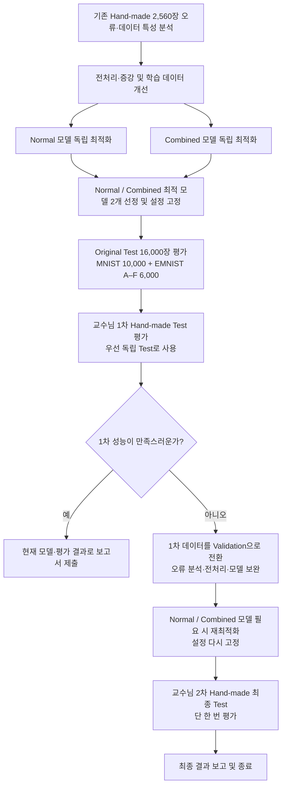

# 확정 연구 흐름도 — 교수님 직접 답변 반영 (2026-11-10)

**교수님 최신 직접 답변:** Original Test는 이 팀의 공식 구성 기준 **MNIST 10,000장 + EMNIST A–F 6,000장 = 16,000장**으로 사용한다(사용자 확인). **1차 Hand-made는 첫 평가 후 Validation으로 전환 가능**, **2차는 최종 Test로 1회만 사용**한다. Normal과 Combined는 **각각 별도로 최적 모델을 선정**하며 같은 알고리즘일 필요가 없다.

**팀 채택 운영안:** 두 모델을 먼저 선정·고정하고 Original Test 16,000장 → 교수님 1차 Hand-made Test 순서로 평가한다. **1차 성능이 충분하면 그대로 보고서 작성·제출**, 부족할 때에만 1차를 *개발용 Validation*으로 전환해 개선하고 2차에서 한 번 최종 평가한다. 이는 팀이 선택한 1차 활용 전략이며 교수님 답변 자체가 모든 경우의 2차 생략을 명시한 것은 아니다.

**독립성:** 1차를 Validation으로 활용하기 시작하면 수정된 모델에 대한 1차 점수는 독립 Test가 아니다. 2차는 결과 확인 후 다시 튜닝하지 않는다. Original Test도 모델을 선택·튜닝하는 데이터로 사용하지 않고, 모델 버전별 평가 결과를 명확히 기록한다. 자동 입력 Pipeline은 각 평가 전에 고정한 설정으로 실행한다.

## 연구 흐름

## 실행·보고 기준

1. **개발용 오류 분석:** 기존 Hand-made 2,560장 Confusion Matrix 및 오분류 사례를 이용하여 손글씨 특성·원인 분석, 전처리 Pipeline 및 Training Augmentation을 실험할 수 있다. Combined 학습과 개발용 검증은 샘플·작성자 누출 방지. 실제 작성자 기준 Group CV는 선택 가능(아직 미실시).
2. **각각 최적화:** Normal과 Combined는 각각 5개 후보 또는 합리적인 후보에서 전처리·데이터 조합·하이퍼파라미터를 독립 검증하여 최적 모델을 **두 개** 선정한다. 같은 설정에서 추가 손글씨의 효과만 비교하는 통제 실험은 보조적 분석이다.
3. **Original Test:** 두 모델 고정 후 공식 **16,000장**을 사용해 비교한다. **10,000장의 MNIST 숫자와 6,000장의 EMNIST 문자**로 구성됨을 명시한다. 여기서 얻은 점수를 모델 변경 기준으로 삼지 않는다.
4. **1차 Test:** 두 고정 모델을 1차 Hand-made에 처음 적용하고 성능을 확인한다. 충분하면 1차 평가를 유지하고 보고서 제출로 종료한다.
5. **1차 미흡 시:** 교수님 허용 범위에서 1차 데이터를 **Validation으로 전환**, 오분류·특성 분석을 포함한 최적화에 사용한다. 이제 1차 결과는 독립 Test라고 표현하지 않는다. 변경된 모델과 Pipeline은 2차 적용 **전에 다시 고정**한다.
6. **2차 Test:** 최종 고정 모델에 대해 **단 한 번만** 평가 후 결과를 보고하고 종료. 2차 이미지를 분석해서 모델을 다시 튜닝하지 않는다.
7. **재현성:** 모델별 데이터·Pipeline·Seed·하이퍼파라미터, Accuracy·Macro F1·학습/전처리/추론 시간, 실제 학습 곡선, Test에 적용된 모델 버전을 Notebook과 실험일지에 남긴다.

**실행 상태:** 이 흐름은 향후 연구계획이다. 기존 W01/W02 실험 1~3의 데이터·실측 결과를 변경하거나 새로운 실험을 완료한 것으로 기재하지 않는다.

[전체 연구계획](RESEARCH_PLAN.md) · [의사결정 변경 이력](DECISION_LOG.md) · [데이터 분할·사용 기준](../02_data/HANDMADE_SPLIT_PLAN.md).
