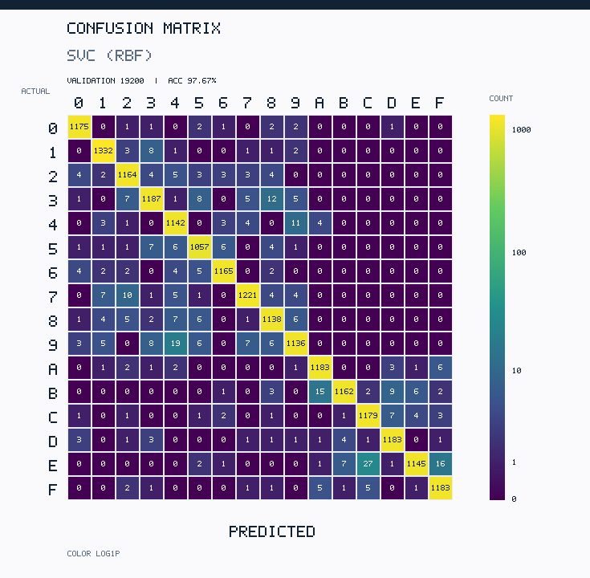
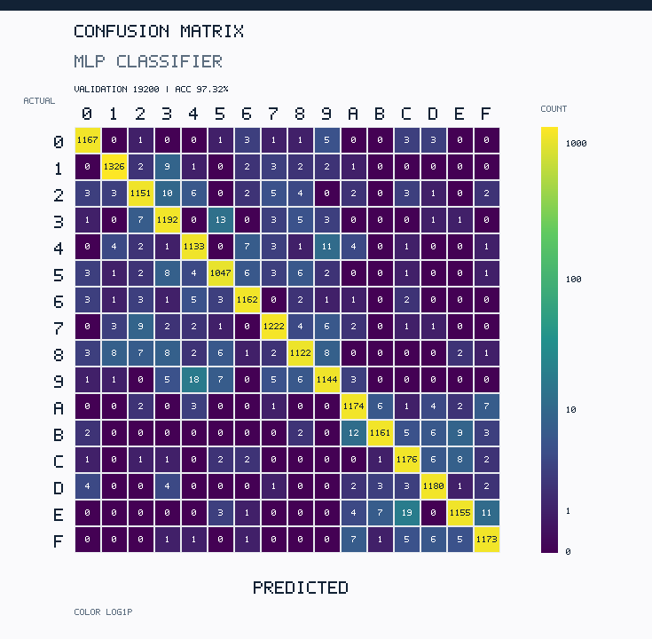
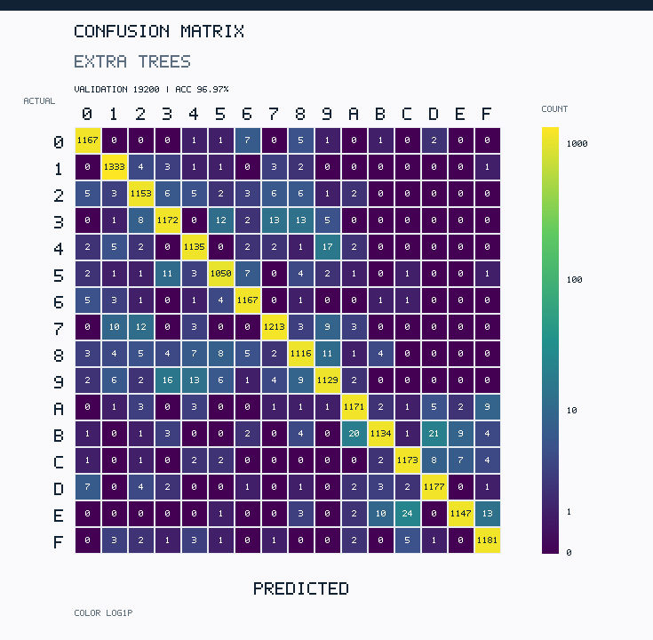
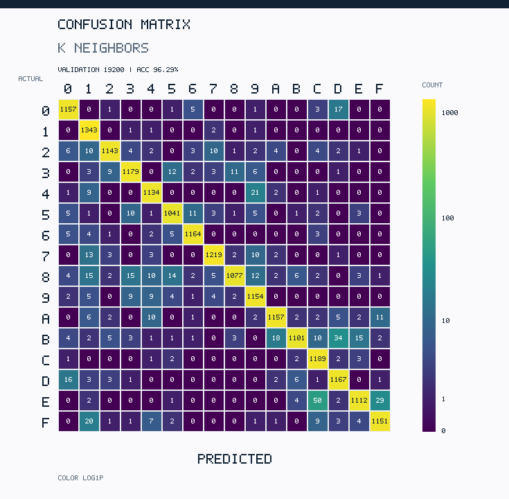

# EXP-유-003 | W02 실험 2 — Normal Dataset 기반 5개 모델 기본 성능 평가

> **연구 단계:** [실험 1 — 13개 후보 초기 비교·5개 선정](EXP-유-002_13개후보_초기평가_5개선정.md) 이후의 **실험 2: Normal Dataset Baseline**. 이후 예정된 **실험 3 — Hand-made 적용 전 성능 평가**, **실험 4 — 데이터·모델 문제 분석 및 개선**, **실험 5 — Combined Dataset 추가 학습**, **실험 6 — 최종 모델 선정**의 기준선으로 사용한다.
>
> **실험 목적:** MNIST·EMNIST만을 이용한 동일한 전체 규모 Training/Validation 조건에서, 선정된 **5개 분류기**의 초기 Accuracy, Macro F1, 학습 시간과 추론 시간을 실제 측정하여 후속 Hand-made 데이터의 성능 하락 및 개선 효과를 비교할 기준값을 확보한다.
>
> **결론:** 5개 모델 모두 **기본 Hyperparameter로 학습·평가 완료**. 정확도 1위는 **SVC(RBF) 97.67%**였지만 Validation 19,200장 추론에 **159.512초**가 소요됐다. 이번 결과는 **Normal Dataset 초기 기준 성능**이며, Hand-made 평가·최적화·최종 모델 1개 선정은 아직 진행하지 않았다.

| 항목 | 기록 |
|---|---|
| 수행일 | 2026-11-09 |
| 담당 | 유용성(팀장), 코드 실행 및 결과 정리 AI 보조 |
| 상태 | **완료 — 실험 2의 5개 Normal Baseline 평가에 한함** |
| 선행 실험 | [EXP-유-002 — W02 실험 1](EXP-유-002_13개후보_초기평가_5개선정.md) |
| 후속 계획 | [W02 연구계획 단계 C~F](../README.md) — **미실시** |
| 통합 수치 | [5개 모델 원본 성능 CSV](../results/EXP-유-003_5models_comparison.csv) |
| 세부 수치 | [클래스별 Precision·Recall·F1](../results/EXP-유-003_per_class.csv) · [전체 Confusion Matrix 수치](../results/EXP-유-003_confusion_long.csv) |
| 재현 코드 | [학습·평가 Python](../../../02_data/notebooks/W02_experiment2/run_experiment2.py) · [픽셀 스케일러](../../../02_data/notebooks/W02_experiment2/pixel_transform.py) |
| 로컬 보관 산출물 | `W02_Experiment2_5models_complete.zip` — 모델 `joblib` 5종, Validation 예측 배열, 분할 인덱스, 실행 로그 및 결과 포함. **대용량 모델 파일은 이번 GitHub 커밋에 업로드하지 않음.** |

## 1. 실험 배경 및 검증 질문

- **이전 단계 결과:** 13개 후보를 소규모로 비교한 뒤, 정확도 90% 이상 및 동일 계열 중복 최소화 기준으로 **SVC(RBF), HistGradientBoosting, MLP, Extra Trees, KNN**을 선정하였다. [실험 1의 학습 12,000/Validation 3,200장 결과](EXP-유-002_13개후보_초기평가_5개선정.md)와 이번 전체 규모 실험은 **비교 목적과 학습 수량이 다른 별도 실험**이다.
- **검증할 질문:** 선정된 다섯 모델이 **동일한 약 8:2 Normal Training/Validation 분할**에서 보이는 초기 분류 정확도와 학습·추론 비용은 어떻게 다른가?
- **후속 실험에서의 역할:** 같은 모델을 Hand-made에 적용했을 때의 정확도 하락 폭을 확인하고, Normal/Combined 학습과 Hyperparameter·Preprocessing 변경 효과를 측정할 **고정된 기준선(Baseline)**이다.

## 2. 데이터셋·공통 실험 조건

| 구분 | 실제 적용 조건 |
|---|---|
| 데이터 | 최종 v3 MNIST·EMNIST 16개 클래스(0–9, A–F), `02_data/datasets/MNIST_EMNIST_official_split_112000.npz` |
| 원본 식별 | SHA-256: `0e9570d0eb04c0c1da99d043b85bfdab7f3b639eebe4b10335b05b57ad671879` |
| 원래 공식 Training | **96,000장**; 여기에서만 분할 |
| **실제 Training** | **76,800장 (80%)** |
| **고정 Validation** | **19,200장 (20%)**, 5개 모델에 동일한 인덱스 사용 |
| 분할 방법 | `StratifiedGroupKFold(n_splits=5, shuffle=True, random_state=42)`의 첫 Fold |
| 누출 검사 | `train_source_index`, `train_source_split` 및 클래스 정보를 결합해 원본·증강본 그룹을 구성. Train/Validation 그룹 중복 **0** 확인 |
| 입력 형식 | 28×28 흑백 → 784차원 `float32` |
| 스케일링 | **SVC·MLP·KNN:** 학습 파이프라인에서 픽셀 `/255`; **HistGradientBoosting·Extra Trees:** 0–255 원본 픽셀값 |
| Hyperparameter | scikit-learn **기본값 유지**, 가능한 모델의 `random_state=42`만 재현성 확보 목적으로 지정 |
| 실행 환경 | Python 3.13.5 / scikit-learn 1.8.0 / NumPy 2.3.5; 실행 시 BLAS/OpenMP 스레드 2개 제한 |
| 사용하지 않은 데이터 | 공식 **Test 16,000장** 및 **Hand-made 2,560장**은 이번 실험 2의 학습·평가에 사용하지 않음 |
| 측정 횟수 | 각 모델 **1회**. 시간 및 점수는 반복 측정 평균이 아님 |

**클래스 수 참고:** 이번 전체 Validation은 실험 1의 '클래스당 200장' 균형 추출과 다르다. 공식 v3의 원래 구성과 그룹 분할을 반영하므로 각 클래스의 이미지 수가 완전히 동일하지 않다. 따라서 Accuracy와 Macro F1을 함께 보고한다.

## 3. 실제 수행 절차와 검증

| 단계 | 입력 | 실행 방법 | 검증·산출물 |
|---:|---|---|---|
| 1 | 최종 v3 NPZ | 해시 검증 후 원본·증강본 그룹별 8:2 분할 | Training **76,800** / Validation **19,200**, 그룹 중복 0 |
| 2 | 고정 Training | 5개 모델을 각각 기본 설정으로 `fit()` | 각 모델의 학습 시간·반복 수·경고 저장 |
| 3 | 동일한 Validation 19,200장 | `predict()` 후 Accuracy·Macro F1·클래스별 수치·Confusion Matrix 계산 | 각 모델의 추론 시간과 예측값 저장 |
| 4 | Training에서 클래스당 100장 | **총 1,600장에만** 추가 예측 | Training 표본 Accuracy 기록. **전체 Training 정확도가 아님** |
| 5 | 예측 결과·Confusion Matrix | 대각선 정답 수와 클래스별 F1의 평균을 지표와 대조 | 계산값 일치 확인, 5개 모델 기본 설정 실험 완료 |

**지표 정의 및 해석:** `Validation Accuracy`는 19,200장 중 정답 비율, `Macro F1`은 16개 문자별 F1의 단순 평균이다. `학습 시간`은 `fit()` 소요 시간, `추론 시간`은 **Validation 19,200장 전체 `predict()`** 소요 시간이다. `Training 표본 정확도`는 별도 진단에 사용한 1,600장의 정답률이며, 해당 Training에 대한 전체 정확도를 뜻하지 않는다. 시간 측정값은 측정 환경과 입력 크기에 종속된다.

## 4. 5개 모델 실측 결과

**Validation Accuracy 내림차순**, 단위: 정확도 %, Macro F1 0~1, 시간 초, 이미지당 추론 ms.

| 순위 | 모델 | Train 표본 1,600장 Acc. | **Val. 19,200장 Acc.** | **Macro F1** | **학습 시간(s)** | **추론 시간(s)** | ms/장 | 수렴 경고 |
|---:|---|---:|---:|---:|---:|---:|---:|---|
| 1 | SVC (RBF) | 99.38% | **97.67%** | 0.9766 | 256.430 | 159.512 | 8.3079 | 없음 |
| 2 | HistGradientBoostingClassifier | 99.88% | **97.46%** | 0.9745 | 382.160 | 5.104 | 0.2658 | 없음 |
| 3 | MLPClassifier | 100.00% | **97.32%** | 0.9730 | 39.464 | 0.042 | 0.0022 | 없음 |
| 4 | ExtraTreesClassifier | 100.00% | **96.97%** | 0.9695 | 35.061 | 0.736 | 0.0384 | 없음 |
| 5 | KNeighborsClassifier | 97.38% | **96.29%** | 0.9628 | 0.048 | 27.532 | 1.4340 | 없음 |

**수치 확인:** [원본 전체 결과 CSV](../results/EXP-유-003_5models_comparison.csv)에는 반올림 전 정확도·Macro F1, `n_iter`, 스케일링, 모델 파일명 등을 담았다. [클래스별 결과 CSV](../results/EXP-유-003_per_class.csv)는 각 클래스의 Precision·Recall·F1·Support를 기록하며, [Confusion Matrix CSV](../results/EXP-유-003_confusion_long.csv)는 실제/예측 레이블별 5×16×16 수치를 보존한다. Confusion Matrix 대각선 합으로 계산한 Accuracy가 원본 5개 값과 모두 일치하는지 재확인했다.

## 5. 모델별 Confusion Matrix 시각화 (16×16 Heatmap)

- **근거:** 실험 2에서 실제 측정한 [Confusion Matrix 원본 CSV](../results/EXP-유-003_confusion_long.csv), 총 5개 모델 × 16×16개 칸. **수치 재학습/재평가 없이** 측정된 원본 값으로 PNG 이미지를 생성했다.
- **읽는 방법:** **세로축(Actual)** = 실제 문자, **가로축(Predicted)** = 모델이 예측한 문자. 대각선은 정답, 대각선 밖은 오분류. 각 칸의 **숫자는 절대 이미지 수(count)** 이다.
- **색상:** 작게 나타나는 오분류도 식별할 수 있도록 색상만 `log(1 + count)`로 변환하여 표시한 **로그 컬러 스케일**이다. **표시 숫자 및 Accuracy는 변환하지 않았다.** 컬러 스케일은 모델별 최대 개수에 맞춰 표시하며, 모델 간 오분류 건수 비교는 반드시 숫자를 기준으로 한다.
- **검증 데이터:** 모델별 동일한 Normal Validation **19,200장**, 클래스 **0–9 및 A–F**. 이미지 5개를 각각 별도의 PNG로 저장하고, [이미지 파일 목록](../results/confusion_matrices/README.md)에 연결한다.

### 1. SVC (RBF) — Validation Accuracy 97.67%



### 2. HistGradientBoosting — Validation Accuracy 97.46%


### 3. MLPClassifier — Validation Accuracy 97.32%



### 4. ExtraTreesClassifier — Validation Accuracy 96.97%



### 5. KNeighborsClassifier — Validation Accuracy 96.29%



## 6. 관찰 결과와 모델별 해석

| 모델 | 확인된 결과 | 해석 및 다음 확인 과제 |
|---|---|---|
| **SVC (RBF)** | **Accuracy 97.67% 1위**, 학습 256.430초 / 추론 159.512초 | Normal 성능은 가장 높지만 실측 **추론 시간이 가장 길다**. 후속 Hand-made 적용 후에도 장점이 유지되는지 확인 |
| **HistGradientBoosting** | **97.46%**, 학습 **382.160초(최장)** / 추론 5.104초 | 초기 높은 정확도를 보이나 학습 비용이 가장 큼. 학습 반복·속도 개선 여지 검토 |
| **MLP** | **97.32%**, 학습 39.464초 / 추론 **0.042초(최단)** | SVC보다 정확도는 약 **0.35%p** 낮지만 빠른 추론을 보임. 추후 수렴·구조 변경 효과 확인 |
| **Extra Trees** | **96.97%**, 학습 35.061초 / 추론 0.736초 | 상대적으로 짧은 학습·추론 시간과 높은 Validation 정확도. Training 표본 성능과 Validation 차이를 함께 검토 |
| **KNN** | **96.29%**, 학습 **0.048초(최단)** / 추론 27.532초 | 매우 짧은 `fit` 시간은 이웃 데이터를 보관하는 구조의 특징. 실제 예측의 거리 계산 비용까지 비교 필요 |

- **이번 실험이 증명하지 않는 것:** 각 모델의 최적 Hyperparameter, Hand-made 분포에서의 성능, Combined 학습 효과, 과적합 원인의 확정, 5개 중 최종 1위 모델은 **아직 알 수 없다**.
- **학습 표본 점수 주의:** MLP·Extra Trees의 1,600장 표본 Accuracy는 100%였으나, 이것만으로 과적합이라고 단정하지 않는다.
- **과거 평가 이력 주의:** 별도 중단된 Training–Test 예비 실행에서 일부 공식 Test 성능을 확인한 이력이 있다. **이번 실험 2에서는 Test를 사용하지 않았지만**, 프로젝트 전체에서 Test가 한 번도 열람되지 않았다고 주장하지 않는다.

## 7. 결론·후속 단계·산출물 관리

**결론: Normal Dataset의 5개 모델 Baseline 확보 완료.** 다섯 모델이 같은 분할에서 보인 성능과 시간 비용을 모두 수치로 남겼으며, 아직 최종 모델 선정은 보류한다.

**다음 실험 3 (계획·미실행):** 저장된 5개 Normal 모델을 **재학습하지 않고** Hand-made 데이터에 적용해 작성자별 Accuracy, Macro F1, Confusion Matrix 및 공식 Validation 대비 성능 차이(%p)를 측정한다. 이어 실험 4에서 입력 데이터 문제인지 모델 설정의 문제인지 원인 가설을 검증하고, 실험 5에서 Normal/Combined 학습 효과를 비교한다.

**학습 모델 및 대용량 예측·분할 NPZ:** 로컬 `W02_Experiment2_5models_complete.zip`에 보존한다. GitHub에는 실험 로그, 지표 CSV, 재현 코드만 우선 등록한다. 새 학습/평가 실험은 사용자가 명시적으로 **“실험 진행”**이라고 요청하기 전에는 시작하지 않는다.

**재현 명령 (저장소 루트 기준):**

```bash
export OPENBLAS_NUM_THREADS=2 OMP_NUM_THREADS=2 MKL_NUM_THREADS=2 NUMEXPR_NUM_THREADS=2
python 02_data/notebooks/W02_experiment2/run_experiment2.py --prepare --input 02_data/datasets/MNIST_EMNIST_official_split_112000.npz
python 02_data/notebooks/W02_experiment2/run_experiment2.py --all --timeout 3600 --input 02_data/datasets/MNIST_EMNIST_official_split_112000.npz
```

이 명령은 **기존 실험 재현 방법**이다. 이번 업로드 작업에서 실행하지 않았다.
