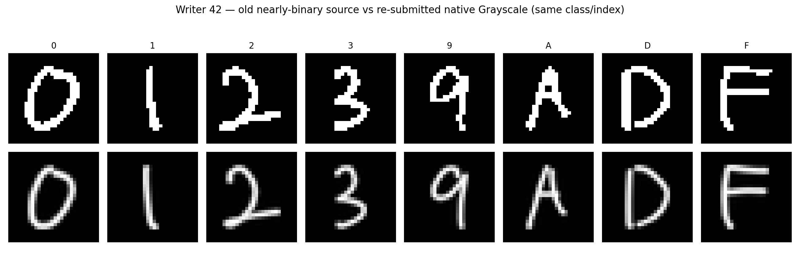

# EXP-유-005 | W02 실험 4 — 42번 Hand-made 원본 Grayscale 재제출 전후 비교

> **확정 기록(2026-11-10 배포).** 실험 범위는 **기존 42번(사실상 Binary인 4단계 밝기)과 새 42번(256단계 Grayscale)**의 데이터 특성 및 동일한 5개 모델의 평가 결과 비교이다. 본 문서는 42번의 데이터 적합성 문제를 분석하며 특정 변환을 통해 정확도를 높이는 것을 목적으로 하지 않는다.

| 항목 | 기록 |
|---|---|
| 담당 | 팀장 유용성, 분석·문서화 AI 보조 |
| 수행일 | 2026-11-09 |
| 실험 | W02 실험 4 (EXP-유-005, 데이터셋 형식·제작 조건 비교) |
| 실험 3 최신 비교안 | 기존 `EXP-유-003` Normal Baseline 보존 후 새 42번 기준 Rotation 비교를 추가 비교 절(8절)에 반영. 기존 `EXP-유-004`는 수정하지 않음 |
| 비교 대상 | 구 42번 NPZ와 재제출 42번 NPZ, 각각 640장·16개 클래스×40장 |
| 평가 방식 | **동일하게 실험 2에서 저장된 Normal 모델 5개 사용, 모델 변경 및 재학습 없음** |

## 1. 문제 발견 및 검증 목적

기존 42번은 `uint8` 28×28 Grayscale로 저장되었지만 **고유 밝기값이 4종(0·1·254·255)**으로 사실상 이진 이미지였다. 다른 작성자들의 표준 데이터는 고유 밝기값이 256종이었다. 따라서 **기술적 파일 형식은 호환되더라도, 제작 과정이 다른 데이터로 작성자별 성능을 비교해도 되는가**가 검증의 출발점이었다.

42번의 새 원본을 다시 제출받은 후 **반전·회전 없이** 표준 NPZ로 구성하고, 두 버전의 밝기 분포와 분류 성능을 비교했다.

## 2. 데이터 확인 및 문제 해결

| 항목 | 구 42번 (이전 실험 3) | 새 42번 (현재 표준) |
|---|---|---|
| 데이터 출처 | 초기 JPG에서 변환한 Grayscale NPZ | 재제출 `ml26_42(2).zip` 내부 NPZ의 `X` |
| 이미지 수·레이블 | 640장, 16클래스×40장 | **동일 수량 및 라벨 순서** |
| 크기·dtype | 28×28, `uint8` | 28×28, `uint8` |
| 고유 픽셀값 | **4종 (0·1·254·255)** | **256종** |
| 중간 밝기(16–239) 비율 | **0.00%** | **11.38%** |
| 중간 밝기(1–254) 비율 | **1.76%** | **19.59%** |
| 흑백 극성 | 최초 변환에서 반전하여 통일 | 원본이 검은 배경·밝은 글자로 **반전 없음** |
| 이미지 방향 | 최초 평가 후 90° 반시계 방향 회전 | 원본이 정방향이므로 **회전 없음** |
| SHA-256 | `447d7bd59154168ea3d710720279d6a1e3d910155f35f5ccb9e93f278d4878b8` | `f364fb453d05b4fe2a705c2b8a80683b404608c7c257d664e3ec7ac86932d4c5` |

**판정:** 구 42번은 Grayscale 파일 형식 자체는 정상이지만 중간 밝기 정보가 사실상 없어, 41·43·44번과 제작 조건이 일관적이지 않았다. 새 42번은 256종 밝기값이 실제로 존재해 데이터 형식과 분포 측면에서 더욱 일관된 입력으로 교체할 근거가 확보됐다.

**주의:** 구 42번과 새 42번은 같은 클래스·이미지 인덱스를 기준으로 대응하지만 **픽셀 배열은 동일하지 않다**(전체 평균 절대 픽셀 차이 약 **14.65/255**). 따라서 단순히 중간 밝기값만 바꾼 통제 실험이라고 간주하지 않는다.

## 3. 실제 실험 조건

1. 모델: 기존 실험 2에서 저장한 SVC, HistGradientBoosting, MLP, Extra Trees, KNN 5개. **재학습이나 하이퍼파라미터 수정 없음**.
2. 비교 데이터: **구 42번**은 과거 실험 3에서 극성과 방향을 통일한 최종 평가 입력, **새 42번**은 제출 NPZ `X`를 그대로 사용한 최종 입력. 따라서 양쪽 모두 모델에 전달할 때 검은 배경·정방향을 유지한다.
3. 정답 배열과 순서: 각 640장, 클래스별 40장, 기존/신규 `label_id` 배열 동일 확인.
4. 입력 크기·범위: 모두 28×28을 784차원으로 펼친 `float32`(픽셀 0–255), 기존 저장 Pipeline의 스케일링 유지.
5. 지표: 작성자 42번에 대한 Accuracy, 정답 수, 클래스별 정답 수, 예측 변화. 모델별 16×16 전체 Confusion Matrix는 최종 **실험 3**에서 확인한다.

## 4. 비교 결과 — 42번 640장

| 모델 | 구 42번 정확도 | 새 42번 정확도 | 정답 수 (전 → 후) | 차이 |
|---|---:|---:|---:|---:|
| SVC (RBF) | 63.91% | **65.94%** | 409 → 422 | +2.03%p |
| HistGradientBoosting | 49.38% | **55.94%** | 316 → 358 | +6.56%p |
| MLP | 69.38% | **69.06%** | 444 → 442 | -0.31%p |
| Extra Trees | 65.78% | **62.34%** | 421 → 399 | -3.44%p |
| KNN | 67.19% | **59.53%** | 430 → 381 | -7.66%p |

정확도 변화는 **SVC +2.03%p, HGB +6.56%p, MLP −0.31%p, Extra Trees −3.44%p, KNN −7.66%p**로, 모델마다 방향과 크기가 달랐다.

### 클래스별 정답 변화의 대표 사례 (클래스당 40장)

| 모델 | 가장 큰 클래스별 정답 감소 | 가장 큰 클래스별 정답 증가 |
|---|---|---|
| SVC (RBF) | A (-9장) | C (+11장) |
| HistGradientBoosting | 6 (-9장) | E (+21장) |
| MLP | 1 (-6장) | 7 (+6장) |
| Extra Trees | 4 (-7장) | C (+2장) |
| KNN | A (-13장) | 9 (+2장) |

원본 수치 전체는 [writer42_old_vs_new.csv](../results/EXP-유-005/writer42_old_vs_new.csv), [writer42_per_class_old_vs_new.csv](../results/EXP-유-005/writer42_per_class_old_vs_new.csv)에 보존한다.

## 5. 결과 해석 및 후속 처리

1. **입력 형식과 데이터 품질을 구분:** 42번의 구 파일도 `uint8` Grayscale이므로 모델 입력으로 사용하는 것 자체가 형식 오류는 아니었다. 하지만 **밝기 정보가 극도로 제한돼 작성자별 공정한 조건 비교에 교란 요인**이 될 수 있었다.
2. **새 원본 사용 근거:** 새 42번은 고유 밝기값 256종이며, 별도 반전·회전 없이 28×28 표준 입력을 구성할 수 있었다. 구 버전으로 재평가할 이유가 줄어 **현재 표준 입력을 새 42번으로 교체**했다.
3. **성능에 대한 비판적 해석:** 일부 모델은 상승하고 일부는 하락했다. 두 원본 사이에는 회색 단계뿐 아니라 실제 픽셀 배열 차이도 있으므로 **정확도 변화가 밝기 단계 수의 영향이라고 인과적으로 단정할 수 없다**. 특히 새로운 데이터가 반드시 모든 모델에서 더 높은 점수를 내야 정상인 것은 아니다.
4. **연구 기록:** 기존 실험 3의 구 42번 성능은 실험 4의 비교표와 Git 이력으로 보존한다. 최신 42번 기준 전체 2,560장 비교는 `EXP-유-003`의 **추가 분석 항목**에 기록하며, 요청대로 기존 `EXP-유-004`를 변경하지 않는다.
5. **향후 과제:** 새 42번을 포함한 현재 데이터를 기준으로 데이터 버전·SHA-256을 고정하고, 이후 모델 변경이나 개선 실험에서는 별도의 보류 평가를 확보한다.

### 재현 및 검증 자료

- 구 42번 입력: 초기 `EXP-유-004_Handmade_Test_Results.zip`의 `orientation_corrected_inputs/ml26_42.npz`(로컬 원본 보관, Git 기록으로 이전 NPZ 확인 가능).
- 새 42번 입력: 현재 `02_data/Hand_made/ml26_42.npz`(원본 픽셀 `X` 보존, **반전 및 회전 없음**).
- 최신 Rotation 비교 검토 결과: `EXP-유-003_rotation_v4/rotation_before_after_5models.csv`, `rotation_before_predictions.csv`, `rotation_after_predictions.csv`.
- 실험 4 비교 결과: [writer42_old_vs_new.csv](../results/EXP-유-005/writer42_old_vs_new.csv), [writer42_per_class_old_vs_new.csv](../results/EXP-유-005/writer42_per_class_old_vs_new.csv).
