# EXP유003 | W02 실험 3 — 현재 Hand-made 2,560장 전체 재평가 및 방향 보정 효과 (2026-11-11 재실행)

> **실험 목적:** [EXP유002](EXP유002_5개모델_Normal_Baseline.md)의 학습된 Normal 모델 5개를 **현재 표준 Hand-made 41·42·43·44번, 총 2,560장**에 적용하고, **41·44번의 방향 보정 효과**와 남은 오분류를 확인한다. **42번은 새로 제출된 256단계 Grayscale 원본**으로, 회전·반전을 추가하지 않는다.
>
> **최종 결론:** 동일한 저장 모델을 재학습하지 않고 5개 모델×4개 작성자×보정 전후 **총 40회의 추론을 새로 실행**했다. 방향 보정으로 전체 Accuracy가 **32.89–36.17% → 54.88–62.85%**로 개선됐다. 이는 **41·44번 입력의 방향 정합성** 효과이며, 42번 데이터 교체 효과가 아니다. 42번 교체 이력은 [EXP유004](EXP유004_42번_Grayscale_원본재제출_비교.md)에서 별도로 평가한다.

| 항목 | 최신 실험 조건·기록 |
|---|---|
| 기존 조사·실험 | 2026-11-09 초기 Hand-made 평가. 이번 문서에 2026-11-11 전체 재실행 결과 통합 |
| 담당 | 유용성(팀장), 실험 재실행 및 문서화 AI 보조 |
| 상태 | **완료 — 현재 표준 42번 기준 5개 모델 전체 재추론·검증(2026-11-11)** |
| 공통 모델 | SVC(RBF), HistGradientBoosting, MLP, Extra Trees, KNN — **실험 2의 저장 모델**, 재학습·파라미터 수정 없음 |
| 핵심 입력 | `02_data/Hand_made/ml26_{41,42,43,44}.npz`, 28×28, 0–255 `uint8`, 640장씩, 16클래스×각 40장 |
| 데이터 분할 | 이 실험에서는 학습·재분할 없음. 현재 2,560장에 대한 **개발용 탐색 평가**. 공식 Original Test 16,000장 사용하지 않음 |
| 검증 결과 | 모델별 Accuracy/Macro F1, 작성자별 평가, **10개 16×16 Confusion Matrix**, 25,600개의 행 단위 예측 기록 |
| 재실행 요약·검증 | [2026-11-11 독립 재추론 검증 기록](../results/EXP-유-003_rotation_v4/REVALIDATION_20261111.md) |
| 실측 CSV | [전체 비교](../results/EXP-유-003_rotation_v4/rotation_before_after_5models.csv) · [작성자별](../results/EXP-유-003_rotation_v4/rotation_before_after_by_writer.csv) · [예측 출처](../results/EXP-유-003_rotation_v4/README.md) |
| 재현 코드 | [run_rotation_comparison.py](../scripts/experiment3_handmade/run_rotation_comparison.py) — 기존 ZIP의 신뢰 가능한 모델만 로드하는 재현 코드 |
| 역사적 이력 | [구 42번 기반 003 원문](archive/EXP유003_20261109_구42번_원문.md) · [002의 기존 8절 원문](archive/EXP유002_8절_20261109_rotation_검토원문.md) |

## 1. 문제 발견과 연구 질문

1. 공식 MNIST·EMNIST Validation 19,200장에서는 5개 모델이 약 **96.29–97.67%**의 초기 Accuracy를 기록했으나, 처음 수집한 Hand-made에서 큰 성능 저하를 관찰했다. 같은 모델을 Hand-made에 적용할 때 입력 형식·방향·밝기·필체 차이를 구분할 필요가 있었다.
2. 초기 조사에서는 **41·44번의 90° 방향 불일치**와 구 42번의 제한된 Grayscale 단계·극성/방향 문제가 있었다. **42번은 이후 원본 자체를 교체**했다. 따라서 현재 데이터를 평가하는 표에는 **구 42번의 회전 전후 정확도 7–69%를 혼용하지 않는다.**
3. 이번 재실행은 **현재 표준 데이터셋 전체 2,560장**을 사용해, **41·44번의 회전 유무에 따른 모델 성능**을 재확인하고 최적화 이전의 정상 입력 기준선을 정하는 것이 목적이다.

## 2. 입력 데이터와 비교 조건

### 2.1 최신 표준 데이터 버전·해시

| 번호 | 현재 입력 데이터의 SHA-256 | 방향·극성 및 실험에서의 처리 |
|---|---|---|
| **41** | `0a829172a72787c770139c73de34cc8b751181829ff6fe08ec260247b9be5a2f` | 표준 NPZ는 **반시계 90° 보정 완료**. 이번 비교에서만 역회전으로 '보정 전' 복원 |
| **42** | `f364fb453d05b4fe2a705c2b8a80683b404608c7c257d664e3ec7ac86932d4c5` | **재제출된 새 원본 256단계 Grayscale**, 이미 정방향·검은 배경/밝은 글자. **추가 회전·반전 없음** |
| **43** | `10db20997c727c1bc1f1299f8e89626fadd3ec9618468d6759c86b0d2ddc4a66` | 표준 NPZ 그대로. 회전 없음 |
| **44** | `0e266a36e7b29edfcca0514836b5c383d13939948b4e335d70f61bb40bdc084d` | 표준 NPZ는 극성 통일·반시계 90° 보정 완료. 이번 비교에서만 역회전으로 '보정 전' 복원 |

**42번 원본의 변경은 회전 실험과 별개다.** 구 42번에는 고유 밝기값 4종/반전/회전이 있었으나, 최신 42번은 **고유 밝기값 256종, 중간 밝기(1–254) 픽셀 비율 19.59%**이고 원본 그대로 입력한다. 원본 교체의 독립 비교는 [EXP유004](EXP유004_42번_Grayscale_원본재제출_비교.md)에 보존한다.

### 2.2 동일하게 유지한 조건

- **모델:** 실험 2에서 학습된 5개 `joblib`을 재사용. 새로 학습하거나 Hyperparameter를 변경하지 않았다.
- **입력:** 28×28 이미지 → 784차원 `float32`, 픽셀 0–255. SVC·MLP·KNN은 저장 Pipeline의 `/255`를 유지하고 외부에 곱하기 255를 적용하지 않았다.
- **레이블:** 0–9, A–F 순서. 각 작성자 640장, 클래스당 40장, 전체 클래스당 160장. 4개 표준 NPZ의 형태·레이블 매핑·SHA-256 확인.
- **변경 변수:** `41·44번 보정 전`은 현재 보정된 NPZ의 역회전(`np.rot90(k=-1)`)으로 복원; `41·44번 보정 후`는 현재 표준 NPZ 그대로 사용. **42·43번은 전후 같은 원본으로 각각 새로 추론**해 예측값 동일함을 확인.
- **평가 범위:** 5개 모델 × 4개 작성자 × 전·후 = **40회 새 `predict()` 실행**. **모델 재학습 0회**. 기존의 예측값을 이번 새 계산에 끼워 넣지 않음.
- **버전:** Python 3.13.5, scikit-learn 1.8.0, NumPy 2.3.5, joblib 1.5.3; 학습 모델 ZIP SHA-256 `53cf8d382b08964b0dadd53cc4d2451265c71e62f9e39f979184efa6fd0aa8fd`.

### 2.3 실제 진행 절차

1. 최신 NPZ 4개의 SHA-256, 28×28 모양, `uint8`, 16개 레이블×40장, 레이블 인덱스를 대조하고 42번의 256개 밝기 단계 확인.
2. 기존 학습 모델 5개를 신뢰된 로컬 ZIP에서 로드하고 모델별 보정 전/후 Hand-made `predict()` 재실행.
3. 보정 전은 41·44번만 역회전한 입력, 보정 후는 현재 41·42·43·44번 표준 입력으로 평가. **42번은 어떤 단계에서도 회전·반전하지 않음.**
4. 정확도, Macro F1, 작성자별 예측, 예측 25,600건, 16×16 Confusion Matrix 10개와 정확도 비교 그래프를 새로 산출.
5. 모든 Confusion Matrix의 총합 2,560, 클래스별 행 합계 160 및 대각선 정답 수를 검증. 새 결과와 기존 최신 검토본의 **예측 25,600건을 모델·작성자·이미지 인덱스 기준으로 전량 대조**.

## 3. 전체 2,560장 정확도 — 현재 표준 데이터 기준

| 모델 | 회전 보정 전 Accuracy | 회전 보정 후 Accuracy | 개선폭(%p) | 전 Macro F1 | 후 Macro F1 | 전 정답/2,560 | 후 정답/2,560 |
|---|---:|---:|---:|---:|---:|---:|---:|
| SVC (RBF) | 35.27% | **61.56%** | +26.29 | 0.3674 | 0.6040 | 903 | 1,576 |
| HistGradientBoosting | 32.89% | **54.88%** | +21.99 | 0.3333 | 0.5175 | 842 | 1,405 |
| MLP | 35.00% | **62.85%** | +27.85 | 0.3665 | 0.6241 | 896 | 1,609 |
| Extra Trees | 36.17% | **61.60%** | +25.43 | 0.3715 | 0.5912 | 926 | 1,577 |
| KNN | 35.82% | **58.83%** | +23.01 | 0.3537 | 0.5664 | 917 | 1,506 |

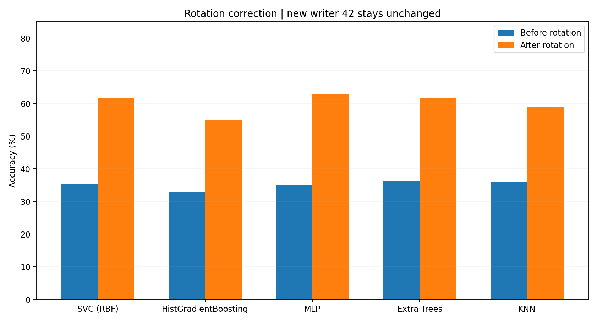

**해석:** 41·44번의 방향을 현재 표준과 맞췄을 때 5개 모델 전부 Accuracy와 Macro F1이 증가했다. **42·43번은 두 조건에서 완전히 동일한 입력**이므로 향상분에 기여하지 않는다. 회전 효과와 구→신 42번 데이터 교체 효과는 반드시 별도로 설명한다.

## 4. 작성자별 정확도 — 640장씩

42번을 '회전 보정 전→후' 대상으로 표시하지 않는다. **42·43번 열의 값 하나는 각 작성자의 현재 원본 Accuracy**이고, 두 조건에서 같은 예측을 얻었다.

| 모델 | 41번 (회전 전→후) | **42번 (새 원본, 회전 없음)** | 43번 (회전 없음) | 44번 (회전 전→후) | 보정 후 최저 작성자 |
|---|---:|---:|---:|---:|---|
| SVC (RBF) | 7.81% → **50.47%** | **65.94%** | 61.41% | 5.94% → **68.44%** | 41번 |
| HistGradientBoosting | 8.12% → **44.53%** | **55.94%** | 60.78% | 6.72% → **58.28%** | 41번 |
| MLP | 8.12% → **59.38%** | **69.06%** | 55.94% | 6.88% → **67.03%** | 43번 |
| Extra Trees | 8.44% → **52.97%** | **62.34%** | 63.91% | 10.00% → **67.19%** | 41번 |
| KNN | 9.84% → **45.16%** | **59.53%** | 66.09% | 7.81% → **64.53%** | 41번 |

- **41번:** 회전 후에도 44.53–59.38%로 5개 모델 중 4개에서 최저 Accuracy. 추가 데이터·자동 중심 정렬·획 굵기·대비 분석의 우선 후보.
- **42번:** 새 256단계 원본을 그대로 평가한 값으로, 회전·극성 보정 전후 실험에서 **변환 없음**. 현재 42번의 모델별 정확도는 **55.94–69.06%**. 옛 42번의 4단계 밝기/회전 보정 수치는 여기 적용하지 않는다.
- **43번:** 회전 미적용, 동일 입력·예측 유지(55.94–66.09%). MLP에서 보정 후 작성자 최저.
- **44번:** 두 조건 사이 **41번과 함께 방향만** 달라진다. 보정 후 58.28–68.44%.

## 5. 새 42번의 주요 Confusion Matrix 오분류 (보정 후와 동일)

**현재 새 원본 42번 640장**을 5개 모델에서 다시 추론해 구한 결과다. 아래 오분류 수는 최신 42번에서 실제 관찰한 건수이며 과거 구 42번의 오류 목록을 재사용하지 않았다.

| 모델 | 42번 정답/640 | 오분류/640 | 상위 오분류 3개 (실제→예측, 건수) |
|---|---:|---:|---|
| SVC (RBF) | 422 | 218 | D→0 (22), B→8 (21), 5→F (11) |
| HistGradientBoosting | 358 | 282 | B→8 (29), D→0 (27), 9→8 (14) |
| MLP | 442 | 198 | B→8 (22), A→4 (13), 5→F (13) |
| Extra Trees | 399 | 241 | D→0 (20), B→8 (17), 7→2 (14) |
| KNN | 381 | 259 | 9→4 (16), 4→1 (15), 7→4 (14) |

실험 2와 달리 같은 이미지를 회전/반전해 42번의 오류가 변화한 것으로 기술하지 않는다. 42번의 **구→신 원본 교체 전후 비교**와 픽셀 분포 변화는 [EXP유004](EXP유004_42번_Grayscale_원본재제출_비교.md)의 별도 실험에 남긴다.

## 6. 모델별 Confusion Matrix — 재실행 확인된 16×16

**축:** 세로 Actual(실제 레이블), 가로 Predicted(예측 레이블), 클래스 `0123456789ABCDEF`. 각 모델별 보정 전·후 **10개의 Matrix**, 각각 전체 2,560장, 클래스당 160장. 색은 시각화용이고 셀 숫자는 실제 오분류 건수다. **2026-11-11 새 전체 추론이 기존 최신 CSV와 일치하여, 이미 게시된 동일 수치의 PNG 파일을 재사용했다.**

### 6.1 SVC (RBF)
보정 전: 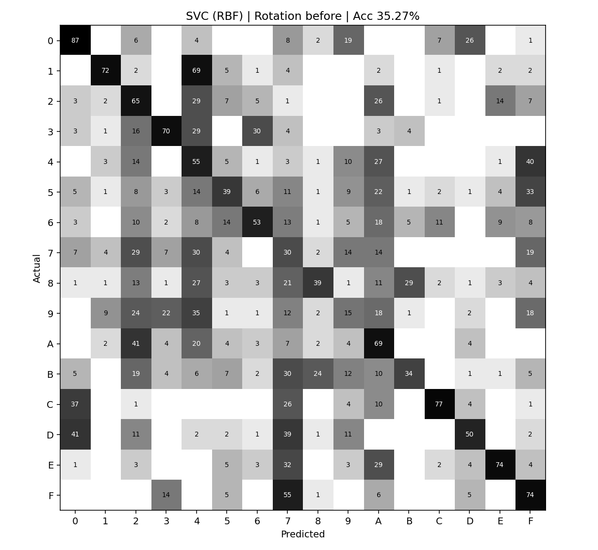

보정 후: 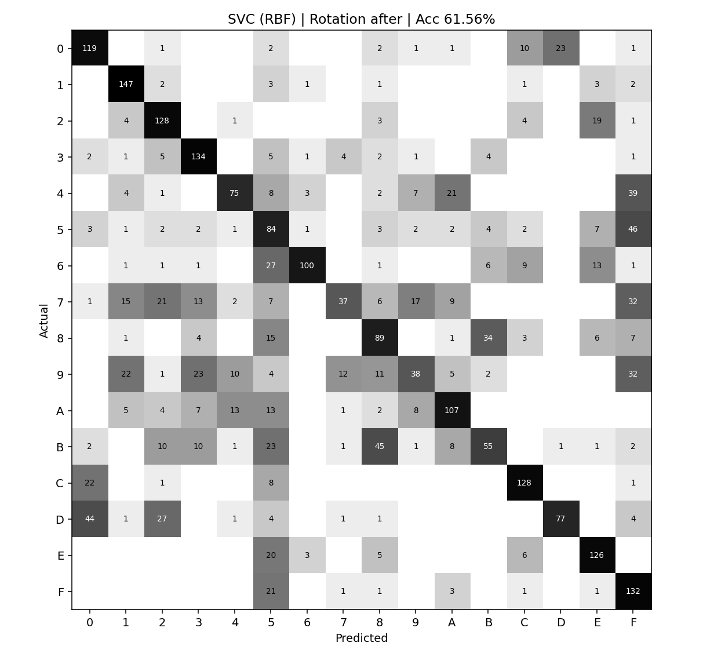

### 6.2 HistGradientBoosting
보정 전: 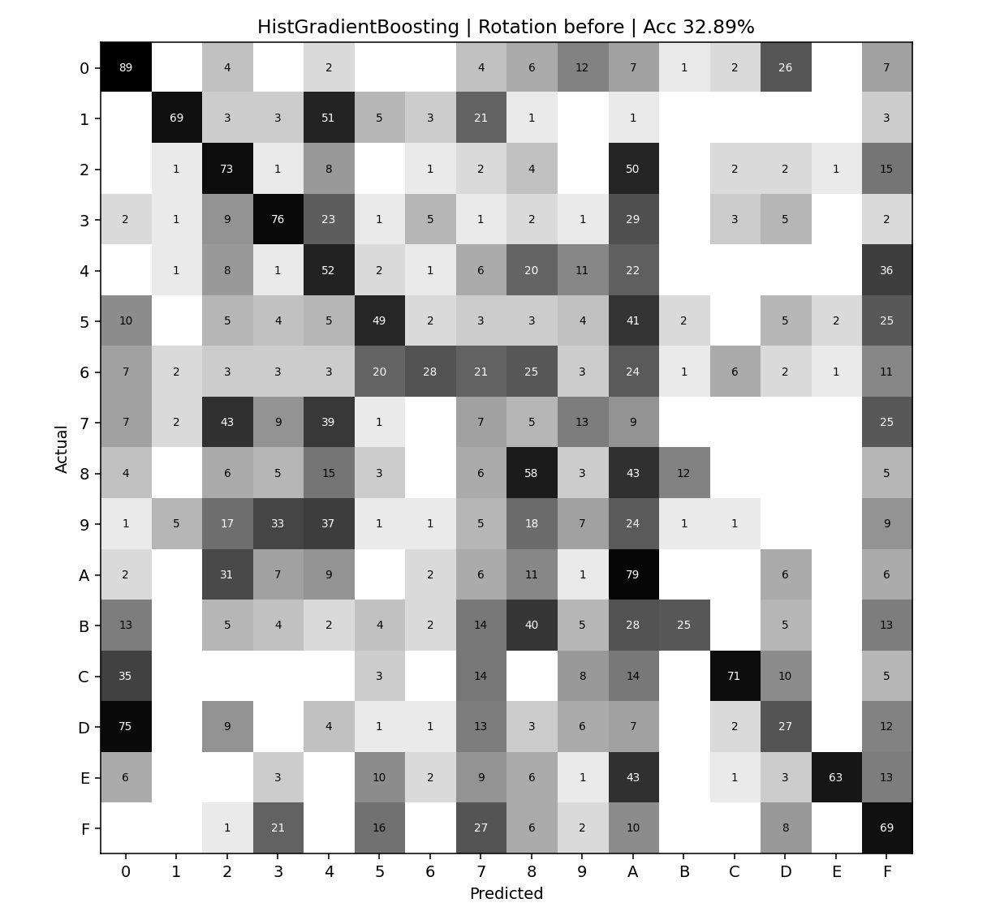

보정 후: 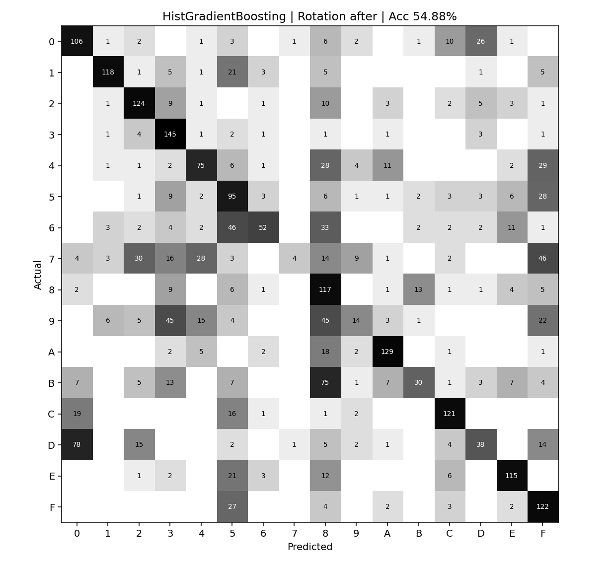

### 6.3 MLP
보정 전: 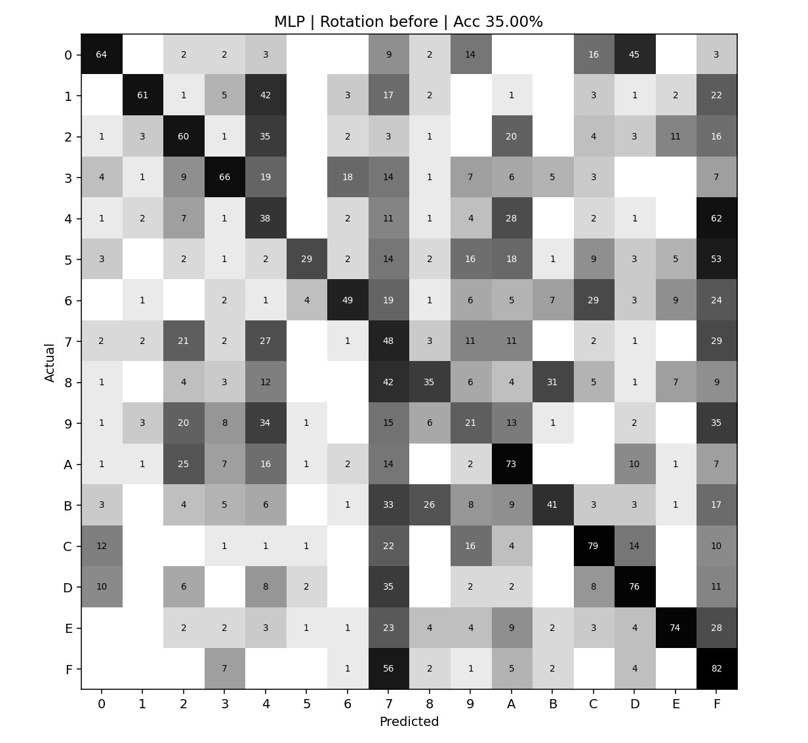

보정 후: 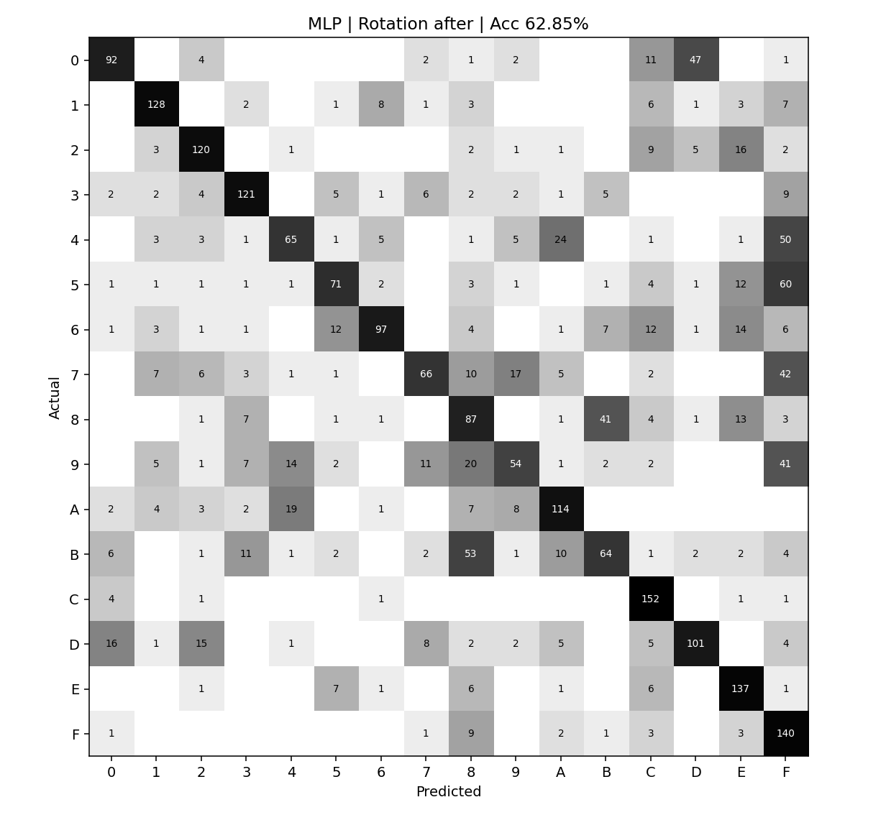

### 6.4 Extra Trees
보정 전: 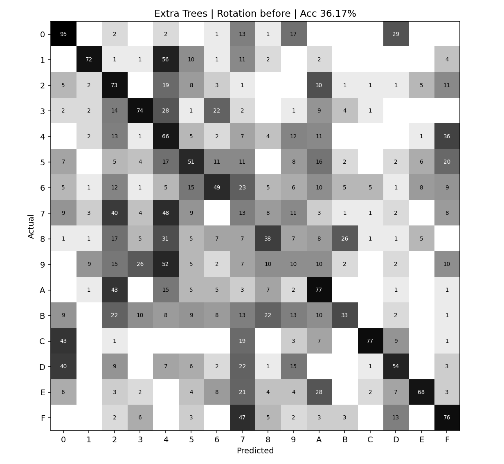

보정 후: 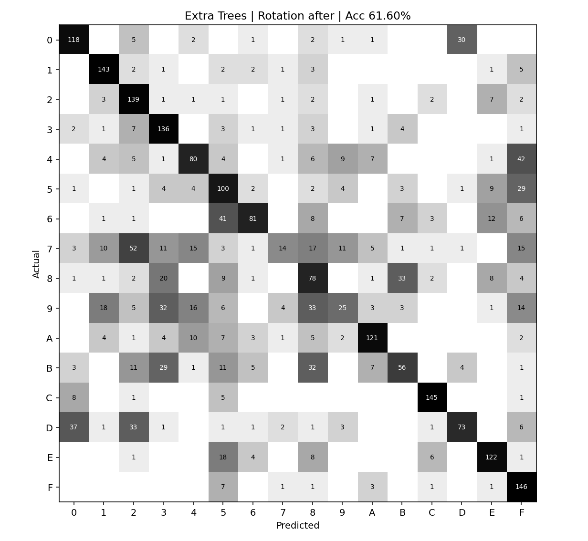

### 6.5 KNN
보정 전: 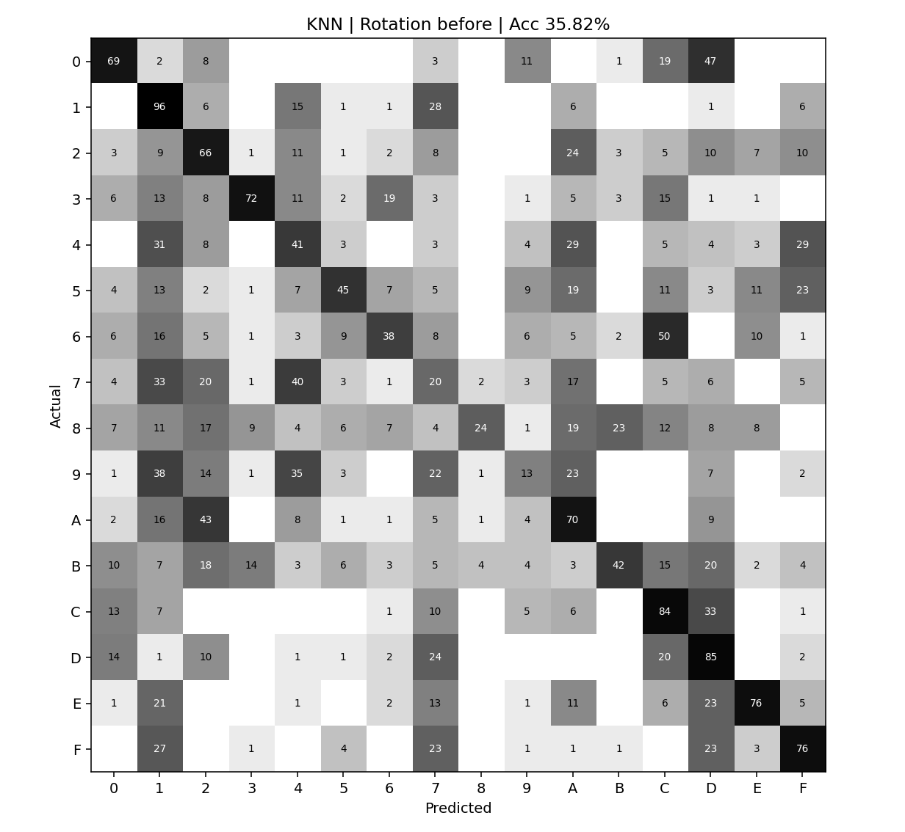

보정 후: 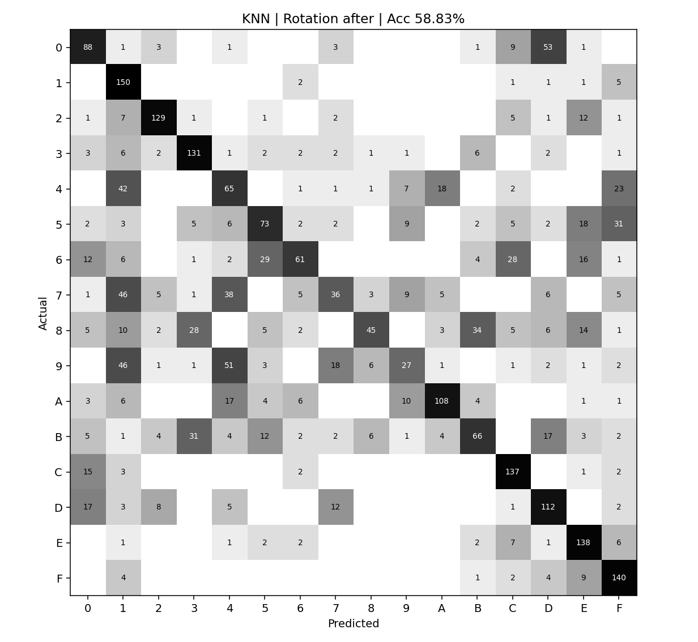

## 7. 실험 결과·해석 및 후속 연구

1. **실측 개선:** 방향 불일치가 있던 41·44번은 보정 후 동일 모델에서 정확도가 크게 증가했다. 개선은 모델 재학습·Hyperparameter 변경의 결과가 아니라 **입력 이미지 방향 정합성**의 영향이다.
2. **42번 교체는 별도 원인:** 42번은 이미 회전·색 변환이 반영된 새로운 원본 데이터로 교체됐고, 이번 회전 비교에서 추가 변환은 없다. 옛 42번의 낮은 최초 정확도나 4단계 회색값을 **현재 입력의 특성이라고 설명하지 않는다**.
3. **남은 문제:** 회전 보정 후에도 공식 Normal Validation 약 96–98%에 비해 Hand-made는 54.88–62.85%에 그친다. 필체·중심·굵기·크기·명암·클래스 혼동 등을 개발용 데이터에서 계속 분석해 **자동 전처리 Pipeline 및 Training Augmentation, Normal/Combined 독립 최적화**를 추진한다.
4. **평가 데이터 독립성:** 이 2,560장은 이미 오류 분석·방법 설계에 사용된 **개발용 탐색 데이터**다. Combined에 편입한 이미지는 같은 실험의 독립 Validation으로 다시 쓰지 않는다. 작성자 기준 Group CV 또는 별도 신규 작성자 Validation을 검토한다.
5. **재현성:** 새 40회 추론의 Accuracy 및 10개 Confusion Matrix는 GitHub의 기존 최신 `rotation_v4` 수치와 **정확히 일치**했다. 작성자별 평가·예측 25,600건도 키 기준 일치했고, 클래스별 F1의 최대 오차는 부동소수점 연산 순서에 따른 약 `2.22e-16`이었다. 기존 결과 CSV/PNG는 그대로 보존하며, 전체 재실행 결과 파일과 실행 스크립트는 별도 ZIP으로 보관·전달한다.

## 8. 과거 자료 보존 — 내용 손실 방지

- 과거 EXP유003의 **구 42번(밝기 4단계, 방향·극성 보정)**에 대한 전체 원문과 수치, 데이터 해시, 클래스별 분석은 [2026-11-09 원문 아카이브](archive/EXP유003_20261109_구42번_원문.md)에 **내용 변경 없이** 보존했다.
- 원래 EXP유002의 **8절 전체**는 [분리된 원문 아카이브](archive/EXP유002_8절_20261109_rotation_검토원문.md)에 보존하고, 유효한 **현재 42번 기준 전체 성능·작성자별·10개 Confusion Matrix·수행 조건**은 본문 2~7절에 통합했다.
- **EXP유004**에는 구 42번 vs 재제출 새 42번의 원본 비교값을 그대로 보존한다. 현재 표준 입력의 정확도는 본문 4~5절을 기준으로 한다.

[전체 실험 재검증 기록](../results/EXP-유-003_rotation_v4/REVALIDATION_20261111.md) · [기존 결과 파일 목록](../results/EXP-유-003_rotation_v4/README.md) · [Normal Baseline 실험 2](EXP유002_5개모델_Normal_Baseline.md)
