# EXP유002 원문 8절 — 2026-11-09 비교 이력 (보존용)

> 당시 이 섹션은 EXP유002 하단에 있었으나, 현재는 EXP유003으로 통합됐다. 다음은 **당시 수치·설명은 보존하고 링크 경로만 archive 위치에 맞춰 정정한 기록**이다. 최신 42번 재실행 결과는 [개정 EXP유003](../EXP유003_Handmade_방향보정_성능평가.md)을 참조한다.

## 8. 추가 비교 — 새 42번 Grayscale 반영 후 Rotation 보정 전·후

**실험 목적:** 새 42번 표준 NPZ를 포함한 2,560장에 동일 저장 모델 5개를 적용하되, 41·44번의 Rotation 보정 유무를 비교하여 이미지 방향 일치의 영향을 확인한다.

**데이터 처리:** 41·44번만 `np.rot90(img,k=1,axes=(1,2))`의 반시계 90°를 적용한다. 새 42번은 원본 28×28 Grayscale을 그대로 사용하며 **흑백 반전, 회전, 추가 스무딩 모두 없음**. 43번도 전후 변경 없다. 분할 및 모델의 `fit`은 다시 하지 않는다.

**정확한 결과 출처:** 41·44번의 보정 전 데이터와 41·43·44번의 보정 후 데이터는 기존 실제 실험 3의 저장 예측값을 비교·검증한 후 재사용했다. **새 42번 640장은 기존 5개 모델에서 각각 다시 예측**했다. 이 자료는 2,560장 전체에 대한 새 모델별 **집계 결과**이지만 모든 모델을 처음부터 다시 돌린 독립 전량 실행 결과는 아니다.

### 8.1 전체 성능

| 모델 | 보정 전 Acc. | 보정 후 Acc. | 변화(%p) | 보정 전 Macro F1 | 보정 후 Macro F1 | 보정 전 정답 | 보정 후 정답 |
|---|---:|---:|---:|---:|---:|---:|---:|
| SVC (RBF) | 35.27% | **61.56%** | **+26.29** | 0.3674 | 0.6040 | 903 | 1576 |
| HistGradientBoosting | 32.89% | **54.88%** | **+21.99** | 0.3333 | 0.5175 | 842 | 1405 |
| MLP | 35.00% | **62.85%** | **+27.85** | 0.3665 | 0.6241 | 896 | 1609 |
| Extra Trees | 36.17% | **61.60%** | **+25.43** | 0.3715 | 0.5912 | 926 | 1577 |
| KNN | 35.82% | **58.83%** | **+23.01** | 0.3537 | 0.5664 | 917 | 1506 |

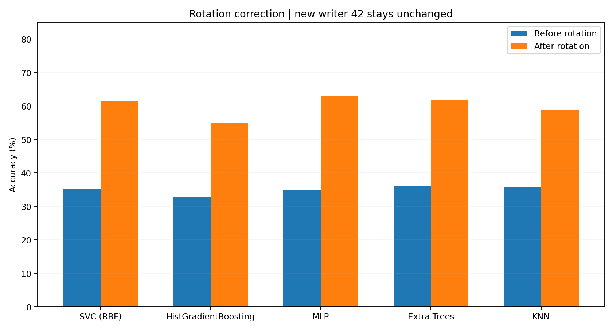

### 8.2 작성자별 성능

| 모델 | 41번 전→후 | 42번 전→후 | 43번 전→후 | 44번 전→후 |
|---|---:|---:|---:|---:|
| SVC (RBF) | 7.81% → 50.47% | 65.94% → 65.94% | 61.41% → 61.41% | 5.94% → 68.44% |
| HistGradientBoosting | 8.12% → 44.53% | 55.94% → 55.94% | 60.78% → 60.78% | 6.72% → 58.28% |
| MLP | 8.12% → 59.38% | 69.06% → 69.06% | 55.94% → 55.94% | 6.88% → 67.03% |
| Extra Trees | 8.44% → 52.97% | 62.34% → 62.34% | 63.91% → 63.91% | 10.00% → 67.19% |
| KNN | 9.84% → 45.16% | 59.53% → 59.53% | 66.09% → 66.09% | 7.81% → 64.53% |

**확인:** 42·43번의 동일한 이미지와 같은 예측이 보정 전·후에 유지되므로 차이 0%p. 41·44번만 회전 보정의 대상이다.

### 8.3 16×16 Confusion Matrix (전·후, 모델당 2개)

행은 실제 클래스, 열은 예측 클래스, 레이블 순서는 `0123456789ABCDEF`이다. 각 행 합 160장, 전체 2,560장, 대각선 합 정답 수를 확인했다. 각 셀의 숫자는 실제 건수다.

#### SVC (RBF)

보정 전

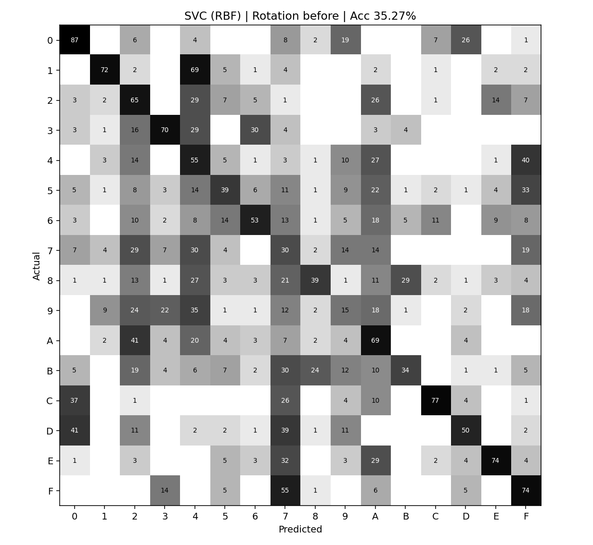

보정 후

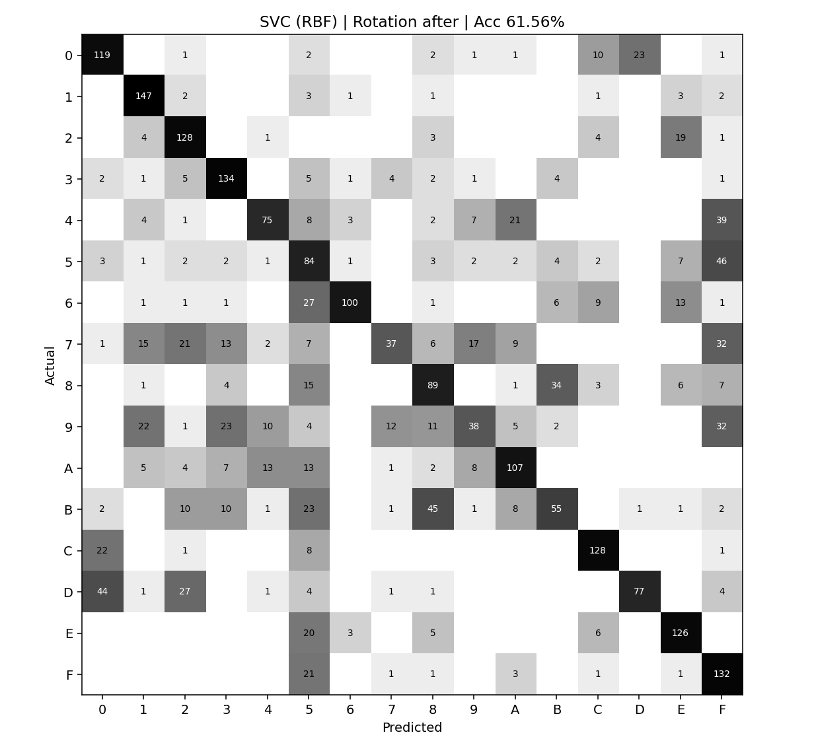

#### HistGradientBoosting

보정 전

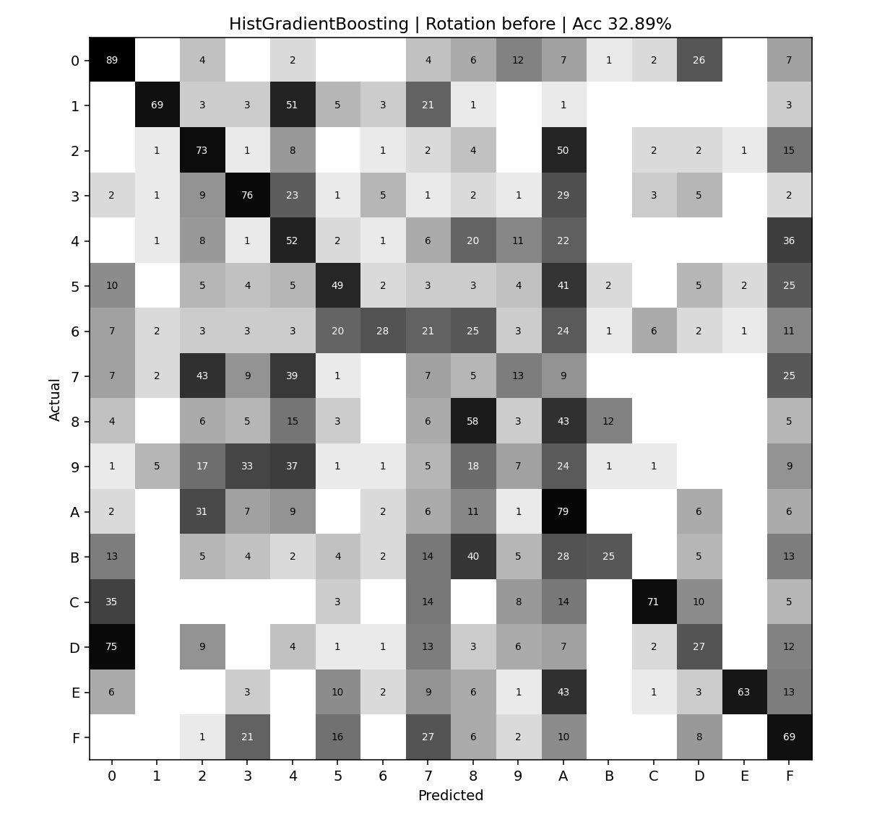

보정 후

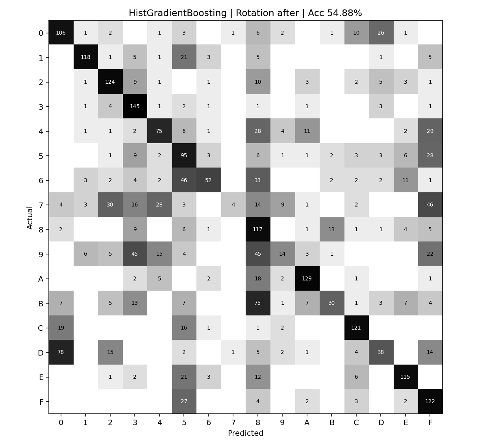

#### MLP

보정 전

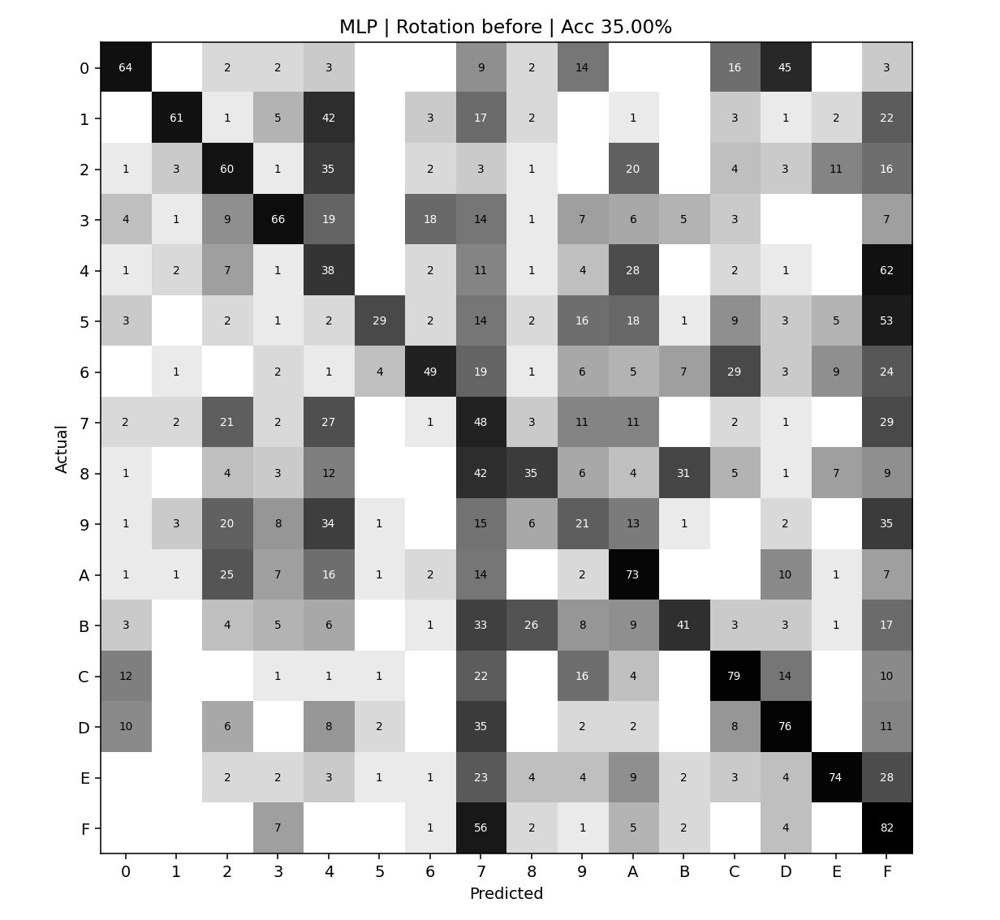

보정 후

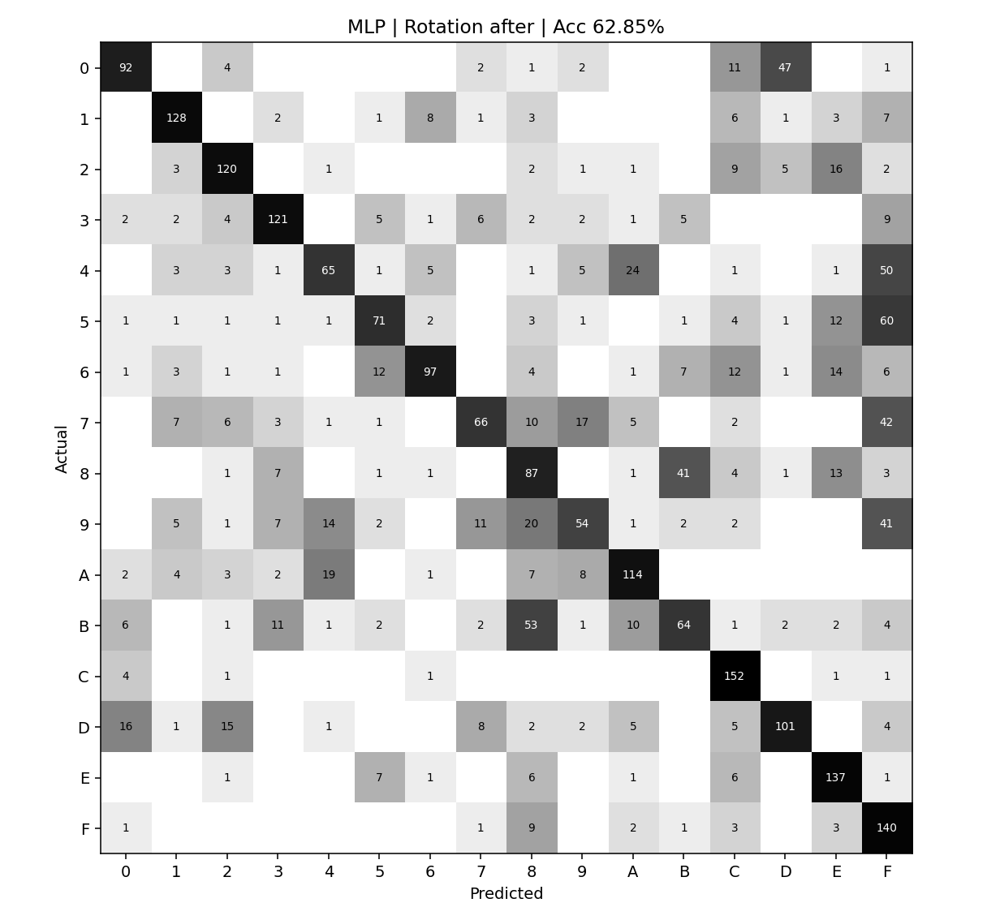

#### Extra Trees

보정 전

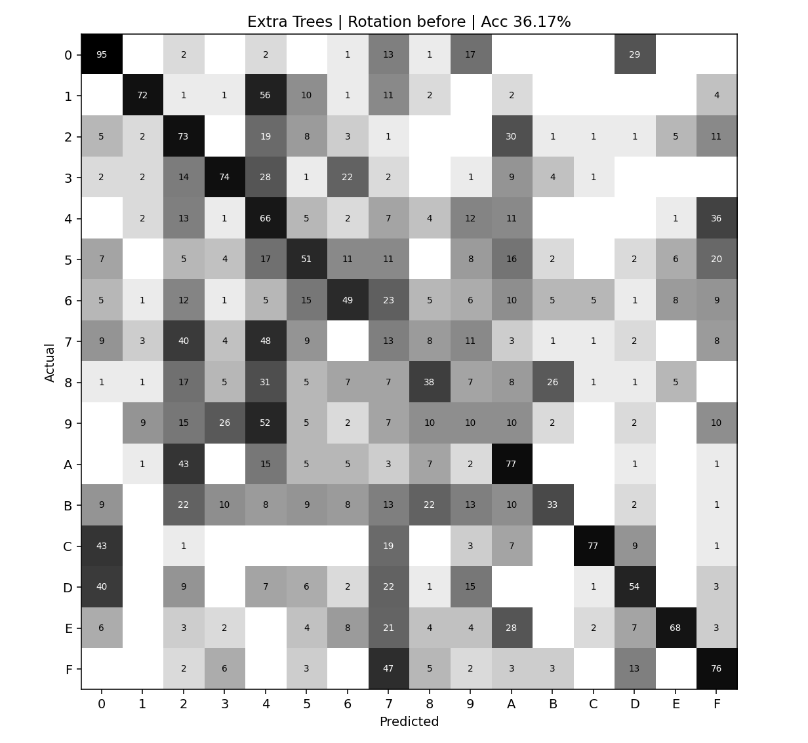

보정 후

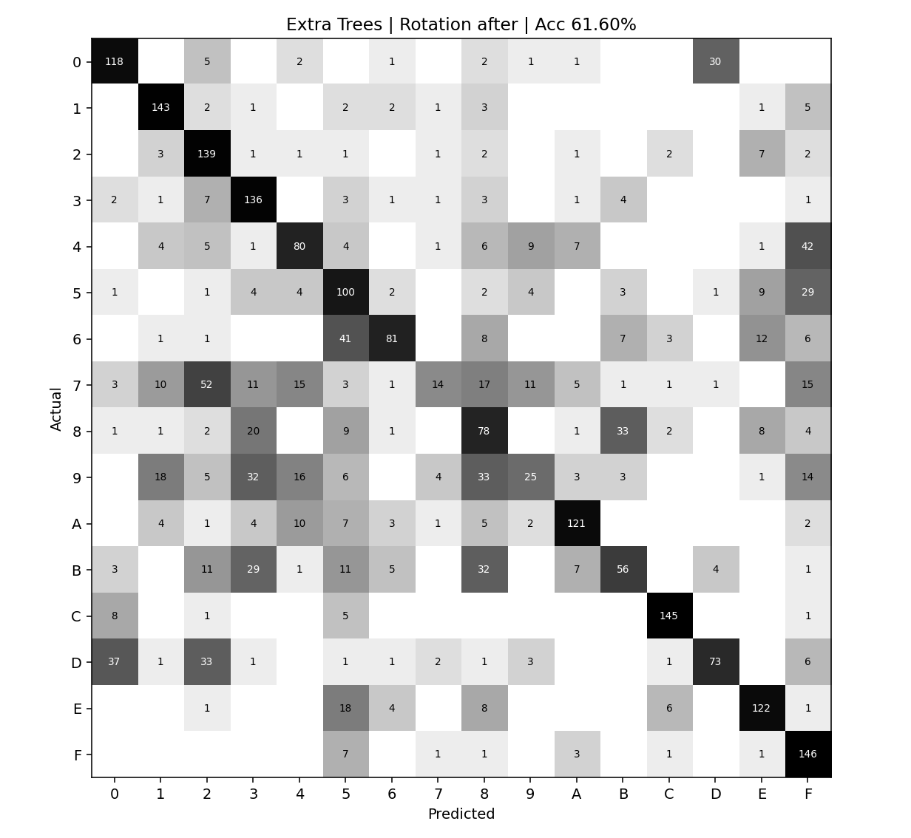

#### KNN

보정 전

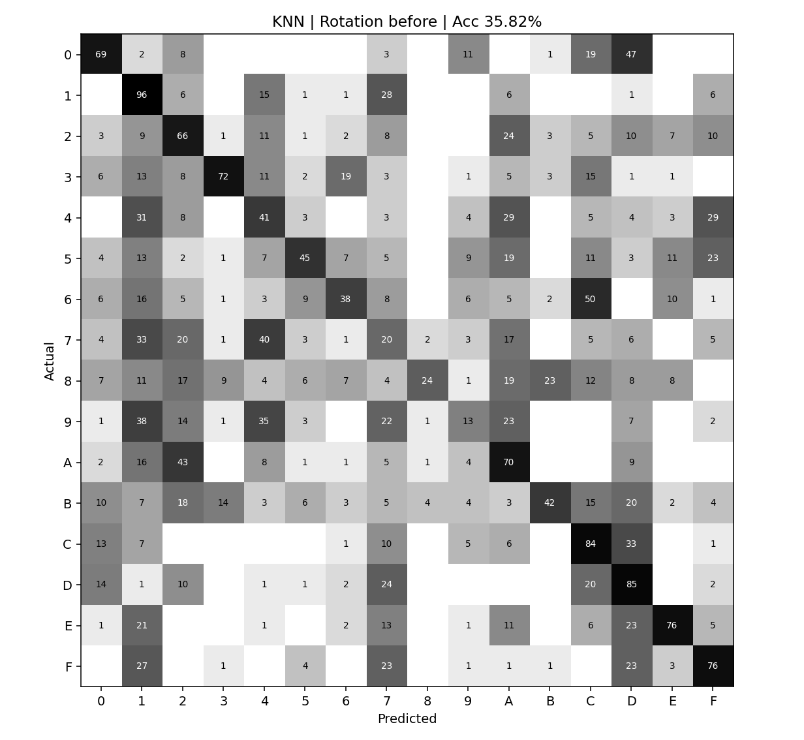

보정 후

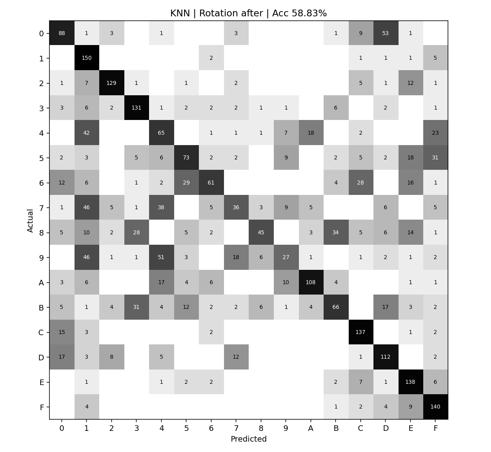

### 8.4 해석 및 재현성

- Rotation 보정 전후의 전체 정확도는 32.89–36.17%에서 54.88–62.85%로 향상됐다. 다섯 모델의 정확도·Macro F1 모두 증가했다.
- 42번 재제출 원본에 따른 효과와 Rotation 보정 효과는 **서로 다른 비교**다. 이 절에서는 42번의 픽셀값과 예측을 전후 동일하게 유지했다.
- Normal Validation(19,200장, 기존 1–7절)은 전혀 변경되지 않았다. 전체 학습 모델도 재학습하지 않았다.
- 42번 Binary형과 재제출 Grayscale형의 데이터 품질·예측 차이는 별도 실험 4(`EXP유004`)에 기록하고, 중간 밝기만 바뀐 통제 실험으로 해석하지 않는다.
- 모델 및 예측값: `W02_Experiment2_5models_complete(1).zip`의 저장 `joblib`, 기존 `EXP유003_Handmade_Test_Results.zip`의 구 방향 실측 예측, 새 42번 재평가 추론 파일. 대용량 모델 파일은 GitHub에 올리지 않음.
- 결과 CSV와 10개 Confusion Matrix는 `../results/EXP-유-003_rotation_v4/`에 함께 등록하는 안. 추후 새 원본으로 완전 신규 전체 재실행할 때는 추가 검증 상태를 구분해서 기록한다.

**재현 스크립트:** [run_rotation_comparison.py](../../scripts/experiment3_handmade/run_rotation_comparison.py) (모델 ZIP 별도 필요). 실제 배포 수치는 `rotation_review_provenance.json`에 명시한 예측값 재사용·신규 42번 추론 기반이며, 이 코드는 동일 모델 및 동일 데이터로 전체 재실행할 때 사용한다.
