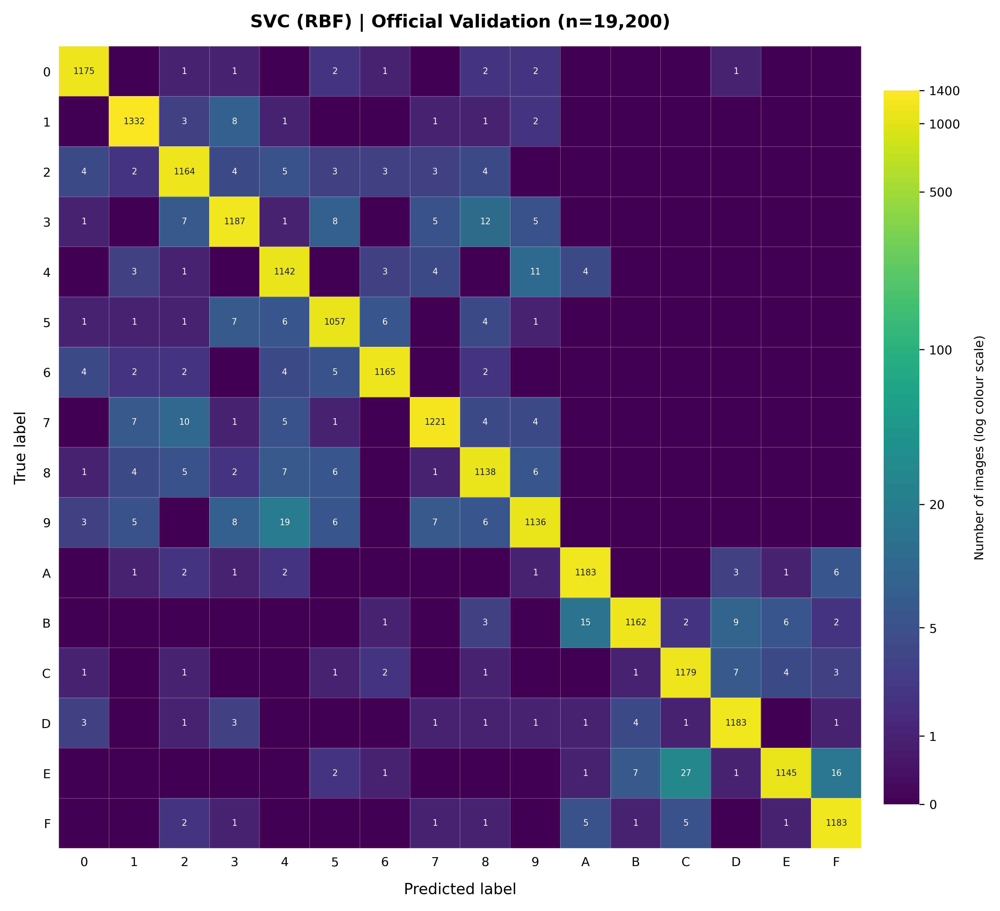
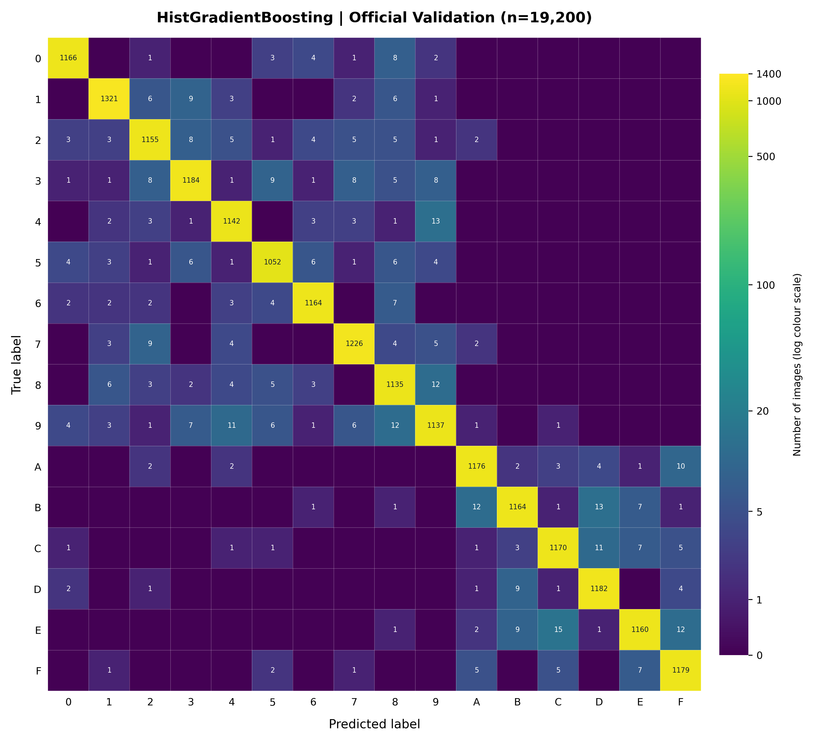
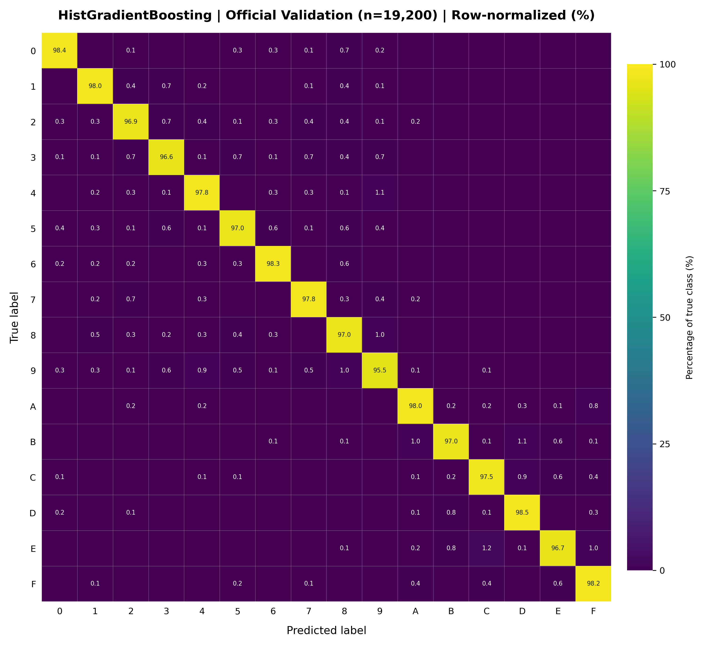
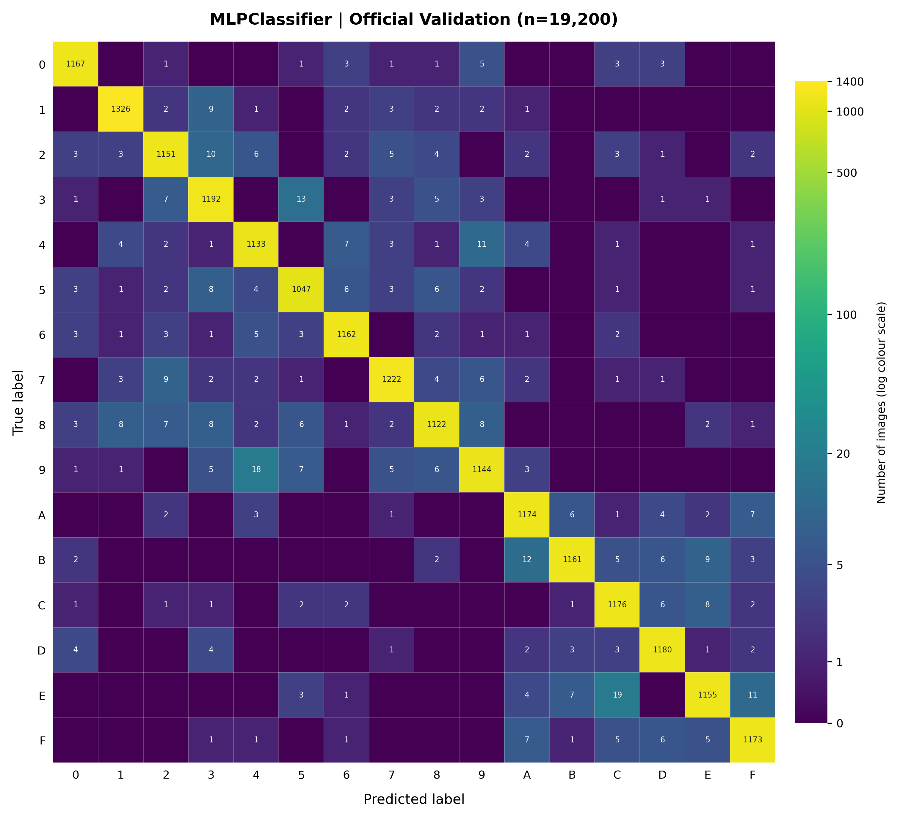
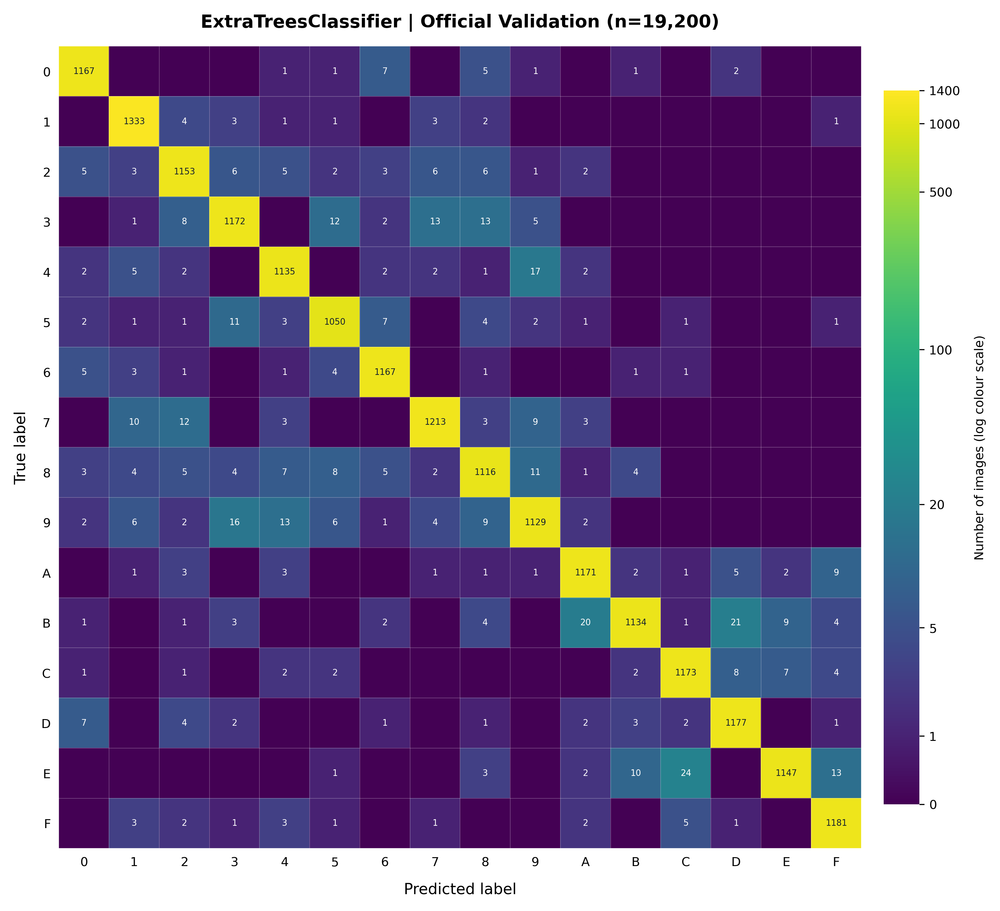
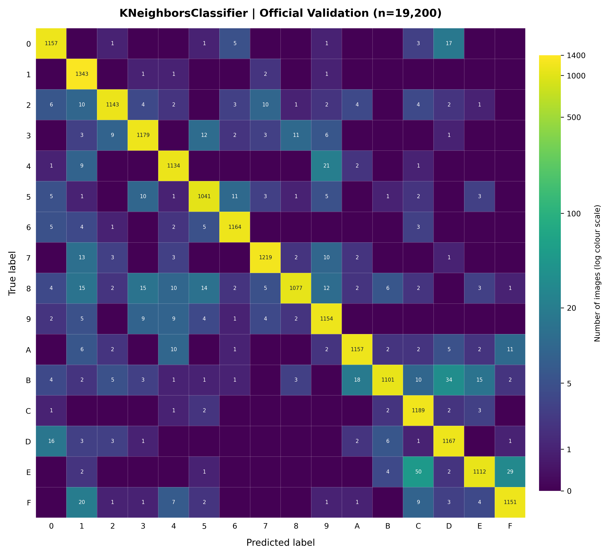
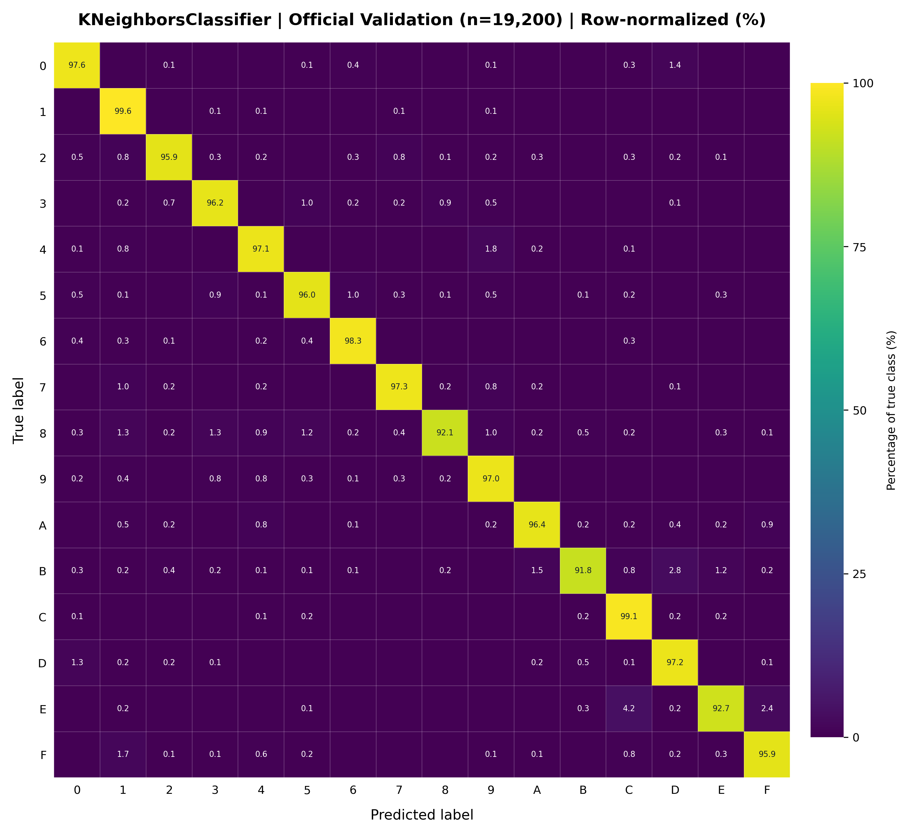

# EXP유002 — Confusion Matrix 컬러 시각화 (5개 모델)

**연구 단계:** W02 실험 2 — Normal Dataset 기반 5개 모델의 기본 성능 평가.

**검증 조건:** Training 76,800장 / Validation 19,200장 / 16개 클래스(0–9, A–F). 새 학습 없이 [기존 측정 CSV](../EXP-유-003_confusion_long.csv)의 값을 그대로 사용했다.

**읽는 방법:** Y축은 실제 클래스(True), X축은 예측 클래스(Predicted). **대각선은 정답, 비대각선은 오분류**다. Count 그림의 숫자는 **건수(절대값)**, Row-normalized 그림은 **실제 클래스별 비율(%)**이다. 모든 그림은 `viridis` 색상을 사용한다. Official Count는 작은 오류를 보여주기 위해 **색상만 `log(1 + count)`** 변환했으며, 원본 수치와 Accuracy는 변경하지 않았다. Official Count 컬러 범위는 다섯 모델에 동일하게 0–1,400장, 정규화 컬러 범위는 0–100%로 고정했다.

| 모델 | Validation Accuracy | Count CM | Row-normalized CM |
|---|---:|---|---|
| SVC (RBF) | 97.67% | [Count](SVC_RBF_confusion_matrix.png) | [Row-normalized](SVC_RBF_confusion_matrix_normalized.png) |
| HistGradientBoosting | 97.46% | [Count](HistGradientBoosting_confusion_matrix.png) | [Row-normalized](HistGradientBoosting_confusion_matrix_normalized.png) |
| MLPClassifier | 97.32% | [Count](MLPClassifier_confusion_matrix.png) | [Row-normalized](MLPClassifier_confusion_matrix_normalized.png) |
| ExtraTreesClassifier | 96.97% | [Count](ExtraTrees_confusion_matrix.png) | [Row-normalized](ExtraTrees_confusion_matrix_normalized.png) |
| KNeighborsClassifier | 96.29% | [Count](KNeighbors_confusion_matrix.png) | [Row-normalized](KNeighbors_confusion_matrix_normalized.png) |

## 모델별 그림

### SVC (RBF)

**Row-normalized (%)**

### HistGradientBoosting

**Row-normalized (%)**

### MLPClassifier

**Row-normalized (%)**

### ExtraTreesClassifier

**Row-normalized (%)**

### KNeighborsClassifier

**Row-normalized (%)**

**실험일지:** [EXP유002 — Normal Baseline](../../logs/EXP유002_5개모델_Normal_Baseline.md). **기초 숫자:** [long-format Confusion Matrix CSV](../EXP-유-003_confusion_long.csv). **설명:** Count 5장과 Row-normalized 5장은 기존 Confusion Matrix CSV에서 그림만 다시 생성했다. 지표 재추정·모델 재학습은 하지 않았다. [재생성 코드](../../scripts/standardize_all_cm.py).
