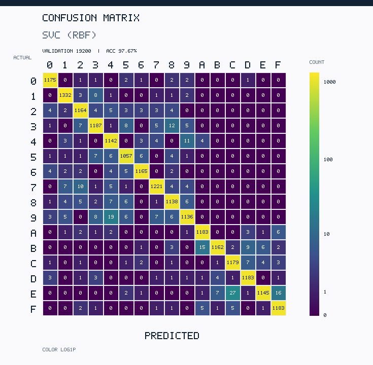
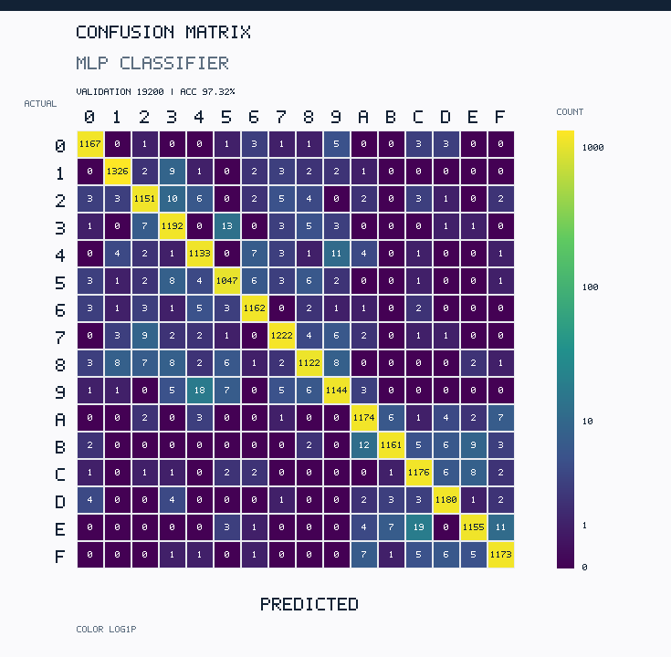
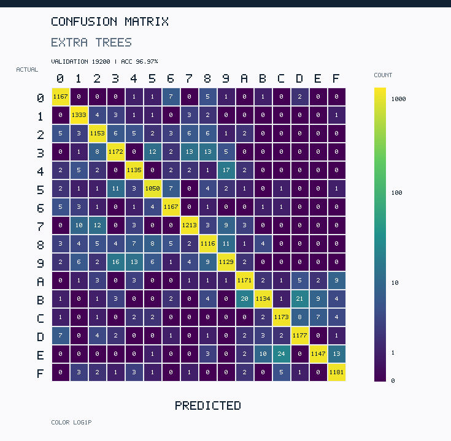
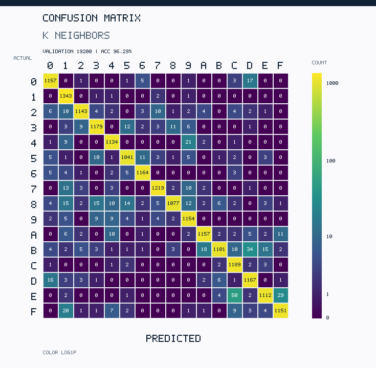

# EXP유002 — Confusion Matrix 컬러 시각화 (5개 모델)

**연구 단계:** W02 실험 2 — Normal Dataset 기반 5개 모델의 기본 성능 평가.

**검증 조건:** Training 76,800장 / Validation 19,200장 / 16개 클래스(0–9, A–F). 새 학습 없이 [기존 측정 CSV](../EXP-유-003_confusion_long.csv)의 값을 그대로 사용했다.

**읽는 방법:** Y축은 실제 클래스(Actual), X축은 예측 클래스(Predicted). **대각선은 정답, 비대각선은 오분류**이며, 각 칸의 **숫자는 건수(절대값)**이다. 낮은 오분류 건수의 색 대비를 높이기 위해 컬러만 `log(1 + count)`를 이용했으므로 이미지 사이의 색상 밝기보다 **수치**를 비교해야 한다.

| 모델 | Validation Accuracy | 16×16 PNG |
|---|---:|---|
| SVC (RBF) | 97.67% | [열기](SVC_RBF_confusion_matrix.png) |
| HistGradientBoosting | 97.46% | [열기](HistGradientBoosting_confusion_matrix.png) |
| MLPClassifier | 97.32% | [열기](MLPClassifier_confusion_matrix.png) |
| ExtraTreesClassifier | 96.97% | [열기](ExtraTrees_confusion_matrix.png) |
| KNeighborsClassifier | 96.29% | [열기](KNeighbors_confusion_matrix.png) |

## 모델별 그림

### SVC (RBF)

### HistGradientBoosting

### MLPClassifier

### ExtraTreesClassifier

### KNeighborsClassifier

**실험일지:** [EXP유002 — Normal Baseline](../../logs/EXP유002_5개모델_Normal_Baseline.md). **기초 숫자:** [long-format Confusion Matrix CSV](../EXP-유-003_confusion_long.csv). **설명:** PNG는 표와 동일한 원본 카운트로 생성한 시각화이며, 지표를 새로 추정하거나 모델을 재학습한 결과가 아니다.
