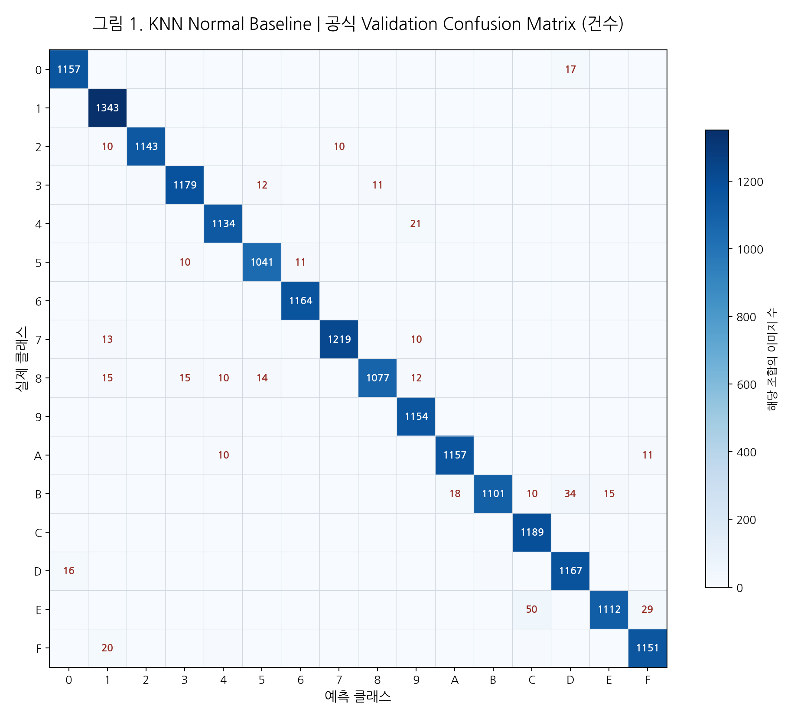
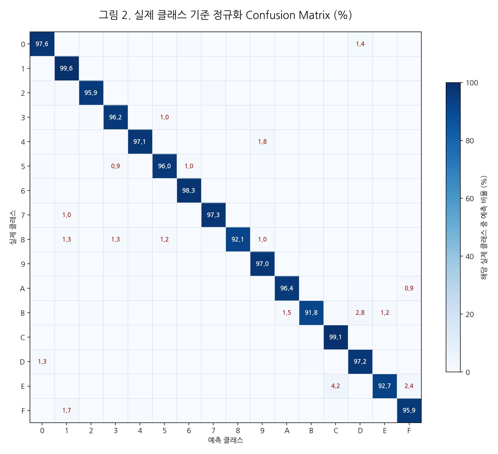
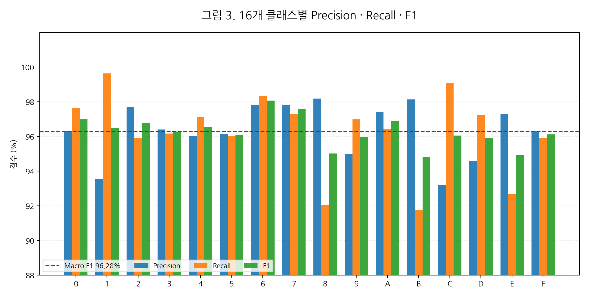
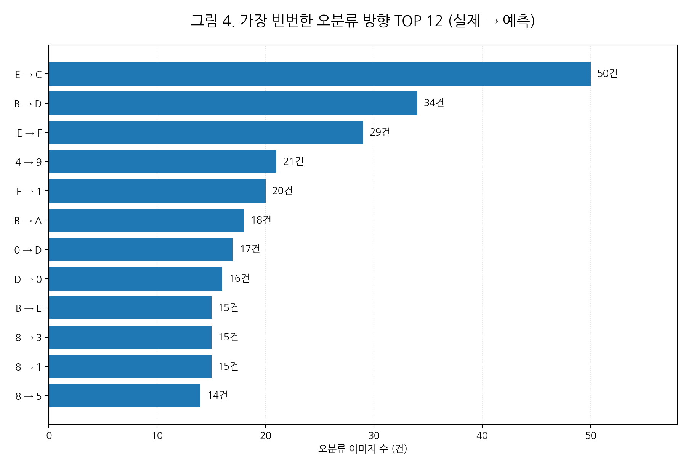
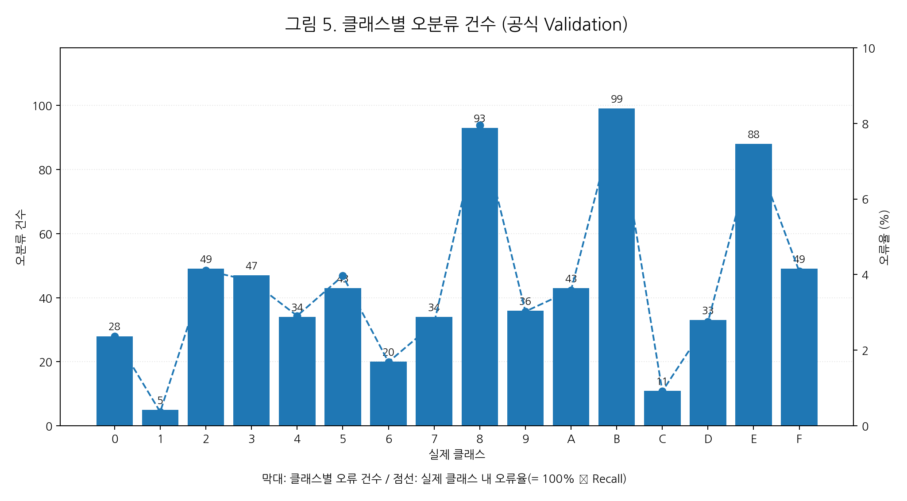

[EXP-001_KNN_Normal_Baseline.md](https://github.com/user-attachments/files/35192292/EXP-001_KNN_Normal_Baseline.md)
# EXP-001 | KNN Normal — Baseline 성능 재현 및 공식 Validation 오분류 분석

> **실험 목적:** KNN Normal의 W02 Baseline 결과를 동일한 공식 데이터 분할로 재현하고, 16개 클래스의 Confusion Matrix와 Precision·Recall·F1을 분석해 후속 최적화에서 우선 확인할 오류를 선정한다.
>
> **결론:** Training **76,800장** / Validation **19,200장** 분할을 재현하였으며, 기존 Baseline과 **Accuracy 96.2917%, Macro F1 0.962791**이 일치하였다. 공식 Validation에서는 **18,488장 정답·712장 오답**이었고, 특히 **E→C 50건, B→D 34건, E→F 29건**이 주요 오류였다. 본 실험은 **개선 실험이 아닌 기준 모델 재현 및 진단**이며, 오류의 원인과 Hand-made 성능은 후속 실험에서 확인한다.

| 항목 | 기록 |
|---|---|
| ID / 수행일 | **EXP-001 (KNN / Normal)** / **2026-11-19** |
| 담당 | **[작성자 이름 입력]** / 로컬 실험 실행·결과 검증 및 분석 |
| 상태 | **공식 Validation Baseline 재현 및 오분류 분석 완료** |
| 실행 코드 | `03_experiments/model_optimization/run.py`, `common.py`, `knn.py` |
| 결과 위치 | [`results/EXP001_baseline/baseline/knn/`](../results/EXP001_baseline/baseline/knn/) |
| 실행 근거 | 로컬 Anaconda Prompt 출력, [`metrics.json`](../results/EXP001_baseline/baseline/knn/metrics.json), [`confusion_matrix.csv`](../results/EXP001_baseline/baseline/knn/confusion_matrix.csv), [`per_class.csv`](../results/EXP001_baseline/baseline/knn/per_class.csv) |
| 선행 자료 | W02 KNN Baseline 기록 및 GitHub 기존 Baseline 구현 |

## 1. 문제 발견과 원인 가설

공식 Validation에 대한 KNN의 전체 정확도만으로는 어떤 클래스가 취약하며 어떤 문자쌍에서 오류가 발생하는지 확인하기 어렵다. 또한 기준 모델이 재현되지 않으면 이후 전처리·이웃 수·거리 지표 변경의 효과를 정확하게 비교하기 어렵다. 따라서 **동일한 Baseline을 먼저 재실행**하고, 전체 혼동행렬과 클래스별 지표를 분석하였다.

- **관찰:** 공식 Validation **19,200장** 중 정답 **18,488장**, 오답 **712장** → Accuracy **96.2917%**.
- **클래스별 집중:** B **99건**, 8 **93건**, E **88건**의 오분류가 발생했다. 세 클래스에서 발생한 **280건은 전체 오류의 39.33%**이다.
- **주요 방향:** **E→C 50건**, **B→D 34건**, **E→F 29건**, **4→9 21건**, **F→1 20건**.
- **가설 A (형태):** 시각적으로 유사한 숫자·문자의 획이나 외곽 구조 때문에 픽셀 거리 기반 이웃 선택이 혼동될 가능성이 있다.
- **가설 B (입력 위치·크기):** 같은 글자라도 중심 위치, 글자 크기 또는 획 굵기가 달라지면 784차원 픽셀 간 거리가 커져 오분류할 가능성이 있다.
- **검증 범위:** 이번 단계는 **오류 분포를 관찰한 진단 실험**이다. 오분류 이미지 자체와 최근접 이웃을 아직 확인하지 않았으므로 **어느 가설도 확정하지 않는다**.

## 2. 수행 조건과 재현성

| 요소 | 이번 실험에서 실제 적용한 조건 |
|---|---|
| 모델 | scikit-learn `KNeighborsClassifier()` Baseline |
| Hyperparameter | `n_neighbors=5`, `weights='uniform'`, `metric='minkowski'`, `p=2` (Euclidean 거리), 나머지 기본값 |
| 이미지 입력 | 28×28 Grayscale → 784차원 `float32`, 픽셀값 **/255** |
| 데이터셋 | `02_data/datasets/MNIST_EMNIST_official_split_112000.npz` |
| 데이터 SHA-256 | `0e9570d0eb04c0c1da99d043b85bfdab7f3b639eebe4b10335b05b57ad671879` |
| 분할 | 공식 Training 96,000장 내부 `StratifiedGroupKFold(n_splits=5, shuffle=True, random_state=42)`의 **첫 번째 Fold** |
| 데이터 수 | **Training 76,800장 / Validation 19,200장** |
| 추가 증강 | **이번 실험에서는 적용하지 않음**. 기존 공식 Training 파일에 포함된 데이터 구성은 유지 |
| Hand-made | **미평가·학습 미사용**. 팀 손글씨 2,560장은 후속 개발용 평가 대상으로 남김 |
| 실행 환경 | Windows / Conda `ml-latest` / Python **3.12.14** / NumPy **2.5.3** / scikit-learn **1.9.1** / SciPy **1.18.1** |
| Test 분리 | 공식 Original Test 16,000장 및 교수님 최종 Test는 **사용하지 않음** |

**로컬 실행 환경 문제 및 조치**

1. Python 3.9.12 환경에서 `hashlib.file_digest()` 미지원 오류가 발생하여 `common.py`의 해당 계산을 `hashlib.sha256(f.read()).hexdigest()`로 변경하였다.
2. 이전 scikit-learn 1.6.1 환경에서는 분할이 **76,801/19,199**로 나와 기존 검증 조건과 일치하지 않았다.
3. `ml-latest` 환경에서 분할 **76,800/19,200**이 재현되었으며, 엄격한 분할 검사를 유지한 상태로 Baseline을 실행했다.
4. **분할 개수 차이의 정확한 원인은 확인하지 못했으므로** 라이브러리 버전이 원인이라고 단정하지 않는다.

저장소 루트에서 실행한 명령:

```bash
python 03_experiments/model_optimization/run.py --model knn --variant baseline --output 05_model_optimize/KNN/Normal/results/EXP001_baseline
```

실행 순서: **데이터 해시 확인 → 첫 Fold 분할 → KNN Baseline 재학습 → Validation 19,200장 예측 → 지표·Confusion Matrix 저장 → 오류 분석**.

## 3. Baseline 재현 결과

| 평가 항목 | 기존 W02 기록 | 이번 실험 | 해석 |
|---|---:|---:|---|
| Training / Validation | 76,800 / 19,200 | **76,800 / 19,200** | 분할 개수 일치 |
| Accuracy | 96.2917% | **96.2917%** | 일치 |
| Macro F1 | 0.962791 | **0.962791** | 일치 |
| Macro Precision | 별도 확인 필요 | **0.963611** | `per_class.csv`의 16개 Precision 평균 |
| Macro Recall | 별도 확인 필요 | **0.962594** | `per_class.csv`의 16개 Recall 평균 |
| 정답 / 오답 | 별도 확인 필요 | **18,488 / 712** | 이번 Confusion Matrix 합계 |
| Fit 시간 | 약 0.048초 | **0.141초** | 실행 환경 차이 존재 |
| Predict 시간 | 약 27.532초 | **25.989초** | Validation 19,200장 기준, 환경 차이 존재 |

**판정:** 기존 KNN Baseline의 Accuracy와 Macro F1을 재현했다. 그러나 이전 실행의 예측을 개별 샘플 단위로 대조하지 않았으므로 **Confusion Matrix의 모든 셀 또는 최근접 이웃의 순서까지 동일하다고 주장하지 않는다**. 또한 환경이 달라 시간 차이를 속도 개선으로 해석하지 않는다.

## 4. 공식 Validation Confusion Matrix 및 오류 분석

### 4.1 16×16 Confusion Matrix (실측 건수)



**그림 1.** 행은 **실제 정답**, 열은 **예측 결과**이다. 대각선은 정분류 개수이며, 대각선 바깥의 숫자는 주요 오분류 건수이다. 대각선 외 **10건 이상**인 칸에 건수를 표시했다. **총 19,200장 / 정답 18,488장 / 오답 712장**.

### 4.2 실제 클래스 기준 정규화 Confusion Matrix



**그림 2.** 실제 클래스마다 Validation 수량이 다르므로, 각 행의 합을 100%로 정규화하여 비교하였다. 대각선은 해당 클래스의 **Recall(%)**과 동일하다. 대각선 밖은 **0.9% 이상**의 혼동 방향만 표시했다.

### 4.3 클래스별 Precision·Recall·F1 비교



**그림 3.** 클래스별 성능을 전체 Macro F1과 함께 나타냈다. 특히 **B의 Recall 91.75%, 8의 Recall 92.05%, E의 Recall 92.67%**가 상대적으로 낮았다. 반대로 1은 Recall **99.63%**이지만 Precision은 **93.52%**로, **1로 잘못 예측된 다른 클래스도 존재**함을 보여준다.

| 실제 클래스 | Support | 정답 | 오답 | Precision | Recall | F1 |
|---|---:|---:|---:|---:|---:|---:|
| B | 1,200 | 1,101 | **99** | 98.13% | **91.75%** | 94.83% |
| 8 | 1,170 | 1,077 | **93** | 98.18% | **92.05%** | 95.02% |
| E | 1,200 | 1,112 | **88** | 97.29% | **92.67%** | 94.92% |
| F | 1,200 | 1,151 | 49 | 96.32% | 95.92% | 96.12% |
| 2 | 1,192 | 1,143 | 49 | 97.69% | 95.89% | 96.78% |
| 3 | 1,226 | 1,179 | 47 | 96.40% | 96.17% | 96.28% |

### 4.4 주요 오분류 방향 TOP 12



**그림 4.** 대각선 외 혼동행렬 값을 내림차순으로 정렬했다. 상위 3개 방향은 **E→C (50건)**, **B→D (34건)**, **E→F (29건)**이며, 단순한 글자별 총 오류와 달리 **어떤 오답으로 쏠리는지**를 보여준다.

| 실제 → 예측 | 건수 | 실제 클래스 내 비율 |
|---|---:|---:|
| E → C | **50** | **4.17%** |
| B → D | **34** | **2.83%** |
| E → F | **29** | **2.42%** |
| 4 → 9 | 21 | 1.80% |
| F → 1 | 20 | 1.67% |
| B → A | 18 | 1.50% |
| 0 → D | 17 | 1.43% |
| D → 0 | 16 | 1.33% |

- **E의 주요 혼동:** E→C **50건**과 E→F **29건**은 E의 전체 오류 88건 중 **79건**을 차지한다.
- **B의 주요 혼동:** B→D **34건**, B→A **18건**, B→E **15건**이 관찰됐다.
- **0↔D:** 0→D **17건**, D→0 **16건**, 합계 **33건**.
- **8↔B:** 8→B **6건**, B→8 **3건**, 합계 **9건**. **현재 공식 KNN Validation에서는 8↔B보다 E→C, B→D의 단방향 오류가 더 빈번**하다.

### 4.5 클래스별 오류 건수와 오류율



**그림 5.** 막대는 오분류 **절대 건수**, 점선은 **해당 실제 클래스의 오류율(100%−Recall)**이다. 전체 오류 **712건** 중 B·8·E에서만 **280건(39.33%)**이 발생했다. 클래스별 Validation 수량이 동일하지 않으므로 오류 건수와 오류율을 함께 비교했다.

### 4.6 시각적 사례 분석 범위

이번 실험의 입력 자료는 **집계된 Confusion Matrix·클래스별 점수**이며, 개별 Validation 이미지의 실제 픽셀 배열·샘플별 예측·최근접 이웃 인덱스를 별도로 저장하지 않았다. 따라서 위 그림은 **모두 측정된 집계 결과의 시각화**이다. **실제 손글씨 이미지, 전처리 전후 예시, 최근접 이웃 5장의 사례 그림을 생성하거나 관찰했다고 주장하지 않는다.** 이러한 그림은 이후 샘플 단위 예측을 저장하는 별도 분석에서 제작한다.

## 5. 해석·판정 및 후속 실험

**이번에 확인한 사실**

- Baseline의 **Accuracy 96.2917%**와 **Macro F1 0.962791**을 재현했다.
- 공식 Validation 19,200장 중 **712건의 오류**가 발생했고, B·8·E에 **39.33%**가 집중됐다.
- 대표적인 혼동 방향은 **E→C, B→D, E→F**이며, 0↔D처럼 양방향 오류도 확인했다.
- KNN 기본 설정은 **k=5, 균일 가중치, Euclidean 거리**다.

**확정하지 않은 원인**

- 서로 비슷한 형태 때문인지, 픽셀 위치·크기·획 굵기의 차이 때문인지 구분하지 못했다.
- 공식 데이터와 Hand-made의 성능 차이는 **이번 실험에서 미측정**이다.
- Training 정확도, 학습 데이터 수에 따른 Learning Curve, 전처리 개선 효과 모두 **미측정/미실시**다.

**다음 실험 (별도 로그)**

1. **KNN Normal Hand-made Baseline 평가:** 모델을 동일하게 유지하고 기존 팀 손글씨 **2,560장(작성자 4명×640장)**을 평가해 공식 Validation과 Accuracy·Macro F1·Confusion Matrix를 비교한다. Hand-made는 **학습에 사용하지 않는다**.
2. 손글씨와 공식 Validation의 **오분류 쌍 및 작성자별 차이**를 분석한다.
3. 오분류 이미지 원본과 KNN의 최근접 이웃을 시각화해 형태·위치·크기·획 가설을 점검한다.
4. 가설 검증 결과에 따라 **CoM/BB 정렬, 학습 시 크기·획 증강, k·가중치·거리 지표**를 **한 번에 하나씩** 바꾸는 비교 실험을 설계한다.

**가설 판단:** **보류(추가 검증 필요)**. 이번 EXP-001에서는 Baseline 재현과 오류 현황을 확인했을 뿐 **성능 개선은 수행하지 않았다**.

### 산출물과 재현 근거

- [`metrics.json`](../results/EXP001_baseline/baseline/knn/metrics.json) — 데이터 해시·환경·설정·Accuracy·Macro F1·학습/예측 시간·전체 혼동행렬
- [`confusion_matrix.csv`](../results/EXP001_baseline/baseline/knn/confusion_matrix.csv) — 16×16 실제/예측 건수
- [`per_class.csv`](../results/EXP001_baseline/baseline/knn/per_class.csv) — 클래스별 Precision·Recall·F1·Support
- [`그림 1~5`](../results/EXP001_baseline/figures/) — 위 CSV/JSON에서 재구성한 진단 시각화. **새로운 모델 실험 결과는 아님**
- 실행 코드: `03_experiments/model_optimization/run.py`, `common.py`, `knn.py`

**재현성 주의:** 이번 실행은 Python 3.12.14 / scikit-learn 1.9.1에서 수행되었다. 예측 시간은 같은 시스템·라이브러리·스레드 조건을 맞추지 않으면 직접적인 성능 비교 지표로 사용하지 않는다. 공식 Original Test 및 교수님 최종 Test는 최적화에 사용하지 않았다.
