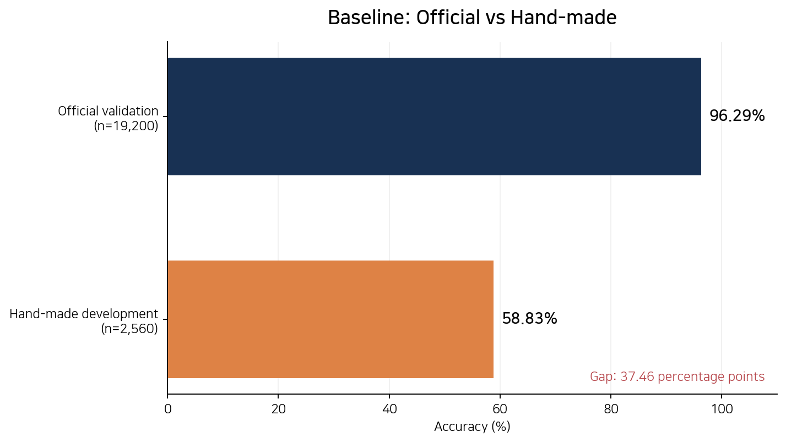
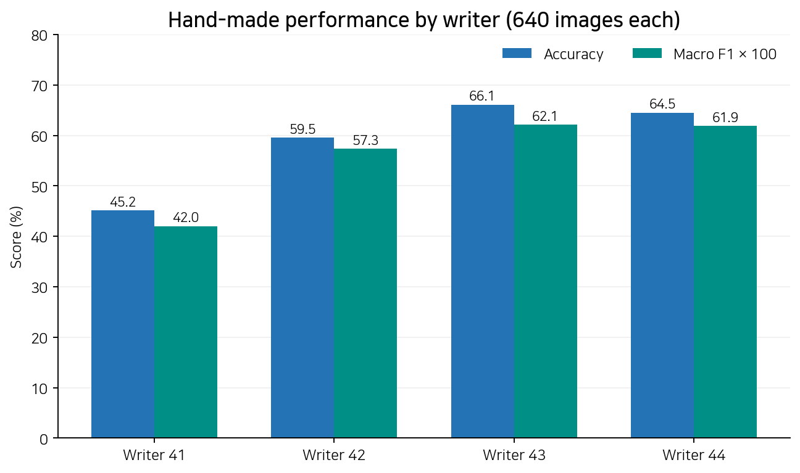
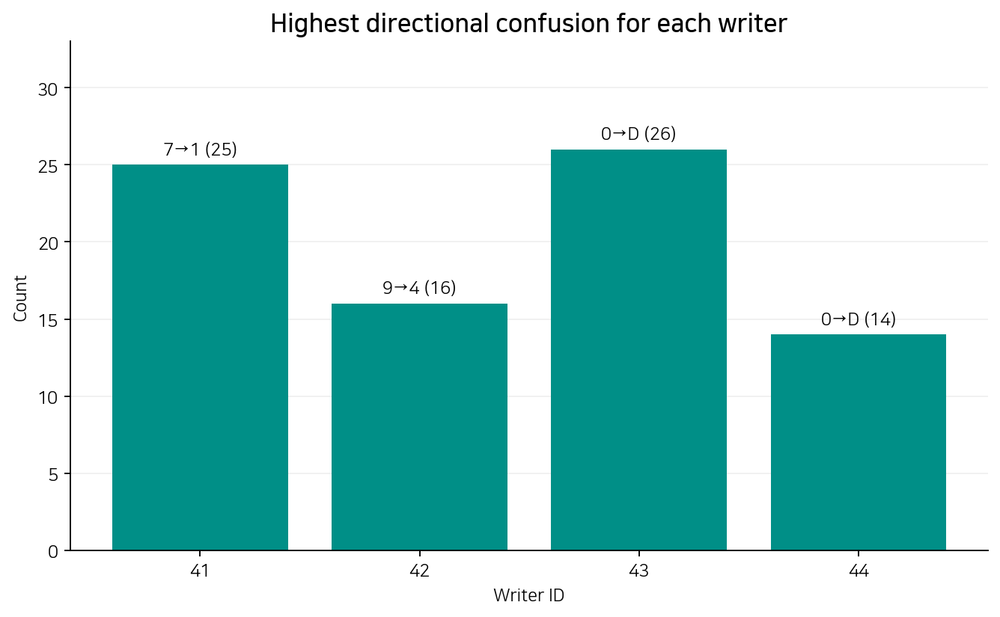
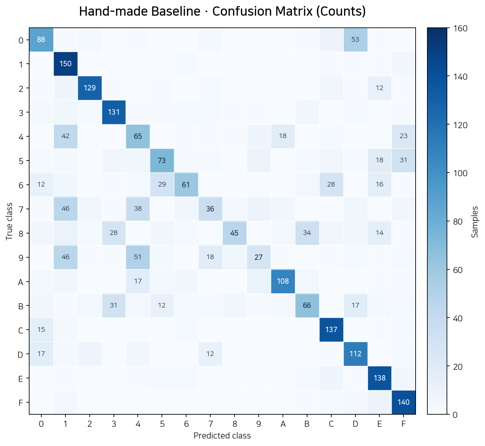
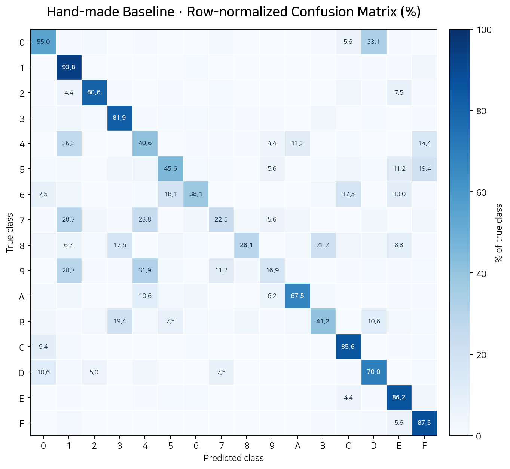
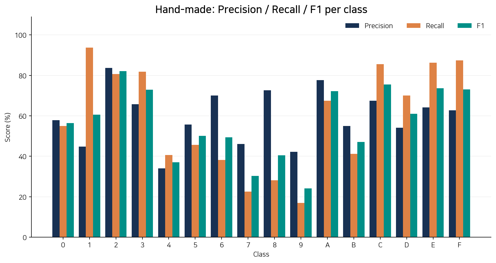
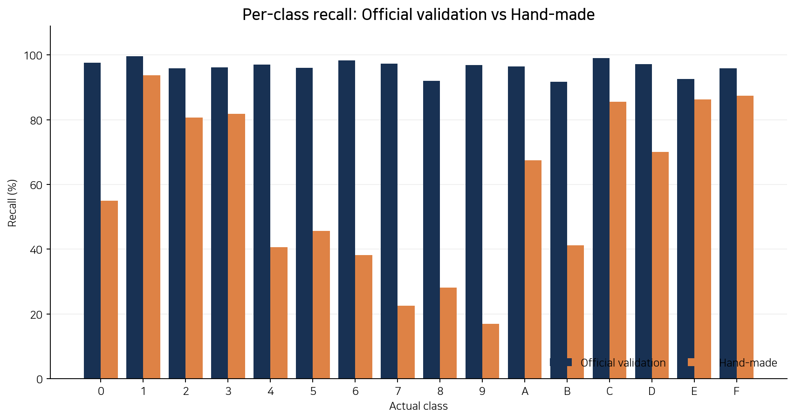
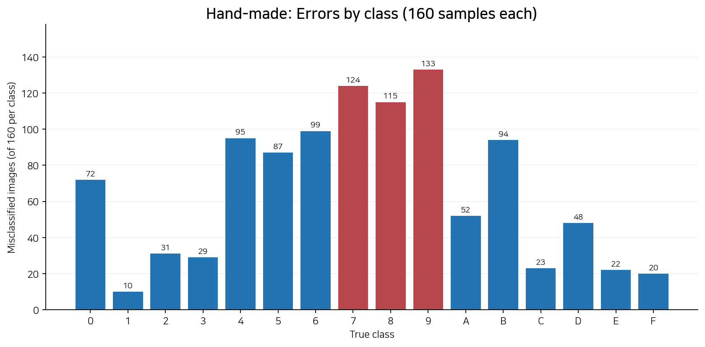
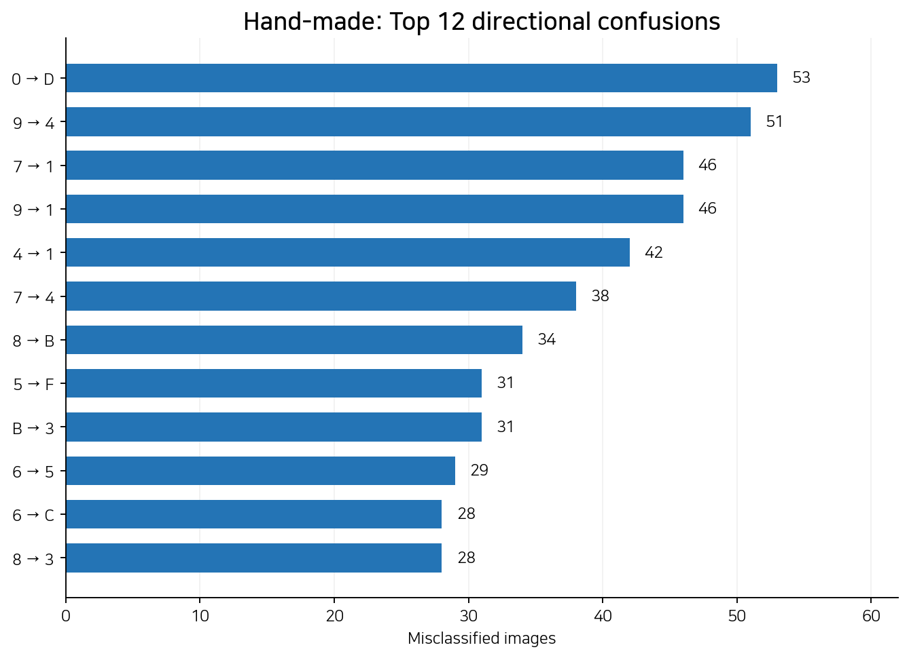

[EXP-002_KNN_Normal_Handmade_Baseline.md](https://github.com/user-attachments/files/35206999/EXP-002_KNN_Normal_Handmade_Baseline.md)
# EXP-002 | KNN Normal — Hand-made Baseline 성능 평가 및 오분류 진단

> **한 줄 목적:** EXP-001에서 재현한 KNN Normal Baseline 모델을 그대로 유지한 채, 팀원 4명의 Hand-made 데이터 2,560장에 평가하여 공식 Validation 대비 일반화 성능 차이와 주요 오분류를 진단한다.
>
> **한 줄 결론:** 공식 Validation Accuracy **96.2917%** 대비 Hand-made Accuracy **58.8281%**로 **37.4635%p** 낮았고, Hand-made Macro F1은 **0.566420**였다. 작성자별 정확도 차이가 크며, 특히 **0→D(53건), 9→4(51건), 7→1(46건)** 혼동이 뚜렷하다. 이는 **개선 전 기준점**이며 원인을 확정하거나 전처리 효과를 검증한 실험은 아니다.

| 항목 | 기록 |
|---|---|
| 실험 ID / 수행일 | **EXP-002 / 2026-11-21** (로컬 실행일은 해당 터미널 실행 기록 기준; 필요 시 수정) |
| 담당 | **[작성자 이름 입력]** |
| 모델 / 영역 | `KNeighborsClassifier` / **Normal** (공식 Training만 학습) |
| 실험 상태 | **완료 — Hand-made 개발용 평가** |
| 선행 실험 | [EXP-001 — Official Validation Baseline](EXP-001_KNN_Normal_Baseline.md) |
| 실행 코드 | `05_model_optimize/KNN/Normal/scripts/evaluate_handmade_baseline.py`, 기존 `03_experiments/model_optimization/common.py`, `knn.py` |
| 결과 위치 | [`../results/EXP002_handmade_baseline/`](../results/EXP002_handmade_baseline/) |
| 실험 근거 | [metrics.json](../results/EXP002_handmade_baseline/metrics.json), [by_writer.csv](../results/EXP002_handmade_baseline/by_writer.csv), [predictions.csv](../results/EXP002_handmade_baseline/predictions.csv), [confusion_matrix.csv](../results/EXP002_handmade_baseline/confusion_matrix.csv), [top_confusions.csv](../results/EXP002_handmade_baseline/top_confusions.csv) |

## 1. 문제 발견 및 원인 가설

### 1.1 선행 실험의 문제

EXP-001에서 공식 MNIST·EMNIST 기반 Validation **19,200장**에 대해 Accuracy **96.2917%**, Macro F1 **0.962791**를 재현했다. 그러나 공식 이미지에서의 높은 성능이 팀원이 직접 작성한 손글씨에서도 유지되는지는 확인되지 않았다. 따라서 모델·전처리·학습 데이터는 동일하게 유지하고 **평가 데이터만 Hand-made로 교체**해 기준 성능을 측정했다.

### 1.2 이번에 관찰된 문제 (측정 결과)

- Hand-made **2,560장** 중 정답 **1,506장**, 오답 **1,054장** → Accuracy **58.8281%**, Macro F1 **0.566420**.
- 공식 Validation과의 Accuracy 차이는 **37.4635%p**, Macro F1 차이는 **0.396371**.
- 작성자 중 **41번 45.16%**로 가장 낮고 **43번 66.09%**로 가장 높아 **20.9375%p** 차이 발생.
- 실제 문자 **9의 Recall 16.88%**, **7의 Recall 22.50%**, **8의 Recall 28.13%**로 특히 낮다.
- 방향별 오분류는 **0→D 53건**, **9→4 51건**, **7→1 46건**, **9→1 46건**, **4→1 42건**이 상위권이다.

### 1.3 설명 가능한 가설과 검증 상태

- **가설 A — 위치·크기 민감도:** KNN은 784차원 이미지의 픽셀 거리를 비교하므로, 중심 위치나 글자 크기가 공식 데이터와 다르면 같은 레이블이어도 거리가 커질 수 있다.
- **가설 B — 획·글씨체 차이:** 글자의 획 굵기, 기울기, 연결 형태 및 작성자별 스타일이 학습 이미지와 다르다면 최근접 이웃이 다른 클래스로 바뀔 수 있다.
- **가설 C — 예측 클래스 편향:** 특정 클래스(예: 1, 4, D)로 오류가 집중되는 현상은 이웃 선택의 편향 또는 픽셀 공간의 구조 때문일 수 있다.

**주의:** 위 가설은 집계된 오분류로부터 제기한 **가설**이다. 실제 오분류 이미지와 최근접 이웃을 직접 시각화·계량하지 않았으므로 인과관계를 확정하지 않는다. Hand-made는 향후 개선 선택에 활용할 **개발용 평가 세트**이며 독립적인 최종 Test가 아니다.

## 2. 수행 조건과 재현성

| 요소 | 실제 수행 조건 |
|---|---|
| 모델 | `sklearn.neighbors.KNeighborsClassifier` 기본 Baseline |
| Hyperparameter | `n_neighbors=5`, `weights='uniform'`, `metric='minkowski'`, `p=2` (Euclidean) |
| 이미지 처리 | 28×28 Grayscale → 784차원 float32 → **픽셀 /255** (기존 `pipeline`) |
| 학습 데이터 | 공식 Training 내부 첫 Fold의 **76,800장** (EXP-001과 동일 분할) |
| 분할 설정 | `StratifiedGroupKFold(n_splits=5, shuffle=True, random_state=42)` 첫 Fold |
| 공식 학습 데이터 SHA-256 | `0e9570d0eb04c0c1da99d043b85bfdab7f3b639eebe4b10335b05b57ad671879` |
| 평가 데이터 | 팀원 Hand-made 4명 × 640장 = **2,560장**, 클래스당 전체 **160장** |
| 작성자 구성 | ID 41·42·43·44, 각 640장(16개 클래스 × 클래스당 40장) |
| 학습에 Hand-made 사용 여부 | **사용하지 않음**. 공식 데이터로만 모델 학습 |
| 추가 증강·모델 최적화 | **실시하지 않음**. 기본 Baseline 설정 고정 |
| 공식 Original Test / 최종 Test | **사용하지 않음** |
| 실행 환경 | Python **3.12.14**, NumPy **2.5.3**, scikit-learn **1.9.1** |
| 학습 시간 | **0.1653초** |
| Hand-made 예측 시간 | **3.7994초** (2,560장 합계) |

**Hand-made 원본 무결성 검증** — 스크립트에서 파일별 SHA-256 및 이미지·라벨 구성 검사를 수행함:

| 작성자 | SHA-256 |
|---|---|
| 41 | `0a829172a72787c770139c73de34cc8b751181829ff6fe08ec260247b9be5a2f` |
| 42 | `f364fb453d05b4fe2a705c2b8a80683b404608c7c257d664e3ec7ac86932d4c5` |
| 43 | `10db20997c727c1bc1f1299f8e89626fadd3ec9618468d6759c86b0d2ddc4a66` |
| 44 | `0e266a36e7b29edfcca0514836b5c383d13939948b4e335d70f61bb40bdc084d` |

**실행 명령 (저장소 루트 기준):**

```bash
python 05_model_optimize/KNN/Normal/scripts/evaluate_handmade_baseline.py
```

**실행 절차:** (1) 공식 Training/Validation 첫 Fold를 재현 → (2) 공식 Training **76,800장으로 KNN 학습** → (3) 작성자별 Hand-made NPZ 로딩과 SHA·형상·레이블 검사 → (4) 각 640장 예측 → (5) 개별 예측, 작성자별 성능, 전체 Confusion Matrix 및 주요 혼동 저장.

**재현성 검증:** 업로드된 `predictions.csv` 2,560개 행으로 Confusion Matrix를 재계산한 결과 `confusion_matrix.csv` 및 `metrics.json`과 **모든 16×16 셀이 일치**했다. 작성자별 정답 수도 `by_writer.csv`와 일치했다. 데이터 합계는 2,560장(정답 1,506 / 오답 1,054장)으로 검증했다.

## 3. 공식 Validation 대비 성능 분석



**그림 1.** 평가 데이터만 달리한 KNN Normal Baseline의 Accuracy 비교. 공식 Validation 19,200장과 Hand-made 2,560장은 **데이터 출처 및 구성 자체가 다르므로** 성능 하락을 관찰하는 비교이지 완전히 통제된 데이터 분포 실험은 아니다.

| 지표 | EXP-001 공식 Validation | EXP-002 Hand-made | 차이 (Hand-made − 공식) |
|---|---:|---:|---:|
| 평가 수 | 19,200 | 2,560 | 평가 구성 다름 |
| Accuracy | **96.2917%** | **58.8281%** | **-37.4635%p** |
| Macro Precision | 0.963611 | 0.596449 | -0.367163 |
| Macro Recall | 0.962594 | 0.588281 | -0.374313 |
| Macro F1 | **0.962791** | **0.566420** | **-0.396371** |

**해석:** 공식 Validation에서 높은 성능을 보인 동일 모델이 Hand-made에서는 정확도가 약 37.46%p 낮았다. 이는 **실제 작성 손글씨에 대한 분포 차이 또는 난이도 차이**가 크다는 근거다. 다만 특정 픽셀 특성이나 전처리 하나가 하락 원인이라고는 말할 수 없다.

## 4. 작성자별 성능 차이



**그림 2.** 동일 모델을 작성자별 640장에 적용한 결과. Macro F1은 보기 쉽게 100을 곱한 축으로 함께 표시했다.

| 작성자 | 정답 / 640장 | Accuracy | Macro F1 |
|---|---:|---:|---:|
| 41 | 289 / 640 | 45.16% | 0.419997 |
| 42 | 381 / 640 | 59.53% | 0.573349 |
| 43 | 423 / 640 | 66.09% | 0.621437 |
| 44 | 413 / 640 | 64.53% | 0.618744 |
| **전체** | **1,506 / 2,560** | **58.8281%** | **0.566420** |

- Writer **41**은 **45.16%**로 가장 낮았고, Writer **43**은 **66.09%**로 가장 높다.
- 네 작성자 모두 동일한 클래스 구성(클래스당 40장)을 사용했지만 정확도 차이가 발생했다. **글씨체·전처리 과정의 차이 여부는 원본 이미지 확인 전까지 미확정**이다.
- 전체 Macro F1은 작성자별 Macro F1의 단순 평균과 같지 않다. 전체 2,560장의 예측을 합쳐 계산한 값 **0.566420**을 사용한다.



**그림 3.** 각 작성자에서 발생한 가장 빈번한 단방향 오분류. 작성자 41: **7→1 25건**, 42: **9→4 16건**, 43: **0→D 26건**. 작성자 44는 **0→D, 9→4, B→D가 각각 14건으로 공동 최다**이며, 그래프에는 그중 0→D를 대표로 표시했다. 모든 작성자가 같은 유형의 오류를 가장 많이 내는 것은 아니다.

## 5. 전체 Hand-made Confusion Matrix 및 클래스별 분석

### 5.1 16×16 Confusion Matrix — 절대 건수



**그림 4.** 실제 클래스(행)와 예측 클래스(열)의 관계. 대각선은 정분류이고, 대각선 밖은 **12건 이상**인 주요 혼동만 숫자를 강조했다. 전체 **2,560장 / 정답 1,506장 / 오답 1,054장**.

### 5.2 실제 클래스 기준 정규화 Confusion Matrix



**그림 5.** 각 행을 100%로 변환한 결과. 모든 실제 클래스는 160장으로 구성된다. 대각선 값은 클래스별 Recall과 같다. 대각선 밖은 **4% 이상**인 혼동 방향을 강조했다.

### 5.3 Precision·Recall·F1 및 공식 데이터와의 비교





**그림 6–7.** Hand-made에서는 `9`의 Recall이 **16.88%**, `7` **22.50%**, `8` **28.13%**로 특히 낮다. 반면 `1`의 Recall은 **93.75%**이나 Precision은 **44.78%**여서, 실제로 다른 글자를 `1`로 예측하는 오분류가 상당하다는 점을 확인할 수 있다.

| 클래스 | Support | 정답 | Precision | Recall | F1 | 공식 Validation Recall |
|---|---:|---:|---:|---:|---:|---:|
| 0 | 160 | 88 | 57.89% | 55.00% | 56.41% | 97.64% |
| 1 | 160 | 150 | 44.78% | 93.75% | 60.61% | 99.63% |
| 2 | 160 | 129 | 83.77% | 80.62% | 82.17% | 95.89% |
| 3 | 160 | 131 | 65.83% | 81.88% | 72.98% | 96.17% |
| 4 | 160 | 65 | 34.03% | 40.62% | 37.04% | 97.09% |
| 5 | 160 | 73 | 55.73% | 45.62% | 50.17% | 96.03% |
| 6 | 160 | 61 | 70.11% | 38.12% | 49.39% | 98.31% |
| 7 | 160 | 36 | 46.15% | 22.50% | 30.25% | 97.29% |
| 8 | 160 | 45 | 72.58% | 28.12% | 40.54% | 92.05% |
| 9 | 160 | 27 | 42.19% | 16.88% | 24.11% | 96.97% |
| A | 160 | 108 | 77.70% | 67.50% | 72.24% | 96.42% |
| B | 160 | 66 | 55.00% | 41.25% | 47.14% | 91.75% |
| C | 160 | 137 | 67.49% | 85.62% | 75.48% | 99.08% |
| D | 160 | 112 | 54.11% | 70.00% | 61.04% | 97.25% |
| E | 160 | 138 | 64.19% | 86.25% | 73.60% | 92.67% |
| F | 160 | 140 | 62.78% | 87.50% | 73.11% | 95.92% |



**그림 8.** 클래스마다 160장이므로 오분류 건수와 Recall은 직접 대응한다. 특히 `9`: **133건 오분류**, `7`: **124건**, `8`: **115건**이다.

### 5.4 오분류 쌍 TOP 12



**그림 9.** Confusion Matrix 대각선 밖에서 발생 횟수가 많은 단방향 오분류를 정렬했다.

| 실제 → 예측 | 오분류 건수 |
|---|---:|
| 0 → D | 53 |
| 9 → 4 | 51 |
| 7 → 1 | 46 |
| 9 → 1 | 46 |
| 4 → 1 | 42 |
| 7 → 4 | 38 |
| 8 → B | 34 |
| 5 → F | 31 |
| B → 3 | 31 |
| 6 → 5 | 29 |
| 6 → C | 28 |
| 8 → 3 | 28 |

**공식 Validation과 비교할 때 중요한 변화** (서로 표본 수가 다르므로 **해당 실제 클래스 내 비율**로 비교):

| 혼동 방향 | 공식 Validation | Hand-made | 비고 |
|---|---:|---:|---|
| 0 → D | 17/1185 = 1.43% | 53/160 = 33.13% | Hand-made에 크게 집중 |
| 9 → 4 | 9/1190 = 0.76% | 51/160 = 31.88% | Hand-made에 크게 집중 |
| 7 → 1 | 13/1253 = 1.04% | 46/160 = 28.75% | Hand-made에 크게 집중 |
| 8 → B | 6/1170 = 0.51% | 34/160 = 21.25% | 숫자·문자 혼동 증가 |

공식 Validation에서 특히 빈번했던 **E→C**나 **B→D**에 비해 Hand-made에서는 **숫자 0·9·7·8의 혼동**이 더욱 핵심적인 문제가 된다. 이는 모델을 개선할 때 **정확도 전체 평균만 볼 것이 아니라 취약 클래스와 작성자별 성능을 함께 측정해야 함**을 보여준다.

## 6. 해석 및 후속 실험 계획

### 6.1 확인된 사실

- EXP-001과 **동일 모델 설정 및 학습 분할**로 Hand-made 개발용 평가 2,560장을 수행했다.
- 공식 Validation **96.2917%** 대비 Hand-made **58.8281%**, 차이 **−37.4635%p**를 확인했다.
- Hand-made Macro F1은 **0.566420**, 작성자별 Accuracy는 **45.16~66.09%**였다.
- 주요 혼동: **0→D, 9→4, 7→1, 9→1, 4→1**이며 특히 `9`, `7`, `8`의 Recall이 낮았다.
- 예측별·작성자별·혼동행렬 파일의 집계가 서로 일치했다.

### 6.2 이번 실험에서 주장하지 않는 내용

- 위치·크기·획 굵기가 실제 오류의 **원인으로 확정**되었다는 주장.
- CoM·BB 정렬, 이미지 증강, k값 변경 등으로 **성능이 개선되었다**는 주장.
- Training Set 또는 최종 Test에 대한 새 평가 결과.
- `predictions.csv`의 레코드만으로 **실제 손글씨 모양을 육안 확인했다**는 주장. 시각적인 원본 사례를 만들려면 원본 NPZ와 이미지 인덱스 연결이 필요하다.

### 6.3 후속 실험 (새 로그로 분리)

1. **EXP-003 — 오분류 샘플/최근접 이웃 시각화:** `predictions.csv`의 writer·index를 Hand-made 원본과 연결하여 `0→D`, `9→4`, `7→1`, `8→B`의 실제 이미지 및 최근접 이웃 5개를 비교하고 원인을 검증한다.
2. **EXP-004 — 이미지 중심·크기 정규화 비교:** EXP-003 근거를 바탕으로 CoM/BB 등 전처리를 한 번에 하나씩 적용하고 같은 데이터 분할로 공식 Validation·Hand-made를 평가한다.
3. 이후 크기·획 증강, `n_neighbors`, `weights`, 거리 지표를 단계별로 검증한다. **Hand-made는 모델 선택에 쓰는 개발용 평가이므로 최종 Test를 대신하지 않는다.**

**결론 및 판정:** EXP-002는 Baseline을 바꾸지 않고 실제 손글씨에서의 **성능 격차와 오류 구조를 정량화한 진단 실험으로 완료**했다. 개선 효과 판정은 **미실시**, 가설은 **검증 대기**다.

## 7. 산출물 및 데이터 출처

- [metrics.json](../results/EXP002_handmade_baseline/metrics.json) — Accuracy, Macro F1, 클래스별 지표, 환경, 원본 해시, Confusion Matrix
- [by_writer.csv](../results/EXP002_handmade_baseline/by_writer.csv) — 작성자별 Accuracy·Macro F1
- [predictions.csv](../results/EXP002_handmade_baseline/predictions.csv) — 2,560개 개별 예측: `writer`, `index`, `true`, `predicted`, `correct`
- [confusion_matrix.csv](../results/EXP002_handmade_baseline/confusion_matrix.csv) — 16×16 Confusion Matrix
- [top_confusions.csv](../results/EXP002_handmade_baseline/top_confusions.csv) — 오분류 방향별 빈도
- [figures/](../results/EXP002_handmade_baseline/figures/) — 위 실측 데이터로 생성한 그림 9개. **추가 모델 훈련 결과가 아님**
- [선행 EXP-001](EXP-001_KNN_Normal_Baseline.md) — 공식 Validation 지표와 실험 기준

> **재현성 메모:** 그림·표는 업로드된 집계 파일과 개별 예측 2,560건으로 계산했다. 추론 시간은 실험 PC·스레드·라이브러리에 따라 달라질 수 있으므로 다른 환경과 직접 성능 비교하지 않는다. 이번 결과는 **최적화 전 Hand-made Baseline으로 보존**한다.
