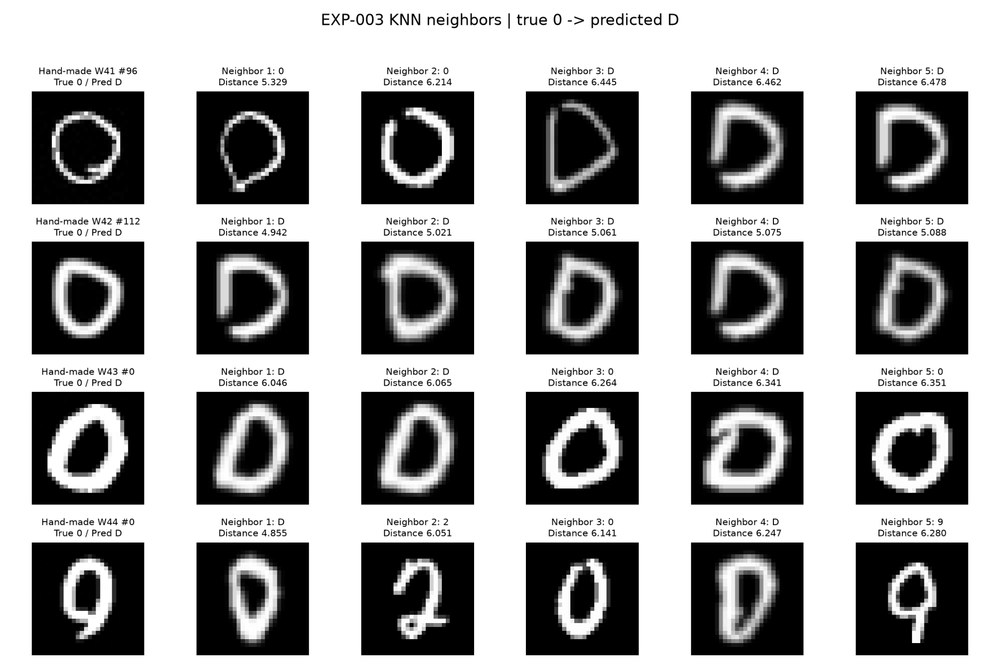
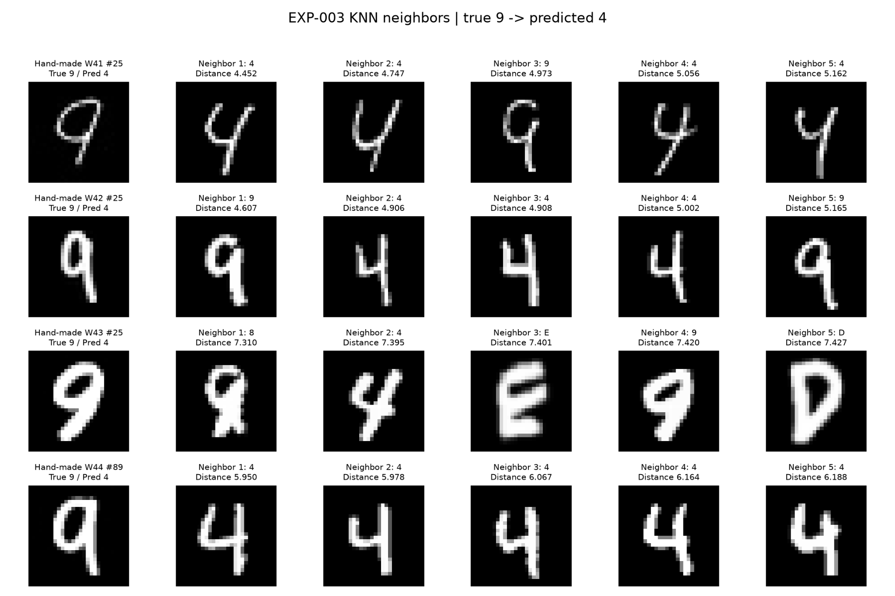
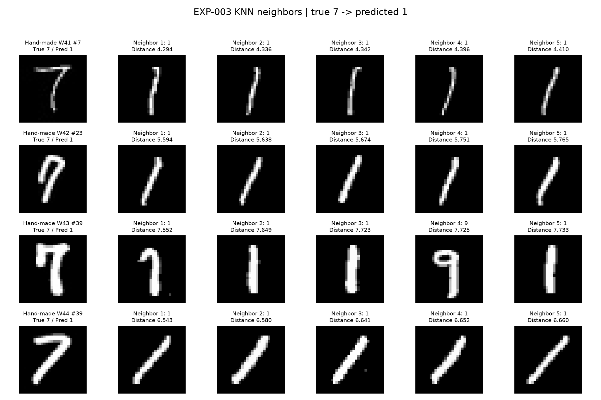
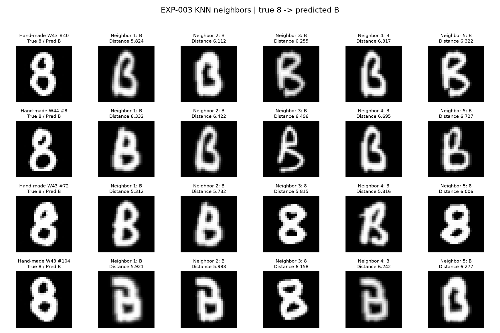
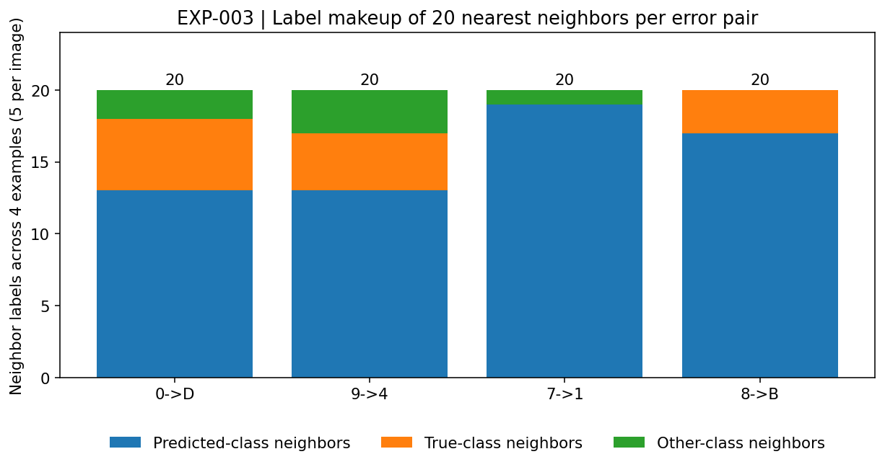
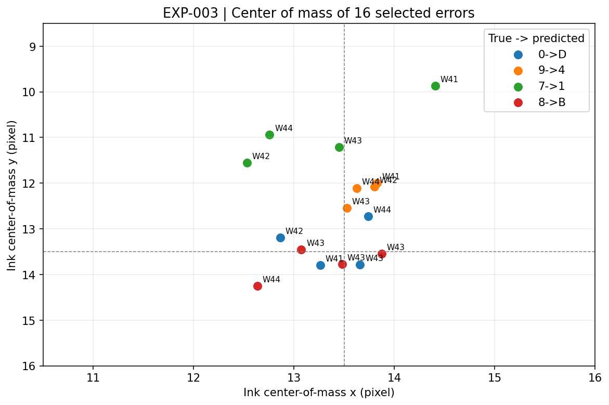

# EXP-003 | KNN Normal — Hand-made 오분류 이미지 및 최근접 이웃 분석

> **한 줄 목적:** EXP-002에서 빈번한 손글씨 오분류 방향 4개를 선정하고, 실제 입력 이미지와 KNN이 선택한 최근접 학습 이미지 5개를 비교하여 오류 발생 양상을 관찰한다.
>
> **한 줄 결론:** 선택된 16개 오류 사례의 최근접 이웃 80개 가운데 **예측 클래스가 62개**, 실제 정답 클래스가 **12개**, 기타 클래스가 **6개**였다. 특히 `7→1`은 20개 이웃 중 **19개가 1, 0개가 7**로 분류되는 사례였다. 형태·획 특징이 거리 기반 이웃 선택에 영향을 줄 가능성이 관찰되지만, 16개는 의도적으로 선택한 사례이므로 **전체 손글씨 오류의 원인을 인과적으로 증명하지는 못한다**.

| 항목 | 내용 |
|---|---|
| 실험 ID / 수행일 | **EXP-003 / 2026-11-21** |
| 담당 | **[작성자 입력]** |
| 모델 | KNN Normal Baseline (`k=5`, uniform, Euclidean) |
| 선행 실험 | [EXP-001 공식 Validation Baseline](EXP-001_KNN_Normal_Baseline.md), [EXP-002 Hand-made Baseline](EXP-002_KNN_Normal_Handmade_Baseline.md) |
| 실행 코드 | `05_model_optimize/KNN/Normal/scripts/analyze_knn_neighbors.py` (스크립트도 별도 GitHub 등록 권장) |
| 결과 위치 | [results/EXP003_error_neighbors](../results/EXP003_error_neighbors/) |
| 근거 파일 | [selected_cases.csv](../results/EXP003_error_neighbors/selected_cases.csv), [nearest_neighbors.csv](../results/EXP003_error_neighbors/nearest_neighbors.csv), [summary.json](../results/EXP003_error_neighbors/summary.json) |
| 실험 성격 | **오분류 원인 탐색 / 모델 개선 미실시** |

## 1. 문제 발견 및 원인 가설

### 1.1 선행 실험에서 관찰한 문제

- EXP-001 공식 Validation: **Accuracy 96.2917% / Macro F1 0.962791**.
- EXP-002 Hand-made 2,560장: **Accuracy 58.8281% / Macro F1 0.566420**.
- 두 평가 데이터의 정확도 차이는 **37.4635%p**.
- EXP-002에서 주요 혼동 방향: **0→D 53건, 9→4 51건, 7→1 46건, 8→B 34건**.

**이번 질문:** KNN이 실제 손글씨를 잘못 분류할 때, 가장 가까운 학습 이미지가 어떻게 생겼고 어느 클래스에 속해 있는가?

### 1.2 원인 가설

- **가설 A — 형태·획 유사성:** 외곽선과 내부 획이 비슷한 문자쌍(0/D, 8/B, 9/4, 7/1)은 784차원 픽셀 거리상 서로 가까워질 수 있다.
- **가설 B — 위치 차이:** 글씨가 28×28 이미지 내 위아래로 치우치면 같은 클래스의 표준 학습 샘플보다 다른 클래스와 가까워질 수 있다.
- **가설 C — 최근접 이웃의 레이블 구성:** 올바른 클래스가 가장 가까운 이웃에 일부 존재하더라도 `k=5`의 균일 다수결에서 다른 클래스가 더 많으면 오분류될 수 있다.

위 사항은 **검증 대상 가설**로서, 일부 시각화 사례만으로 전반적 원인을 단정하지 않는다.

## 2. 실제 수행 조건과 재현성

| 항목 | 조건 |
|---|---|
| 학습 데이터 | EXP-001·002와 동일한 공식 Training 분할 **76,800장** |
| 학습 분할 | StratifiedGroupKFold(n_splits=5, shuffle=True, random_state=42) 첫 Fold |
| 모델 / 거리 | `KNeighborsClassifier(n_neighbors=5, weights='uniform', metric='minkowski', p=2)` |
| 입력 | 28×28 → 784차원, 픽셀값 `/255`; 추가 정렬·증강·학습 데이터 보강 없음 |
| 분석 대상 | EXP-002 Hand-made 오류 중 **4개 방향 × 4개 사례 = 16개 이미지** |
| 이웃 분석 | 이미지당 학습 샘플 **최근접 이웃 5개** → 총 **80개 이웃** |
| 거리 값 | `/255` 스케일을 적용한 784차원 이미지의 **Euclidean 거리** |
| 대표 사례 선정 | 오류를 설명하기 위한 선택 사례; **무작위·대표성 표본 아님** |
| 기존 성능 | Hand-made Accuracy 58.8281% / Macro F1 0.566420 (**변경 없음**) |
| 제외 | 공식 Original Test 및 최종 Test 사용 안 함, Hand-made 학습 사용 안 함 |

`summary.json`은 입력 Baseline, 대상 오류 방향, 샘플 수, 분석 제한을 기록한다. `selected_cases.csv`는 샘플별 작성자·인덱스·예측·중심좌표·이웃 투표를, `nearest_neighbors.csv`는 개별 이웃의 순위·학습 인덱스·레이블·거리를 기록한다.

## 3. 시각 분석 — 실제 오분류 이미지와 학습 이웃

각 그림에서 왼쪽 열은 **실제 Hand-made 이미지**이고, 오른쪽 5열은 KNN이 선택한 **최근접 공식 학습 이미지**다. 제목의 `True`는 정답이고 `Pred`는 예측 결과다. `Distance`가 낮을수록 모델의 픽셀 거리 공간에서 가깝다.

### 3.1 실제 0 → 예측 D

**관찰:** 동그란 폐곡선 또는 길쭉한 타원 형태의 손글씨 `0`이 일부 `D` 학습 샘플과 가깝게 대응했다. 특히 W42 사례는 최근접 이웃 5개가 모두 `D`였고, W41·W43은 정답 `0` 이웃이 각각 2개씩 존재했지만 `D`가 3개여서 오분류했다. 이는 **일부 정답 이웃이 존재해도 다수결로 오분류할 수 있음**을 직접 보여준다. 특정 문자 획이 실제로 원인인지는 추가 비교가 필요하다.

### 3.2 실제 9 → 예측 4

**관찰:** `9`의 고리와 내려오는 획 형태가 `4`의 위쪽 연결 획과 시각적으로 일부 유사한 사례가 보인다. W41·W44에서는 `4` 이웃이 각각 4개·5개였으며, W43은 5개 이웃의 레이블이 모두 달랐다(`8/4/E/9/D`). **W43은 동률 상황에서 `4`가 예측된 사례**이므로, 모든 사례가 단순 과반수 때문이라고 해석해서는 안 된다.

### 3.3 실제 7 → 예측 1

**관찰:** 4개 사례 모두 최근접 이웃 5개 중 **4~5개가 `1`**이었고 정답 `7`은 한 개도 없었다. 일부 손글씨 `7`은 길게 내려오는 단일 획이 두드러졌으며, 학습 이웃 `1`들은 세로획 위주 형태가 많았다. 선택된 `7→1` 사례의 중심 y좌표는 **9.872~11.551**로 이미지 세로 중앙(13.5)보다 위쪽에 위치했다. 다만 이것만으로 **위치 이동이 오분류의 원인임을 증명하지는 못한다**.

### 3.4 실제 8 → 예측 B

**관찰:** 위·아래 고리의 배치가 비슷해 선택된 `8` 이미지가 `B` 이웃과 가까운 사례가 확인된다. W43 #40과 W44 #8은 최근접 5개 모두 `B`였다. 다른 두 사례에서는 `8` 이웃이 1~2개 포함되었지만 `B`가 더 많아 오분류했다. 외곽 형태뿐 아니라 고리의 연결 위치·획 두께를 후속 시각 분석 대상으로 삼을 수 있다.

## 4. 정량 요약 및 추가 시각화

### 4.1 최근접 이웃 레이블 구성

선택된 오류 방향별 **4개 사례 × 5개 이웃 = 20개 이웃**의 레이블 구성을 아래에 정리했다.

| 실제 → 예측 | 예측 레이블 이웃 | 정답 레이블 이웃 | 기타 레이블 이웃 | 1순위가 예측 레이블인 사례 |
|---|---:|---:|---:|---:|
| 0->D | 13 | 5 | 2 | 3 / 4 |
| 9->4 | 13 | 4 | 3 | 2 / 4 |
| 7->1 | 19 | 0 | 1 | 4 / 4 |
| 8->B | 17 | 3 | 0 | 4 / 4 |

- 전체 80개 이웃 중 예측 레이블 **62개**, 정답 레이블 **12개**, 기타 **6개**.
- 이는 **이미 틀린 사례만 의도적으로 선택한 결과**다. 따라서 전체 Hand-made 예측에 대한 이웃 레이블 분포를 대표하지 않는다.
- `weights='uniform'`이므로 표에 표시된 이웃 거리 값은 분류 다수결의 **가중치로 직접 사용하지 않는다**. 거리 값은 이웃을 선택하고 순위를 정할 때 사용한다.

### 4.2 선택된 손글씨의 중심좌표

그림은 16개 선택 사례의 획 중심좌표(`com_x`, `com_y`)를 나타낸다. 점선은 28×28 이미지의 중앙인 **(13.5, 13.5)**이다. 이 데이터에서 `7→1` 사례는 다른 세 방향보다 y좌표가 작은 경향을 보였지만, **동일한 작성자의 올바르게 분류된 `7`이나 학습 이미지와 비교하지 않았기 때문에 효과 크기·유의성·인과관계는 미확정**이다.

### 4.3 개별 사례별 이웃 투표 기록

| 사례 ID | 최근접 이웃 레이블(1~5위) | 투표 수 | 획 중심(x, y) |
|---|---|---|---|
| 0_to_D_W41_096 | 0/0/D/D/D | 0:2/D:3 | (13.26, 13.80) |
| 0_to_D_W42_112 | D/D/D/D/D | D:5 | (12.86, 13.20) |
| 0_to_D_W43_000 | D/D/0/D/0 | 0:2/D:3 | (13.66, 13.79) |
| 0_to_D_W44_000 | D/2/0/D/9 | 0:1/2:1/9:1/D:2 | (13.74, 12.72) |
| 9_to_4_W41_025 | 4/4/9/4/4 | 4:4/9:1 | (13.83, 12.00) |
| 9_to_4_W42_025 | 9/4/4/4/9 | 4:3/9:2 | (13.80, 12.08) |
| 9_to_4_W43_025 | 8/4/E/9/D | 4:1/8:1/9:1/D:1/E:1 | (13.53, 12.55) |
| 9_to_4_W44_089 | 4/4/4/4/4 | 4:5 | (13.62, 12.11) |
| 7_to_1_W41_007 | 1/1/1/1/1 | 1:5 | (14.41, 9.87) |
| 7_to_1_W42_023 | 1/1/1/1/1 | 1:5 | (12.53, 11.55) |
| 7_to_1_W43_039 | 1/1/1/9/1 | 1:4/9:1 | (13.45, 11.21) |
| 7_to_1_W44_039 | 1/1/1/1/1 | 1:5 | (12.76, 10.94) |
| 8_to_B_W43_040 | B/B/B/B/B | B:5 | (13.07, 13.46) |
| 8_to_B_W44_008 | B/B/B/B/B | B:5 | (12.64, 14.25) |
| 8_to_B_W43_072 | B/B/8/B/8 | 8:2/B:3 | (13.88, 13.55) |
| 8_to_B_W43_104 | B/B/8/B/B | 8:1/B:4 | (13.48, 13.78) |

- 근거 원본: [nearest_neighbors.csv](../results/EXP003_error_neighbors/nearest_neighbors.csv) (총 **80행**) / [selected_cases.csv](../results/EXP003_error_neighbors/selected_cases.csv) (총 **16행**).
- 선정한 16개 모두 EXP-002에서 **오분류로 확인된 사례**다.

## 5. 판단, 한계, 다음 실험

### 5.1 확인된 사실

1. 선택된 **16개 오분류**에 대해 각각 최근접 학습 이미지 5개를 직접 확인했다.
2. 다수의 사례에서 **예측 클래스가 이웃 5개 중 우세**했다. 특히 `7→1`은 4개 사례 중 3개에서 이웃 5개 모두 `1`, 나머지 1개에서도 `1`이 4개였다.
3. `9→4` W43의 경우에는 **다섯 이웃의 레이블이 서로 다른 동률 사례**가 관찰됐다.
4. 이미지에서는 `0/D`, `8/B`, `9/4`, `7/1` 간 형태의 유사점이 일부 확인되었다.
5. **모델 변경 및 개선 실험은 수행하지 않았다.** 평가 성능은 EXP-002 Baseline과 동일하다.

### 5.2 확인되지 않은 사항

- 이미지 위치를 보정하면 실제로 오분류가 얼마나 줄어드는지.
- 크기·획 두께 또는 기울기 중 어떤 요소가 가장 큰 영향을 주는지.
- 16개 사례에서 관찰한 현상이 전체 Hand-made 오분류 **1,054건**에 적용되는지.
- 중심 정렬이 다른 정상 분류 이미지에 악영향을 주는지.

### 5.3 다음 EXP-004에서 검증할 가설

**첫 검증 가설:** 이미지의 중심 위치 차이가 손글씨 KNN 인식률 저하에 일부 영향을 준다면, **질량중심(CoM) 정렬**을 학습·평가 이미지에 동일하게 적용했을 때 Hand-made 정확도 또는 취약 클래스 Recall이 개선될 수 있다.

- 기존 Baseline(k=5, uniform, Euclidean)과 데이터 분할을 유지하고 **전처리만 변경**한다.
- 공식 Validation과 Hand-made를 **둘 다 평가**해 한쪽 개선으로 다른 쪽이 크게 악화되지 않는지 확인한다.
- 전체 정확도·Macro F1뿐 아니라 `0→D`, `7→1`, `8→B`, `9→4` 등 관심 오류와 작성자별 차이를 함께 비교한다.
- **개선이 없거나 악화하면 가설을 보류**하고, BB 크기 정규화·획 증강·거리 지표를 후속 비교 대상으로 검토한다.
- 개발용 Hand-made에 반복적으로 맞추는 것은 과적합 위험이 있으므로 공식 Original Test 및 별도 최종 Test는 모델 선택에 사용하지 않는다.

**최종 판단:** EXP-003은 **오분류 사례와 KNN 이웃 선택의 실제 양상을 확인하는 탐색적 분석**으로 완료한다. 정렬·증강·하이퍼파라미터 변경의 효과는 아직 측정하지 않았다.
