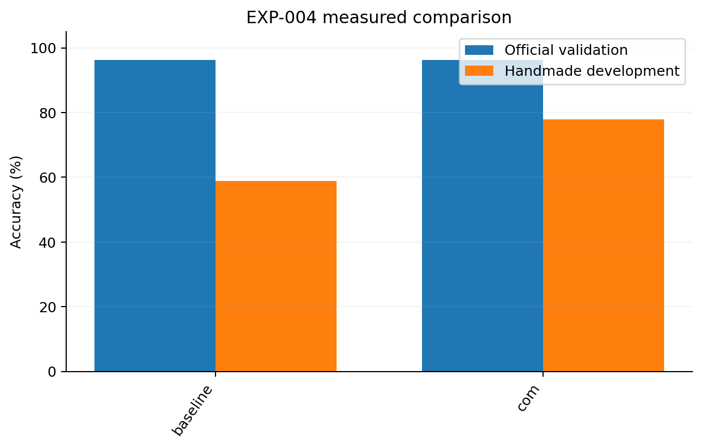

# EXP-004 | KNN Normal — CoM 중심 정렬

> **실험 목적:** 위치 편차를 줄이면 픽셀 기반 KNN이 개선되는가?
> **핵심 결론:** Hand-made +19.02%p, 공식 −0.09%p. CoM을 채택하고 추가 분석 진행.

| 항목 | 내용 |
|---|---|
| ID / 날짜 | EXP-004 / 2026-11-21 |
| 구분 | KNN Normal, 개발용 실험 |
| 실험 코드 | [`EXP004_KNN_Normal_CoM.py`](../scripts/EXP004_KNN_Normal_CoM.py) |
| 결과 폴더 | [`EXP004_com_centering`](../results/EXP004_com_centering/) |

## 1. 문제 및 가설

위치 편차를 줄이면 픽셀 기반 KNN이 개선되는가?

## 2. 데이터·실험 조건

Training 76,800 / Validation 19,200; Hand-made development 2,560 (writers 41–44). Original Test 미사용.

- 모든 파생 학습 이미지는 공식 Training에서만 생성하며 Validation 및 Hand-made는 학습에 직접 포함하지 않는다.
- 결과의 공식 Validation / Hand-made는 개발 중 반복 비교된 수치이며 별도 독립 Test 결과가 아니다.
- 아래 수치는 실행 로그를 전사한 기록이며, EXP-005~015의 원본 전체 CSV·개별 예측 파일은 사용자 PC에 보관되어 있다.


## 3. 실측 결과

| 조건 | 공식 Validation Accuracy | Hand-made Accuracy | Hand-made Macro F1 |
|---|---:|---:|---:|
| `baseline` | 96.2917% | 58.8281% | 0.566420 |
| `com` | 96.1979% | 77.8516% | 0.776486 |



**선정 후보:** `com` — 공식 96.1979%, Hand-made 77.8516%, Hand-made Macro F1 0.776486.

## 4. 해석 및 채택 판단

Hand-made +19.02%p, 공식 −0.09%p. CoM을 채택하고 추가 분석 진행.

## 5. 재현 및 원본 보존

```bat
python 05_model_optimize/KNN/Normal/scripts/EXP004_KNN_Normal_CoM.py
```

- 콘솔 전사 지표: [`console_metrics_transcribed.csv`](../results/EXP004_com_centering/console_metrics_transcribed.csv)
- 비교 그래프: [`comparison.png`](../results/EXP004_com_centering/comparison.png)
- **추가 첨부 필요:** 사용자 PC의 같은 `results/` 폴더에 생성된 `metrics.json`, `candidate_results.csv`, `by_writer.csv`, `per_class_handmade.csv`, 예측 CSV, 혼동행렬 CSV 등(해당 실험에서 실제 생성된 것만).
- 본 패키지는 전달받지 못한 세부 결과를 합성하지 않았다.
