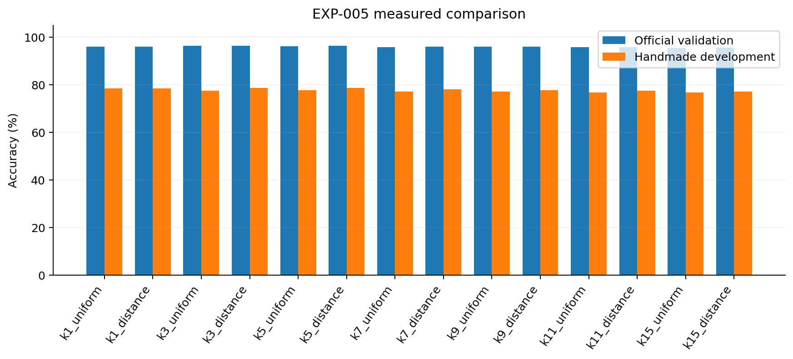

# EXP-005 | KNN Normal — k 및 가중치 탐색

> **실험 목적:** CoM을 유지한 상태에서 투표 방식만 변경하면 개선되는가?
> **핵심 결론:** k=3 distance가 Hand-made F1과 공식 정확도에서 유리하여 채택.

| 항목 | 내용 |
|---|---|
| ID / 날짜 | EXP-005 / 2026-11-21 |
| 구분 | KNN Normal, 개발용 실험 |
| 실험 코드 | [`EXP005_KNN_Normal_K_Weights_fixed.py`](../scripts/EXP005_KNN_Normal_K_Weights_fixed.py) |
| 결과 폴더 | [`EXP005_k_weights`](../results/EXP005_k_weights/) |

## 1. 문제 및 가설

CoM을 유지한 상태에서 투표 방식만 변경하면 개선되는가?

## 2. 데이터·실험 조건

Training 76,800 / Validation 19,200; Hand-made development 2,560 (writers 41–44). Original Test 미사용.

- 모든 파생 학습 이미지는 공식 Training에서만 생성하며 Validation 및 Hand-made는 학습에 직접 포함하지 않는다.
- 결과의 공식 Validation / Hand-made는 개발 중 반복 비교된 수치이며 별도 독립 Test 결과가 아니다.
- 아래 수치는 실행 로그를 전사한 기록이며, EXP-005~015의 원본 전체 CSV·개별 예측 파일은 사용자 PC에 보관되어 있다.


## 3. 실측 결과

| 조건 | 공식 Validation Accuracy | Hand-made Accuracy | Hand-made Macro F1 |
|---|---:|---:|---:|
| `k1_uniform` | 96.0156% | 78.5937% | 0.784626 |
| `k1_distance` | 96.0156% | 78.5937% | 0.784626 |
| `k3_uniform` | 96.3698% | 77.5000% | 0.773296 |
| `k3_distance` | 96.5052% | 78.7891% | 0.786540 |
| `k5_uniform` | 96.1979% | 77.8516% | 0.776486 |
| `k5_distance` | 96.3437% | 78.7891% | 0.786211 |
| `k7_uniform` | 95.9375% | 77.2266% | 0.769675 |
| `k7_distance` | 96.1198% | 78.0859% | 0.779157 |
| `k9_uniform` | 95.9583% | 77.1875% | 0.768907 |
| `k9_distance` | 95.9948% | 77.8125% | 0.775799 |
| `k11_uniform` | 95.8177% | 76.8750% | 0.765990 |
| `k11_distance` | 95.9063% | 77.5391% | 0.772967 |
| `k15_uniform` | 95.5260% | 76.7578% | 0.765477 |
| `k15_distance` | 95.6823% | 77.2266% | 0.769980 |



**선정 후보:** `k3_distance` — 공식 96.5052%, Hand-made 78.7891%, Hand-made Macro F1 0.786540.

## 4. 해석 및 채택 판단

k=3 distance가 Hand-made F1과 공식 정확도에서 유리하여 채택.

## 5. 재현 및 원본 보존

```bat
python 05_model_optimize/KNN/Normal/scripts/EXP005_KNN_Normal_K_Weights_fixed.py
```

- 콘솔 전사 지표: [`console_metrics_transcribed.csv`](../results/EXP005_k_weights/console_metrics_transcribed.csv)
- 비교 그래프: [`comparison.png`](../results/EXP005_k_weights/comparison.png)
- **추가 첨부 필요:** 사용자 PC의 같은 `results/` 폴더에 생성된 `metrics.json`, `candidate_results.csv`, `by_writer.csv`, `per_class_handmade.csv`, 예측 CSV, 혼동행렬 CSV 등(해당 실험에서 실제 생성된 것만).
- 본 패키지는 전달받지 못한 세부 결과를 합성하지 않았다.
