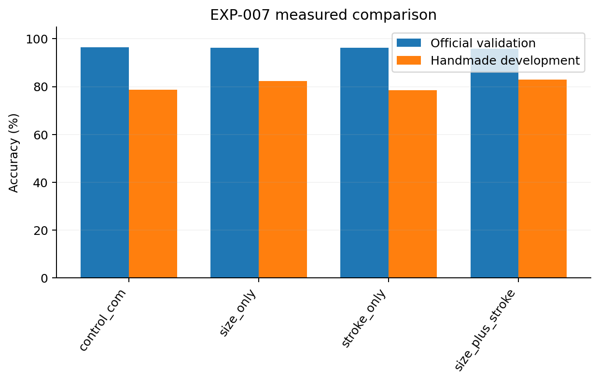

# EXP-007 | KNN Normal — 크기·획 증강

> **실험 목적:** 공식 Training 일부 이미지의 크기/획을 변형하면 도메인 격차가 감소하는가?
> **핵심 결론:** 복합 증강 20%에서 Hand-made 82.93%, 공식 95.84%. 개발 후보 갱신.

| 항목 | 내용 |
|---|---|
| ID / 날짜 | EXP-007 / 2026-11-21 |
| 구분 | KNN Normal, 개발용 실험 |
| 실험 코드 | [`EXP007_KNN_Normal_Augmentation.py`](../scripts/EXP007_KNN_Normal_Augmentation.py) |
| 결과 폴더 | [`EXP007_augmentation`](../results/EXP007_augmentation/) |

## 1. 문제 및 가설

공식 Training 일부 이미지의 크기/획을 변형하면 도메인 격차가 감소하는가?

## 2. 데이터·실험 조건

Training 76,800 / Validation 19,200; Hand-made development 2,560 (writers 41–44). Original Test 미사용.

- 모든 파생 학습 이미지는 공식 Training에서만 생성하며 Validation 및 Hand-made는 학습에 직접 포함하지 않는다.
- 결과의 공식 Validation / Hand-made는 개발 중 반복 비교된 수치이며 별도 독립 Test 결과가 아니다.
- 아래 수치는 실행 로그를 전사한 기록이며, EXP-005~015의 원본 전체 CSV·개별 예측 파일은 사용자 PC에 보관되어 있다.

- 기본 증강은 EXP-007의 크기·획 변형을 사용하며, 실험 단계에 따라 비율과 강도가 달라진다.

## 3. 실측 결과

| 조건 | 공식 Validation Accuracy | Hand-made Accuracy | Hand-made Macro F1 |
|---|---:|---:|---:|
| `control_com` | 96.5052% | 78.7891% | 0.786540 |
| `size_only` | 96.1979% | 82.4219% | 0.823989 |
| `stroke_only` | 96.2708% | 78.5156% | 0.782484 |
| `size_plus_stroke` | 95.8385% | 82.9297% | 0.828566 |



**선정 후보:** `size_plus_stroke` — 공식 95.8385%, Hand-made 82.9297%, Hand-made Macro F1 0.828566.

## 4. 해석 및 채택 판단

복합 증강 20%에서 Hand-made 82.93%, 공식 95.84%. 개발 후보 갱신.

## 5. 재현 및 원본 보존

```bat
python 05_model_optimize/KNN/Normal/scripts/EXP007_KNN_Normal_Augmentation.py
```

- 콘솔 전사 지표: [`console_metrics_transcribed.csv`](../results/EXP007_augmentation/console_metrics_transcribed.csv)
- 비교 그래프: [`comparison.png`](../results/EXP007_augmentation/comparison.png)
- **추가 첨부 필요:** 사용자 PC의 같은 `results/` 폴더에 생성된 `metrics.json`, `candidate_results.csv`, `by_writer.csv`, `per_class_handmade.csv`, 예측 CSV, 혼동행렬 CSV 등(해당 실험에서 실제 생성된 것만).
- 본 패키지는 전달받지 못한 세부 결과를 합성하지 않았다.
