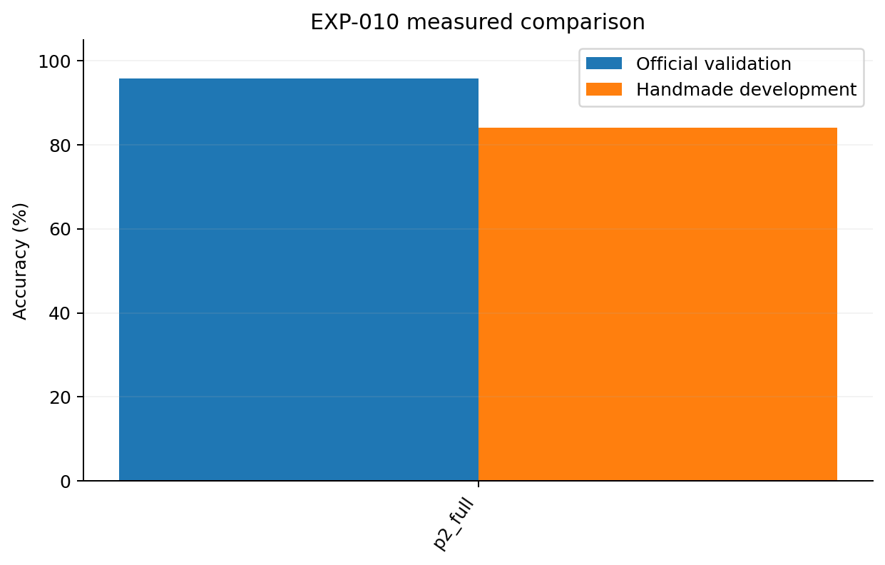
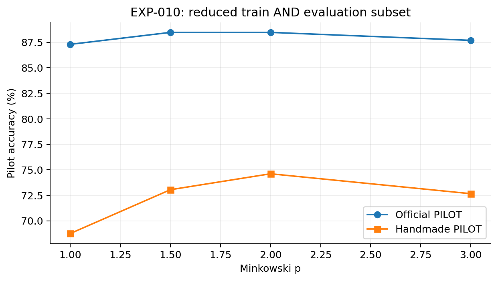

# EXP-010 | KNN Normal — 거리 함수 탐색 및 중단 기록

> **실험 목적:** Manhattan/Minkowski/Euclidean을 비교하되 계산비용과 완전성 확인.
> **핵심 결론:** PILOT 네 종류, FULL p=2만 완료. p=1.5 전체 계산 중단; 최적거리의 보편성 주장 불가.

| 항목 | 내용 |
|---|---|
| ID / 날짜 | EXP-010 / 2026-11-21 |
| 구분 | KNN Normal, 개발용 실험 |
| 실험 코드 | [`EXP010_KNN_Normal_Distance_Metric.py`](../scripts/EXP010_KNN_Normal_Distance_Metric.py) |
| 결과 폴더 | [`EXP010_distance_metrics`](../results/EXP010_distance_metrics/) |

## 1. 문제 및 가설

Manhattan/Minkowski/Euclidean을 비교하되 계산비용과 완전성 확인.

## 2. 데이터·실험 조건

Training 76,800 / Validation 19,200; Hand-made development 2,560 (writers 41–44). Original Test 미사용.

- 모든 파생 학습 이미지는 공식 Training에서만 생성하며 Validation 및 Hand-made는 학습에 직접 포함하지 않는다.
- 결과의 공식 Validation / Hand-made는 개발 중 반복 비교된 수치이며 별도 독립 Test 결과가 아니다.
- 아래 수치는 실행 로그를 전사한 기록이며, EXP-005~015의 원본 전체 CSV·개별 예측 파일은 사용자 PC에 보관되어 있다.

- 기본 증강은 EXP-007의 크기·획 변형을 사용하며, 실험 단계에 따라 비율과 강도가 달라진다.

## 3. 실측 결과

| 조건 | 공식 Validation Accuracy | Hand-made Accuracy | Hand-made Macro F1 |
|---|---:|---:|---:|
| `p2_full` | 95.7344% | 84.1016% | 0.840871 |



**선정 후보:** `p2_full` — 공식 95.7344%, Hand-made 84.1016%, Hand-made Macro F1 0.840871.

## 4. 해석 및 채택 판단

PILOT 네 종류, FULL p=2만 완료. p=1.5 전체 계산 중단; 최적거리의 보편성 주장 불가.

### PILOT 결과 (학습·평가 축소; FULL과 직접 비교 불가)

| p | 공식 PILOT | Hand-made PILOT | Hand-made F1 |
|---:|---:|---:|---:|
| 1 | 87.3047% | 68.7500% | 0.681005 |
| 1.5 | 88.4766% | 73.0469% | 0.727512 |
| 2 | 88.4766% | 74.6094% | 0.741421 |
| 3 | 87.6953% | 72.6562% | 0.719173 |

**중단·제약:** 전체 평가 `p=1.5`는 계산시간 문제로 종료되었으며, 완료·저장된 FULL은 `p=2` 1건뿐이다. PILOT 최고 p=2는 FULL 전체 거리함수 최적화를 입증하지 않는다.



## 5. 재현 및 원본 보존

```bat
python 05_model_optimize/KNN/Normal/scripts/EXP010_KNN_Normal_Distance_Metric.py
```

- 콘솔 전사 지표: [`console_metrics_transcribed.csv`](../results/EXP010_distance_metrics/console_metrics_transcribed.csv)
- 비교 그래프: [`comparison.png`](../results/EXP010_distance_metrics/comparison.png)
- **추가 첨부 필요:** 사용자 PC의 같은 `results/` 폴더에 생성된 `metrics.json`, `candidate_results.csv`, `by_writer.csv`, `per_class_handmade.csv`, 예측 CSV, 혼동행렬 CSV 등(해당 실험에서 실제 생성된 것만).
- 본 패키지는 전달받지 못한 세부 결과를 합성하지 않았다.
