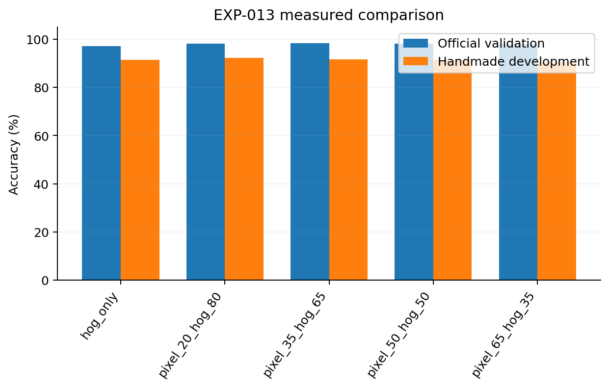

# EXP-013 | KNN Normal — Pixel/HOG 혼합비 탐색

> **실험 목적:** HOG 중심 혼합비가 정확도와 추론비용에 미치는 영향을 비교한다.
> **핵심 결론:** 20:80에서 손글씨 92.19%; 공식 98.18%; 35:65는 공식 최고 98.28%.

| 항목 | 내용 |
|---|---|
| ID / 날짜 | EXP-013 / 2026-11-21 |
| 구분 | KNN Normal, 개발용 실험 |
| 실험 코드 | [`EXP013_KNN_Normal_HOG_Mix_Ratio.py`](../scripts/EXP013_KNN_Normal_HOG_Mix_Ratio.py) |
| 결과 폴더 | [`EXP013_hog_mix_ratio`](../results/EXP013_hog_mix_ratio/) |

## 1. 문제 및 가설

HOG 중심 혼합비가 정확도와 추론비용에 미치는 영향을 비교한다.

## 2. 데이터·실험 조건

Training 76,800 / Validation 19,200; Hand-made development 2,560 (writers 41–44). Original Test 미사용.

- 모든 파생 학습 이미지는 공식 Training에서만 생성하며 Validation 및 Hand-made는 학습에 직접 포함하지 않는다.
- 결과의 공식 Validation / Hand-made는 개발 중 반복 비교된 수치이며 별도 독립 Test 결과가 아니다.
- 아래 수치는 실행 로그를 전사한 기록이며, EXP-005~015의 원본 전체 CSV·개별 예측 파일은 사용자 PC에 보관되어 있다.

- 기본 증강은 EXP-007의 크기·획 변형을 사용하며, 실험 단계에 따라 비율과 강도가 달라진다.
- 전처리는 CoM 및 Deskew이며, EXP-011에서 적용 순서를 비교했다.
- 특징은 Pixel / HOG / 혼합이며, HOG는 324차원, Pixel은 784차원이다.

## 3. 실측 결과

| 조건 | 공식 Validation Accuracy | Hand-made Accuracy | Hand-made Macro F1 |
|---|---:|---:|---:|
| `hog_only` | 97.2240% | 91.4453% | 0.914183 |
| `pixel_20_hog_80` | 98.1823% | 92.1875% | 0.921519 |
| `pixel_35_hog_65` | 98.2812% | 91.6016% | 0.915534 |
| `pixel_50_hog_50` | 98.1979% | 91.4453% | 0.913995 |
| `pixel_65_hog_35` | 98.0104% | 90.4687% | 0.904181 |



**선정 후보:** `pixel_20_hog_80` — 공식 98.1823%, Hand-made 92.1875%, Hand-made Macro F1 0.921519.

## 4. 해석 및 채택 판단

20:80에서 손글씨 92.19%; 공식 98.18%; 35:65는 공식 최고 98.28%.

## 5. 재현 및 원본 보존

```bat
python 05_model_optimize/KNN/Normal/scripts/EXP013_KNN_Normal_HOG_Mix_Ratio.py
```

- 콘솔 전사 지표: [`console_metrics_transcribed.csv`](../results/EXP013_hog_mix_ratio/console_metrics_transcribed.csv)
- 비교 그래프: [`comparison.png`](../results/EXP013_hog_mix_ratio/comparison.png)
- **추가 첨부 필요:** 사용자 PC의 같은 `results/` 폴더에 생성된 `metrics.json`, `candidate_results.csv`, `by_writer.csv`, `per_class_handmade.csv`, 예측 CSV, 혼동행렬 CSV 등(해당 실험에서 실제 생성된 것만).
- 본 패키지는 전달받지 못한 세부 결과를 합성하지 않았다.
