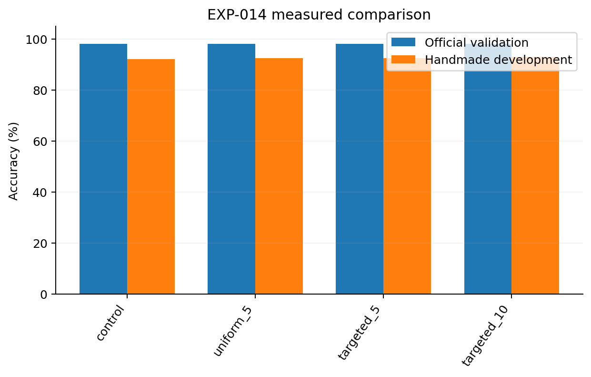

# EXP-014 | KNN Normal — 취약 문자 집중 증강

> **실험 목적:** 오류 상위 D/B/5/3에 학습 전용 증강을 추가하면 개선되는가?
> **핵심 결론:** targeted 10%에서 Hand-made 93.01%, 공식 98.18%. 개발셋 기반 선정의 선택 편향 주의.

| 항목 | 내용 |
|---|---|
| ID / 날짜 | EXP-014 / 2026-11-21 |
| 구분 | KNN Normal, 개발용 실험 |
| 실험 코드 | [`EXP014_KNN_Normal_Targeted_Augmentation.py`](../scripts/EXP014_KNN_Normal_Targeted_Augmentation.py) |
| 결과 폴더 | [`EXP014_targeted_augmentation`](../results/EXP014_targeted_augmentation/) |

## 1. 문제 및 가설

오류 상위 D/B/5/3에 학습 전용 증강을 추가하면 개선되는가?

## 2. 데이터·실험 조건

Training 76,800 / Validation 19,200; Hand-made development 2,560 (writers 41–44). Original Test 미사용.

- 모든 파생 학습 이미지는 공식 Training에서만 생성하며 Validation 및 Hand-made는 학습에 직접 포함하지 않는다.
- 결과의 공식 Validation / Hand-made는 개발 중 반복 비교된 수치이며 별도 독립 Test 결과가 아니다.
- 아래 수치는 실행 로그를 전사한 기록이며, EXP-005~015의 원본 전체 CSV·개별 예측 파일은 사용자 PC에 보관되어 있다.

- 기본 증강은 EXP-007의 크기·획 변형을 사용하며, 실험 단계에 따라 비율과 강도가 달라진다.
- 전처리는 CoM 및 Deskew이며, EXP-011에서 적용 순서를 비교했다.
- 특징은 Pixel / HOG / 혼합이며, HOG는 324차원, Pixel은 784차원이다.
- D/B/5/3 집중 증강 대상은 EXP-013의 Hand-made 개발 데이터 오류 수(D 48, B 41, 5 14, 3 13)에서 선정했다.

## 3. 실측 결과

| 조건 | 공식 Validation Accuracy | Hand-made Accuracy | Hand-made Macro F1 |
|---|---:|---:|---:|
| `control` | 98.1823% | 92.1875% | 0.921519 |
| `uniform_5` | 98.1615% | 92.5781% | 0.925478 |
| `targeted_5` | 98.1719% | 92.6172% | 0.926096 |
| `targeted_10` | 98.1823% | 93.0078% | 0.930121 |



**선정 후보:** `targeted_10` — 공식 98.1823%, Hand-made 93.0078%, Hand-made Macro F1 0.930121.

## 4. 해석 및 채택 판단

targeted 10%에서 Hand-made 93.01%, 공식 98.18%. 개발셋 기반 선정의 선택 편향 주의.

targeted_10 손글씨 정답은 2,381/2,560, 대조군은 2,360/2,560이다. 집중 대상 선정 및 반복 튜닝에 동일한 Hand-made 개발 데이터를 사용했으므로 선택 편향 가능성을 명시한다.

## 5. 재현 및 원본 보존

```bat
python 05_model_optimize/KNN/Normal/scripts/EXP014_KNN_Normal_Targeted_Augmentation.py
```

- 콘솔 전사 지표: [`console_metrics_transcribed.csv`](../results/EXP014_targeted_augmentation/console_metrics_transcribed.csv)
- 비교 그래프: [`comparison.png`](../results/EXP014_targeted_augmentation/comparison.png)
- **추가 첨부 필요:** 사용자 PC의 같은 `results/` 폴더에 생성된 `metrics.json`, `candidate_results.csv`, `by_writer.csv`, `per_class_handmade.csv`, 예측 CSV, 혼동행렬 CSV 등(해당 실험에서 실제 생성된 것만).
- 본 패키지는 전달받지 못한 세부 결과를 합성하지 않았다.
