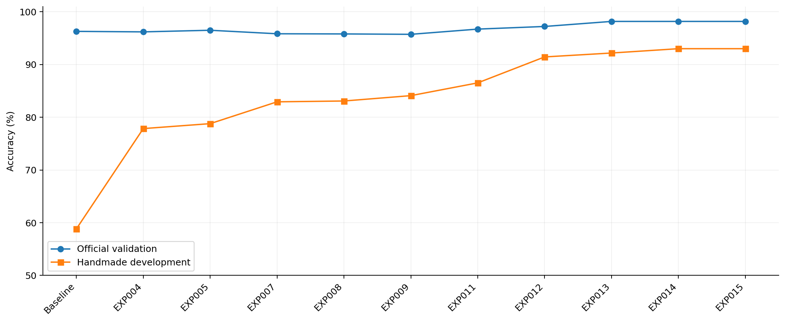

# KNN Normal 최적화 종합 보고 — EXP-001~015

> 기록 기준일: 2026-11-21 / EXP-004~015 정리 패키지

## 핵심 결론

**최종 개발용 설정은 EXP-014 `targeted_10`의 KNN(k=3, distance, Euclidean), CoM→Deskew, Pixel:HOG=20:80, 공식 Training 크기·획 증강 30%(획 강도 0.44) + D/B/5/3 타깃 증강 10%이다.**

- 공식 Validation: **98.1823%** (전사된 EXP-014 로그값 0.981823)
- Hand-made 개발 평가: **93.0078%**, Macro F1 **0.930121**
- 최초 KNN Hand-made Baseline: **58.8281%** → 최종 **93.0078%** (**+34.1797%p**)
- 학습 이미지: **107,520장**(공식 Training 76,800장 + 기본 증강 23,040장 + 집중 증강 7,680장).
- EXP-015에서 k=1,3,5,7,9,11과 uniform/distance 재비교 결과 k=3/distance 유지.

## 주요 실험별 결론

| 실험 | 핵심 변경 | 선정 후보 | 공식 Validation | Hand-made | 판정 |
|---|---|---|---:|---:|---|
| EXP-004 | CoM 중심 정렬 | `com` | 96.1979% | 77.8516% | 개발 후보 |
| EXP-005 | k 및 가중치 탐색 | `k3_distance` | 96.5052% | 78.7891% | 개발 후보 |
| EXP-006 | BB 크기 정규화 | `com` | 96.5052% | 78.7891% | 기준 유지 |
| EXP-007 | 크기·획 증강 | `size_plus_stroke` | 95.8385% | 82.9297% | 개발 후보 |
| EXP-008 | 증강 비율 탐색 | `combined_30` | 95.8073% | 83.0859% | 개발 후보 |
| EXP-009 | 획 강도 탐색 | `combined_strength_44` | 95.7344% | 84.1016% | 개발 후보 |
| EXP-010 | 거리 함수 탐색 및 중단 기록 | `p2_full` | 95.7344% | 84.1016% | 기준 유지 |
| EXP-011 | Deskew 기울기 보정 | `com_then_deskew` | 96.7240% | 86.5234% | 개발 후보 |
| EXP-012 | HOG 특징 추출 | `hog_only` | 97.2240% | 91.4453% | 개발 후보 |
| EXP-013 | Pixel/HOG 혼합비 탐색 | `pixel_20_hog_80` | 98.1823% | 92.1875% | 개발 후보 |
| EXP-014 | 취약 문자 집중 증강 | `targeted_10` | 98.1823% | 93.0078% | 개발 후보 |
| EXP-015 | HOG 최종 k·가중치 재검증 | `k3_distance` | 98.1823% | 93.0078% | 기준 유지 |

## 재현성 및 평가 한계

1. 공식 96,000장 중 그룹 기반 76,800/19,200 분할을 사용했다. 16개 문자와 작성자 41~44의 Hand-made 2,560장을 평가했다.
2. **Hand-made는 여러 차례 모델 선택 및 취약 클래스 선별에 사용된 개발 평가셋**이므로 최종 미지 데이터 일반화 성능으로 해석하면 안 된다.
3. 공식 Original Test 16,000장(및 별도 Test)은 이 실험 과정에서 열람·튜닝에 사용하지 않았다. 최종 독립 평가는 모델·전처리·증강 설정을 동결하고 별도 진행해야 한다.
4. EXP-010에서는 FULL p=2 외 거리 함수 전체 평가를 완료하지 않았다. PILOT은 축소 학습·평가셋이며 FULL과 비교하면 안 된다.
5. EXP-005~015의 개별 예측/혼동행렬 원본 파일은 현재 제공되지 않아 패키지에 포함하지 않았다. `console_metrics_transcribed.csv`는 사용자가 공유한 실행 로그 전사값이다.
6. 실험 스크립트는 상대 경로 기준 실행을 전제로 하며 프로젝트의 `03_experiments/model_optimization/` 및 기존 MLP 전처리 참조 코드가 있어야 한다.

## 패키지 사용 안내

- [logs/](./)의 EXP-004~015 개별 Markdown 12개를 GitHub의 `05_model_optimize/KNN/Normal/logs/`에 업로드한다.
- [`results/summary/`](../results/summary/)의 통합 CSV와 그래프를 업로드한다.
- [`scripts/`](../scripts/)의 실제 실행 `.py` 12개 및 EXP-010 fast `.py`를 업로드한다.
- 사용자 PC의 `results/EXP005_*` ~ `results/EXP015_*`의 원본 CSV/JSON을 **기존 디렉터리 구조를 유지한 채 추가 업로드**한다.
- `results/EXP004_com_centering/`에는 이전에 확보한 일부 실측 원본이 포함돼 있다.
