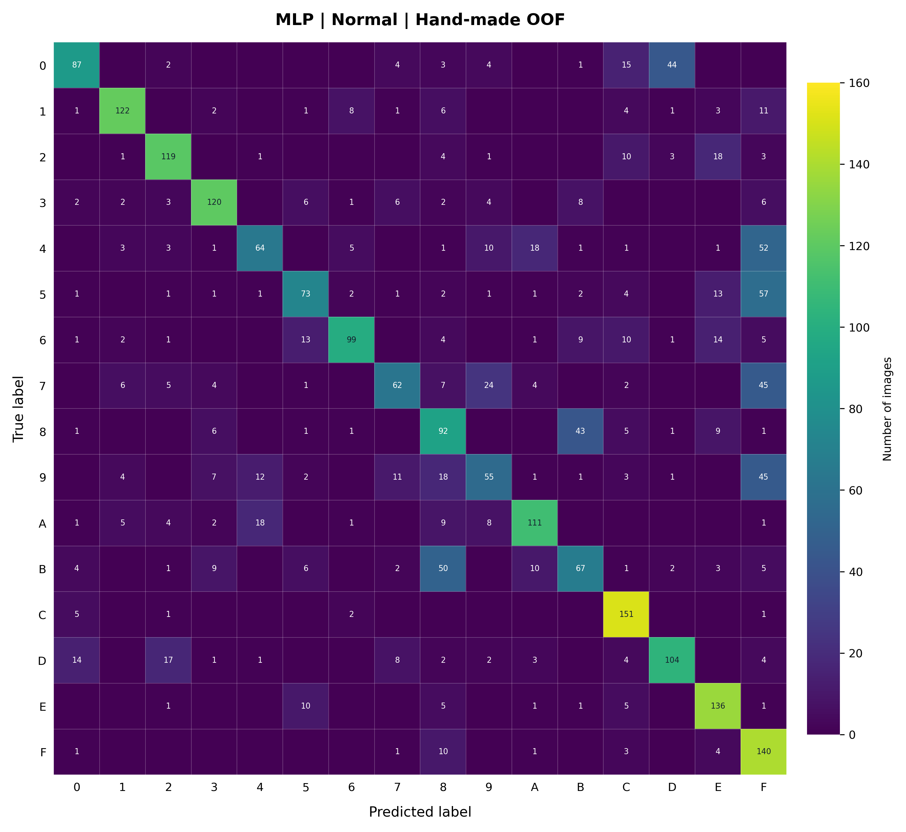
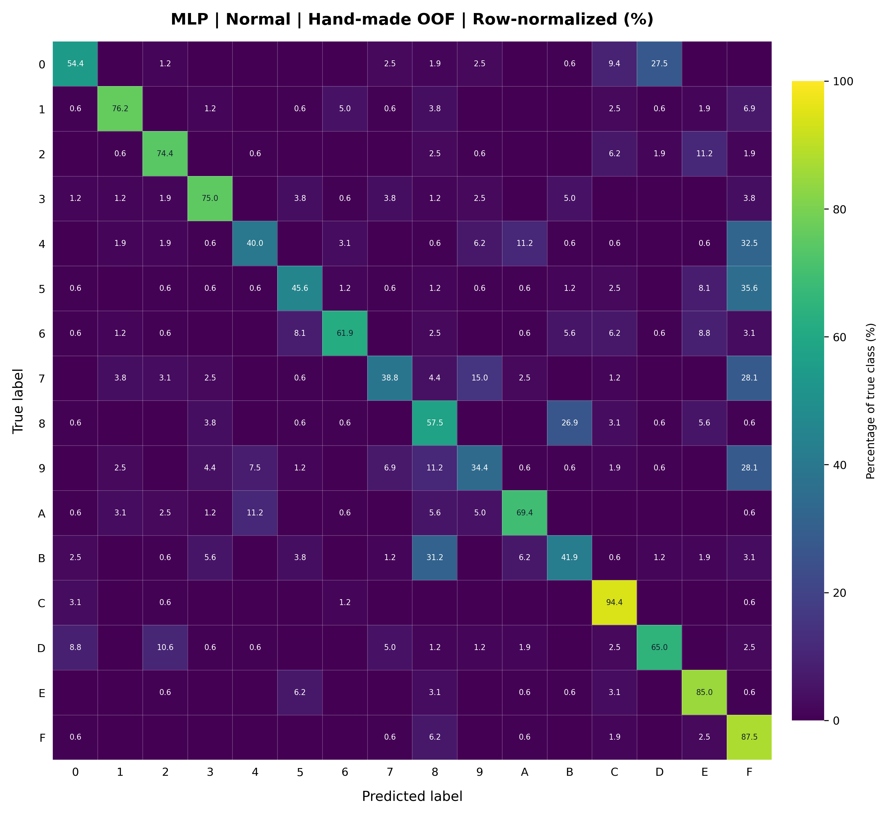
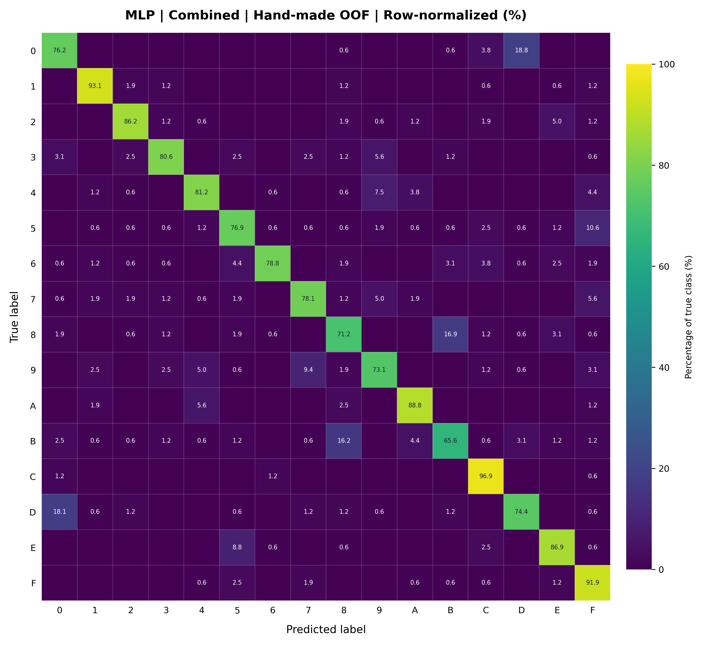
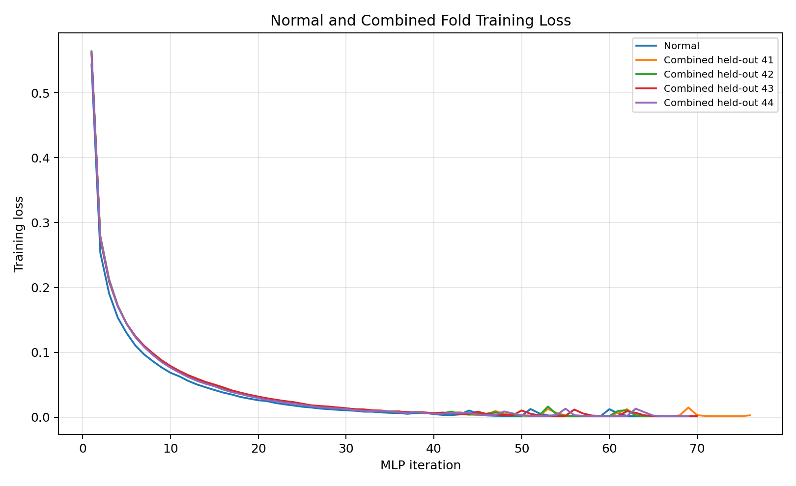

# EXP유001 | Combined MLP Baseline 및 작성자별 4-Fold Cross-Validation

> **실험 ID:** EXP-CMB-001 · **2026-11-15** (KST) · **담당자:** 유용성 · **상태:** 완료
>
> **질문:** 공식 데이터만 학습한 Normal MLP에 Hand-made Training 데이터를 추가하면, 학습에 참여하지 않은 작성자의 16-class 손글씨 인식 성능이 좋아지는가?
>
> **결론:** 동일 MLP 조건에서 Hand-made OOF Accuracy **62.5781% → 81.2500% (+18.6719%p)**, Macro F1 **0.623046 → 0.812043**. 단, `0 ↔ D` 혼동은 개선되지 않았으며 일부 Fold의 공식 Validation 성능이 감소했다.

| 항목 | 기록 |
|---|---|
| 구분 | MLP / Combined 초기 Baseline, Normal 대조군 |
| 실험 근거 | [GitHub Actions Run #43622998640](https://github.com/ryu980920/Machine_Learning/actions/runs/43622998640), 최종 `success` |
| 모델·전처리 | `PixelScaler255(X/255.0) → MLPClassifier(random_state=42)` |
| 모델 설정 | MLP 기본 설정 (은닉층 100개 노드, ReLU, Adam 등); 정확한 값은 [`experiment_manifest.json`](../results/EXP_CMB_001/experiment_manifest.json) |
| 재현 코드 | [`combined_mlp_writer_cv.py`](../scripts/combined_mlp_writer_cv.py) / [`test_reproducibility.py`](../scripts/test_reproducibility.py) |
| 수치 근거 | [`metrics_summary.csv`](../results/EXP_CMB_001/metrics_summary.csv) / [`OOF_predictions.csv`](../results/EXP_CMB_001/OOF_predictions.csv) |

## 1. 문제 발견 및 실험 목적

기존 Normal MLP는 공식 MNIST·EMNIST 개발 Validation에 비해 Hand-made 데이터 인식 성능이 낮았다. 학습에 포함되지 않은 필체에 대한 일반화 문제를 확인하기 위해 **MLP 구조와 하이퍼파라미터를 변경하지 않은 상태**에서 Hand-made 학습 데이터를 추가했다.

이번 실험의 핵심 비교 변수는 **Hand-made 데이터를 학습에 포함하는지 여부**다. 다음 세 가지를 확인한다.

1. 학습하지 않은 작성자의 Hand-made Accuracy·Macro F1 개선 여부
2. Confusion Matrix에서 개선·악화된 클래스와 작성자별 편차
3. 공식 MNIST·EMNIST 개발 Validation 정확도 유지 여부

## 2. 원인 가설 및 방법 선정

- **가설:** 공식 데이터로만 학습한 Normal MLP는 실제 작성자의 필체·획 형태 다양성을 충분히 경험하지 못했다. Hand-made Training을 추가하면 미학습 작성자에 대한 오분류가 감소할 것으로 예상했다.
- **방법:** 작성자 ID를 기준으로 한 **Leave-One-Writer-Out 4-Fold Cross-Validation(CV)**. 각 Fold에서 작성자 3명의 Hand-made 이미지를 학습에 추가하고 나머지 1명은 검증 전용으로 보류했다.
- **통제:** Normal은 공식 Training만으로 새로 1회 학습하고 네 작성자에게 평가했다. Combined는 같은 모델 설정으로 Fold마다 새로 학습했다. 추가 회전·반전·이진화·증강이나 하이퍼파라미터 튜닝은 시행하지 않았다.

## 3. 데이터·분할·수행 조건

| 항목 | Normal | Combined (각 Fold) |
|---|---:|---:|
| 공식 MNIST·EMNIST Train | 76,800 | 76,800 |
| 추가 Hand-made Train | 0 | 1,920 (작성자 3명) |
| 총 학습 이미지 | 76,800 | **78,720** |
| 공식 개발 Validation | 19,200 | 19,200 |
| 보류 작성자 Validation | 640/작성자 | 640/작성자 |
| 모델 설정 | `MLPClassifier(random_state=42)` | 동일 |
| 픽셀 전처리 | `X/255.0` | 동일 |
| 학습 재사용 | 공식 Train으로 1회 새 학습 | Fold마다 새 학습 |

- 공식 v3 NPZ: `02_data/datasets/MNIST_EMNIST_official_split_112000.npz`, SHA-256 `0e9570d0eb04c0c1da99d043b85bfdab7f3b639eebe4b10335b05b57ad671879`.
- 공식 96,000 Training의 내부 분할: `StratifiedGroupKFold(n_splits=5, shuffle=True, random_state=42)` 첫 Fold 사용. 출처 그룹은 `label·원본 split·원본 index`를 합성해 원본 및 증강본의 Training/Validation 분리 보장.
- Hand-made: `02_data/Hand_made/ml26_41.npz`~`ml26_44.npz` 각 640장, 작성자별 16클래스×40장, 총 2,560장. **현재 Grayscale 버전**, 기존 보정 방향 유지, 새 42번 NPZ 사용. 원본 SHA-256은 manifest에 수록.

| Fold | Combined 학습 작성자 | 보류 Validation 작성자 | 학습 수 | Validation 수 |
|---|---|---|---:|---:|
| 1 | 42·43·44 | **41** | 78,720 | 640 |
| 2 | 41·43·44 | **42** | 78,720 | 640 |
| 3 | 41·42·44 | **43** | 78,720 | 640 |
| 4 | 41·42·43 | **44** | 78,720 | 640 |

**실제 실행 순서:** SHA-256 확인 → 공식 Train/Validation 인덱스 생성 및 그룹 중복 검사 → Normal 1회 학습 → Combined Fold별 1회씩 학습 → 동일 작성자 Hand-made 추론 → 2,560장 OOF 예측 취합 → 공식 개발 Validation 평가 → CM·손실 곡선 및 학습 모델 저장 → CSV 수치 재검산.

**재현 자료:** [`official_split_indices.npz`](../results/EXP_CMB_001/official_split_indices.npz) (Train/Validation 실제 원본 행 인덱스), [`experiment_manifest.json`](../results/EXP_CMB_001/experiment_manifest.json) (Fold 작성자·이미지 범위·모델·환경·SHA), [`trained_models.zip`](../results/EXP_CMB_001/trained_models.zip) (Normal 1개 및 Combined 4개 모델).

## 4. 실측 결과

### 4.1 Hand-made OOF 전체 비교

| 항목 | Normal | Combined | 변화 |
|---|---:|---:|---:|
| Accuracy | 62.5781% | **81.2500%** | **+18.6719%p** |
| Macro F1 | 0.623046 | **0.812043** | +0.188997 |
| 맞힌 이미지 / 2,560 | 1,602 | **2,080** | +478 |
| 틀린 이미지 / 2,560 | 958 | **480** | -478 |

이미지별 실제 예측 비교 시 **Normal 오답 → Combined 정답 540장**, **Normal 정답 → Combined 오답 62장**, 순개선 478장이다.

### 4.2 작성자별 성능

| 보류 작성자 | Normal Accuracy | Combined Accuracy | 개선폭 | Combined Macro F1 |
|---|---:|---:|---:|---:|
| 41 | 60.3125% | **75.9375%** | +15.6250%p | 0.7554 |
| 42 | 68.4375% | **85.6250%** | +17.1875%p | 0.8535 |
| 43 | 55.4688% | **78.5938%** | +23.1250%p | 0.7737 |
| 44 | 66.0938% | **84.8438%** | +18.7500%p | 0.8474 |

모든 보류 작성자에서 개선이 관찰되었다. 특히 43번은 개선폭이 가장 컸지만, Combined 이후에도 41·43번 작성자의 정확도가 상대적으로 낮았다.

### 4.3 Confusion Matrix 분석

최종 이미지에는 16×16 `viridis` 디자인을 적용했다. **원본 예측값은 변경하지 않았고**, Count형은 색상 범위 0~160장, 행 정규화형은 0~100%로 고정했다.

| 실제 → 예측 | Normal | Combined | 변화 |
|---|---:|---:|---|
| `0 → D` | 44 | 30 | 감소 |
| `D → 0` | 14 | 29 | **증가** |
| `8 → B` | 43 | 27 | 감소 |
| `B → 8` | 50 | 26 | 감소 |
| `5 → F` | 57 | 17 | 감소 |
| `4 → F` | 52 | 7 | 감소 |
| `9 → F` | 45 | 5 | 감소 |
| `7 → F` | 45 | 9 | 감소 |

- `0 ↔ D` 양방향 오류는 **58장 → 59장**으로 개선되지 않았다. 43번 작성자의 `0 → D` 28장과 41·42번 작성자의 `D → 0` 16·11장을 우선 검토한다.
- `8 ↔ B` 양방향 오류는 **93장 → 53장**으로 줄었지만 잔존한다.
- F로의 과다 예측은 감소했으며, F Precision은 **37.14% → 73.13%**로 개선됐다.

**Confusion Matrix — Count (색상 범위 0–160장)**

**그림 1. Normal MLP — Hand-made OOF Confusion Matrix (Count)**

**그림 2. Combined MLP — Hand-made OOF Confusion Matrix (Count)**

**Confusion Matrix — Row-normalized (행별 0–100%)**

**그림 3. Normal MLP — Hand-made OOF Confusion Matrix (Row-normalized)**

**그림 4. Combined MLP — Hand-made OOF Confusion Matrix (Row-normalized)**

*네 그래프는 동일한 2,560장 OOF 예측에 기반하며, 비교를 위해 Count와 Row-normalized 각각 동일 색상 범위를 사용했다.*

### 4.4 공식 개발 Validation 성능

| 모델 | Accuracy | Macro F1 |
|---|---:|---:|
| Normal | 97.2240% | 0.9721 |
| Combined (41 보류) | 96.5313% | 0.9651 |
| Combined (42 보류) | 97.2604% | 0.9724 |
| Combined (43 보류) | 97.3594% | 0.9734 |
| Combined (44 보류) | 97.3177% | 0.9730 |

41번 작성자 보류 Fold는 Normal보다 공식 Validation Accuracy가 약 **0.69%p 감소**했다. 공식 데이터 성능 보존도 후속 Combined 최적화에서 함께 관리한다.

### 4.5 학습 반복·시간·Loss

| 모델 | 반복 수 | 학습 시간 | 최종 Training Loss |
|---|---:|---:|---:|
| Normal | 66 | 32.82초 | 0.001386 |
| Combined (41 보류) | 76 | 39.25초 | 0.002767 |
| Combined (42 보류) | 68 | 34.93초 | 0.001592 |
| Combined (43 보류) | 70 | 35.60초 | 0.001548 |
| Combined (44 보류) | 69 | 35.60초 | 0.001524 |

Loss Curve는 **Iteration별 Training Loss**이며 Validation Loss를 측정한 것이 아니다. 5개 모델 모두 학습 경고가 발생하지 않았다. [원본 수치 `loss_curves.csv`](../results/EXP_CMB_001/loss_curves.csv).

**그림 5. Normal 및 Combined 4-Fold MLP — Training Loss Curve**

*Normal 모델 1개와 Combined Fold별 모델 4개, 총 5개 모델의 학습 반복에 따른 Training Loss를 나타낸다.*

## 5. 결과 판단 및 다음 실험

**판단:** Hand-made 이미지를 추가한 Combined MLP는 보류 작성자 OOF Accuracy를 **+18.67%p** 개선했다. 동일한 모델과 스케일러에서 비교했으므로 Hand-made 데이터 편입 효과를 확인했다.

**남은 문제:** `0/D`, `8/B` 필체 혼동이 남고, 특정 Fold는 공식 데이터 개발 Validation 정확도가 하락했다. 그 원인이 되는 이미지 형태는 아직 별도로 정량 분석하지 않았다.

**후속 후보(미실시):** `0↔D`, `8↔B` 오분류 이미지를 작성자별로 점검하고, 중심·기울기·크기·획 굵기의 원인을 측정한다. 해당 결과를 바탕으로 자동 전처리 또는 Training-only Augmentation을 단일 변수씩 비교하고, 같은 4-Fold CV 및 공식 개발 Validation으로 판단한다.

**검증 근거:** 공식 원본·증강 그룹 누출 0, Hand-made 작성자 누출 0, SHA-256 확인, 저장된 모델/예측/CM/Loss 수치 일치. 공식 Original Test 16,000장과 교수님 Test는 **미사용**.

**해석 범위:** OOF는 개발 평가이며 최종 독립 Test가 아니다. 네 Combined Fold는 **각각 별도 모델 4개**이므로, 현재 성능을 단일 최종 모델의 성능으로 표시하지 않는다. 기존 W02 Normal 저장 가중치를 재사용하지 않고 이 실험에서 통제용 Normal을 새로 학습했다.
