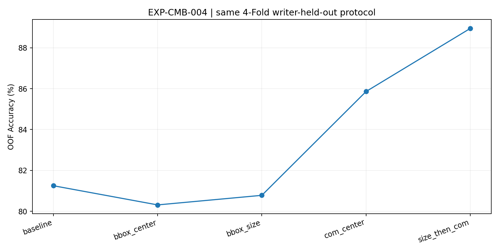

# EXP-CMB-004 · 02 최종 결과 — Geometry Normalization

> **실험 ID: EXP-CMB-004 · 상태: 실험·보강 대조 완료 / main 배포 검토 대기**
>
> **사전등록 기준:** [실험 전 고정한 설명 중심 통과 기준](EXP-CMB-004_01_Plan_Geometry_Normalization.md). Accuracy·Macro F1의 절대 숫자가 아닌 **Bounding Box Size와 CoM Center 중 어느 방법이 어떤 오류에 왜 유리한지 실제 기하 변화·정오답 전환·재학습 대조·부작용까지 설명 가능해야 완료**한다.
>
> **최종 연구 판단:** 목적 달성. **CoM-only는 Size-only보다 전체 Hand-made OOF 일반화에 유리했고, Size+CoM은 두 방법의 숫자/문자 상충을 상당 부분 완화해 가장 높은 OOF 성능을 보였다.** 단, **공식 개발 Validation이 모두 하락**했고 기존 개발용 작성자 4명을 반복 평가한 결과이므로 **최종 모델 선정·배포는 보류**한다. Normal에서 얻은 정렬 효과가 Combined에서도 동일하게 나타난다고 가정하지 않았으며 **새 4-Fold CV에서 독립적으로 검증**했다.

## 1. 실제 수행·통제와 결과 출처

- 사용 데이터: 공식 Group-aware Training **76,800장**, 개발 Validation **19,200장**, Hand-made 작성자 **41–44**, Fold마다 3명×640=1,920장만 학습하고 보류 1명×640 평가. **OOF 2,560장**.
- 동일 MLPClassifier(random_state=42), 단일 은닉층 100 ReLU, PixelScaler255 및 Baseline 나머지 기본 설정/데이터 순서. **방법별 4개의 MLP를 독립적으로 처음부터 학습**(총 16개)하고 Baseline 기존 학습은 반복하지 않았다.
- 원본 EXP-CMB-001 예측·원본 데이터 SHA·작성자 Fold·공식 분할 재확인. 원본 Test 16,000장·교수님 Test **미사용**.
- Foreground 기준 **32/255**, 크기 목표는 **공식 Training에서만 계산한 BBox 긴 변 중앙값 20px**, CoM 목표 (13.5,13.5), 정수 이동·no-wrap·zero padding. Size 변환은 BBox 중심 기준 양축 같은 배율의 bilinear resize. 모든 Train/Val/OOF에 동일 파이프라인 적용.
- **방법:** 원본 A / Bounding Box 중심만 B(참고) / Bounding Box Size만 C / CoM Center만 D / Size+CoM E.
- 실행: [4-Fold 재학습 GitHub Actions #43747924168](https://github.com/ryu980920/Machine_Learning/actions/runs/43747924168) · [가중치 고정/재학습 효과 분리 #43748490480](https://github.com/ryu980920/Machine_Learning/actions/runs/43748490480). 모두 성공. 실제 데이터·CSV·loss·Viridis CM·모델 ZIP은 [결과 디렉터리](../../results/Geometry_Normalization/README.md) 참조.

## 2. 전체 OOF 및 오류 교정·신규 오류

| 방법 | Accuracy | Macro F1 | Baseline 대비 | 오답→정답 | 정답→오답 |
|---|---:|---:|---:|---:|---:|
| **Original (기존)** | 81.2500% | 0.8120 | — | — | — |
| BBox Center-only | 80.3125% | 0.8036 | −0.9375%p | 197 | 221 |
| **BBox Size-only** | **80.7813%** | 0.8096 | −0.4688%p | 246 | 258 |
| **CoM Center-only** | **85.8594%** | **0.8593** | **+4.6094%p** | 273 | 155 |
| **Size+CoM** | **88.9453%** | **0.8898** | **+7.6953%p** | 343 | 146 |

`Size+CoM`은 2,560개 중 2,277개 정답으로 **197장 순증가**. 고정 숫자 통과선을 넘긴 결과가 아니라, 각 방법의 변화와 장단점을 설명하는 실험의 관찰 자료다.

## 3. 숫자·문자 성능의 상반된 반응

| 방법 | 숫자 0–9 (n=1,600) | 문자 A–F (n=960) |
|---|---:|---:|
| Baseline | 79.5625% | 84.0625% |
| BBox Center-only | 80.6875% | 79.6875% |
| **BBox Size-only** | **72.5000%** (−7.0625%p) | **94.5833%** (+10.5208%p) |
| **CoM Center-only** | **89.3125%** (+9.7500%p) | **80.1042%** (−3.9583%p) |
| **Size+CoM** | **86.6875%** (+7.1250%p) | **92.7083%** (+8.6458%p) |

**비교 판단:** 단일 Size는 문자에 유리한 대신 숫자를 악화, 단일 CoM은 숫자에 유리한 대신 문자를 악화했다. 결합은 두 그룹 모두 Baseline 대비 개선했다. 그러나 결합이 모든 집단에서 최고라는 뜻은 아니다. **숫자는 CoM-only, 문자는 Size-only가 최고**였다.

## 4. 실제 오류쌍 — 왜 두 방법의 역할이 다른가

| 조건 | 0→D | D→0 | 8→B | B→8 | 네 방향 합계 |
|---|---:|---:|---:|---:|---:|
| Baseline | 30 | 29 | 27 | 26 | **112** |
| BBox Center-only | 43 | 35 | 40 | 36 | 154 |
| **BBox Size-only** | 33 | **6** | 48 | **4** | 91 |
| **CoM Center-only** | **25** | 35 | **15** | 35 | 110 |
| **Size+CoM** | **13** | **11** | 30 | **14** | **68** |

- **Size-only:** D→0 **29→6**, B→8 **26→4**로 문자 오분류를 크게 줄였지만, 0→D **30→33**, 8→B **27→48**로 숫자→문자 오분류는 악화.
- **CoM-only:** 0→D **30→25**, 8→B **27→15**로 숫자→문자 오분류를 줄였지만, 반대 방향 D→0과 B→8은 증가.
- **Size+CoM:** 0↔D 합계 59→24, 8↔B 합계 53→44로 핵심 쌍 총 112→**68** 감소. 단 **8→B는 27→30으로 소폭 악화**된 예외도 함께 남았다.
- 이는 Size와 CoM의 개선 방향이 **서로 다른 클래스·오류 방향에서 나타난다**는 실측 근거다. 어느 한 방법이 모든 방향의 오류를 해결한다고 설명하지 않는다.

## 5. 실제 기하 변화 — 전처리가 의도대로 작동했는가

| 측정 지표 | 원본 | Size-only | CoM-only | Size+CoM |
|---|---:|---:|---:|---:|
| 공식 Train BBox 긴 변 표준편차 | **2.015px** | **0.115px** | 1.974px | **0.115px** |
| Hand-made CoM 평균 중심 오차 | **1.390px** | 1.347px | **0.380px** | **0.380px** |

**Size-only는 크기 분포를 거의 일정하게 만들었으나 중심 오차를 크게 줄이지 못했고, CoM-only는 중심을 맞췄으나 크기 분산을 거의 줄이지 않았다.** 따라서 두 조건은 실제로 서로 다른 입력 특징을 조작했다.

참고인 **BBox Center-only**는 Hand-made의 CoM 오차를 **1.390→1.385px**로 거의 바꾸지 못했다. 기존 Hand-made는 BBox 중심이 이미 상당히 정렬돼 있어 손대지 않는 이미지가 많았다. 예를 들어 **작성자 42는 BBox Center-only에서 변형된 이미지가 0장**이었다. 반면 공식 Training은 약 54%가 변화하여 학습 데이터만 상대적으로 더 많이 바뀌는 결과가 생겼다.

**Size-only의 작성자 편차**도 실제 원본 크기에서 확인할 수 있다.

| 작성자 | 원본 BBox 긴 변 평균 | Size 후 평균 | Size-only OOF 변화 |
|---|---:|---:|---:|
| 41 | 19.381px | 20.106px | 75.9375→**67.1875%** |
| 42 | 20.000px | 20.000px | 85.6250→85.6250% |
| 43 | 21.969px | 20.000px | 78.5938→**91.4063%** |
| 44 | 21.577px | 20.030px | 84.8438→**78.9063%** |

43번은 대부분 크기가 축소되며 오답이 크게 개선됐지만 44번 역시 축소되었는데 성능이 악화됐다. **크기 변화만으로 작성자별 효과가 결정되는 것은 아니라는 반례**다. 또한 **작성자 42는 640장 전부 크기 변환이 없었음에도** 새 Size MLP에서 정답·오답 전환이 존재했다. 이는 **재학습된 가중치의 변화**가 별도로 작용함을 보여준다.

주의: 크기 변경은 보간 과정에서 픽셀 총 강도도 변한다. 따라서 크기·잉크량·획 두께의 영향을 완전히 분리한 것이 아니며, 이미지 질량 변화량을 모두 '잘림 손실'이라고 해석하지 않는다.

## 6. 재학습 가중치 효과 분리 — 동일 이미지 네 조건 대조

추가 실험은 작성자 보류 Fold별 동일 실제 이미지에 다음 4조건을 비교해, 입력 보정만의 영향과 재학습의 영향을 분리했다.

- **A:** 기존 입력 + 기존 Combined MLP
- **B:** 전처리 입력 + **기존 Combined MLP 고정** (이미지 변화만의 영향)
- **C:** B와 정확히 같은 전처리 입력 + **새롭게 해당 전처리로 재학습한 MLP** (학습 효과)
- **D:** 기존 입력 + 새 MLP (학습 분포 밖 통제; 실제 배포용 아님)

| 방법 | A: 기존/원본 | B: 기존/변형 | C: 새 MLP/변형 | B−A 입력만 | C−B 학습 차이 |
|---|---:|---:|---:|---:|---:|
| BBox Center | 81.250% | 81.211% | 80.312% | −0.039%p | −0.898%p |
| **BBox Size** | 81.250% | **83.906%** | **80.781%** | **+2.656%p** | **−3.125%p** |
| **CoM Center** | 81.250% | **77.891%** | **85.859%** | **−3.359%p** | **+7.969%p** |
| **Size+CoM** | 81.250% | **77.852%** | **88.945%** | **−3.398%p** | **+11.094%p** |

- **BBox Size:** 기존 모델에 변형 이미지만 입력할 때 개선(+2.656%p)이 있었지만, 새 학습 후 문자 쪽 판단이 강화되고 숫자 성능이 하락하며 전체 성능이 오히려 감소했다. **'입력 변형만의 개선'을 '재학습한 Pipeline 개선'으로 간주하면 안 된다.**
- **CoM:** 기존 모델을 고정하고 정렬 이미지만 넣으면 성능이 악화(−3.359%p)됐다. **정렬된 입력으로 재학습할 때 +7.969%p 회복/개선**했다. 특히 문자는 B의 **62.708%→C의 80.104%**로 크게 회복됐다.
- **Size+CoM:** 변형만 적용하면 77.852%로 하락했지만 같은 변형 이미지를 대상으로 새로 학습하면 **88.945%**였다. 문자는 **56.354%→92.708%**로 회복했다.
- 방향별 대조에서 Size-only의 기존 고정 모델은 0→D 30→**4**, D→0 29→**35**였지만, 재학습 후 0→D **33**, D→0 **6**으로 반전했다. **입력의 기하학적 이동뿐 아니라 새로 학습된 클래스 간 판단 기준의 변화가 실제 오류 방향을 바꾼다**는 근거다.

[네 조건의 전체 데이터](../../results/Geometry_Normalization/CROSS_4WAY_SUMMARY.md) · [작성자별 4-way](../../results/Geometry_Normalization/cross_4way_writers.csv) · [4-way 혼동 방향](../../results/Geometry_Normalization/cross_4way_pair_errors.csv) · [같은 이미지 logit margin 변화](../../results/Geometry_Normalization/cross_4way_focus_margins.csv).

**통제 한계:** B→C는 입력을 고정했지만 학습 분포·가중치가 함께 달라진 두 모델의 비교다. 신경망의 특정 개별 가중치나 추상적 형태 인식을 인과적으로 식별한 것은 아니다.

## 7. 작성자별 OOF와 공식 개발 Validation 반례

| 작성자 보류 Fold | Baseline OOF | CoM-only OOF | Size+CoM OOF | Baseline 공식 Val | CoM 공식 Val | Size+CoM 공식 Val |
|---|---:|---:|---:|---:|---:|---:|
| 41 | 75.9375% | 77.9688% | 82.5000% | 96.5313% | 96.9375% | 95.9688% |
| 42 | 85.6250% | 88.1250% | 91.8750% | 97.2604% | 96.7448% | 96.0313% |
| 43 | 78.5938% | 87.0313% | 94.8438% | 97.3594% | 95.9115% | 96.0313% |
| 44 | 84.8438% | 90.3125% | 86.5625% | 97.3177% | 96.7656% | 96.1510% |

CoM-only 및 Size+CoM 모두 **작성자 4명 OOF는 개선**됐다. 하지만 공식 Validation에서 CoM은 **41번 Fold만 +0.406%p**, 다른 세 Fold는 하락(최대 −1.448%p). Size+CoM은 네 Fold 모두 **−0.563~−1.328%p** 하락했다.

따라서 **Hand-made OOF 최상위는 Size+CoM**, **공식 데이터 손실까지 고려하면 즉시 최종 모델로 채택하기 어렵다.** 이 연구가 설명한 성능 개선은 특정 개발 Fold의 결과이지, 아직 독립 신작성자 또는 최종 Test에서 검증된 모델이 아니다.

## 8. 실험 목적 달성 판정 — 점수 기준 없음

| 사전등록 요구 | 검증 결과 | 상태 |
|---|---|---|
| 조작 방법이 실제 목표 특징을 바꾸는가? | Size 긴 변 분산 2.015→0.115; CoM 중심 오차 1.390→0.380px | **확인** |
| 두 방법의 클래스·작성자 차이를 설명하는가? | Size 문자↑·숫자↓, CoM 숫자↑·문자↓, 작성자 43/41의 반례 | **확인** |
| 핵심 혼동쌍의 교정과 신규 오류 설명 | 네 방향 112→Size 91 / CoM 110 / 결합 68, 반대 방향 악화 포함 | **확인** |
| 재학습 효과를 분리했는가? | 기존 가중치/새 가중치를 같은 이미지에 적용한 4-way 대조 완수 | **확인** |
| 부작용과 제한 확인 | 공식 Validation 하락, 보간·총 픽셀 강도, 기존 개발 OOF 반복 확인 | **확인** |

**EXP-CMB-004 연구 목적을 달성했으므로 종료한다.** 중요한 결론은 정량 성능 기준 통과가 아니라, **서로 다른 두 전처리의 작동 방향과 모델 재학습의 영향, 그리고 공식 데이터 성능 손실을 수치·실제 오답 전환으로 설명할 수 있게 됐다는 것**이다.

**후속 연구 방향(아직 실행 안 함):** Size+CoM의 공식 개발 Validation 하락을 완화하는 학습 데이터 구성·정규화 강도·증강 같은 독립 가설을 세워 통제 실험으로 검증한다. 이번 실험의 사전등록 방식/목표 크기를 결과에 맞춰 사후 수정하지 않는다.

## 9. 재현 자료

- [결과 인덱스](../../results/Geometry_Normalization/README.md) · [정량 비교 CSV](../../results/Geometry_Normalization/method_comparison.csv) · [작성자별](../../results/Geometry_Normalization/writer_comparison.csv) · [숫자·문자](../../results/Geometry_Normalization/group_comparison.csv) · [방향별 오류](../../results/Geometry_Normalization/main_error_pairs.csv).
- [형태·정렬 변경량](../../results/Geometry_Normalization/geometry_comparison.csv) · [오답 전환과 기하 변화 연결](../../results/Geometry_Normalization/mechanism_by_stratum.csv) · [factorial descriptive interaction](../../results/Geometry_Normalization/factorial_interaction.csv).
- [고정 가중치 대비/재학습 대조](../../results/Geometry_Normalization/CROSS_4WAY_SUMMARY.md) · [재현 기록](../../results/Geometry_Normalization/AGGREGATE_MANIFEST.json).
- [4-Fold 실행 코드](../../scripts/exp_cmb004_geometry_normalization.py) · [결과 집계](../../scripts/exp_cmb004_compare.py) · [4-way 검증 코드](../../scripts/exp_cmb004_cross_diagnostic.py).
- 방법별 결과 폴더에는 OOF 예측·16×16 CM (Viridis Count/행 정규화)·Loss Curve·작성자/클래스별 CSV·공식 Val·실제 변환 Grid·훈련 모델 4개 ZIP과 SHA가 있다.
