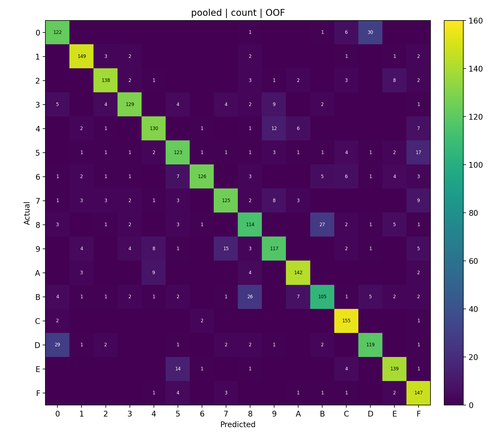

# EXP유002 — Combined Error Analysis: 가설 A·B 연구 우선순위 결정

> **실험 ID:** EXP-CMB-002 · **상태: 실험 완료 / 연구 방향 결정**
>
> **연구 목표:** Combined의 잔존 오류를 작성자·클래스·이미지 특성별로 분석하여, **가설 A(픽셀·획 형태 판단)**, **가설 B(위치·크기·공간·명암 특성)** 또는 둘 모두에 대한 추가 연구의 우선순위를 증거로 결정한다.
>
> **결론:** **가설 B를 우선 검증**, 가설 A의 **독립적인 획 인접·연결 구조 가설은 보류**한다. 실험에서 입증된 것은 **작성자·클래스별 공간/잉크 특징과 오류의 연관성**이지, 전처리 도입 시 정확도가 올라간다는 효과는 아니다. 후속 개선 실험의 결과가 나오기 전까지 최종 Pipeline을 바꾸지 않는다.

**실행 근거:** [GitHub Actions #43742381093](https://github.com/ryu980920/Machine_Learning/actions/runs/43742381093) 초기 분석 · [#43742905999](https://github.com/ryu980920/Machine_Learning/actions/runs/43742905999) 형태·픽셀 교환 대조 · [#43743082289](https://github.com/ryu980920/Machine_Learning/actions/runs/43743082289) 오류쌍별 임계값 안정성 재검증 (모두 성공). **MLP 재학습 0회**.

## 1. 문제 발견 — 기존 OOF와 모델 재현

- 기존 [EXP-CMB-001](../EXP유001_Combined_MLP_4Fold_CV_Baseline.md)의 Normal 1개 + 보류 작성자별 Combined 4개 모델 파일을 SHA-256으로 검증해 로드했다. 공식 원본 파일 및 4개 Hand-made NPZ의 SHA-256도 manifest와 대조.
- **2,560개 Normal·Combined 원본 예측 100% 일치**, Combined Accuracy **2,080/2,560 = 81.2500%**.
- 기존 오답 480장 중 **418장**은 Normal도 오답(같은 오답 270, 다른 오답 148), **62장**은 Normal 정답에서 Combined 오답이 된 사례. Normal 오답→Combined 정답 **540장**.
- 주요 혼동: **0→D 30장**, **D→0 29장**, **8→B 27장**, **B→8 26장**. 0/D 합계 59, 8/B 합계 53. 이 두 실제 클래스쌍 관련 이미지 **640장**(각 클래스 160장)을 분석했다.

| 보류 작성자 | 0→D | D→0 | 8→B | B→8 | Combined Accuracy |
|---|---:|---:|---:|---:|---:|
| 41 | 0 | 16 | 1 | 14 | 75.9375% |
| 42 | 0 | 11 | 2 | 5 | 85.6250% |
| 43 | 28 | 1 | 18 | 0 | 78.5938% |
| 44 | 2 | 1 | 6 | 7 | 84.8438% |

- [작성자별 Count/Row-normalized CM 전체](../../results/Error_Analysis/README.md)
- [실제 오류·정답 0/D 이미지 Grid](../../results/Error_Analysis/figures/error_grid_0D.png)
- [실제 오류·정답 8/B 이미지 Grid](../../results/Error_Analysis/figures/error_grid_8B.png)

## 2. 원인 가설

- **가설 B — 공간/명암 특징:** 글자의 중심·너비·높이·잉크량·밝기·공간적 잉크 배치가 같은 작성자·실제 클래스 안에서도 정답/오답과 연관되어 있다.
- **가설 A — 픽셀·획 형태 판단:** 특정 좌표/획 영역의 차이가 MLP 클래스 점수를 바꾸며, **획의 인접 연결 구조 자체**를 변경한 경우 일반적인 동일 규모의 픽셀 변경보다 더 큰 영향을 줄 수 있다.
- 두 가설의 특징은 일부 겹친다. 픽셀 기여도 또는 공간 상관관계 하나만으로 어느 원인이 유일한지 확정하지 않는다.

## 3. 통제 조건

- 실제 Hand-made **2,560장**, 작성자 41–44별 **640장**. 집중 분석 0/D/8/B **640장**. 원본 OOF의 작성자·이미지 행번호로 실제 28×28 Grayscale에 연결.
- **각 이미지에는 해당 작성자를 학습에서 보류한 Combined 모델만 사용**, 공통 Normal 모델은 원래 EXP-CMB-001의 모델만 사용.
- 기준 MLP 하이퍼파라미터·가중치 고정, 추가 이미지 학습 없음.
- 이미지를 분석할 때 정답 레이블과 작성자 ID는 **연구용 집계**에만 사용. 이를 모르는 최종 추론에 사용할 전처리 규칙으로 적용하지 않는다.
- 공식 Original Test 16,000장·교수님 최종 Test **미사용**.

## 4. 가설 B 증거 — 동일 작성자·실제 클래스 내부 비교

### 4.1 전체 평균만 보면 원인을 놓칠 수 있음

0/D/8/B의 **640장 중 오답 180장**을 대상으로, 작성자·실제 클래스 16개 층 안에서 정오답 라벨을 **2,500회 순열검정**, 공간/명암 7개 특징의 Benjamini–Hochberg FDR을 계산했다.

**전체 통합에서 유의한 특징 없음:** 최소 보정 q = **0.4831**. 모든 작성자·클래스에 같은 크기·중심 보정을 하는 것은 아직 근거가 없다.

형태/공간 분포 지표 11개를 추가해 같은 640장에 **3,000회 층화 순열검정**을 시행한 결과, **상하 잉크 분포 비대칭**만 유의했다: 오답−정답의 층내 표준화 차이 **+0.225**, p = **0.0030**, FDR q = **0.0330**. 이는 공간적 잉크 분포와 관련된 약한 집단적 연관성이며, 형태의 의미 자체를 입증하지 않는다.

### 4.2 원인이 집중된 작성자·클래스

Baseline 오류 패턴에서 선정한 5개 작성자×실제 클래스 집단에 대해 **7개 공간 특징 + 11개 형태 특징**, 총 90개 비교에 대한 FDR을 적용했다. **6개 비교가 q<0.05**였다. 선정 집단은 이전 결과를 보고 고른 것이므로 이 검정은 **탐색적**이다.

| 작성자·실제 클래스 | 주요 오답 집단 | 정오답 비교 시 확인된 차이 | 90개 비교 FDR |
|---|---|---|---|
| **43번 / 8** | 8→B 중심 | 오답의 Bounding Box 너비 **+2.529px**, Ink Ratio **+0.0461**, 평균 밝기 **+11.026**, 중앙부 잉크 질량 비율 **−0.0930** | 각각 q≈**0.0337** |
| **41번 / D** | D→0 중심 | 오답의 가로 무게중심 x **+0.622px**, 왼쪽 잉크 질량 비율 **−0.1010** | q≈**0.0360 / 0.0375** |

단, 위 표는 해당 클래스의 **모든 오답 vs 정답** 비교이므로 구체적인 8→B, D→0만을 대상으로 한 결과가 아니다. 이를 구분하기 위해 아래 직접 오류쌍 검증을 추가했다.

### 4.3 실제 목표 오분류쌍의 임계값 안정성

같은 작성자·실제 클래스에서 **해당 오분류만** 추출하여 정상 분류 사례와 비교했다. 전경 기준 threshold를 **32, 64, 128**로 바꿔도 방향이 유지되는지 검증했다. 이미지별 4,000회 순열검정, 사후 지정한 20개 비교에 BH 보정 (탐색적 재검증).

| 비교 대상 | 오분류 vs 정답 수 | 실제 관찰 | 보정 q |
|---|---:|---|---:|
| **43번 8→B** | 18장 vs 17장 | 너비 **14.278 vs 12.471px**, **+1.807px**; threshold 32·64·128에서 동일 | **0.0033** |
| 43번 8→B | 18 vs 17 | Ink Ratio **0.2681 vs 0.2225**, **+0.0457**; 3개 threshold에서 방향 유지 | **0.0030** |
| **41번 D→0** | 16 vs 18 | x 무게중심 **12.890 vs 12.210px**, **+0.681px**; 3개 threshold에서 방향 유지 | **0.0033** |
| **43번 0→D** | 28 vs 7 | y 무게중심 **13.637 vs 14.052px**, **−0.415px**; 3개 threshold에서 방향 유지 | **0.0087** |
| 41번 B→8 | 14 vs 14 | 너비 **−1.214px** 차이, **유의하지 않음** | **0.2758** |

**판단:** 현재 오류는 공통적인 하나의 너비/중심 방향으로 설명되지 않는다. 하지만 **특정 작성자·클래스에서 반복되는 공간/잉크 특징 차이**는 충분히 관찰되므로, **가설 B의 효과를 입력 고정 실험에서 우선 확인할 가치가 있다**.

이 값들은 **관찰적 차이**다. 사용한 동일 개발용 Hand-made에서 선택한 집단을 다시 검증했으므로, 별도 독립 데이터의 재현 결과 또는 이미 입증된 전처리 정확도 향상으로 해석하면 안 된다.

## 5. 가설 A 증거 — 픽셀 기여도 vs 형태 인접성

### 5.1 픽셀 위치·영역 효과

- 실제 **89개 서로 다른 손글씨**, Normal/Combined 모델 조건 합계 **178개 Signed IG·정답−경쟁 Logit Margin** 진단. IG 산출과 잔차를 기록했다.
- 사전 지정한 좌측·우측·중앙 영역의 전경 픽셀을 제거한 후 동일 수의 임의 전경 제거 32회를 대조했다.
- 예를 들어 중앙 수평 영역의 **절대 Logit 변화 추가 효과 +4.082**, 이미지 단위 bootstrap 95% 구간 **[2.438, 5.925]**.

하지만 영역 제거 시 **총 밝기·Bounding Box·CoM·획의 형태가 함께 달라질 수 있기 때문에** 이 결과는 특정 좌표의 중요성만 시사한다. **획의 연결 구조 자체를 사용한다는 증거로 단정하지 않는다.**

### 5.2 총 밝기와 Bounding Box를 보존한 픽셀 교환 대조

추가 **62개 실제 원본 이미지 선정**, 제약을 만족하는 **61개 이미지**에서 각 변형마다 **전경/배경 픽셀 네 쌍 교환(총 8개 좌표 변경)**을 수행했다.

- **보존:** 전체 0–255 픽셀값 히스토그램, 총 밝기, threshold 128 전경 수, Bounding Box.
- **제약:** 픽셀 이동거리 매칭, 중심 이동량 **0.3px 이하**.
- **비교:** 4-이웃 전경 연결을 많이 감소시킨 후보 vs 같은 횟수·유사 이동거리의 대조 후보. 모델 출력으로 조작 후보를 선택하지 않았다.
- 이미지마다 8개 변형/조건을 평가하고 **서로 다른 원본 이미지 61개를 통계 단위**로 부트스트랩했다.

| 비교 범위 | 원본 이미지 수 | 획 인접성 감소군 − 대조군 절대 Logit 변화량 | 이미지 단위 95% 구간 |
|---|---:|---:|---|
| 전체 0/D/8/B | 61 | **+0.076** | **−0.090 ~ +0.246** |
| 0/D | 29 | +0.105 | −0.125 ~ +0.336 |
| 8/B | 32 | +0.051 | −0.184 ~ +0.288 |

**판단:** 획 연결성 감소 조작의 추가 영향은 **일관되게 확인되지 않았다**(모든 구간에 0 포함). 4-이웃 연결 수는 사람이 보는 의미 있는 획 형태와 동등하지 않고, 소수점 단위 CoM을 완전히 고정한 것도 아니다. 이 결과는 **가설 A의 모든 형태 학습 가능성을 기각하지는 않지만**, 지금 당장 별도 형태 교정 실험을 우선 수행할 근거는 부족하다는 의미다.

## 6. 가설별 결론 — 실험 목적 판정

| 가설 | 이번 실험에서 지지된 범위 | 추가 연구 가치 | 판정 |
|---|---|---|---|
| **B — 위치·크기·명암 및 공간 분포** | 작성자·클래스별 정오답 사이 특징 차이, 목표 오류쌍·임계값 안정성 확인 | **높음** — 모델 고정 단일 입력 조작으로 실제 교정/신규 오류를 검증해야 함 | **우선 진행** |
| **A — 픽셀·획 연결 구조** | 특정 픽셀 영역 민감도는 확인, 그러나 연결성 훼손이 적절한 대조군보다 추가 영향을 낸다는 근거 부족 | **조건부 보류** — B 검증 이후에도 남는 오류에서 의미 있는 형태 조작·사람 평가가 필요하면 재개 | **당장 독립 실험 진행 안 함** |

**EXP유002의 목적은 달성했다.** 이 실험이 증명한 것은 **무엇을 다음에 우선 검증할 가치가 있는지**이지, 오류의 완전한 인과 원인이나 개선된 최종 정확도는 아니다. 따라서 **가설 B를 우선 선택, 가설 A는 배제하지 않고 보류**하는 것으로 실험을 종료한다.

다음 [EXP유003 Input Sensitivity](EXP유003_Input_Sensitivity.md)에서는 41번 D→0의 중심 위치와 43번 8→B의 너비·잉크량에 대한 **라벨 비사용 입력 변형**을 기존 모델에 적용하고 교정·새 오답을 함께 확인한다. 원본 평가 이미지의 실제 정답 레이블을 아는 경우만 변환하는 규칙은 배포할 수 없다. **후속 실험은 아직 실행하지 않았다.**

## 7. 결과 및 재현 파일

- [실측 결과 폴더 / 파일 설명](../../results/Error_Analysis/README.md)
- [1차 전체 비교 SUMMARY](../../results/Error_Analysis/SUMMARY.md) · [형태·픽셀 교환 검증 요약](../../results/Error_Analysis/FOLLOWUP_SUMMARY.md)
- [전체 특징값 2,560장](../../results/Error_Analysis/image_features.csv) · [전체 형태 특징 2,560장](../../results/Error_Analysis/morphology_features.csv)
- [공간 7개 지표 층화 순열 검정](../../results/Error_Analysis/feature_associations.csv) · [형태 11개 지표 검정](../../results/Error_Analysis/morphology_associations.csv)
- [사전 선택 작성자×클래스 90개 검정](../../results/Error_Analysis/targeted_writer_class_tests.csv) · [오류쌍·임계값 20개 후속 확인](../../results/Error_Analysis/pair_specific_threshold_sensitivity.csv)
- [픽셀 교환 대조 및 통계](../../results/Error_Analysis/topology_contrasts.csv) · [실제 선택 IG](../../results/Error_Analysis/margin_ig_diagnostics.csv)
- 실행 코드: [기초 특징·IG·지역 제거](../../scripts/exp_cmb002_evidence.py) / [형태·픽셀 교환·임계값 안정성](../../scripts/exp_cmb002_followup.py)
- 실행 결과 JSON: [evidence_summary.json](../../results/Error_Analysis/evidence_summary.json), [FOLLOWUP_EVIDENCE.json](../../results/Error_Analysis/FOLLOWUP_EVIDENCE.json)

**한계:** Hand-made 4명 OOF를 이미 여러 차례 분석했으며, 위 사후 선정 집단은 독립된 외부 검증이 아니다. 강한 상관관계라도 기계적 인과를 증명하지 않는다. 데이터·실험 변형·후속 가설 선택은 모두 개발 단계에 국한한다.
