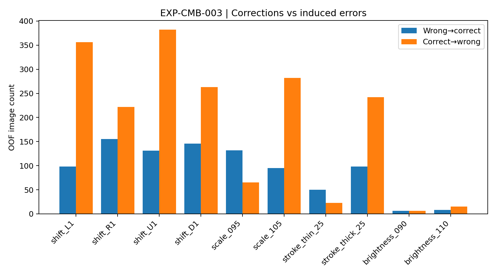
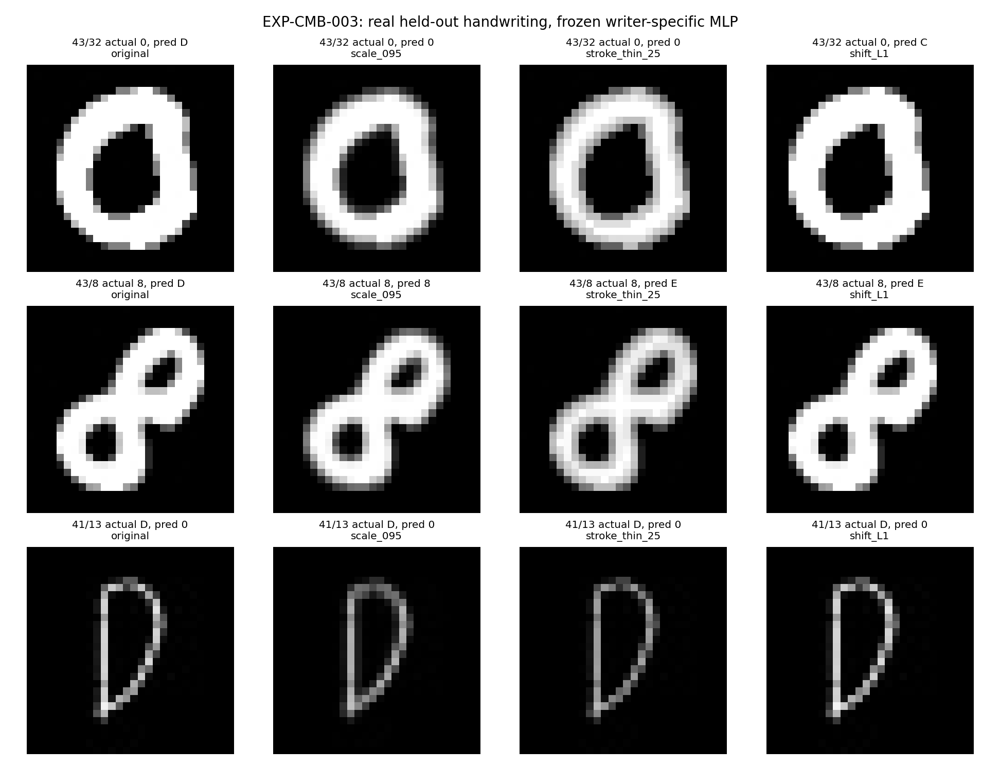
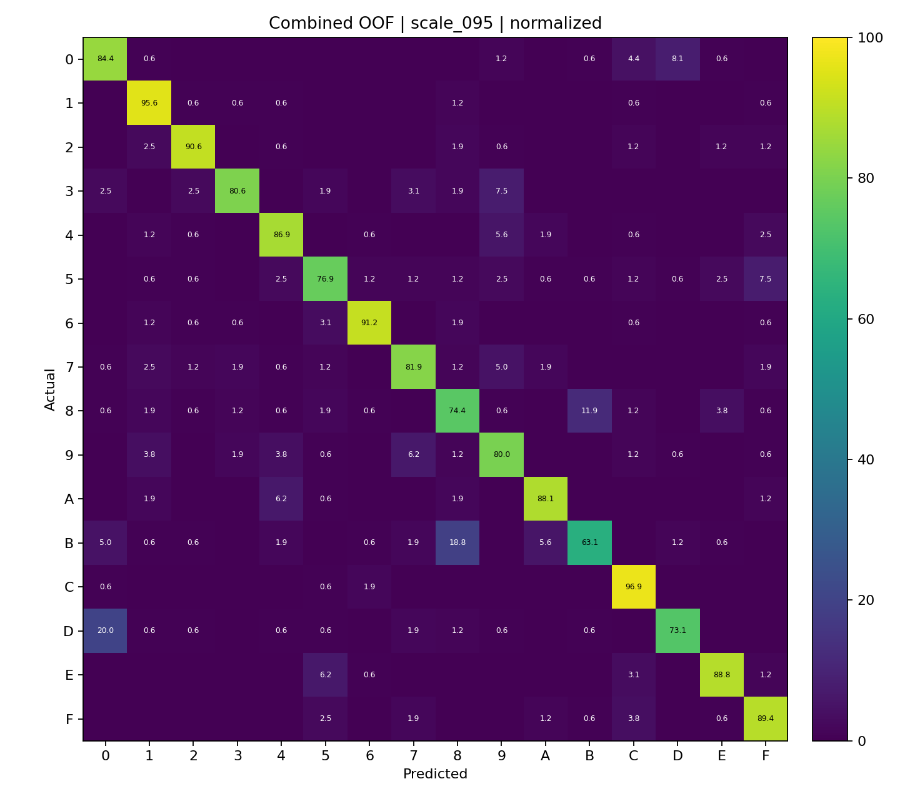

# EXP유003 — Combined 입력 민감도 검증 (실험 완료)

> **실험 ID:** EXP-CMB-003 · **연구 목적 판정: 달성** · **상태: 실행 완료 / 후속 4-Fold 재학습은 미실시**
>
> **질문:** EXP유002에서 확인한 작성자별 위치·크기·획 특징이 실제 오류에 영향을 주는가? 단일 변형으로 오답을 교정하면 어떤 부작용이 있는가? 어떤 조건이 후속 통제 재학습을 할 가치가 있는가?
>
> **결론:** 가설 B의 입력 민감성은 실측으로 확인. **95% 축소는 전체 OOF +2.6172%p이나 개선이 43번에 집중되고 공식 개발 Validation이 4개 Fold 전부 악화**했다. **획 얇게 25%는 OOF +1.0547%p**이며 사전 정의한 후속 후보 선별 기준을 통과했다. 다만 41번 및 문자 성능이 악화해 최종 전처리로 채택하지 않는다. **일괄 ±1px 중심 이동은 근거 부족**. 새 모델 학습은 하지 않았다.

## 1. 문제 발견 및 선행 근거

[EXP유001 Baseline](../EXP유001_Combined_MLP_4Fold_CV_Baseline.md)에서는 보류 작성자 OOF 2,560장 가운데 2,080장 정답(81.2500%)이었다. [EXP유002](EXP유002_Error_Analysis.md)는 43번의 8→B 오답이 같은 작성자의 정답 8보다 너비 +1.807px, Ink Ratio +0.0457이고, 41번의 D→0 오답은 x 중심이 +0.681px 오른쪽이라는 관찰적 차이를 확인했다. 이 차이가 입력 변화에 따른 오분류 교정으로 연결되는지 검증한다.

## 2. 통제 조건

- 기존 EXP-CMB-001 **Normal 모델 1개 + Combined 작성자 보류 모델 4개**를 SHA-256 검증 후 로드. 기존 Normal·Combined OOF 2,560개 예측 **100% 재현**.
- 기존 Hand-made 4명 각 640장, 16클래스 균형, 기존 작성자 보류 Fold 유지. 모든 작성자·클래스 이미지에 **똑같은 변형**을 적용하며 정답/작성자에 따른 추론 시점 선택 없음.
- 모델 가중치 고정, 추가 학습 0회. 공식 기존 Group-aware Validation 19,200장에도 같은 변형을 적용. **공식 Original Test 및 교수님 최종 Test 미사용**.
- [Normal Input Sensitivity 구현](../../../Normal/scripts/Input_Sensitivity.py)과 동일한 조작: 위치 좌/우/상/하 1px 이동(경계 0), 크기 95%/105%(중심 13.5px, Bilinear affine), 획 얇게·두껍게(3×3 grayscale 최소/최대 필터를 25% 혼합), 밝기 90%/110%. 각 변수 독립 적용, 0–255 반올림/클리핑 후 기존 X/255 평가.
- 평가: OOF Accuracy/Macro F1, 동일 이미지 오답→정답/정답→오답/예측 변경, 작성자·숫자/문자·클래스별 성능, 0↔D/8↔B, 정답−경쟁 Logit Margin, 공식 Validation 성능, 전처리·추론 진단. 10개 변형에 대응 McNemar exact p 및 BH 다중검정 사용.
- 사용한 OOF는 이미 여러 차례 분석한 개발 데이터이며 이미지별 검정의 p값이 **새 작성자에 대한 독립 일반화 증거는 아니다**.

## 3. 전체 OOF 실측

| 고정 가중치·입력 변형 | Combined Accuracy | Baseline 대비 | 교정 | 신규 오답 | 예측 변경 |
|---|---:|---:|---:|---:|---:|
| Original | **81.2500%** | — | — | — | — |
| 좌 1px | 71.1719% | −10.0781%p | 98 | 356 | 22.54% |
| 우 1px | 78.6328% | −2.6172%p | 155 | 222 | 18.05% |
| 위 1px | 71.4453% | −9.8047%p | 131 | 382 | 24.06% |
| 아래 1px | 76.6797% | −4.5703%p | 146 | 263 | 20.12% |
| **크기 95%** | **83.8672%** | **+2.6172%p** | **132** | **65** | 9.57% |
| 크기 105% | 73.9453% | −7.3047%p | 95 | 282 | 17.77% |
| **획 얇게 25%** | **82.3047%** | **+1.0547%p** | **50** | **23** | 3.40% |
| 획 두껍게 25% | 75.6250% | −5.6250%p | 98 | 242 | 16.21% |
| 밝기 90% | 81.2500% | 0.0000%p | 6 | 6 | 0.51% |
| 밝기 110% | 80.9766% | −0.2734%p | 8 | 15 | 1.25% |

- 크기 95%: Macro F1 **0.812043→0.837672**, 교정 132/신규 65 (순이득 **67장**); McNemar exact p=**2.074×10⁻⁶**, 10조건 BH q=**3.456×10⁻⁶**.
- 획 얇게 25%: Macro F1 **0.812043→0.822512**, 교정 50/신규 23 (순이득 **27장**); exact p=**0.002118**, BH q=**0.002648**.
- 두 수치는 *기존 가중치에 다른 입력을 넣은 결과*이며 Train/Validation을 모두 바꿔서 재학습한 결과가 아니다.

## 4. 작성자·숫자/문자별 효과 및 부작용

| 보류 작성자 | Original | 크기 95% | 획 얇게 25% |
|---|---:|---:|---:|
| 41 | 75.9375% | 76.4063% (+3장) | **75.1563% (−5장)** |
| 42 | 85.6250% | 85.3125% (−2장) | 85.9375% (+2장) |
| 43 | 78.5938% | **89.0625% (+67장)** | **82.5000% (+25장)** |
| 44 | 84.8438% | 84.6875% (−1장) | 85.6250% (+5장) |

**95% 축소의 전체 순개선 67장 중 순증가 67장 모두가 43번에서 발생**했다. 다른 세 작성자의 순변화 +3−2−1은 합계 0장. 따라서 전체 Accuracy 상승이 작성자 전반의 개선을 의미하지 않는다.

| 클래스 그룹 | Original Accuracy | 크기 95% | 획 얇게 25% |
|---|---:|---:|---:|
| 숫자 0–9, n=1600 | 79.5625% | 84.2500% (+4.6875%p) | 81.6250% (+2.0625%p) |
| 문자 A–F, n=960 | 84.0625% | **83.2292% (−0.8333%p)** | **83.4375% (−0.6250%p)** |

숫자/문자 Macro F1은 그룹별 해당 10개/6개 클래스만으로 재계산하고 검증했다. [그룹별 Precision·Recall·F1](../../results/Input_Sensitivity/digit_letter_metrics.csv)에 원본 수치를 저장했다.

## 5. 목표 혼동쌍과 실제 이미지

| 핵심 목표 오류 | 원본 오답 수 | 95% 축소 후 | 획 얇게 후 |
|---|---:|---:|---:|
| **43번 0→D** | 28 | **11** | 24 |
| **43번 8→B** | 18 | **9** | 17 |
| **41번 D→0** | 16 | **21** | 16 |
| **41번 B→8** | 14 | **17** | 14 |

95% 축소에서 **43번의 정답−경쟁 logit margin**은 0−D **+11.312**, 8−B **+9.815** 증가했으나, **41번의 D−0은 −1.029, B−8은 −0.601** 감소했다. 전체 95% 축소 시 0→D 30→13, D→0 29→32, 8→B 27→19, B→8 26→30. 상반된 방향으로 움직이는 혼동을 하나의 일률적 Size 보정으로 완전히 해결할 수 없었다.

획 얇게 25%는 0→D 30→25, D→0 29→29, **8→B 27→30(오히려 악화)**, B→8 26→26으로 핵심 두 쌍을 모두 해결한 것은 아니다.

## 6. 공식 개발 Validation 보존

| 저장 Combined 모델 | Original 공식 Val | 크기 95% Δpp | 획 얇게 25% Δpp |
|---|---:|---:|---:|
| 보류 41 | 96.5313% | **−0.9375** | **−0.2031** |
| 보류 42 | 97.2604% | −0.3750 | −0.0625 |
| 보류 43 | 97.3594% | −0.3854 | −0.0938 |
| 보류 44 | 97.3177% | −0.4219 | −0.0521 |

네 Fold 모두 공식 개발 Validation이 하락했다. 축소는 특히 보류 41의 공식 Val을 −0.9375%p 하락시켰으며, 얇게 25%의 공식 Val 손실은 Fold별 −0.0521∼−0.2031%p에 그쳤다.

## 7. Normal과의 입력 안정성 비교

| 변형 | Normal Prediction Flip Rate | Combined Prediction Flip Rate |
|---|---:|---:|
| 좌 1px | 35.59% | **22.54%** |
| 우 1px | 27.73% | **18.05%** |
| 크기 95% | 14.84% | **9.57%** |
| 획 얇게 25% | 5.90% | **3.40%** |

동일 변형에 대해 Combined의 예측 변경률이 더 작은 경향을 확인했다. 이는 시험한 조작에 한정한 관찰이며, 예측을 덜 바꾸는 것 자체가 높은 정확도를 보장하지는 않는다.

## 8. 목적 달성 판정 및 후속 실험 조건

**실험 종료 판정: 목적 달성.**

1. 실제 영향을 준 변수: **Size 축소·확대, 획 얇게·두껍게, 위치 이동** 모두 고정 Combined 예측을 유의미하게 바꿨다. 밝기 ±10%의 영향은 제한적이었다.
2. 교정/신규 오답 균형: 95% 축소 **132/65**, 얇게 25% **50/23**. 그러나 축소는 43번에만 순개선이 집중되고 문자·공식 Val이 악화했다.
3. 재학습 후보 선별: 사전 설정한 **OOF Accuracy +0.5%p 이상, 대응 McNemar BH q<0.05, 4명 중 3명 이상 비악화, 공식 Val 각 Fold −0.3%p 이내**를 **획 얇게 25%만 통과**했다. 95% 축소·일괄 ±1px 이동은 통과하지 못했다.

**향후 연구 판단:** 획 얇게 25%는 *Training과 추론 입력에 동일 변형을 적용한 4-Fold 재학습 검증*의 우선 후보이다. Size 95%는 43번 사례에서 관찰적 가치가 높아 추가 연구 대상이지만, 일률 적용 시 발생하는 편차·공식 Val 손실 때문에 **현재 상태 그대로 배포하지 않는다**. Center ±1px 일괄 이동은 선택하지 않는다.

새로운 MLP는 아직 학습하지 않았다. OOF는 동일 네 작성자를 반복 살펴본 **개발 평가**로서, 독립 신규 작성자 또는 별도 보존한 평가에서 최종 검증해야 한다.

## 9. 출처·산출물

- [실측 결과 전체](../../results/Input_Sensitivity/README.md) · [전체 OOF 비교](../../results/Input_Sensitivity/oof_metrics.csv) · [원본→변형 대응 예측](../../results/Input_Sensitivity/paired_predictions.csv.gz).
- [작성자별](../../results/Input_Sensitivity/writer_metrics.csv) · [숫자/문자](../../results/Input_Sensitivity/digit_letter_metrics.csv) · [클래스별](../../results/Input_Sensitivity/per_class_metrics.csv) · [혼동쌍별](../../results/Input_Sensitivity/pair_confusion_changes.csv).
- [정답−경쟁 logit](../../results/Input_Sensitivity/focus_margin_diagnostics.csv) · [공식 개발 Validation](../../results/Input_Sensitivity/official_validation_metrics.csv) · [변환 품질 진단](../../results/Input_Sensitivity/transform_diagnostics.csv).
- [재현 메타데이터](../../results/Input_Sensitivity/run_manifest.json) · [실행 코드](../../scripts/exp_cmb003_input_sensitivity.py).
- 최종 성공 실행 [GitHub Actions #43745629093](https://github.com/ryu980920/Machine_Learning/actions/runs/43745629093). 이전 성공 실행 #43745269717에서 숫자/문자 그룹 Macro F1 집계를 수정한 뒤 최종 재검증했다.
