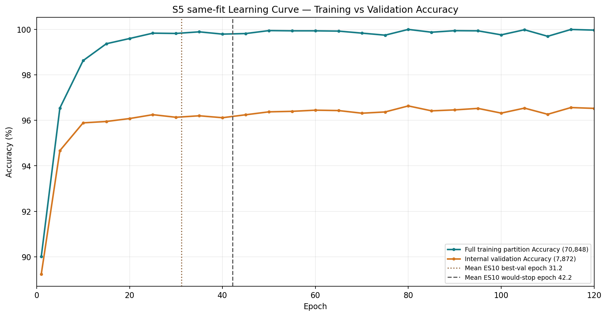
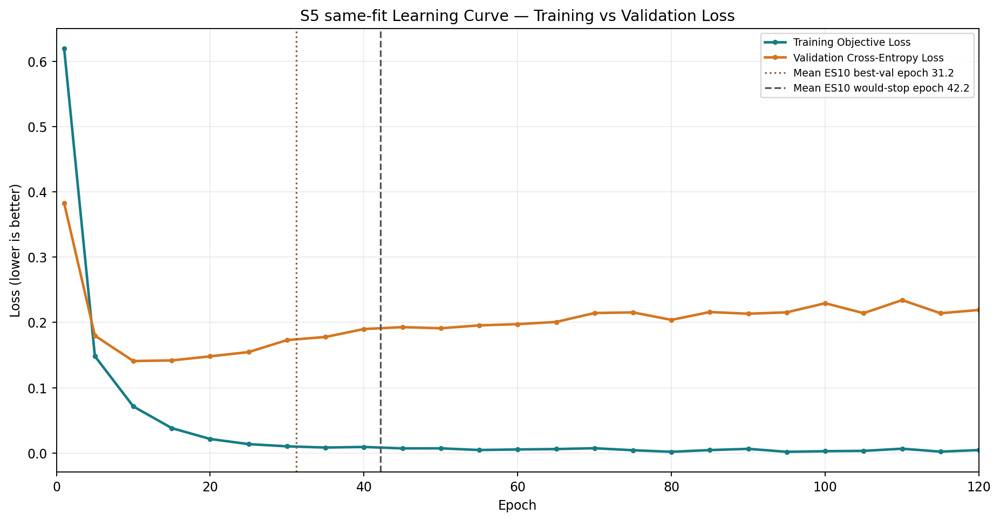
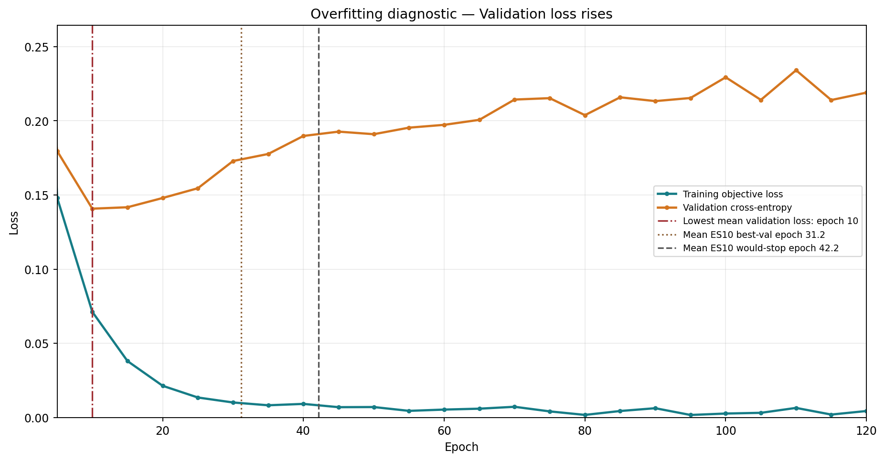
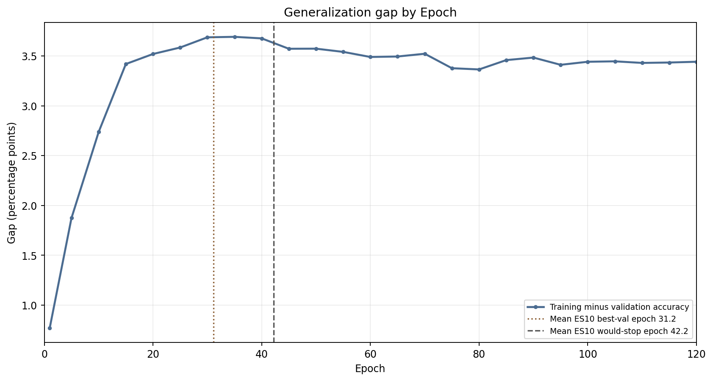
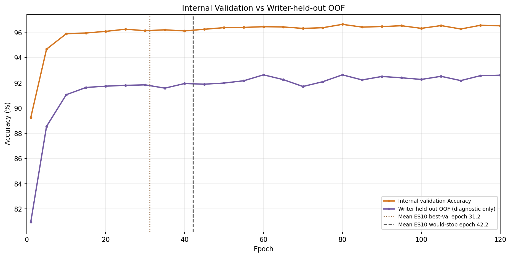
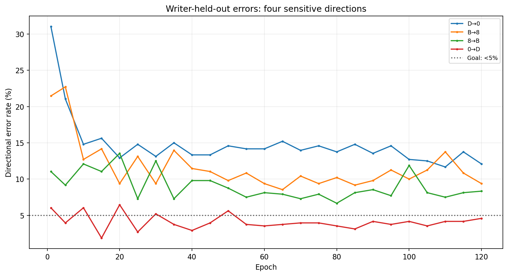

# EXP-CMB-008 · 16 Same-fit Training Accuracy / Validation Accuracy

이번 그래프의 Training Accuracy와 Validation Accuracy는 동일한 모델·Epoch·실행에서 실제 70,848개 Train과 7,872개 Internal Validation으로 계산했다. 각 Epoch별 12 Fold 평균이며, Training Accuracy는 부분 샘플이 아니라 전체 학습 집합이다.

## 1. Training vs Validation Accuracy

## 2. Training vs Validation Loss

## 3. Generalization gap

## 4. Internal Validation vs Writer-held-out OOF

## 실제 측정값

| Epoch | Training Accuracy | Internal Validation Accuracy | Training Objective Loss | Validation Cross-Entropy Loss | Train-Val gap |
|---:|---:|---:|---:|---:|---:|
| 1 | 90.011% | 89.239% | 0.619413 | 0.382708 | +0.772 pp |
| 5 | 96.542% | 94.668% | 0.148250 | 0.179677 | +1.874 pp |
| 10 | 98.627% | 95.889% | 0.071280 | 0.140814 | +2.738 pp |
| 15 | 99.369% | 95.950% | 0.038115 | 0.141763 | +3.420 pp |
| 20 | 99.599% | 96.079% | 0.021446 | 0.148005 | +3.520 pp |
| 25 | 99.835% | 96.249% | 0.013566 | 0.154576 | +3.585 pp |
| 30 | 99.823% | 96.135% | 0.010207 | 0.172923 | +3.688 pp |
| 35 | 99.893% | 96.201% | 0.008326 | 0.177679 | +3.693 pp |
| 40 | 99.793% | 96.116% | 0.009255 | 0.189815 | +3.677 pp |
| 45 | 99.818% | 96.245% | 0.007045 | 0.192724 | +3.573 pp |
| 50 | 99.948% | 96.374% | 0.007133 | 0.190995 | +3.574 pp |
| 55 | 99.938% | 96.397% | 0.004564 | 0.195401 | +3.541 pp |
| 60 | 99.938% | 96.447% | 0.005425 | 0.197302 | +3.490 pp |
| 65 | 99.926% | 96.430% | 0.006035 | 0.200674 | +3.495 pp |
| 70 | 99.837% | 96.314% | 0.007308 | 0.214339 | +3.523 pp |
| 75 | 99.747% | 96.369% | 0.004201 | 0.215277 | +3.378 pp |
| 80 | 100.000% | 96.635% | 0.001836 | 0.203818 | +3.365 pp |
| 85 | 99.877% | 96.418% | 0.004462 | 0.215856 | +3.459 pp |
| 90 | 99.944% | 96.460% | 0.006350 | 0.213289 | +3.484 pp |
| 95 | 99.937% | 96.526% | 0.001790 | 0.215388 | +3.412 pp |
| 100 | 99.761% | 96.318% | 0.002757 | 0.229352 | +3.442 pp |
| 105 | 99.985% | 96.538% | 0.003238 | 0.214110 | +3.447 pp |
| 110 | 99.697% | 96.266% | 0.006553 | 0.234103 | +3.431 pp |
| 115 | 99.998% | 96.563% | 0.002067 | 0.214009 | +3.435 pp |
| 120 | 99.969% | 96.527% | 0.004459 | 0.219016 | +3.442 pp |

## 동일 실행에서 재구성한 Early Stopping 판단
- patience=10일 때의 동일 실행 경로에서 계산한 평균 중지 Epoch: **42.17**, 평균 복원 Best Validation Epoch: **31.17**.
- 관측된 5-Epoch 간격에서 평균 Validation Loss 최저점: **10 Epoch**.
- 평균 Validation Accuracy 최고 관측점: **80 Epoch**.
- Early Stopping은 Accuracy 기준으로 체크포인트를 선택하므로, Loss 기준 과적합 시작점과 같은 Epoch일 필요가 없다.
- Training Objective Loss에는 L2 규제가 포함되며 Validation Log-loss는 예측 확률의 Cross-Entropy이므로 절대 수준을 동일 지표처럼 단순 비교하지 않는다.
- 같은 Fold의 같은 학습 경로에서 Train/Val를 추적한 자료여서 서로 다른 실행 결과를 정렬해 발생하는 착시를 줄였다.
- OOF는 오직 진단용이다. OOF의 최고 Epoch를 선택하면 새로운 Writer 데이터에 대한 선택 과적합을 유발할 수 있다.
- 독립 Test, 교수님 Test, 신규 480장 미사용. ES=False는 아직 최종 재검증 전 잠정 선택값이다.

## 원본
- [집계 CSV](../../results/Hyperparameter_Optimization/S5_SameFit_TrainVal/same_run_train_val_curve_aggregate.csv)
- [Fold별 Best/Stop Epoch](../../results/Hyperparameter_Optimization/S5_SameFit_TrainVal/per_fold_best_stop.csv)
- [요약 JSON](../../results/Hyperparameter_Optimization/S5_SameFit_TrainVal/diagnostic_summary.json)
