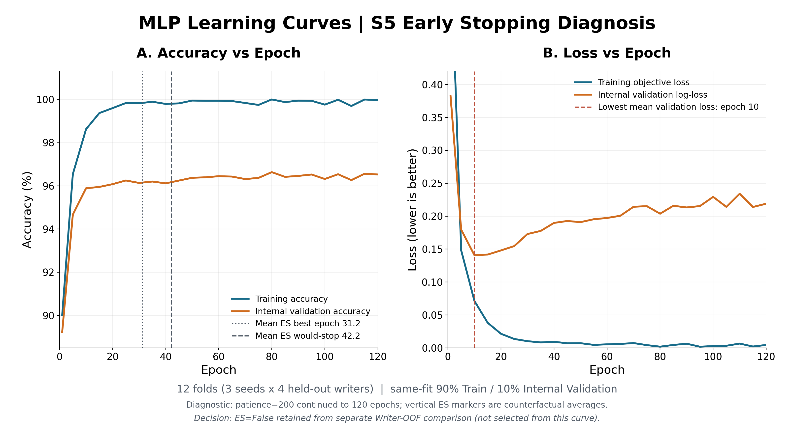
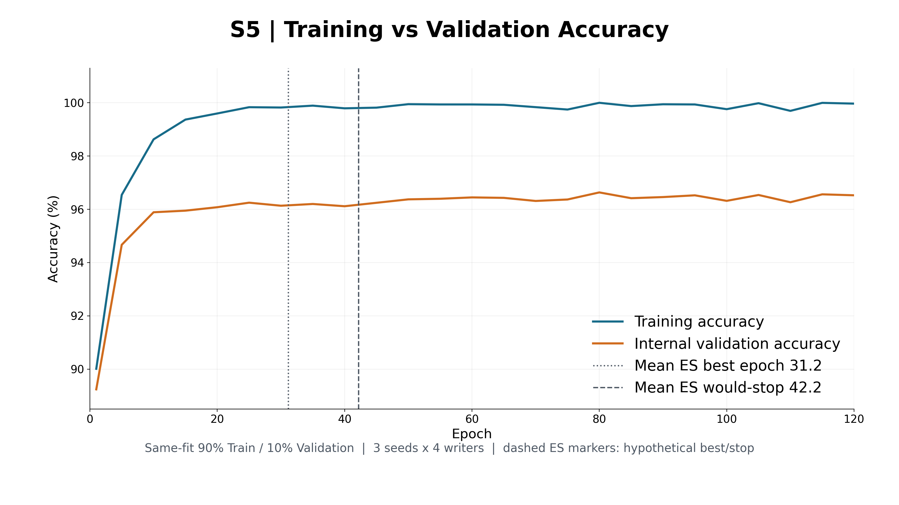
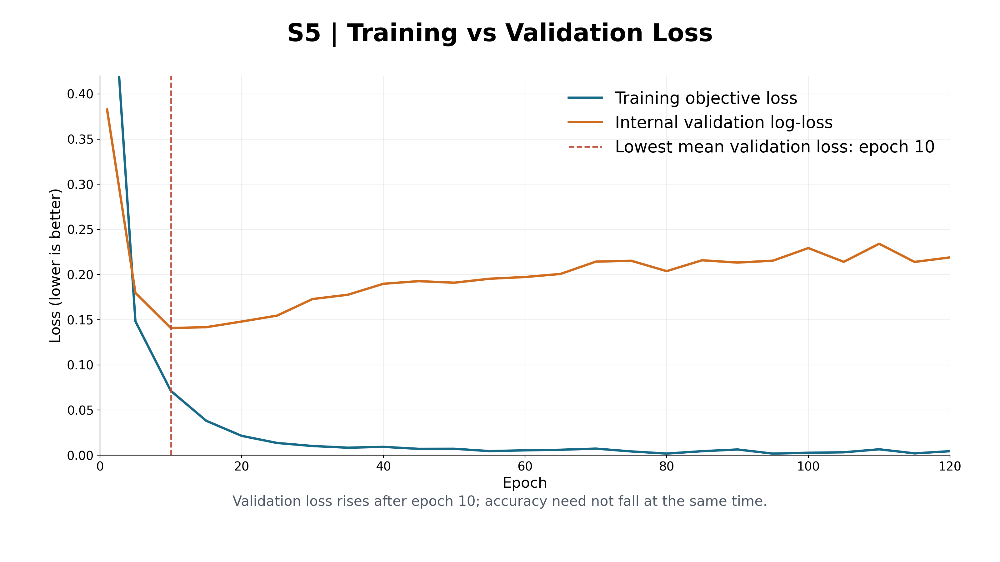

# EXP-CMB-008 · 18 발표용 Learning Curve 및 Early Stopping 결정

> **최종 결정(개발용): `early_stopping=False` 유지.** 본 문서는 기존 S1~S5와 Same-fit Learning Curve 결과를 발표에 바로 인용할 수 있도록 **그림 중심으로 요약**한 자료다. 신규 학습이나 모델 재선정은 수행하지 않는다.

## 발표 슬라이드용 핵심 그림 — Accuracy / Loss

**그림 1.** Epoch에 따른 **Training Accuracy(파랑)·Internal Validation Accuracy(주황)**, **Training Objective Loss(파랑)·Internal Validation Log-loss(주황)**. **가로축=Epoch**, 세로축=Accuracy(%) 또는 Loss. 그림의 점선은 동일 경로에서 patience=10이었다면 선택·종료했을 **평균 Best Epoch 31.17 / 평균 Would-stop Epoch 42.17**이므로 실제 120-Epoch 진단 학습이 중단된 위치가 아니다.

> **PPT 사용:** 위 PNG는 **16:9, 3200×1800px**로 생성한다. 한 장 슬라이드에 그림만 넣어도 두 패널을 읽을 수 있도록 별도 큰 글씨 버전을 사용한다. 아래 개별 그림은 필요할 때 각각 한 장으로 분리해 사용한다.

### Accuracy만 크게 보는 슬라이드

### 과적합 징후를 보여주는 Loss 슬라이드

## 핵심 실측값 (발표 표)

| 관찰 | Epoch 10 | Epoch 80 | Epoch 120 |
|---|---:|---:|---:|
| Training Accuracy | 98.627% | **100.000%** | **99.969%** |
| Internal Validation Accuracy | 95.889% | 96.635% | **96.527%** |
| Training Objective Loss | 0.071280 | 0.001836 | 0.004459 |
| Internal Validation Log-loss | **0.140814** | 0.203818 | **0.219016** |

- **측정 방법:** Size30% / Stroke28% / CoM, MLP (256,), alpha=0.0001, LR=0.001; **3 Seed × 4 Writer-held-out = 12 Fold 평균**.
- 각 Fold에서 **78,720장 Training 후보**를 **70,848장 실제 Train + 7,872장 내부 Validation**으로 분리했다. 두 Accuracy와 두 Loss는 **같은 네트워크, 같은 실행, 같은 Epoch**에서 측정했다.
- Training Accuracy가 거의 100%인데 Validation Accuracy는 **96%대에서 정체**하고, Validation Log-loss는 Epoch 10 이후 대체로 상승했다. **과적합 징후는 존재**한다. 다만 Validation Accuracy가 계속 감소하는 단조 하락 형태는 아니다.
- Training Objective Loss에는 L2 규제항이 포함되고 Validation Log-loss는 Cross-Entropy이므로 **두 값의 절대 크기보다는 추세와 일반화 격차**를 해석한다.
- 그림은 **ES=True의 내부 검증 분할을 유지하며 patience=200으로 120 Epoch까지 계속 학습한 진단 실행**이다. **최종 선정된 ES=False 모델 자체의 Learning Curve라고 말하면 안 된다.**

## 왜 Early Stopping=False를 유지하는가? — 원본 S5 직접 비교

| 원본 S5 평가 지표 | **ES=False (선정)** | ES=True |
|---|---:|---:|
| Hand-made 4 Writer OOF Accuracy | **92.214%** | 91.771% |
| OfficialVal Accuracy | **97.044%** | 97.025% |
| 실제 문자 D → 숫자 0 | **67 / 480 (13.958%)** | 77 / 480 (16.042%) |
| 실제 문자 B → 숫자 8 | **43 / 480 (8.958%)** | 49 / 480 (10.208%) |
| 숫자 8 → 문자 B | **38 / 480 (7.917%)** | 49 / 480 (10.208%) |
| 숫자 0 → 문자 D | **14 / 480 (2.917%)** | 14 / 480 (2.917%) |

**최종 판단:** ES=False는 기존 S5에서 **Writer OOF Accuracy가 더 높고 중요한 네 방향의 오분류가 늘지 않았기 때문에 유지**한다. 학습 곡선에는 과적합 징후가 있으므로 **ES=False가 과적합을 방지한다거나 과적합이 없다고 주장하지 않는다.** ES 세부 설정의 추가 탐색은 진행하지 않고 현재 개발용 HP를 유지한다.

**목표 미달:** D→0, B→8, 8→B, 0→D를 각각 5% 미만으로 낮추는 목표는 아직 충족하지 못했다. 동일 4 Writer OOF를 반복 활용한 선택 편향이 남아 있다. Original Test·교수님 Test·신규 손글씨 480장은 **사용하지 않았다**.

### 슬라이드 하단에 넣을 핵심 문장

> Training Accuracy는 99.97%까지 상승했지만 내부 Validation Accuracy는 96.53%에 머물고 Validation Loss가 증가해 과적합 징후가 관측됐다. 그럼에도 Early Stopping을 활성화한 모델은 Writer OOF 정확도와 주요 오분류가 악화되어 **현재 조건에서는 Early Stopping=False를 유지**했다.

## 근거 링크·재현 방법

- [S5 False vs True 실측](EXP-CMB-008_10_Stage5_EarlyStopping_Results.md) · [S1~S5 최종 HP 기록](EXP-CMB-008_11_Final_HP_Decision.md)
- [동일 실행의 원본 Learning Curve와 Epoch별 수치](EXP-CMB-008_16_S5_SameFit_TrainVal_Results.md) · [과적합 분석](EXP-CMB-008_17_S5_SameFit_Overfitting_Interpretation.md)
- [Learning Curve 집계 CSV](../../results/Hyperparameter_Optimization/S5_SameFit_TrainVal/same_run_train_val_curve_aggregate.csv) · [재현성·측정 요약](../../results/Hyperparameter_Optimization/S5_SameFit_TrainVal/diagnostic_summary.json)
- [16:9 이미지 재생성 코드](../../scripts/exp_cmb008_s5_presentation_curves.py) (입력 CSV/JSON 불변, 그래프만 재배치).
