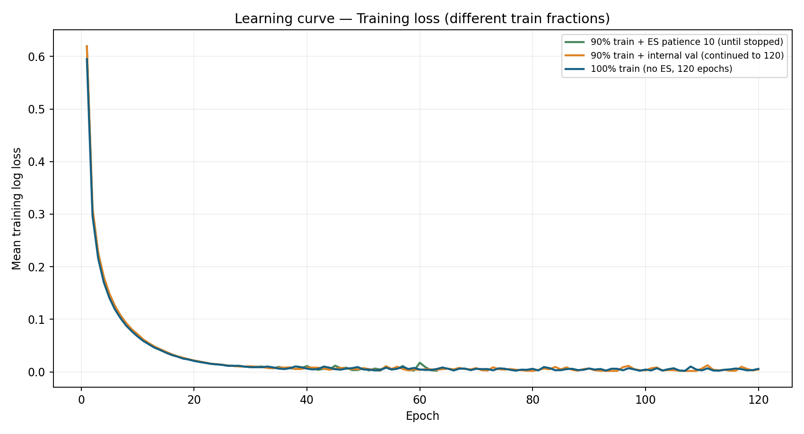
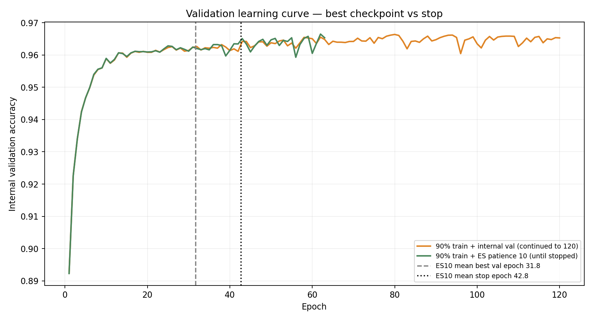
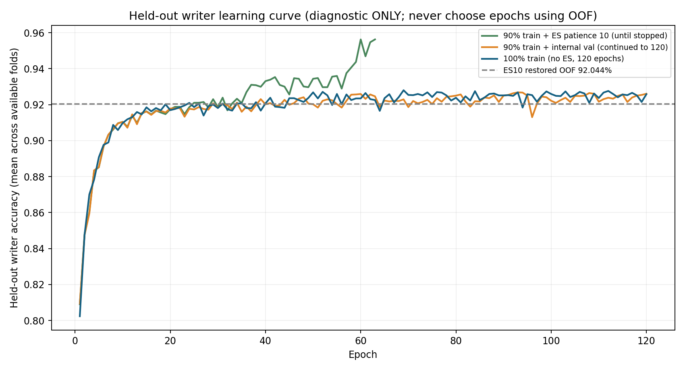
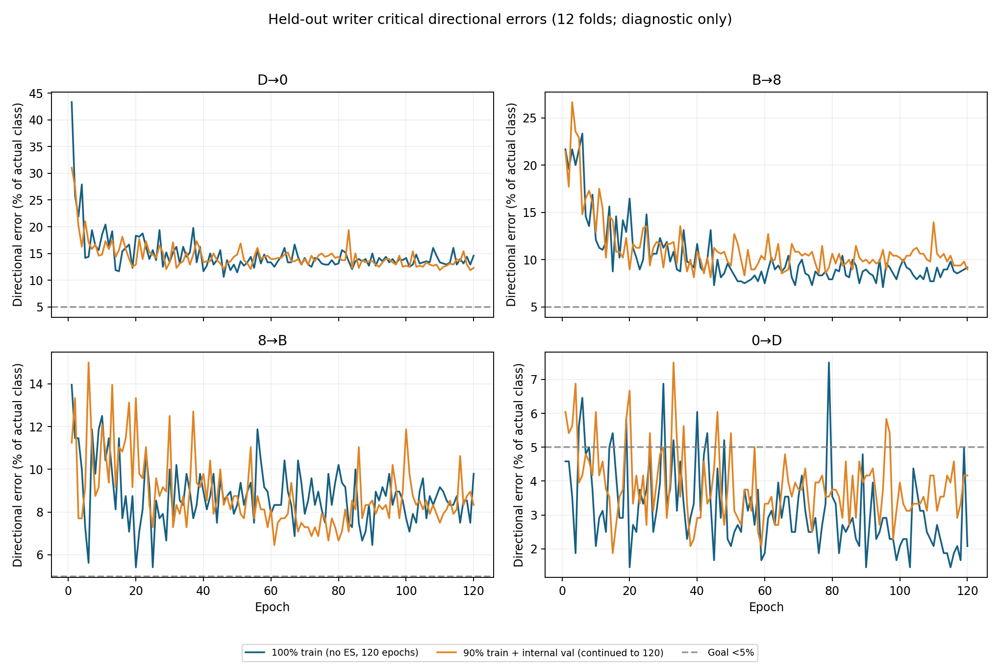
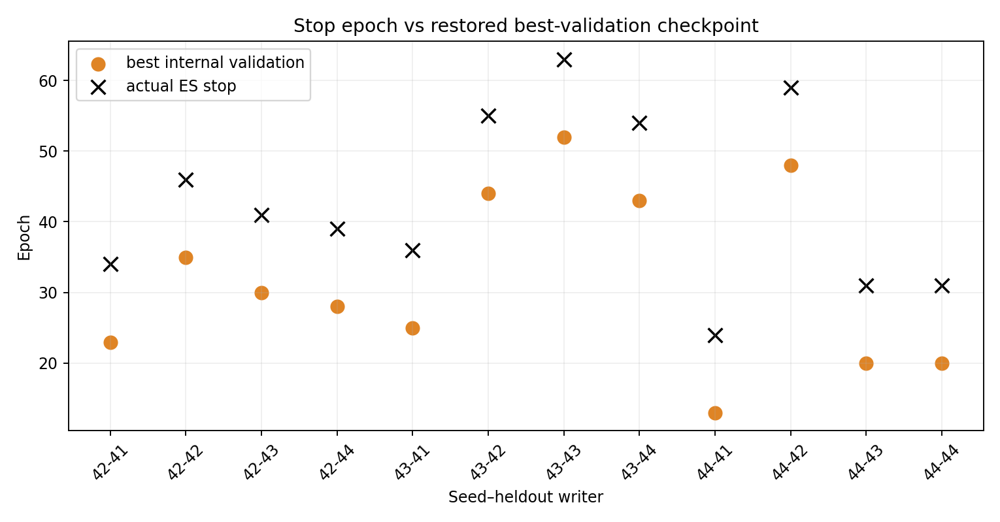

# EXP-CMB-008 · 13 Early Stopping Learning Curve 실측 보고

> **실측 완료:** 3 Seed × 4 Writer × 3 학습 조건 = 36개 실제 모델. 원본 S5/조건 간 재현성 차이를 모두 감사했으며 일치 여부를 반드시 아래에서 확인한다.
> **제한:** 120 Epoch 연장은 진단용이다. held-out OOF 최적 Epoch를 모델 선택에 사용하지 않는다. Original Test·교수님 Test·신규 손글씨 480장 미사용.

## 비교 설계와 실험 이유

| 조건 | Training / Validation | 종료 규칙 | 무엇을 구분하는가? |
|---|---|---|---|
| es10 | Training Fold 90% / 내부 Val 10% | 기존 S5 ES=True, patience 10, max_iter 200 | 실제 종료 위치와 검증 최고점 |
| internal120 | es10과 **동일한** 90% / 내부 Val 10% | 동일 초기값/Adam, patience 200, 120 Epoch 추적 | 종료 후 학습이 지속될 때의 변화 (OOF는 진단만) |
| full120 | Training Fold 100% | ES=False, patience 200, 120 Epoch 추적 | 10% 학습데이터 제외가 결과에 미치는 영향 (검증 분할도 변함) |

## 재현성 감사 (이 결과를 해석할 때 필수)

- **기존 S5 원본과 Stop Epoch 및 최종 OOF 예측까지 정확히 재현한 Fold:** 3/12.
- **계측 es10과 internal120가 Stop 이전 모든 Epoch Loss·Validation·OOF가 일치한 Fold:** 9/12.
- 이 차이는 같은 입력과 Seed를 지정해도 실행 환경/부동소수점 연산 순서 등의 요소가 달라질 수 있음을 보여준다. 원인을 확정하지 않은 상태에서 **원본 S5를 정확히 재현했다거나 동일한 optimizer 경로라고 주장하지 않는다**.
- 만약 일치 Fold가 12 미만이라면, 이어서 학습한 곡선과 기존 ES10은 엄격한 단일 변수 통제 비교가 아니라 독립 반복 궤적이다. OOF/Best Epoch 차이는 진단 참고 결과이며 인과적 결론·최종 HP 선택에 사용하지 않는다.
- Fold별 불일치 원본은 [진단 요약 JSON](diagnostic_summary.json)의 `replay_s5_audit`와 `continuation_audit` 참조.

## 실제 종료 및 최고 검증 체크포인트

- 이번에 재측정한 ES10의 평균 **Stop Epoch 42.75**, 평균 **최고 Validation Epoch 31.75**. 기존 S5에 발표된 평균 종료 횟수는 47.17 Epoch이다.
- **새로 재측정한 ES10**의 restored OOF = **92.044%**. 복원 모델 D→0=71, B→8=59, 8→B=46, 0→D=15건 (3 Seed×4 Writer, 실제 클래스당 480회). 기존 S5 원본은 OOF 91.771%, D→0 77건, B→8 49건, 8→B 49건, 0→D 14건이다.
- 모든 Fold의 실제 Stop/Best Epoch와 OOF 복원 성능은 [fold_checkpoint_summary.csv](fold_checkpoint_summary.csv) 보존.

## 실제 Learning Curve — 원본 데이터에서 생성한 PNG

## 사전 고정한 Epoch별 진단 체크포인트

| 조건 | Epoch | OOF 정확도 | D→0 | B→8 | 8→B | 0→D |
|---|---:|---:|---:|---:|---:|---:|
| internal120 | 40 | 92.018% | 64 | 52 | 47 | 14 |
| internal120 | 60 | 92.591% | 67 | 48 | 39 | 16 |
| internal120 | 80 | 92.500% | 69 | 51 | 32 | 18 |
| internal120 | 100 | 92.214% | 61 | 49 | 57 | 19 |
| internal120 | 120 | 92.604% | 59 | 43 | 40 | 20 |
| full120 | 40 | 92.070% | 56 | 56 | 43 | 29 |
| full120 | 60 | 92.344% | 64 | 36 | 38 | 9 |
| full120 | 80 | 92.383% | 63 | 38 | 49 | 17 |
| full120 | 100 | 92.591% | 68 | 44 | 37 | 10 |
| full120 | 120 | 92.578% | 70 | 44 | 47 | 10 |

## 어떤 가설을 검증했는가?

- **H1 조기 종료:** 위 사전 고정 Epoch 60/80/100/120의 internal120 OOF와 각 오류 방향을 원본 ES10 복원 모델과 비교해, 학습 지속이 실질적인 개선을 보이는지 판단한다. **가장 잘 나온 OOF Epoch를 사후 선택하지 않는다.**
- **H2 내부 검증/Writer 일반화 불일치:** Figure 2의 내부 Validation Accuracy 최고 구간과 Figure 3의 보류 Writer OOF 변화, Figure 4의 D→0을 나란히 비교한다.
- **H3 10% 학습데이터 분리:** 동일 Epoch에서 full120(100% 학습)과 internal120(90% 학습)을 비교한다. 내부 검증 사용/랜덤 미니배치의 차이까지 완벽히 분리한 인과 실험은 아니므로 '데이터 감소만의 효과'로 단정하지 않는다.
- **후속 의사결정:** Early Stopping 설정의 최종 채택/기각은 새 모델을 OOF 최고 Epoch에 맞춰 고르는 대신, Training 내부 validation 기반으로 미리 정한 변경안에서 다시 검증해야 한다.
- **과적합 주의:** 개발용 4 Writer를 S1~S5에서 반복 사용했으므로 추가 OOF도 독립 일반화 측정이 아니며, Original Test 및 교수님 Test는 그대로 봉인했다.

## 데이터와 재현

- [원본 Epoch별 관측 CSV](learning_curve_epoch_aggregate.csv) · [진단 요약 JSON](diagnostic_summary.json) · [Fold별 Stop/Best](fold_checkpoint_summary.csv)
- 기존 S5와 개별 Fold의 정확한 재현 여부를 `diagnostic_summary.json`에서 공개했다. 불일치한 경우 이전 S5 선택 성능을 새로운 곡선의 정확한 마지막 점과 혼동하지 않는다.
