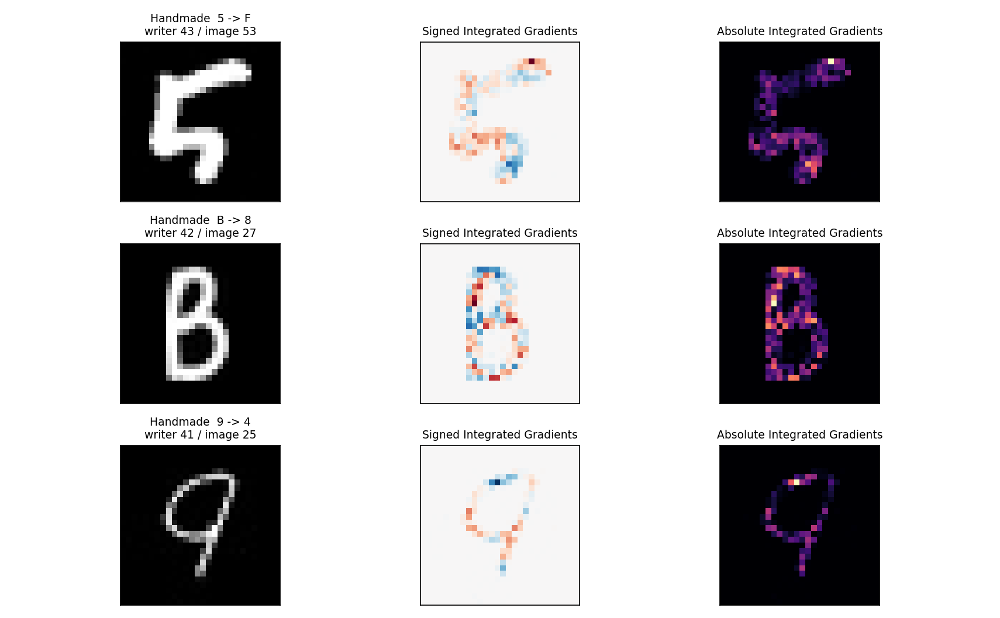
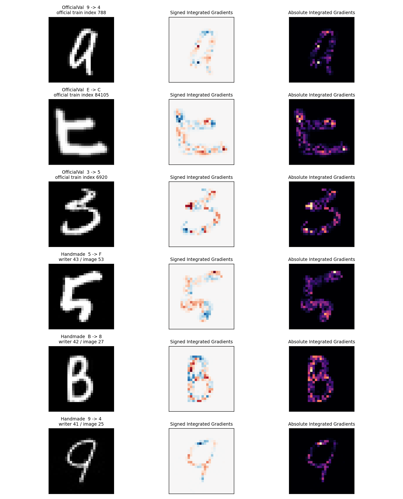

# EXP유001 | Normal MLP — Pixcel_Attribution (1·2단계)

> **실험 목적:** Normal MLP가 공식 MNIST·EMNIST에서는 높은 정확도를 보이지만 실제 팀원 손글씨에서는 성능이 낮은 이유를 파악하기 위해, 정상 분류와 오분류 이미지의 **실제 입력 픽셀 기여도**를 비교한다.
>
> **결론:** 기존 Normal Baseline의 예측을 재현하고 **98장**의 이미지에서 Integrated Gradients를 계산했다. 글자의 획을 구성하는 픽셀의 기여도를 확인했으나 **모델이 형태 자체를 충분히 학습했는지, 위치·명암·굵기가 주요 오차 원인인지는 1·2단계만으로 판정하지 않았다.** 해당 원인 검증은 별도 3단계 입력 변화 실험으로 분리한다.

| 항목 | 기록 |
|---|---|
| ID / 수행일 | **EXP유001 (MLP / Normal)** / 2026-11-15 |
| 담당 | 유용성 / 코드 실행·결과 검증 및 문서화 AI 보조 |
| 상태 | **1단계 표본 추출 + 2단계 픽셀 기여도 분석 완료** |
| 코드 | [Pixcel_Attribution.py](../scripts/Pixcel_Attribution.py) |
| 결과 | [results/Pixcel_Attribution/](../results/Pixcel_Attribution/README.md) |
| 실행 근거 | [GitHub Actions 성공 실행 #43624586601](https://github.com/ryu980920/Machine_Learning/actions/runs/43624586601) (초기 동일 분석 로직); [현재 재현 워크플로](../../../../.github/workflows/mlp_pixcel_attribution.yml) |
| 선행 자료 | [W02 Normal Baseline](../../../../03_experiments/W02_2026-11-09_11-15/logs/EXP유002_5개모델_Normal_Baseline.md), [W02 Hand-made 평가](../../../../03_experiments/W02_2026-11-09_11-15/logs/EXP유003_Handmade_방향보정_성능평가.md) |

## 1. 문제 발견과 원인 가설

- 공식 Validation 19,200장: **18,685장 정답 / 515장 오답 / 97.3177083% 정확도**.
- 현재 표준 Hand-made 2,560장: **1,609장 정답 / 951장 오답 / 62.8515625% 정확도**.
- 공식과 Hand-made에서 함께 확인된 혼동: **9→4(18/14건), E→C(19/6건), 3→5(13/5건), 7→2(9/6건)**.
- Hand-made에서 두드러진 혼동: **5→F 60건, 4→F 50건, B→8 53건, 8→B 41건, 0→D 47건**.
- **가설 A:** 유사한 획·곡선·교차 구조를 가진 서로 다른 문자 사이의 구분 능력이 부족하다.
- **가설 B:** MLP가 글자의 절대적인 픽셀 위치, 밝기, 크기, 획 굵기 등의 변화에 민감하다.
- 여기서는 모델 기여도만 측정한다. 단일 변수 변화에 따른 인과 효과는 **이 실험 범위 밖**이다.

## 2. 수행 조건과 재현성

| 요소 | 이번 실험에서 실제 적용한 조건 |
|---|---|
| 모델 | 기존 [MLP Baseline 정의](../../../../03_experiments/model_optimization/mlp.py) 그대로: `MLPClassifier(random_state=42)`, 은닉층 100개/ReLU, Adam, `alpha=0.0001`, `max_iter=200` |
| 입력 | 28×28 Grayscale → 784차원 `float32`, 기존 `PixelScaler255`로 **/255** |
| 데이터 | `02_data/datasets/MNIST_EMNIST_official_split_112000.npz` / SHA-256: `0e9570d0eb04c0c1da99d043b85bfdab7f3b639eebe4b10335b05b57ad671879` |
| 데이터 분할 | 공식 `X_train` 96,000장 내부에서 `StratifiedGroupKFold(n_splits=5, shuffle=True, random_state=42)` 첫 Fold → **Train 76,800장 / Validation 19,200장** |
| Hand-made | `02_data/Hand_made/ml26_41.npz` ~ `ml26_44.npz`, 각 640장×4명; 42번은 현재 256단계 Grayscale 원본 |
| 재학습 | 보관된 예전 모델 ZIP 대신 **같은 공식 Train과 같은 Baseline으로 새로 fit**; Hand-made 학습 금지 |
| IG 설정 | 검은 이미지(전부 0)를 기준으로 128개 midpoint 적분 구간. **정상 분류는 정답 클래스 logit**, **오분류는 예측 logit − 정답 logit**의 픽셀 기여도 |
| 실행 환경 | GitHub Actions Ubuntu, Python **3.13.18**, NumPy **2.3.5**, scikit-learn **1.8.0**, matplotlib **3.10.7** |
| 사용 제외 | 공식 **Test 16,000장**, Hand-made 학습, 모델 파라미터 최적화, 모든 3단계 입력 변형 |

실행 순서: **데이터 해시·분할 확인 → 기존 Baseline 재학습 → 공식·Hand-made 기존 예측과 비교 → 1단계 이미지 선정 → 2단계 IG 계산 → CSV·PNG·NPZ 출력**.

GitHub Actions 실행뿐 아니라 저장소 루트에서 다음 명령으로 재현할 수 있다.

```bash
OPENBLAS_NUM_THREADS=2 OMP_NUM_THREADS=2 MKL_NUM_THREADS=2 NUMEXPR_NUM_THREADS=2 \
python 05_model_optimize/MLP/Normal/scripts/Pixcel_Attribution.py \
  --out 05_model_optimize/MLP/Normal/results/Pixcel_Attribution
```

## 3. 1단계 — 정상·오분류 이미지 선택

11개 오류 방향(9→4, E→C, 3→5, 7→2, 5→F, 4→F, B→8, 8→B, 0→D, 4→A, A→4)에서 **방향당 최대 4장**, 정답 사례는 5/F/9/4/B/8 **각 2장**을 데이터별로 추출했다. 손글씨의 경우 가능하면 다른 작성자를 포함하도록 선정했다.

| 데이터 | 정상 분류 | 오분류 | 합계 |
|---|---:|---:|---:|
| 공식 Validation | **12** | **30** | **42** |
| Hand-made | **12** | **44** | **56** |
| **합계** | **24** | **74** | **98** |

각 샘플의 정답·예측·작성자/인덱스·정답 확률·예측 확률은 [selected_cases.csv](../results/Pixcel_Attribution/selected_cases.csv)에 기록했다. 원본 이미지와 기여도 배열은 [selected_pixels_and_IG.npz](../results/Pixcel_Attribution/selected_pixels_and_IG.npz)에 같은 순서로 저장했다.

**표본 선택의 한계:** 오류 쌍을 의도적으로 선정한 98장이므로, 이 표본의 예측 확률 분포가 전체 Validation 또는 Hand-made 모집단을 대표하지 않는다.

## 4. 2단계 — Integrated Gradients와 실측 결과

### 4.1 기존 모델 예측 재현

| 항목 | W02 기록 | 이번 재실행 | 확인 |
|---|---:|---:|---|
| 공식 Validation Accuracy | **97.3177083%** | **97.3177083%** | 일치 |
| 공식 16×16 Confusion Matrix | 기존 CSV | 256개 셀 | **절대 차이 합 0** |
| Hand-made Accuracy | **62.8515625%** | **62.8515625%** | 일치 |
| Hand-made 전체 개별 예측 | 2,560개 | 2,560개 | **불일치 0개** |
| 공식 / Hand-made Macro F1 | — | **0.9730325 / 0.6241422** | 재실행에서 계산 |

**같은 예측 결과를 재현했지만, 재학습된 내부 가중치가 과거 저장 모델과 바이트 단위로 동일함을 주장하지 않는다.** 본 기여도는 이번 재학습 Baseline의 가중치를 기준으로 계산했다.

### 4.2 계산·시각화 방식

- 각 픽셀 중요도는 **Integrated Gradients(IG)**로 계산했다. 원본은 28×28 픽셀이며, 입력은 /255로 변환한 공간에서 경사도를 적분한다.
- 오분류 이미지에서 **빨강**은 *예측한 오답 클래스 logit − 실제 정답 클래스 logit*을 높이는 방향, **파랑**은 그 값을 낮추는 방향의 기여다.
- 정상 분류 이미지에서는 **정답 클래스 logit 자체**에 대한 기여를 나타내므로 정상/오분류 색상의 의미가 완전히 동일하지 않다.
- **Absolute IG**는 부호를 제거한 중요도이며 어느 클래스에 유리한지를 나타내지 않는다.
- 검은 이미지 기준 IG는 입력 픽셀이 0인 배경에 기여도 0을 부여한다. 따라서 획 주변에 기여도가 보인다는 사실만으로 형태 의존이 입증되는 것은 아니다.
- **128-step 근사에서 최대 completeness 잔차 절댓값 0.1256962**가 관찰됐다. 매우 작은 기여도 차이를 과도하게 해석하지 않는다.

### 4.3 실제 관찰 사례

| 입력 샘플 | 실제→예측 | 오답 클래스 예측 확률 | 검토 사항 |
|---|---|---:|---|
| Hand-made 43번, #53 | **5→F** | **99.9955%** | 위 가로획과 굴곡을 포함한 여러 획 픽셀의 기여 분포 |
| Hand-made 42번, #27 | **B→8** | **99.1342%** | 좌측 세로획 및 위·아래 곡선 주변의 기여 분포 |
| Hand-made 41번, #25 | **9→4** | **99.3254%** | 위쪽 고리와 아래로 이어지는 획의 기여 분포 |
| Hand-made 43번, #0 | **0→D** | **99.0982%** | 외곽선과 세로 방향 픽셀의 기여 분포 |

선별된 **Hand-made 오분류 44장 중 31장**, 공식 오분류 **30장 중 19장**에서 잘못 예측한 클래스에 90% 이상 확률을 부여했다. 이는 **선별 표본에 대한 관찰**이며 전체 오류 비율이나 모델 전체의 확률 보정 상태를 의미하지 않는다.





전체 98장 상세 그림은 [review_grids/](../results/Pixcel_Attribution/review_grids/)에, 수치 및 예측 결과는 [results/Pixcel_Attribution](../results/Pixcel_Attribution/README.md)에 보관한다.

## 5. 해석·판정 및 후속 실험

- **이번에 확인한 사실:** MLP는 글자의 획을 구성하는 여러 픽셀의 조합에 반응하고, 오답에도 높은 확률을 부여하는 실제 사례가 존재한다. 공식 Validation과 Hand-made에 공통으로 나타나는 오류 및 손글씨 특이 오류를 각각 시각적으로 검토할 근거를 확보했다.
- **확정하지 않은 원인:** 글자의 형태를 충분히 학습했는지, 위치·크기·명암·획 굵기 중 어느 것이 주요 오차 요인인지는 IG 그림만으로 구분되지 않는다.
- **다음 실험(별도 로그):** 이미지를 고정된 Normal MLP에 입력하면서 **위치·밝기·두께·크기를 한 번에 하나씩 바꾸는 입력 민감도 분석**. Prediction Flip Rate, Error Correction/Induction Rate, 클래스 확률/Logit Margin 변화를 공식 Validation과 Hand-made에서 나누어 분석한다.
- **개선 여부:** **미실시**. 이번에는 MLP 파라미터 변경, 새 전처리 적용, Training Augmentation 또는 학습 성능 개선을 수행하지 않았다.

### 산출물과 재현 근거

- [selected_cases.csv](../results/Pixcel_Attribution/selected_cases.csv) — 원본 인덱스·예측·확률·IG 수치
- [handmade_all_predictions.csv](../results/Pixcel_Attribution/handmade_all_predictions.csv) — 2,560장 재검증
- [run_metadata.json](../results/Pixcel_Attribution/run_metadata.json) — 버전·해시·재현 검증 및 IG 적분 잔차
- [selected_pixels_and_IG.npz](../results/Pixcel_Attribution/selected_pixels_and_IG.npz) — 입력/IG 원본 수치
- [review_grids/](../results/Pixcel_Attribution/review_grids/) — 원본·Signed IG·Absolute IG 이미지 비교
- [Pixcel_Attribution.py](../scripts/Pixcel_Attribution.py) · [GitHub Actions](../../../../.github/workflows/mlp_pixcel_attribution.yml) — 독립 재현 코드
