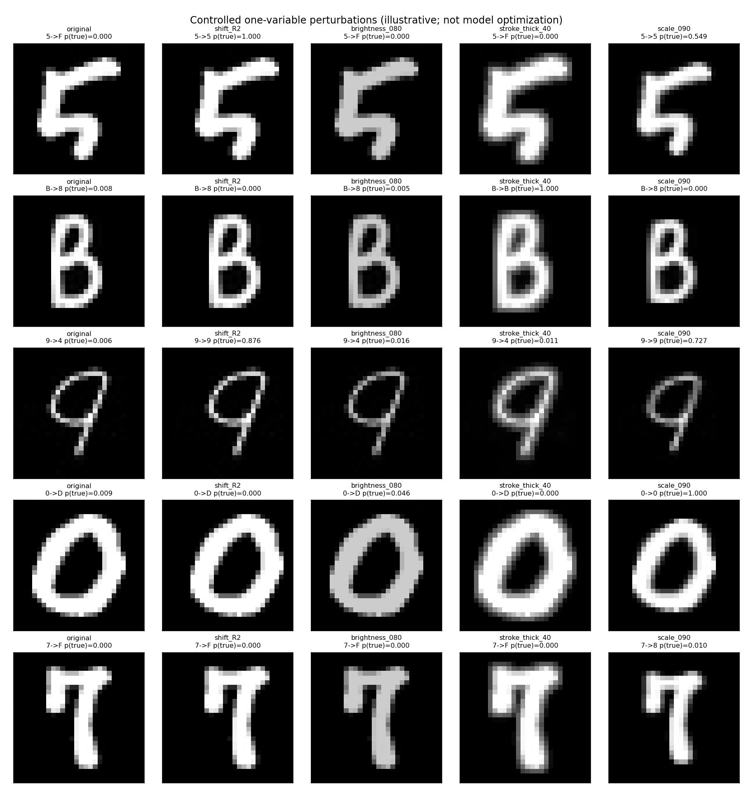
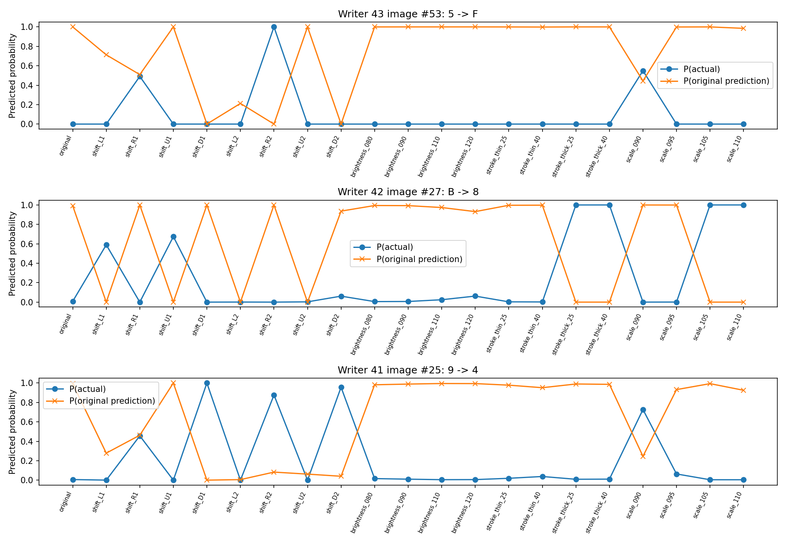

# EXP유002 | Normal MLP — Input_Sensitivity (3단계)

> **실험 목적:** EXP유001 [Pixcel_Attribution](EXP유001_Pixcel_Attribution.md)에서 발견한 손글씨 오분류의 원인이 입력 **위치·밝기·획 굵기·크기**에 대한 과도한 민감도와 연관되는지 확인한다. **학습된 Normal MLP는 모든 변형 조건에서 고정**하고, 입력 이미지만 한 가지씩 바꾼다.
>
> **최종 결론:** 공식 Validation 19,200장과 Hand-made 2,560장에 원본 포함 21조건을 적용하여 **456,960건**의 예측을 완료했다. 특히 위치 ±1px, 크기 90~110% 변화에 손글씨 예측이 크게 흔들렸다. 그러나 **오분류 수정과 신규 오분류 발생이 동시에 존재**하고 숫자/문자·작성자마다 반응이 반대였다. 이는 위치·크기 정규화를 검토할 근거이지만, 본 실험의 단순 변형을 곧바로 최적 전처리로 채택했다는 의미는 아니다.

| 항목 | 실험 기록 |
|---|---|
| 실험 ID / 일자 | **EXP유002 (MLP / Normal)** · **2026-11-15 KST** |
| 담당 | 유용성 / 실험 실행·자료 검토 및 문서화 AI 보조 |
| 단계 및 상태 | **3단계 입력 단일 변수 민감도 실험 완료 / 개선 모델 개발은 미실시** |
| 이전 실험 | [EXP유001 — Pixcel_Attribution (1·2단계)](EXP유001_Pixcel_Attribution.md) |
| 실행 코드 | [Input_Sensitivity.py](../scripts/Input_Sensitivity.py) |
| 실측 결과 | [results/Input_Sensitivity/](../results/Input_Sensitivity/README.md) |
| GitHub Actions | [성공 실행 #43629898144](https://github.com/ryu980920/Machine_Learning/actions/runs/43629898144); 결과 Artifact: `normal-mlp-input-sensitivity-stage3` |
| 실행 환경 | GitHub Actions Ubuntu, Python 3.13.18 / NumPy 2.3.5 / SciPy 1.17.0 / scikit-learn 1.8.0 / matplotlib 3.10.7 |

## 1. 문제 발견과 원인 가설

- W02 기본 모델 평가 결과 Normal MLP는 공식 Validation **97.3177083%**인데, 최신 Hand-made **62.8515625%**로 떨어졌다.
- EXP유001 IG 분석에서는 글자 획 주변의 기여도 분포를 확인했으나, **실제로 이미지 위치나 밝기를 바꿨을 때 예측이 바뀌는지는 확인하지 못했다**.
- 가설 A: **글자 이동에 민감**하다면 같은 획 구조를 유지하고 ±1~2픽셀만 움직여도 원본 예측이 자주 바뀔 것이다.
- 가설 B: **크기·획 굵기** 변화가 인식 오류에 영향을 준다면 조건별 정확도·예측 뒤집힘률이 크게 달라질 것이다.
- 가설 C: **밝기**가 주요 요인이라면 형태와 위치를 유지한 채 밝기 배율만 바꿔도 높은 민감도를 보일 것이다.
- 검증할 때 오분류의 단순 이동을 '개선'으로 간주하지 않고, **오답→정답(교정)**과 **정답→오답(신규 오류)**를 분리한다.

## 2. 실제 수행 조건

| 설정 | 적용 내용 |
|---|---|
| 모델 | [기존 `MLPClassifier(random_state=42)`](../../../../03_experiments/model_optimization/mlp.py), 기본 은닉층 100개·ReLU·Adam, `PixelScaler255`로 입력 /255 |
| 학습 | 공식 NPZ의 `X_train`에서 `StratifiedGroupKFold(5,shuffle=True,random_state=42)` 첫 Fold **76,800장**만 재학습 |
| 평가 | 공식 **Validation 19,200장** + 현재 손글씨 **41·42·43·44번 각 640장=2,560장**. 손글씨는 학습에 편입하지 않음 |
| 데이터 SHA-256 | 공식 NPZ: `0e9570d0eb04c0c1da99d043b85bfdab7f3b639eebe4b10335b05b57ad671879`; 손글씨는 [EXP유001 원본 해시](EXP유001_Pixcel_Attribution.md)와 코드에서 검증 |
| 변형 규칙 | **한 번에 하나의 변수만 변경**, 변형 전후 모두 같은 재학습 모델로 평가 |
| 공식 Test | **16,000장 미사용**. 교수님 Test 미사용 |
| 최적화 | **가중치 재학습 반복·하이퍼파라미터 탐색·전처리 채택 미실시** |

### 실제 사용한 21개 변형 조건

| 그룹 | 원본 제외 조건 | 조건 수 | 구현 |
|---|---|---:|---|
| 위치 이동 | 좌·우·상·하 × 1, 2px | **8** | 이미지 밖은 0으로 채우고 순환 이동 금지 |
| 밝기 | ×0.80, ×0.90, ×1.10, ×1.20 | **4** | 픽셀값을 0~255로 제한, 포화 픽셀 비율 기록 |
| 획 굵기 | 얇게 25%/40%, 굵게 25%/40% | **4** | 3×3 min/max filter를 원본과 선형 혼합 |
| 크기 | 중심 기준 ×0.90, ×0.95, ×1.05, ×1.10 | **4** | 중심 13.5픽셀 고정, 선형 보간, 빈 공간 0 |
| 원본 | 아무 변형 없음 | **1** | 비교 기준 |
| **전체** | | **21** | **21,760×21=456,960개 예측** |

실행 순서: **변형 함수 자체 검사 → 기존 Baseline 재학습 → 이전 공식 CM·손글씨 개별 예측 재현 확인 → 106장 집중 분석 → 전체 데이터셋에 조건별 변형 및 예측 → CSV·그래프·모델 체크포인트 저장**.

이번 모델은 각 조건을 평가할 때 **재학습하지 않으며**, 한 번 학습된 모델을 고정한다.

## 3. 재현 검증 및 실패 이력

| 확인 항목 | 성공 실행 |
|---|---:|
| 공식 Validation 원본 | **18,685/19,200 정답 = 97.3177083%** |
| 기존 공식 16×16 CM와 차이 | **셀 절댓값 차이 합 0** |
| Hand-made 원본 | **1,609/2,560 정답 = 62.8515625%** |
| 기존 Hand-made 2,560개 예측과 불일치 | **0건** |
| EXP유001의 98개 사례 예측과 불일치 | **0건** |
| 변형 조건별 예측 행 | 공식 403,200 + Hand-made 53,760 = **456,960행** |
| 시각화 대상 | EXP유001 98장 + 손글씨 9→F/7→F 각 4장 = **106장**, 2,226개 조건별 사례 |

**재현 과정의 시행착오:** [첫 실행 #43629458948](https://github.com/ryu980920/Machine_Learning/actions/runs/43629458948)에서는 같은 설정으로 재학습했으나 공식 CM 셀 차이 합 **216**, 손글씨 개별 예측 차이 **191**이 발생하여 중단했다. 이 실행의 성능·민감도는 결과로 사용하지 않았다. 코드에 모델 재현 차이 기록 및 해당 실행의 고정 체크포인트 보관 기능을 추가해 재실행했고, **최종 성공 실행 #43629898144는 위 기준과 모두 일치**했다. 원본 ZIP에 `normal_mlp_refit_stage3.joblib` 가중치를 남겨 재현 근거를 확보했다.

## 4. 핵심 실측 결과

### 4.1 전체 공식 Validation / Hand-made 비교

| 변형 | 공식 Accuracy | 공식 원본 대비 | Hand-made Accuracy | Hand-made 원본 대비 | Hand-made 예측 뒤집힘률 |
|---|---:|---:|---:|---:|---:|
| **원본** | **97.3177%** | — | **62.8516%** | — | — |
| 오른쪽 1px | 95.2135% | −2.1042%p | **65.3906%** | **+2.5391%p** | **28.40%** |
| 아래쪽 1px | 93.4115% | −3.9062%p | **65.0391%** | **+2.1875%p** | **28.98%** |
| 왼쪽 1px | 93.2708% | −4.0469%p | **46.8750%** | **−15.9766%p** | **35.82%** |
| 위쪽 1px | 93.0781% | −4.2396%p | **52.6172%** | **−10.2344%p** | **34.02%** |
| 크기 90% | 93.1406% | −4.1771%p | **65.6641%** | **+2.8125%p** | **30.90%** |
| 크기 95% | 97.0104% | −0.3073%p | **66.6797%** | **+3.8281%p** | **15.55%** |
| 밝기 90% | 97.2708% | −0.0469%p | **63.0078%** | **+0.1562%p** | **1.48%** |
| 획 얇게 25% | 97.2656% | −0.0521%p | **63.2812%** | **+0.4297%p** | **6.84%** |
| 획 굵게 40% | 92.0833% | −5.2344%p | **53.6328%** | **−9.2188%p** | **33.16%** |

**핵심 해석:** 손글씨는 위치 1px 이동만으로 **약 28~36%의 예측 클래스가 바뀌었다**. 동일 조건의 공식 Validation은 약 4.50~6.49%만 바뀌었다. 작은 픽셀 이동에 대한 손글씨의 민감도가 훨씬 크다. 밝기 ±10~20%의 손글씨 뒤집힘률은 상대적으로 작은 **약 1.48~3.83%**였다.

### 4.2 오류 교정과 신규 오답 분리

| Hand-made 변형 | 오답→정답 | 정답→오답 | 순정답 변화 |
|---|---:|---:|---:|
| 오른쪽 1px | **269** | **204** | **+65** |
| 아래쪽 1px | **273** | **217** | **+56** |
| 크기 90% | **301** | **229** | **+72** |
| 크기 95% | **170** | **72** | **+98** |
| 왼쪽 1px | **96** | **505** | **−409** |
| 획 굵게 40% | **183** | **419** | **−236** |

**예측 뒤집힘률은 개선율이 아니다.** 오답이 다른 오답으로 바뀌는 경우도 발생한다. 예를 들어 95% 축소에서는 오류 170건을 교정했지만 기존 정답 72건을 새로 틀렸고, **순이익 98장 / 2,560장 = +3.8281%p**다.

### 4.3 숫자(0–9)와 문자(A–F) 사이 상충

| Hand-made 조건 | 숫자 1,600장 Accuracy | 숫자 변화 | 문자 960장 Accuracy | 문자 변화 |
|---|---:|---:|---:|---:|
| 원본 | 56.3125% | — | 73.7500% | — |
| 오른쪽 1px | **66.3750%** | **+10.0625%p** | **63.7500%** | **−10.0000%p** |
| 아래쪽 1px | **64.3125%** | **+8.0000%p** | **66.2500%** | **−7.5000%p** |
| 크기 95% | **64.6250%** | **+8.3125%p** | **70.1042%** | **−3.6458%p** |
| 크기 90% | **70.1250%** | **+13.8125%p** | **58.2292%** | **−15.5208%p** |

전체 Hand-made 정확도가 개선된 변형도 **숫자에는 유리하고 문자에는 불리**했다. 최적 전처리 판단에는 총정확도뿐 아니라 16개 클래스·작성자별 성능과 공식 Validation 손실까지 고려해야 한다.

### 4.4 작성자별 위치·크기 반응

| 작성자 | 오른쪽 1px | 아래쪽 1px | 크기 95% | 크기 90% |
|---|---:|---:|---:|---:|
| 41번 | +0.63%p | −0.16%p | +1.56%p | −0.94%p |
| 42번 | −3.13%p | −1.25%p | −1.72%p | −4.69%p |
| **43번** | **+8.13%p** | **+9.38%p** | **+11.88%p** | **+16.88%p** |
| 44번 | +4.53%p | +0.78%p | +3.59%p | 0.00%p |

**43번 작성자의 개선이 전체 평균에 크게 기여**한다. 반면 42번은 같은 변화에서 악화되므로, 전체 작성자에게 일괄 적용할 보정이라는 결론은 유보한다.

### 4.5 주요 오류쌍 변화

| Hand-made 오분류 | 원본 건수 | 크기 95% 이후 | 아래쪽 1px 이후 |
|---|---:|---:|---:|
| **5→F** | 60 | **45** | 34 |
| **9→F** | 41 | **12** | **2** |
| **B→8** | 53 | **63** | **87** |
| **8→B** | 41 | **20** | **7** |
| **0→D** | 47 | **32** | **28** |

혼동쌍의 감소는 **일부가 다른 오답으로 이동한 경우를 포함**하므로, 감소 건수를 곧바로 교정 건수로 해석하지 않는다. 상세 결과는 [stage3_error_pairs.csv](../results/Input_Sensitivity/stage3_error_pairs.csv)에서 원래 혼동쌍의 교정 수·그대로 오분류·다른 오답 전환을 구분하여 확인한다.

## 5. 판단과 다음 실험

- **확인:** 현재 Normal MLP가 작은 **공간 위치 이동과 크기 변경에 매우 민감**하다는 관찰을 원본 이미지 대비 단일 변수 변형으로 검증했다.
- **보완:** 이동·크기 변형은 픽셀 배치와 일부 획 기하를 바꾸므로 이 현상이 글자 형태와 무관한 원인 *만* 때문이라는 결론은 내리지 않는다.
- **상충:** 일부 전체 Accuracy 개선은 숫자·문자/작성자별 악화를 수반하므로 단순히 ‘크기 95% 적용’을 확정 최적화로 채택하지 않았다.
- **우선 후속 연구:** 공식/Hand-made의 중심 위치·경계 상자·실제 글자 크기 분포를 비교하고, **정답을 사용하지 않는 자동 중심 정렬과 크기 정규화**를 개발용 Validation에서 교차 검증한다. 이후 학습용 증강 및 MLP 하이퍼파라미터는 별도 실험으로 평가한다.
- **모델 개선 여부:** **미실시** — 지금은 단일 변수 입력 민감도 분석 단계이다. 공식 Original Test와 교수님 Test는 사용하지 않았다.

## 6. 데이터·코드·결과 파일

| 파일 | 내용 |
|---|---|
| [Input_Sensitivity.py](../scripts/Input_Sensitivity.py) | 학습·변형·정량평가 원본 실행 코드 |
| [stage3_sensitivity_summary.csv](../results/Input_Sensitivity/stage3_sensitivity_summary.csv) | 전체 2데이터×21조건 지표 |
| [stage3_per_class.csv](../results/Input_Sensitivity/stage3_per_class.csv) | 16클래스×2데이터×21조건 |
| [stage3_per_writer.csv](../results/Input_Sensitivity/stage3_per_writer.csv) | 4명×21조건 |
| [stage3_error_pairs.csv](../results/Input_Sensitivity/stage3_error_pairs.csv) | 주요 혼동쌍 13개×2데이터×21조건 |
| [stage3_focus_106.csv](../results/Input_Sensitivity/stage3_focus_106.csv) | 선정된 106장, 21조건의 이미지별 확률·예측 |
| [stage3_predictions.csv.gz](../results/Input_Sensitivity/stage3_predictions.csv.gz) | 총 **456,960행** 예측 상세 내역 (gzip 압축 CSV) |
| [stage3_run_metadata.json](../results/Input_Sensitivity/stage3_run_metadata.json) | 해시·실행환경·조건·재현 검증 |
| [normal_mlp_refit_stage3.joblib](../results/Input_Sensitivity/normal_mlp_refit_stage3.joblib) | 3단계에 사용한 가중치 체크포인트 |
| [stage3_example_grid.png](../results/Input_Sensitivity/stage3_example_grid.png), [stage3_probability_curves.png](../results/Input_Sensitivity/stage3_probability_curves.png) | 실제 변형 이미지·확률 비교 |
| [SUMMARY.md](../results/Input_Sensitivity/SUMMARY.md) | 실행 스크립트 자동 생성 요약 |

**아카이브 출처:** [GitHub Actions #43629898144](https://github.com/ryu980920/Machine_Learning/actions/runs/43629898144)의 `normal-mlp-input-sensitivity-stage3` Artifact. 모든 지표는 **해당 성공 실행의 원본 CSV**에서 기록했다.
