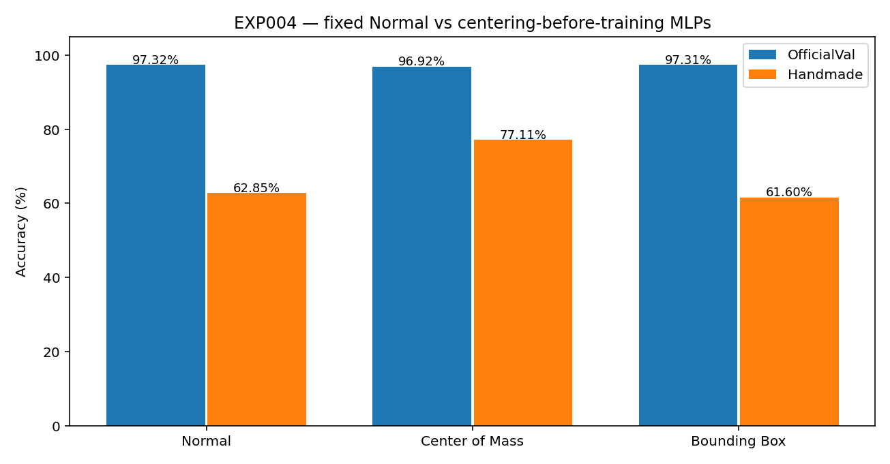

# EXP유004 — Automatic_Centering: Center of Mass vs Bounding Box Center

> **상태: 실험·검증 완료 / 승인된 연구 결과 정식 배포.** 본 배포는 두 후보 전처리를 실제 추론 Pipeline에 최종 적용한다는 결정이 아니다.
>
> **핵심 결과:** Center of Mass를 학습·평가 입력에 적용하면 공식 Validation **97.3177% → 96.9167% (−0.4010%p)**, Hand-made **62.8516% → 77.1094% (+14.2578%p)**. 반면 Bounding Box Center는 공식 Validation **97.3073%**, Hand-made **61.6016%**로 개선되지 않았다. **Center of Mass는 Hand-made 숫자에서 +26.88%p, 문자에서는 −6.77%p**로 효과가 상반되어 최종 Pipeline 채택은 보류한다.

## 1. 연구 문제 · 선행 연구 연결

- **EXP유001 — Pixcel_Attribution:** 고정 MLP의 픽셀 기여 패턴 및 오분류 사례 관찰.
- **EXP유002 — Input_Sensitivity:** 같은 이미지의 위치·밝기·굵기·크기 변화로 예측과 정오답이 상당히 달라지는 현상 측정.
- **EXP유003 — Spatial_Response:** 공식 데이터와 Hand-made의 공간 분포 차이, 같은 이미지의 위치 변화와 오분류/은닉층 반응의 연관성 관찰.
- **EXP유004의 가설:** 학습과 추론 양쪽에서 이미지별 중심을 무감독·일관된 규칙으로 정렬하면 실제 손글씨 인식의 성능이 개선될 수 있다. **중심을 잘 옮겼다는 사실 자체와 분류 성능 개선은 별도 검증 대상이다.**

[실행 코드](../scripts/Automatic_Centering_Experiment.py) · [중심 정렬 Transformer](../scripts/Automatic_Centering_Transformer.py) · [실제 결과](../results/Automatic_Centering/README.md) · [성공한 GitHub Actions #43638979287](https://github.com/ryu980920/Machine_Learning/actions/runs/43638979287)

## 2. 실행 조건 및 통제

| 구분 | 적용 내용 |
|---|---|
| 작성자/기간 | 유용성 · 2026-11-15 KST |
| 공식 학습/평가 | 동일한 **Training 76,800장 / Validation 19,200장**, 이전 Baseline의 그룹 분할 유지 |
| 실제 Hand-made 평가 | 작성자 **41·42·43·44**, 각 640장, 총 **2,560장**. 학습과 전처리 규칙 선정에는 **미사용** |
| 기준 모델 | **기존 EXP유002 frozen Normal MLP**, 예측 기록 재검증, 재학습 없음 |
| 신규 후보 | **Center_of_Mass MLP**, **Bounding_Box_Center MLP**, 각각 동일 공식 Training 76,800장으로 새로 학습 |
| 모델 정의 | 동일 `MLPClassifier(random_state=42)`, ReLU 단일 은닉층 **100개**, 기본 하이퍼파라미터, 동일 0~1 픽셀 스케일러 |
| Center of Mass | Threshold **32/255** 이상 픽셀의 **밝기 가중 중심** |
| Bounding Box Center | Threshold **32/255** 이상 영역의 최솟값·최댓값으로 구한 사각형 중심 |
| 목표 좌표 | **(13.5, 13.5)** — 28×28 이미지의 고정 기하학적 중심 |
| 이동 | `np.rint`를 적용한 **정수 픽셀 병진 이동**, 경계 외부 0 채움, wrap 및 보간 없음 |
| 학습/평가 Pipeline | `원본 → 같은 방식으로 중심 정렬 → PixelScaler255 → MLP` |
| 사용하지 않은 데이터 | **공식 Original Test 16,000장과 교수님 Test 전부 미사용** |
| 실험 결과 저장 | [review 실행 #43638979287](https://github.com/ryu980920/Machine_Learning/actions/runs/43638979287), Artifact `normal-mlp-exp004-automatic-centering-review`; 이후 **사용자 승인으로 원본을 변경 없이 연구 기록에 배포** |

기존 Normal의 Official Validation Confusion Matrix 차이 합 **0**, 기존 Hand-made 예측 불일치 **0**. 사용한 기존 MLP SHA-256: `9b54ba9c60e389575200d88ad0b93c47ec47f9c673eebeb755ff47e3ebe23b0a`. 공식 원본 데이터 SHA-256: `0e9570d0eb04c0c1da99d043b85bfdab7f3b639eebe4b10335b05b57ad671879`.

**분석 원칙:** 정답 클래스·작성자 정보는 사후 평가에서만 사용한다. 전처리의 위치·임계값·방식을 Hand-made의 결과에 맞춰 개별 이미지별로 선택하지 않는다.

## 3. 평가 결과 — 공식 Validation과 Hand-made

| 평가 데이터 | 조건 | 정답 수 | Accuracy | 기존 대비 | Macro F1 | 기존 오답 교정 / 신규 오답 |
|---|---|---:|---:|---:|---:|---:|
| 공식 Val 19,200장 | Normal | **18,685** | **97.3177%** | — | 0.9730 | — |
| 공식 Val 19,200장 | Center of Mass | 18,608 | 96.9167% | **−0.4010%p** | 0.9690 | 245 / 322 |
| 공식 Val 19,200장 | Bounding Box | 18,683 | 97.3073% | −0.0104%p | 0.9729 | 260 / 262 |
| Hand-made 2,560장 | Normal | **1,609** | **62.8516%** | — | 0.6241 | — |
| Hand-made 2,560장 | **Center of Mass** | **1,974** | **77.1094%** | **+14.2578%p** | **0.7704** | **533 / 168** |
| Hand-made 2,560장 | Bounding Box | 1,577 | 61.6016% | −1.2500%p | 0.6204 | 337 / 369 |



- Center of Mass Hand-made의 정답 개수는 기존보다 **365장 증가(533장 교정 − 168장 신규 오류)**했다.
- Bounding Box는 기존보다 **32장 감소(337장 교정 − 369장 신규 오류)**했다.
- 공식 Validation에서는 Center of Mass가 **77장 감소**, Bounding Box는 **2장 감소**했다.
- 정확도 차이만으로 **새로운 필체에서의 일반화 성능**을 확정하지 않는다.

## 4. Hand-made 숫자/문자 및 작성자별 효과

| 그룹 | Normal | Center of Mass | Bounding Box | Center of Mass 변화 |
|---|---:|---:|---:|---:|
| **숫자 0–9** | 56.31% | **83.19%** | 66.38% | **+26.88%p** |
| **문자 A–F** | **73.75%** | **66.98%** | 53.65% | **−6.77%p** |
| 작성자 41 | 59.38% | 68.44% | 66.41% | +9.06%p |
| 작성자 42 | 69.06% | 78.75% | 65.47% | +9.69%p |
| 작성자 43 | 55.94% | 77.97% | 44.69% | +22.03%p |
| 작성자 44 | 67.03% | 83.28% | 69.84% | +16.25%p |

**클래스별 실제 사례:**
- 숫자 **9: 33.75% → 90.00%**, 숫자 **5: 44.38% → 73.75%** (Normal → Center of Mass).
- 문자 **B: 40.00% → 33.12%**, **C: 95.00% → 83.75%**, **D: 63.12% → 53.12%**, **F: 87.50% → 77.50%**.
- **5→F 오류 60건 → 12건으로 감소**, **B→8 오류 53건 → 79건으로 증가**. 따라서 숫자 개선이 특정 문자 혼동을 함께 해결한 것은 아니다.

16개 클래스의 전체 Accuracy·Precision·Recall·F1, 작성자별 숫자/문자 성능 및 기존 예측과의 1:1 비교는 [exp004_group_metrics.csv](../results/Automatic_Centering/exp004_group_metrics.csv)와 [exp004_predictions.csv.gz](../results/Automatic_Centering/exp004_predictions.csv.gz)에 남겨두었다.

## 5. 중심 정렬의 정확성과 획 정보 손실

| 출처 | 방법 | 목표 중심까지 평균 거리: 정렬 전→후 | 일부 픽셀 강도 손실이 발생한 이미지 수 |
|---|---|---:|---:|
| 공식 Training | Center of Mass | 1.055 → 0.381px | 6,288 / 76,800 |
| 공식 Training | Bounding Box | 1.088 → 0.163px | 31 / 76,800 |
| 공식 Validation | Center of Mass | 1.055 → 0.383px | 1,617 / 19,200 |
| 공식 Validation | Bounding Box | 1.083 → 0.162px | 4 / 19,200 |
| **Hand-made** | **Center of Mass** | **1.390 → 0.380px** | **700 / 2,560** |
| **Hand-made** | Bounding Box | **0.276 → 0.258px** | **2 / 2,560** |

- Hand-made의 Center of Mass 정렬 시 전체 획 강도 대비 **평균 손실률 약 0.0118%**. 700장은 잉크값 손실이 0이 아닌 사례의 수이며, 각 사례에서 큰 손실이 발생했다는 뜻은 아니다.
- Bounding Box 기준에서는 Hand-made가 정렬 전부터 평균 중심 오차가 약 **0.276px**로 작아 전처리의 효과가 제한되었다.
- 정렬 후 목표 좌표에 가까워진 정도와 **MLP의 예측 정확도는 같은 평가 지표가 아니다**. 이 실험에서도 중심 정렬 오차가 작은 Bounding Box의 Hand-made 정확도가 더 낮았다.
- 본 실험은 **정수 픽셀 이동·획 손실 확인**만 했으며, 서브픽셀 보간이나 추가 크기 보정은 평가하지 않았다.

## 6. 결론, 가설 검증 및 제한

1. **Center of Mass 정렬의 개선 가능성:** 4명의 기존 Hand-made 전체에서 분류 정확도가 **+14.26%p** 개선되었다. 공식 Validation에서는 **−0.40%p** 변동을 동반했다.
2. **반례/상충:** 전체 Hand-made 정확도 향상은 숫자에서 주도됐다. **문자 성능은 오히려 하락**하여 정렬을 최종 개선 정책으로 승인하기에는 추가 연구가 필요하다.
3. **방법별 차이:** Bounding Box Center는 정렬 위치를 정밀하게 계산했지만 Hand-made에서는 Baseline보다 낮은 정확도를 기록했다. 중심 좌표 보정량이 적다는 점과 관련 가능성이 있으나, 단일 원인으로 단정하지 않는다.
4. **선택 과적합 제한:** 기존 Hand-made는 **네 명의 작성자 데이터**이며 EXP유001·002·003에서 이미 반복적으로 분석했다. 이 결과를 바탕으로 Center of Mass를 가장 유망한 후보로 기술할 수는 있지만, **새 작성자에 대한 일반화 성능으로 보고할 수는 없다**.
5. **추가 검증 필요:** 현재 한 번의 **random_state=42** 학습 결과다. 복수 학습 Seed, 문자 정확도 하락의 원인, 새 작성자 독립 평가가 필요하다. 공식 Test / 교수님 Test는 **최종 단계까지 보존**한다.
6. **자동 배포/서비스 반영 금지:** 이번 기록의 배포는 **연구 결과 보관·공유**만 뜻하며, 기본 Normal MLP 코드를 후보 모델로 대체하거나 추론 Pipeline을 변경하지 않았다.

## 7. 후속 분석 — CoM 이동 자체 vs 재학습 영향 (승인 후 배포)

[**EXP유004_CoM_판단근거_후속분석.md**](EXP유004_CoM_판단근거_후속분석.md)에서 기존 Normal MLP를 고정한 원본/CoM 입력을 비교하고, **동일한 CoM 입력에서 두 모델**을 비교했다.

- **기존 모델에 CoM 이동만 적용:** 숫자 56.31%→82.00% (**+25.69%p**), 문자 73.75%→52.40% (**−21.35%p**).
- **같은 CoM 입력에서 재학습 모델로 변경:** 숫자 82.00%→83.19% (**+1.19%p**), 문자 52.40%→66.98% (**+14.58%p**).
- 실제 **5→F 교정**, **B→8 신규 오류**의 Signed Integrated Gradients를 함께 계산했다.
- **핵심 판단:** 이동만으로 상반된 변화가 나타나 기존 MLP의 **입력 픽셀 절대 위치 의존성**을 확인했다. 재학습은 문자 성능을 회복시키지만 최종 개선에 충분하지 않다.
- [후속 분석 CSV·IG 원본](../results/Automatic_Centering/CoM_Decision_Review/README.md) · [분석 코드](../scripts/CoM_Decision_Diagnostic.py) · [성공 실행](https://github.com/ryu980920/Machine_Learning/actions/runs/43686466736)
- 후속 분석은 **기존 저장 모델 사용, 재학습 없음, Test 미사용**. 아직 ±1px 위치 증강(EXP유005 후보) 등 새 개선 방법을 실행하지 않았으며 기본 모델 Pipeline도 변경하지 않았다.

## 8. 증빙과 재현 방법

- [원본 결과 디렉터리와 파일 해시/목록](../results/Automatic_Centering/README.md)
- [실험 코드](../scripts/Automatic_Centering_Experiment.py) · [자동 정렬 구현](../scripts/Automatic_Centering_Transformer.py)
- [실험 성공 실행과 원본 Artifact](https://github.com/ryu980920/Machine_Learning/actions/runs/43638979287) · Artifact ID **14131562043**
- [exp004_group_metrics.csv](../results/Automatic_Centering/exp004_group_metrics.csv) · [exp004_confusions.csv](../results/Automatic_Centering/exp004_confusions.csv) · [exp004_typical_confusions.csv](../results/Automatic_Centering/exp004_typical_confusions.csv)
- [exp004_alignment_stats.csv](../results/Automatic_Centering/exp004_alignment_stats.csv) · [exp004_run_metadata.json](../results/Automatic_Centering/exp004_run_metadata.json)
- [Center of Mass 모델](../results/Automatic_Centering/exp004_mass.joblib) · [Bounding Box 모델](../results/Automatic_Centering/exp004_bbox.joblib). **검증된 코드가 설치된 환경에서만 joblib 역직렬화**할 것.

```bash
OPENBLAS_NUM_THREADS=2 OMP_NUM_THREADS=2 MKL_NUM_THREADS=2 NUMEXPR_NUM_THREADS=2 \
python 05_model_optimize/MLP/Normal/scripts/Automatic_Centering_Experiment.py \
  --out /tmp/normal_mlp_exp004_review
```

**환경:** Python 3.13.18, NumPy 2.3.5, SciPy 1.17.0, scikit-learn 1.8.0, matplotlib 3.10.7. 예측 파일은 공식 Validation 19,200행 + Hand-made 2,560행, 총 **21,760행**. 결과 원본은 재분석한 수치로 덮어쓰지 않고 성공 실행 파일 그대로 보관한다.
