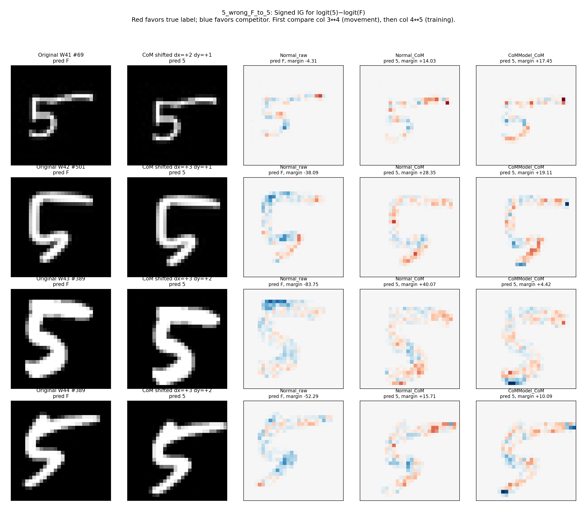
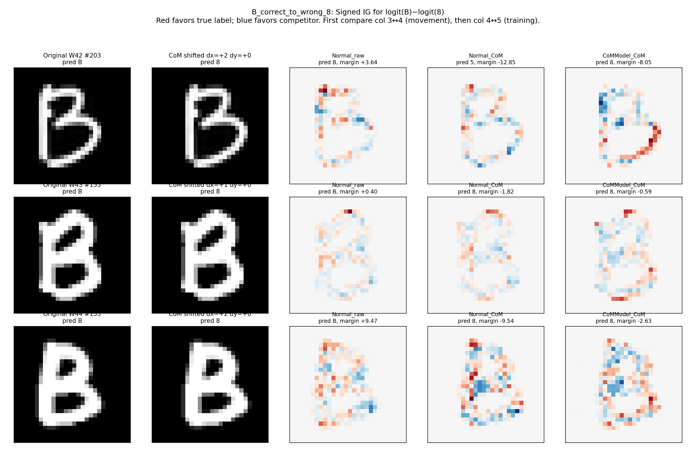

# EXP유004 후속 분석 — CoM 정렬에 따른 픽셀 위치 의존성 및 숫자·문자 분류

> **실험 목적:** EXP유004에서 CoM 정렬 후 Hand-made 숫자는 개선되고 문자는 악화된 원인을, **이미지 이동 자체**와 **CoM 정렬 데이터로 MLP를 재학습한 효과**로 분리한다.
>
> **핵심 결론:** MLP의 **가중치를 고정하고 CoM 이동만 수행**해도 Hand-made 숫자는 **56.31%→82.00%(+25.69%p)**, 문자는 **73.75%→52.40%(−21.35%p)**로 변화했다. **같은 CoM 이미지를 새 모델에 입력**하면 숫자는 **83.19%**, 문자는 **66.98%**로 변화한다. 따라서 숫자 개선·문자 악화의 상반된 방향은 모델 재학습만의 효과가 아니라 **입력 위치 이동 단계에서도 나타난다.** 모델의 절대 픽셀 위치 의존성이 가설 B의 중요한 설명 요인임을 지지한다.

[EXP유004 원 실험 로그](EXP유004_Automatic_Centering.md) · [후속 결과 원본](../results/Automatic_Centering/CoM_Decision_Review/README.md) · [분석 코드](../scripts/CoM_Decision_Diagnostic.py) · [성공 실행 #43686466736](https://github.com/ryu980920/Machine_Learning/actions/runs/43686466736)

## 1. CM 기반 오차 원인 및 검증 가설

- 기존 Hand-made에서는 **5→F 60건**, **B→8 53건** 등 숫자/문자 간 오분류가 빈번했다.
- EXP유002에서 1px 위치 변화만으로 예측이 크게 바뀌었고, EXP유003에서 공식 Training과 Hand-made의 중심 위치 분포 차이를 확인했다.
- EXP유004의 CoM 신규 학습 Pipeline은 Hand-made 전체 **62.85%→77.11%**를 기록했으나 숫자(**+26.88%p**)와 문자(**−6.77%p**)에서 결과가 달랐다.
- **후속 가설 B-1:** 같은 MLP에서도 원본→CoM 정렬 이동만으로 숫자·문자의 판정이 반대로 달라지는가?
- **후속 가설 B-2:** 같은 CoM 정렬 이미지를 볼 때, 원래 MLP와 재학습 MLP의 점수·예측이 어떻게 다른가?
- **후속 가설 B-3:** 실제 5/F, B/8 혼동 사례에서 각 클래스의 상대 점수에 기여하는 픽셀 영역이 변화하는가?

## 2. 동일 데이터·동일 저장 모델을 이용한 통제 비교

| 비교 | 입력 | 가중치 | 해석 |
|---|---|---|---|
| **① Normal/raw** | 원본 손글씨 | 기존 Normal MLP | 기존 기준 |
| **② Normal/CoM** | CoM 이동 이미지 | **기존 Normal MLP 고정** | **이미지 이동 자체의 영향** |
| **③ CoMModel/CoM** | **②와 정확히 동일한 CoM 이미지** | CoM 학습 MLP | **재학습된 가중치의 영향** |
| 보조: CoMModel/raw | 원본 손글씨 | CoM 학습 MLP | 학습 입력 분포 밖 통제이며 배포용 Pipeline이 아님 |

- 평가 데이터: 기존 Hand-made 41·42·43·44 각 640장 = **2,560장** (숫자 1,600장, 문자 960장).
- 기존 확정 Normal·CoM Pipeline의 가중치 **재학습하지 않음**, 기존 EXP유004의 2,560장 원본 예측을 **전수 일치 검증**.
- CoM 목표좌표 **(13.5,13.5)**, 밝기 임계값 **32**, 정수 픽셀 병진 이동, 보간 없음.
- **공식 Original Test 16,000장과 교수님 Test 모두 미사용.** Hand-made 데이터 학습·전처리 하이퍼파라미터 탐색 미실시.
- 예측 비교 결과는 [four_way_predictions.csv](../results/Automatic_Centering/CoM_Decision_Review/four_way_predictions.csv)에 같은 이미지별로 4조건을 나란히 저장했다.

## 3. 전체 정확도 — 무엇이 문자 인식을 악화시켰는가?

| Hand-made | ① Normal/raw | ② Normal/CoM: 이동만 | ③ CoMModel/CoM: 이동+재학습 |
|---|---:|---:|---:|
| **숫자 0–9 (1,600장)** | 56.31% (901) | **82.00% (1,312)** | **83.19% (1,331)** |
| **문자 A–F (960장)** | **73.75% (708)** | 52.40% (503) | 66.98% (643) |
| **전체 (2,560장)** | 62.85% (1,609) | 70.90% (1,815) | **77.11% (1,974)** |

### 3.1 이미지 이동만 변경: ①→②

| 집단 | 정확도 변화 | 오답→정답 | 정답→오답 | 해석 |
|---|---:|---:|---:|---|
| 숫자 | **+25.69%p** | 455 | 44 | 같은 MLP에서도 CoM 이동으로 숫자 판정이 개선됨 |
| 문자 | **−21.35%p** | 29 | 234 | 같은 MLP에서도 CoM 이동으로 문자 오답이 대폭 증가 |

### 3.2 입력을 고정하고 MLP 가중치만 변경: ②→③

| 집단 | 정확도 변화 | 오답→정답 | 정답→오답 | 해석 |
|---|---:|---:|---:|---|
| 숫자 | **+1.19%p** | 108 | 89 | 재학습으로 숫자는 소폭 추가 개선 |
| 문자 | **+14.58%p** | 185 | 45 | 재학습으로 문자가 상당 부분 회복되었으나 원본 기준 73.75%에는 미달 |

**판단:** CoM 이동만으로도 숫자·문자 성능 방향이 반대가 되는 현상을 확인했으며, 재학습은 특히 문자 성능을 회복시키는 효과가 있었다. 즉, **이미지 정렬의 효과와 MLP가 학습한 위치별 가중치를 함께 고려해야 한다.**

## 4. 실제 오분류 2종에 대한 픽셀 기여도(IG)

- **모델 판단 분석:** 16개 클래스를 동시에 예측하는 MLP의 `정답 클래스 logit − 경쟁 클래스 logit`에 대한 **Signed Integrated Gradients**.
- IG 설정: 검은 이미지 기준(0), **128 midpoint**, 두 비교에서 동일한 정답/경쟁 클래스 사용.
- **빨강 계열:** 경쟁 클래스보다 정답 클래스의 점수 차이를 높이는 픽셀 기여.
- **파랑 계열:** 경쟁 클래스 쪽으로 점수 차이를 낮추는 픽셀 기여.
- 실제 사례에서 각도·크기·획 자체는 바꾸지 않고 **이미지 전체를 정수 픽셀로 이동**했다.

### 4.1 숫자 5→F 오답이 CoM 이동 후 정답으로 바뀐 경우

Hand-made **작성자 42, 이미지 #501**. 실제 이동량 **X +3px, Y +1px**.

| 판단 조건 | 예측 | logit(5) − logit(F) |
|---|---|---:|
| 기존 Normal MLP + 원본 | **F (오답)** | −38.09 |
| 기존 Normal MLP + CoM 이미지 | **5 (정답)** | +28.35 |
| CoM 학습 MLP + 같은 CoM 이미지 | **5 (정답)** | +19.11 |

### 4.2 문자 B→8 신규 오류가 발생한 경우

Hand-made **작성자 44, 이미지 #155**. 실제 이동량 **X +2px, Y 0px**.

| 판단 조건 | 예측 | logit(B) − logit(8) |
|---|---|---:|
| 기존 Normal MLP + 원본 | **B (정답)** | +9.47 |
| 기존 Normal MLP + CoM 이미지 | **8 (오답)** | −9.54 |
| CoM 학습 MLP + 같은 CoM 이미지 | **8 (오답)** | −2.63 |

실제 **5→F 교정 유형 37장**, **B→8 신규 오답 유형 14장**을 확인했고, 작성자를 분산하여 대표 샘플의 Signed IG를 계산했다. 선택한 사례의 로그잇 변화와 IG를 전체 오류의 유일한 원인이라고 일반화하지 않는다.

## 5. 가설 B의 결론과 다음 실험

1. **확인한 사실:** MLP 가중치를 고정했을 때도 CoM에 의한 *픽셀 절대 위치의 변화*가 숫자·문자 분류 결과를 크게 달라지게 한다.
2. **확인한 사실:** 정렬된 이미지로 MLP를 학습하면 문자 성능이 크게 회복된다. 그렇지만 원래 Normal MLP의 문자 정확도보다 여전히 **−6.77%p** 낮다.
3. **가능한 해석:** MLP가 글자 형태뿐 아니라 **이미지 내 특정 픽셀 좌표에 형성된 패턴**에 의존하므로, 통째로 이동한 획이 일부 클래스 판단에는 유리하고 다른 클래스에는 불리할 수 있다.
4. **확인되지 않은 것:** MLP가 글자의 획 형태를 **전혀 학습하지 않았다**는 주장, 모든 문자 악화의 단일 원인, 새로운 작성자에 대한 최종 성능.
5. **다음 개선 가설:** CoM 정렬은 유지하되, **학습 시 CoM 이동 후 ±1px 소규모 위치 증강**을 추가하면 특정 픽셀 좌표에 대한 과도한 의존성을 낮춰 문자의 손실을 줄일 수 있다. **아직 검증되지 않은 실험 제안**이며 본 EXP유004에는 학습/추론 정책으로 반영하지 않았다.

### 원본 데이터 / 재현

- [후속 원본 결과 9개와 SHA-256](../results/Automatic_Centering/CoM_Decision_Review/README.md) · [성공한 워크플로 #43686466736](https://github.com/ryu980920/Machine_Learning/actions/runs/43686466736), Artifact **14150383005**.
- [분석 코드](../scripts/CoM_Decision_Diagnostic.py) · [4조건 전체 지표](../results/Automatic_Centering/CoM_Decision_Review/four_way_summary.csv) · [오류 교정·신규오류](../results/Automatic_Centering/CoM_Decision_Review/contrasts.csv) · [상대 logit margin](../results/Automatic_Centering/CoM_Decision_Review/pairwise_margins.csv) · [IG 수치](../results/Automatic_Centering/CoM_Decision_Review/selected_ig_diagnostics.csv).
- **기존 Normal MLP 체크포인트 SHA-256** `9b54ba9c60e389575200d88ad0b93c47ec47f9c673eebeb755ff47e3ebe23b0a`.
- **CoM 학습 MLP 체크포인트 SHA-256** `3c1aac362d75ff5c4d9652188c1c4fd97524525f5409ec00d5a6c56fa3ad27ef`.

**원본 후속 실행 시 생성한 `SUMMARY.md`와 `metadata.json`의 `review-only` 표기는 당시 실행·보관 상태를 의미한다. 이후 사용자 승인으로 연구 결과만 배포하였고, MLP 운영 Pipeline은 변경하지 않았다.**
