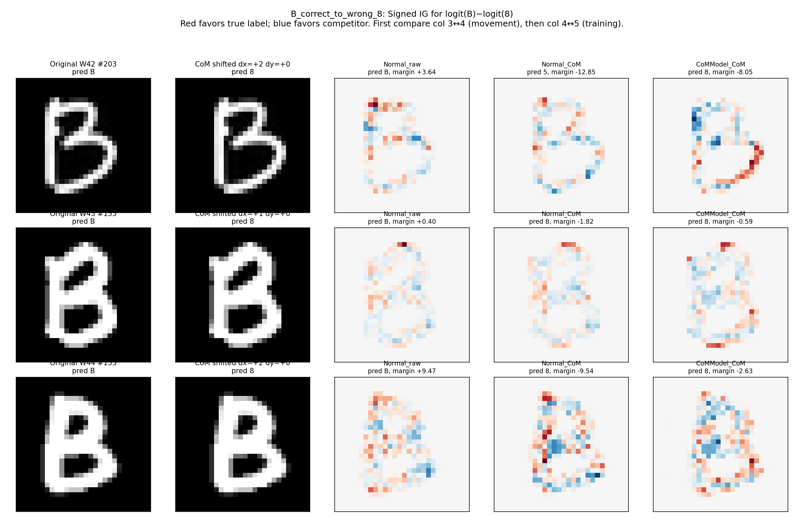
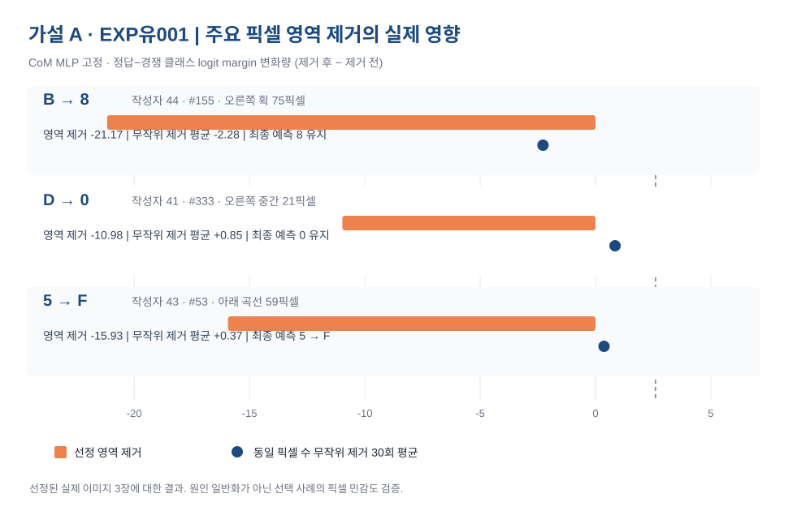

# 가설 A · EXP유001 — MLP의 픽셀 판단 근거 분석

> **검증 목표:** MLP가 유사한 숫자와 문자를 구별할 때 어떤 픽셀 영역에 반응하며, CoM 정렬 후 왜 문자를 숫자로 오분류하는지 분석한다.
>
> **상태:** 1차 실측 진단 완료. Hand-made **2,560장 전체 혼동행렬**과 선택한 **원본 이미지 20장**의 실제 픽셀·모델 점수·영역 제거를 별도로 분석. 상세 CSV·PNG·모델은 별도 검토용 산출물로 보관.

## 1. 실험 가설

- **A-1:** MLP는 특정 좌표·영역의 픽셀값 조합을 분류에 사용한다.
- **A-2:** CoM 이동은 정답과 형태가 비슷한 경쟁 클래스 간 상대 점수를 변화시킨다.
- **추가 검증 문제:** 모델이 사람처럼 획의 형태와 연결 구조를 인식한 것인지, 단순히 해당 좌표의 픽셀값에 민감한 것인지는 분리 검증한다.

## 2. 데이터 및 비교 조건

- Hand-made **2,560장** 전수 혼동행렬, 실제 선택 이미지 **20장** 진단.
- 비교 조건: **A Normal MLP/원본**, **B 동일 Normal MLP/CoM 정렬**, **C CoM 학습 MLP/CoM 정렬**.
- 가중치 고정, 신규 학습 없음. 공식 Original Test 및 교수님 Test 미사용.
- Normal 모델 SHA256 `9b54ba9c60e389575200d88ad0b93c47ec47f9c673eebeb755ff47e3ebe23b0a`, CoM 모델 SHA256 `3c1aac362d75ff5c4d9652188c1c4fd97524525f5409ec00d5a6c56fa3ad27ef`.

## 3. 전체 오분류 경향

| 실제→예측 | Normal/원본 | CoM MLP/CoM |
|---|---:|---:|
| B→8 | 53 | **79** |
| D→0 | 16 | **67** |
| 8→B | 41 | 34 |
| 0→D | 47 | 20 |
| 5→F | 60 | **12** |
| F→5 | 0 | 15 |

실제 문자 960장 중 **숫자로 예측한 수**: Normal/원본 **200장 → 동일 Normal/CoM 412장 → CoM 학습 MLP/CoM 296장**.

## 4. 모델의 실제 클래스 점수 비교

마진 = `logit(정답) − logit(경쟁 클래스)`. **두 클래스 간 마진의 부호와 최종 16-way 예측은 구분한다.**

| 실제 손글씨 | Normal/원본 | Normal/CoM | CoM MLP/CoM | 16-way 예측 |
|---|---:|---:|---:|---|
| B(작성자44/#155), B−8 | +9.47 | −9.54 | −2.63 | B→8→8 |
| D(작성자41/#333), D−0 | +8.85 | −8.49 | −6.25 | D→0→0 |
| 5(작성자43/#53), 5−F | −19.01 | +11.46 | +4.61 | F→5→5 |
| 0(작성자43/#0), 0−D | −4.70 | −4.70 | +6.99 | D→D→0 |

Signed Integrated Gradients: 검은 입력(0) 기준, 128 midpoint, `정답−경쟁` logit 마진을 기준으로 픽셀별 기여도 확인.

### 실제 손글씨·IG 근거 이미지

이 이미지는 **작성자 44 / #155의 B→8 대표 사례**에 대한 기존 검증 그림이다. 그림을 통해 동일 획의 CoM 이동과 `B−8` 상대 점수 기여 변화를 확인할 수 있지만, 이 사례만으로 사람과 동일한 획 형태 인식을 판정할 수는 없다.

## 5. 픽셀 영역을 직접 제거·약화한 결과

같은 MLP를 고정하고 주요 영역 전경 픽셀을 25~100% 약화/제거했다. 완전 제거 실험은 **동일 픽셀 수의 무작위 제거 30회**를 대조군으로 삼았다.

- **B, 작성자44/#155:** B−8 마진 **−2.63**. 오른쪽 영역 전경 75픽셀 제거 시 마진 **−21.17 추가 하락**(동일 수 무작위 제거 평균 **−2.28**). 중앙 연결 영역 70픽셀을 50% 약화하자 마진은 **+2.09**로 상승했으나 최종 예측은 **0**, 정답 B는 아님.
- **D, 작성자41/#333:** D−0 마진 **−6.25**. 오른쪽 중간 영역 21픽셀 제거 시 **−10.98 추가 하락**(무작위 평균 **+0.85**), 왼쪽 중간 영역 21픽셀 제거 시 **+4.46 상승**. 최종 예측은 모두 0 오답 유지.
- **5, 작성자43/#53:** 5−F 마진 **+4.61**. 오른쪽 획 49픽셀의 밝기를 **25% 약화**하자 **−0.27**로 바뀌며 최종 예측도 **F**로 변함. 오른쪽 아래 영역 59픽셀 제거 시 마진 **−15.93 변화**(무작위 평균 **+0.37**) 및 5→F 오답.

### 핵심 근거 그래프: 영역 제거 vs 동일 픽셀 수 무작위 제거

위 SVG는 기존 `exp006_region_ablation.csv`의 **세 대표 이미지(B·D·5)**와 각 이미지당 동일 픽셀 수 무작위 제거 **30회 평균**을 시각화한 것이다. 일반적인 오분류 원인을 확정하는 결과가 아니다.

## 6. 현재 결론

**확인:** 특정 위치의 픽셀값 변화가 모델의 상대 클래스 점수와 일부 최종 예측에 영향을 준다. CoM 정렬 후 B→8·D→0이 증가하고 5→F가 감소한다는 경향은 전체 혼동행렬에서 확인된다.

**미확인:** 사람이 보는 '곡선·세로획·연결 구조'라는 **의미 있는 형태**를 모델이 실제로 구분하는지, 해당 좌표의 픽셀값 조합에 반응하는지는 지금 실험만으로 판정하지 못한다. 픽셀 영역 개입은 선택한 20장에 국한되며, 일부 오분류 유형은 **대표 1장**을 집중 검증했다.

**다음 실험:** 좌표·밝기 총량·획 굵기를 통제하고 **형태·연결 구조만 바꾸는 대조 실험**, 동일 픽셀 수 무작위 변경, B/8·D/0 전체 오분류 사례 및 작성자별 반복 검증.

## 7. 재현 근거

- 공개 비교 결과: [CoM 중심 정렬 분석](../../results/Automatic_Centering/README.md).
- 실제 원본 픽셀·혼동행렬·IG·영역 제거·감쇠 분석 결과 CSV/PNG 및 분석 코드는 **별도 검토용 산출물로 보관**. 이번에는 검증된 B/8 Signed IG 기존 이미지와 핵심 영역 개입 비교 그래프를 직접 연결했다. 다른 검토용 원본 CSV·PNG·모델은 별도로 보관한다.
