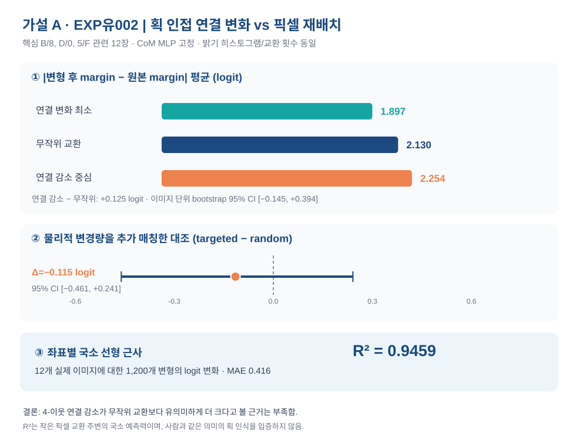

# 가설 A · EXP유002 — 픽셀 좌표 반응과 획 인접 연결성 분리 검증

> **연구 질문:** 픽셀을 같은 규모로 재배치할 때 획의 인접 연결을 많이 끊는 변화가 일반적인 픽셀 교환보다 MLP의 클래스 판단에 더 큰 영향을 주는가?
>
> **상태:** 1차 진단 실험 완료. **실제 20장·유효 픽셀 개입 1,993건**(핵심 12장·1,200건). 기존 MLP 가중치 고정, 신규 학습 없음. 공식 Original Test·교수님 Test 미사용.

## 1. 실험 배경과 목적

[가설 A EXP유001](EXP유001_픽셀판단근거_분석.md)은 B/8·D/0·5/F 이미지에서 특정 픽셀 영역을 제거하면 클래스 출력이 크게 달라지는 것을 확인했다. 그러나 픽셀 제거는 획의 형태와 밝기를 동시에 바꾸므로 **모델이 획의 공간적 관계를 사용하는지** 분리할 수 없었다.

이번 실험에서는 **같은 손글씨의 픽셀값 교환으로 전체 밝기를 유지**하면서, 연결 구조의 변화 정도에 따른 모델 반응을 비교한다.

## 2. 데이터, 모델 및 조작 변수

- **기존 검증된 실제 Hand-made 20장**. 그중 주요 6개 클래스(B·8·D·0·5·F)의 **12장**을 핵심 분석 대상으로 지정(실제 B 4장, D 1장, 5 3장, 8 1장, 0 2장, F 1장).
- 실제 검증된 Normal MLP와 CoM MLP 체크포인트를 로드. **주요 개입 분석은 CoM MLP + CoM 정렬 입력** 기준으로 수행. 원본 20장의 60개 기초 예측 재현 검증 완료.
- 한 번의 개입: 밝은 전경 픽셀(≥200)과 인접 배경 픽셀(≤30)을 맨해튼 거리 3 이내에서 **4쌍 교환**, 변경 좌표 총 **8개**.
- **완전 보존:** 0–255 픽셀 밝기값의 전체 히스토그램, 총 밝기 합, 임계값 128 기준 전경 픽셀 수, Bounding Box, CoM **정수 이동량**.
- **완전히 동일하지 않음:** CoM의 소수점 이하 미세 위치. 핵심 분석에서 평균 약 **0.031~0.040px**, 전체 최대 약 **0.221px** 차이가 발생할 수 있음.
- 조작 후보 선택에 **MLP 예측·확률·logit 점수를 사용하지 않음**.
- 비교: **① 4-이웃 연결 감소를 최대로 유도한 교환 ② 같은 제약의 무작위 교환 ③ 4-이웃 연결 변화가 작은 교환**.
- 원본 이미지당 최대 100회(①20, ②60, ③20). 총 계획 2,000건 중 유효 **1,993건**, 핵심 12장의 1,200건은 모두 유효.
- 4-이웃 연결은 컴퓨터 비전의 **인접 구조 대리 지표**이며 사람이 지각하는 곡률·획 의미와 동치가 아니다.

## 3. 모델 반응과 비교 지표

평가 지표는 `정답 클래스 logit − 가장 관련된 경쟁 클래스 logit`의 **원본 대비 절대 변화량**과 16개 클래스 중 예측 변경률이다.

| 조건 | 핵심 12장 평균 4-이웃 연결 변화 | 평균 상대 logit 변화의 절댓값 | 16-class 예측 변경률 |
|---|---:|---:|---:|
| 연결 변화 최소 | −2.008 | 1.897 | 0.42% |
| 무작위 교환 | −7.564 | 2.130 | 4.03% |
| 연결 감소 중심 | **−9.954** | **2.254** | 4.58% |

- **연결 감소 − 무작위:** +0.125 logit, **12개 독립 원본 이미지 단위 부트스트랩 95% 구간 −0.145~+0.394**. 구간에 0이 포함됨.
- **연결 감소 − 연결 최소:** +0.357 logit, 95% 구간 **−0.040~+0.783**. 이 역시 0 포함.
- 전체 20장에서는 연결 감소 − 무작위 +0.106 logit, 95% 구간 **−0.093~+0.313**.

## 4. 밝기 차이·이동 거리까지 매칭한 추가 대조

최초 비교에서 연결 감소 조건은 무작위 조건보다 옮긴 밝기의 차이 합계와 거리가 조금 더 컸다. 그래서 **옮긴 밝기 차이 합계·맨해튼 이동거리·소수점 중심 이동량**이 가까운 무작위 개입을 모델 출력과 무관하게 선정하여 재비교했다.

- 핵심 12장: 연결 감소 **2.254** vs 매칭 무작위 **2.369** logit.
- 차이 **−0.115 logit**, 이미지 단위 부트스트랩 95% 구간 **−0.461~+0.241**.
- 전체 20장: 차이 **−0.182**, 95% 구간 **−0.431~+0.069**.
- 따라서 구조 연결 감소 조작이 물리적 변경량을 맞춘 무작위 픽셀 교환보다 **일관되게 더 큰 영향을 준다는 근거는 확보되지 않았다**.

## 5. 국소 좌표별 민감도로 실제 점수 변화를 설명할 수 있는가?

기존 CoM MLP의 실제 가중치와 ReLU 활성화 상태를 이용해 **원본 손글씨에서 정답−경쟁 logit 마진의 784개 입력 픽셀별 미분**을 계산하였다. 픽셀 변화량에 이 미분을 곱한 1차 선형 예측과 실제 MLP의 logit 변화를 비교하였다.

- 핵심 12장·1,200개 개입: **R² = 0.9459**, 평균 절대 잔차 **0.416 logit**.
- 전체 20장·1,993개 개입: **R² = 0.8827**, 평균 절대 잔차 **0.568 logit**.

이 결과는 **검증한 작은 픽셀 교환의 영향 대부분이 원본 주변 각 좌표의 국소 민감도로 근사 가능하다**는 근거다. ReLU MLP의 국소 선형 특성 때문에, 이 사실은 **모델이 사람처럼 획 형태를 인식하지 못한다는 증거가 아니다**.

### 핵심 근거 그래프

위 그림의 평균·신뢰구간·R²는 실제 검토용 `exp_a2_per_image_summary.csv`, `exp_a2_contrasts.csv`, `exp_a2_matched_summary.csv`, `exp_a2_local_linearity.csv`에서 직접 정리했다.

## 6. 실제 손글씨 사례와 한계

- **B (작성자44/#155):** 원래 B→8 오답. 연결 감소 20개 중 4개 조작에서 B로 교정, 무작위 60개 중 8개 교정.
- **D (작성자41/#333):** D→0 오분류가 연결 감소 20개 조건에서도 모두 유지됨.
- **5 (작성자43/#53):** 원래 5 정답. 연결 감소 20개 중 3개에서 5→F 신규 오류, 무작위 60개 중 5개에서 신규 오류.

**한계:** 핵심 실제 손글씨는 12장이고 실제 D는 1장이다. 1,993개 조작은 독립 손글씨 1,993장을 뜻하지 않는다. 변형된 이미지를 사람이 여전히 원래 문자로 읽는지 직접 평가하지 않았다. 글자의 위치·밝기 총량·정수 정렬은 통제했으나 **변경 픽셀 좌표 및 소수점 중심은 완전히 동일하지 않다**.

## 7. 최종 결론 및 다음 검증

1. 획 인접 연결을 더 끊는 조작도 출력에 영향을 주지만, 동일 픽셀 수를 변경한 무작위 조작 대비 **뚜렷하고 일관된 추가 효과는 확인되지 않았다**.
2. 이번 범위에서는 좌표별 국소 픽셀 민감도가 실제 클래스 점수 변화를 높은 설명력으로 근사했다.
3. **사람이 보는 획의 의미·연결·곡률을 MLP가 인지하는지는 여전히 미검증**이다.

다음 실험은 사람이 형태 유지/훼손을 확인한 실제 B·D·5의 변형과 그에 대응하는 픽셀 이동·밝기 대조군을 구성해야 한다. 다수 원본·작성자별 반복을 포함하고 테스트 데이터는 최종 단계까지 보존한다.

## 8. 산출물 및 재현 범위

- 본 GitHub 커밋에는 **결론을 뒷받침하는 SVG 그래프 1장과 실험 로그만 업로드**했다.
- 상세 검토용 원본: `exp_a2_swaps_per_sample.csv` (1,993개 개입), `exp_a2_per_image_summary.csv`, `exp_a2_contrasts.csv`, `exp_a2_matched_summary.csv`, `exp_a2_local_linearity.csv`, `exp_a2_metadata.json`, 예시 원본 이미지·모델 체크포인트·실행 코드. **현재 저장소에 없는 파일에 대한 가짜 Markdown 링크는 작성하지 않는다.**
