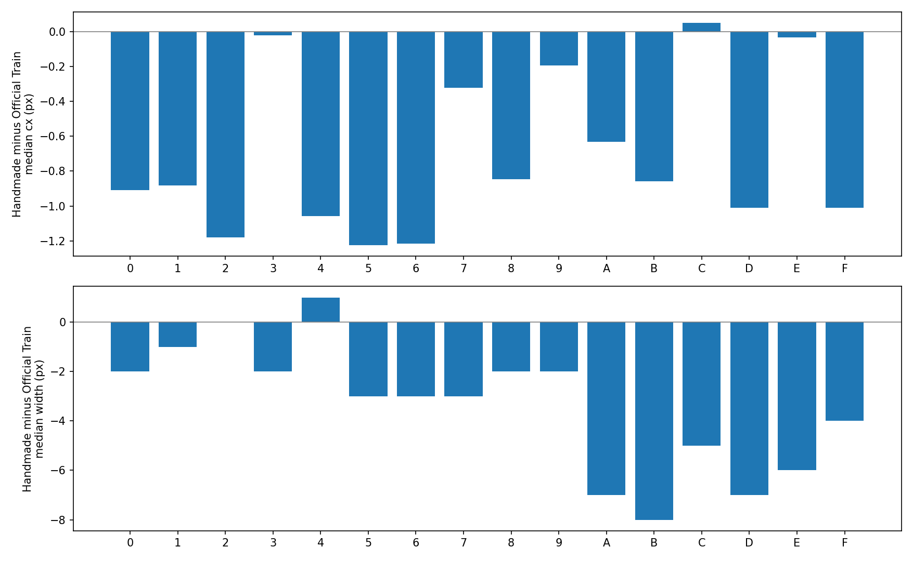
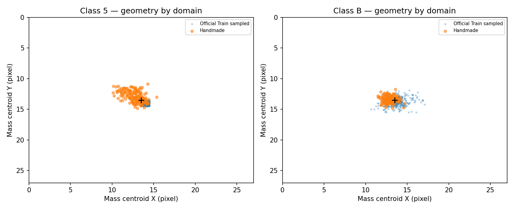
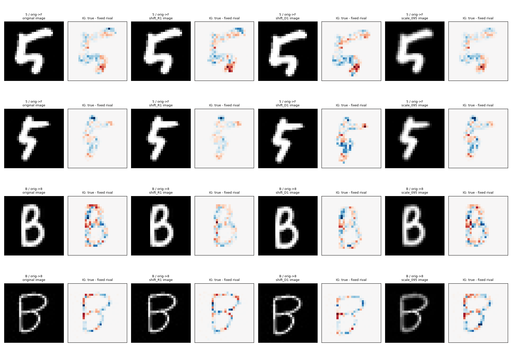

# EXP유003 | Normal MLP — Spatial Distribution & MLP Response Analysis

> **연구 질문:** 기존 Normal MLP에서 확인한 손글씨 위치·크기 민감도는 공식 학습 데이터와 Hand-made의 실제 공간 분포 차이와 연결되는가? 그리고 같은 이미지를 미세하게 이동·축소했을 때 MLP 은닉층 활성화·클래스 점수·픽셀 기여도는 어떻게 변하는가?
>
> **결론:** 공식 Training과 Hand-made는 실제 중심·Bounding Box 분포가 다르며, 이미지 이동에 따른 **공식 학습 분포와의 접근 정도**와 오류 교정에는 연관성이 나타났다. 하지만 모든 클래스·작성자에서 일관되지는 않았고, **95% 축소는 공간 분포와의 평균 거리가 늘어나도 정확도가 개선**되었다. 공간적 불일치가 유력한 관련 요인이라는 설명은 지지되지만, 유일한 원인이나 최적 전처리 방법은 아직 확정하지 않는다.

| 항목 | 실제 기록 |
|---|---|
| 실험 ID / 실시일 | **EXP유003 (MLP / Normal)** · 2026-11-15 KST |
| 단계 | **공간 분포 및 MLP 내부 반응 분석 (진단 완료)** |
| 담당 | 유용성 / 분석·검증·문서화 AI 보조 |
| 선행 실험 | [EXP유001 — Pixcel_Attribution](../초기분석/EXP유001_Pixcel_Attribution.md) → [EXP유002 — Input_Sensitivity](../초기분석/EXP유002_Input_Sensitivity.md) |
| 코드 | [Spatial_Response_Analysis.py](../../scripts/Spatial_Response_Analysis.py) |
| 결과 원본 | [results/Spatial_Response/](../../results/Spatial_Response/README.md) |
| 검증 실행 | [GitHub Actions #43634701305 (success)](https://github.com/ryu980920/Machine_Learning/actions/runs/43634701305), Artifact: \`normal-mlp-exp003-spatial-response-review\` |
| 범위 | **분포·오류와의 연관성·기존 고정 MLP 내부 활성화와 IG 비교**만 수행. **자동 정렬 도입/모델 최적화 미실시** |

## 1. 문제와 검증 가설

1. **공간 분포 불일치 가설:** 공식 Train과 Hand-made의 글자 중심 및 너비·높이 분포가 서로 다르며, 그 차이가 위치 민감도와 관련될 수 있다.
2. **예측 교정 연관성 가설:** 동일한 손글씨를 이동한 결과 공식 Training의 공간적 참조 분포에 가까워지면 일부 오류가 더 잘 교정될 수 있다.
3. **모델 내부 반응 가설:** 같은 입력의 작은 위치·크기 변화가 은닉층 ReLU 활성화와 정답-경쟁 클래스 logit 차이, Integrated Gradients(IG)를 변화시켜 예측이 뒤집힐 수 있다.

**반증 조건:** 공간적 분포 차이가 없거나, 공식 분포에 가까워지는 변화가 실제 교정과 연결되지 않는다면 단순한 위치 불일치 원인 가설은 약화된다. 반대로 상관관계만 존재해도 학습 과정의 인과적 원인이 입증된 것은 아니다.

## 2. 데이터, 기준 모델과 분석 방법

| 구분 | 실제 적용 |
|---|---|
| 모델 | EXP유002의 [저장된 Normal MLP 체크포인트](../../results/Input_Sensitivity/normal_mlp_refit_stage3.joblib) **그대로 로드**, **재학습 0회** |
| 체크포인트 SHA-256 | \`9b54ba9c60e389575200d88ad0b93c47ec47f9c673eebeb755ff47e3ebe23b0a\` |
| 공식 NPZ SHA-256 | \`0e9570d0eb04c0c1da99d043b85bfdab7f3b639eebe4b10335b05b57ad671879\` |
| 공식 Train | **76,800장**, 원본 72,521장 / 증강 4,279장 — 분리 분석 |
| 공식 Validation | **19,200장** |
| Hand-made | 작성자 41·42·43·44 각 640장 = **2,560장**, 최신 표준 NPZ |
| 공간 특징 | **총 98,560장**의 중심 X·Y, Bounding Box 중심/너비/높이, 상하좌우 여백, 획 면적 |
| 픽셀 판정 기준 | 0~255 강도에서 **임계값 32**, **64·128**로 민감도 교차 확인 |
| 대응 비교 | 원본, **좌 1px**, **우 1px**, **아래 1px**, **90% 축소**, **95% 축소** 총 **6조건 × 21,760장 = 130,560건** |
| MLP 내부 분석 | 기존 대표 **106장 × 6조건 = 636건**의 은닉층 활성화, 출력 점수 및 예측 |
| IG | 대표 **18장 × 4조건 = 72개**. 128-step midpoint, 검은 이미지 기준. 같은 샘플의 **정답 logit − 원본 고정 경쟁 클래스 logit** 목표 함수 |
| 미사용 자료 | **공식 Test 16,000장**, 교수님 Test. Hand-made 학습·파라미터 최적화 없음 |

### 분석 절차

- 기존 모델의 공식 Validation **97.3177083%**, Hand-made **62.8515625%** 재현 확인. 공식 CM 셀 절댓값 차이 합 **0**, Hand-made 2,560개 기존 예측 불일치 **0**.
- 학습·검증·손글씨의 공간 특징을 계산하고, 공식 Train **원본/증강본·클래스별·작성자별** 분포를 분리해 비교.
- 공식 Train **각 정답 클래스**의 중심 X·Y, 너비·높이 중앙값과 IQR을 참조해, 변형 전후 거리를 계산.
- 변형 결과가 해당 참조 분포에 **가까워진/가까워지지 않은 경우**로 나눈 뒤 오류 교정과 신규 오분류를 따로 집계.
- 16개 클래스와 손글씨 작성자별로 관계를 추가로 분리해 전체 평균에서 보이는 착시를 확인.
- 동일 모델의 100개 은닉 뉴런 활성화 변화와 클래스 점수 차이, IG의 변화를 관찰.

**주의:** 공식 Training의 정답 클래스별 공간 참조 거리는 **정답 레이블을 활용한 사후 연구용 지표**다. 추론 시 정답을 알 수 없으므로 이 거리를 직접 사용한 정답별 전처리를 제안하는 것은 부적절하다.

## 3. 실제 결과 A — 공간 분포 차이

| 중앙값 (px) | 공식 Training | 공식 Validation | Hand-made |
|---|---:|---:|---:|
| 밝기 가중 중심 X | **13.871** | 13.870 | **12.983** |
| 밝기 가중 중심 Y | **13.925** | 13.928 | **13.357** |
| Bounding Box 가로 너비 | **18** | 18 | **15** |
| Bounding Box 세로 높이 | **20** | 20 | **20** |

손글씨의 중심은 공식 Train보다 **X −0.888px, Y −0.568px** 왼쪽·위쪽이며 가로 너비 중앙값은 **3px 더 좁다**. 이는 전체 클래스 집계이므로 글자 자체의 형태 차이와 구별하려면 개별 클래스 비교가 필수다.

| 클래스 | 손글씨−공식 중심 X 중앙값 차이 | Bounding Box 너비 중앙값 (공식→손글씨) |
|---|---:|---|
| 5 | **−1.224px** | 19→16px |
| 9 | −0.194px | 14→12px |
| B | **−0.858px** | **22→14px** |
| F | **−1.011px** | 20→16px |

가로·위치 차이가 16개 클래스에 일률적으로 동일하지 않다. 특히 **B의 너비 차이 8px**은 B→8 오분류와 연결해 추가 조사할 가치가 있다. 임계값 32·64·128로 계산했을 때도 모든 원본 이미지가 유효한 글자 영역을 가지고 있었으며, 주요 차이 방향의 안정성을 확인했다.

## 4. 실제 결과 B — 공간 분포와 교정의 연관성

| Hand-made 입력 | 정확도 | 기존 오류 중 정답 교정 | 기존 정답 중 신규 오답 | 공식 클래스별 공간 참조에 가까워진 이미지 | 평균 공간 거리 변화 |
|---|---:|---:|---:|---:|---:|
| 원본 | **62.8516%** | — | — | — | — |
| 왼쪽 1px | **46.8750%** | 96 | 505 | 183/2,560 | **+0.515** |
| 오른쪽 1px | **65.3906%** | 269 | 204 | **1,586/2,560** | **−0.113** |
| 아래쪽 1px | **65.0391%** | 273 | 217 | 1,312/2,560 | **−0.064** |
| 90% 축소 | **65.6641%** | 301 | 229 | 707/2,560 | **+0.628** |
| 95% 축소 | **66.6797%** | 170 | 72 | 1,764/2,560 | **+0.070** |

오른쪽 1px 이동에서 원래 오답인 손글씨는 **분포에 가까워진 집단 212/665=31.9%**가 교정됐으며, **가까워지지 않은 집단 57/286=19.9%**가 교정됐다. 원래 정답이었던 손글씨의 신규 오답은 가까워진 집단 **79/921=8.6%**, 나머지 **125/688=18.2%**였다.

**핵심 제한·반례:** 클래스/작성자별로 구분하면 같은 방향이 모든 집단에서 재현되지는 않는다. 또한 95% 축소는 손글씨 정확도가 증가해도 **공식 클래스별 공간 거리의 평균은 증가(+0.070)**했다. 그러므로 **'공식 중심·크기 분포와 같아지면 반드시 성능이 개선된다'는 단순 가설은 불충분**하다.

원본·변형본은 같은 고정 모델에서 비교했지만, 이동·보간은 많은 픽셀을 동시에 바꾸며 획의 일부도 영향을 받는다. 공식 참조 거리와 오분류의 관련성은 **사후 탐색적 연관성**으로 해석한다.

## 5. 실제 결과 C — 모델 내부 반응과 IG

| 원본 Hand-made 오류 (작성자/인덱스) | 적용 변형 | 변형 후 예측 | 은닉층 활성화 상대 L2 |
|---|---|---|---:|
| **5→F (43/#53)** | 90% 축소 | **5 (정답)** | 0.397 |
| **B→8 (42/#27)** | 왼쪽 1px | **B (정답)** | 0.388 |
| **9→4 (41/#25)** | 아래쪽 1px | **9 (정답)** | 0.464 |
| **0→D (43/#0)** | 오른쪽 1px | **0 (정답)** | 0.395 |

예를 들어 9→4 사례에서는 아래쪽 1px 이동으로 정답 9에 대한 예측 확률이 **약 99.96%**가 되었고, 은닉층 활성·비활성 상태가 바뀐 뉴런 비율이 **18%**였다. 작은 이미지 이동이 은닉층 표현과 출력 결정 경계를 크게 변화시키는 구체적인 사례를 확보했다.

전체 평균 은닉층 활성화 상대 L2 변화는 Hand-made의 오른쪽 1px **0.406**, 아래쪽 1px **0.440**, 95% 축소 **0.185**였다.

대표 18개 이미지에 대해 **동일한 고정 경쟁 클래스 기준**으로 IG를 계산하였고, 최대 절댓값 completeness residual은 **약 0.100**이었다. 배경 0픽셀의 기여도가 0인 것은 검은 기준 이미지 선택의 영향도 있으므로, 기여도 분포가 *형태 학습의 인과적 증거*라고 해석하지 않는다.

전체 5개 IG 비교 이미지는 [focus_ig_grids/](../../results/Spatial_Response/focus_ig_grids/)에 있다.

## 6. 판단과 다음 연구

**이번 실험에서 확인된 것**

- 공식 학습 분포와 개발용 Hand-made의 중심·너비·작성자/클래스 분포에 실제 차이가 존재한다.
- 같은 이미지를 이동·축소하면 **MLP의 100개 은닉 뉴런 활성화, 출력 logit margin, IG와 최종 예측이 변화**한다.
- 위치가 공식 학습 분포에 가까워지는 정도와 오류 교정에는 **일부 연관성**이 나타나지만, 모든 오류와 크기 민감도를 단일 원인으로 설명하지 못한다.

**아직 확인하지 못한 것**

- MLP가 특정 위치의 가중치를 **학습 과정에서 왜 형성했는가**라는 인과적 메커니즘.
- 자동 중심 정렬 또는 크기 정규화가 **새 작성자**의 독립 데이터에서 일반화 성능을 높이는가.
- 라벨·작성자 정보 없이 결정할 수 있는 최적 정렬 방식이 무엇인가.

**중요한 개발 원칙:** Hand-made **2,560장(실제 4명 작성)**은 이미 반복 분석한 개발 데이터다. 이 집단에서 가장 높은 Accuracy를 낸 일괄 이동·축소를 실제 추론 전처리로 선택하면 **개발 데이터 선택 과적합**이 발생할 수 있다. 본 실험은 **전처리 선정 실험이 아니며**, 정답 클래스별 공간 참조값을 실제 추론 입력 보정에 사용하지 않았다.

**후속 후보:** EXP유004 *Automatic_Centering* — 입력 이미지 자체의 무게중심 / Bounding Box 중심으로 라벨 없이 정렬하는 후보를 공식 Training과 Validation에 동일하게 적용하여 비교한다. 초기 진단은 기존 고정 MLP에서 진행하고, 실제 Pipeline 개선에서는 학습/추론 전처리 일관성을 유지한다. 방법과 임계값은 Hand-made 정확도만으로 선택하지 않고 공식 개발용 Validation 및 새로운 작성자 평가를 통해 결정한다.

## 7. 원본 결과·재현 근거

- [기하학적 특징 98,560행](../../results/Spatial_Response/all_image_geometry.csv.gz) · [공식/손글씨 요약 153행](../../results/Spatial_Response/geometry_distribution_summary.csv)
- [클래스·작성자별 차이 96행](../../results/Spatial_Response/per_class_geometry_differences.csv) · [공식 클래스 참조값](../../results/Spatial_Response/official_class_references.csv)
- [변형 전후 전수 결과 130,560행](../../results/Spatial_Response/paired_geometry_model_response.csv.gz) · [조건별 요약](../../results/Spatial_Response/spatial_response_summary.csv)
- [공간거리와 교정·악화](../../results/Spatial_Response/geometry_proximity_vs_outcome.csv) · [클래스/작성자 내 분리 1,777행](../../results/Spatial_Response/geometry_proximity_by_writer_class.csv)
- [은닉층 반응 636행](../../results/Spatial_Response/focus_hidden_responses.csv) · [IG 72행](../../results/Spatial_Response/focus_ig_completeness.csv) · [IG 배열](../../results/Spatial_Response/focus_ig_maps.npz)
- [검증 메타데이터](../../results/Spatial_Response/run_metadata.json) · [실행 요약](../../results/Spatial_Response/SUMMARY.md)
- [재현 코드](../../scripts/Spatial_Response_Analysis.py) · [Actions 워크플로](../../../../../.github/workflows/mlp_spatial_response_stage4.yml)
- [GitHub Actions 성공 원본 실행 #43634701305](https://github.com/ryu980920/Machine_Learning/actions/runs/43634701305), 원본 Artifact \`normal-mlp-exp003-spatial-response-review\`.
