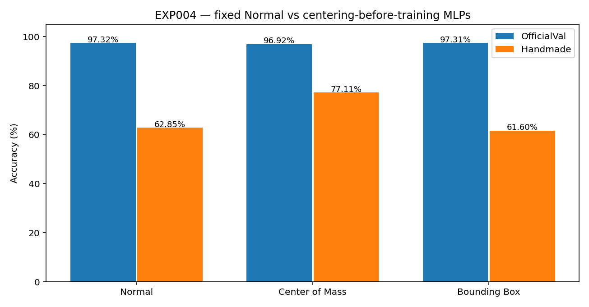
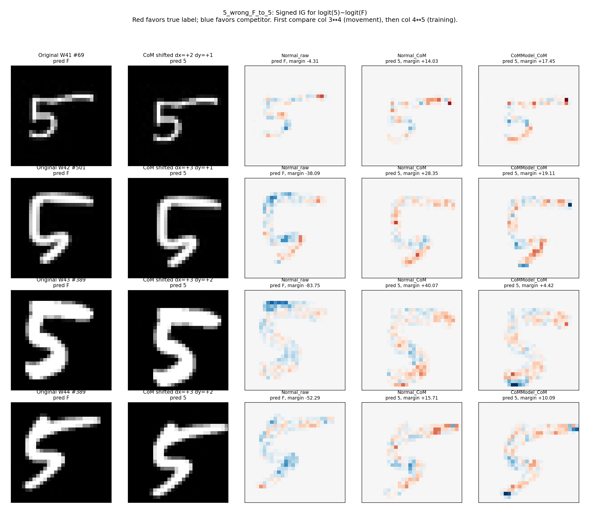
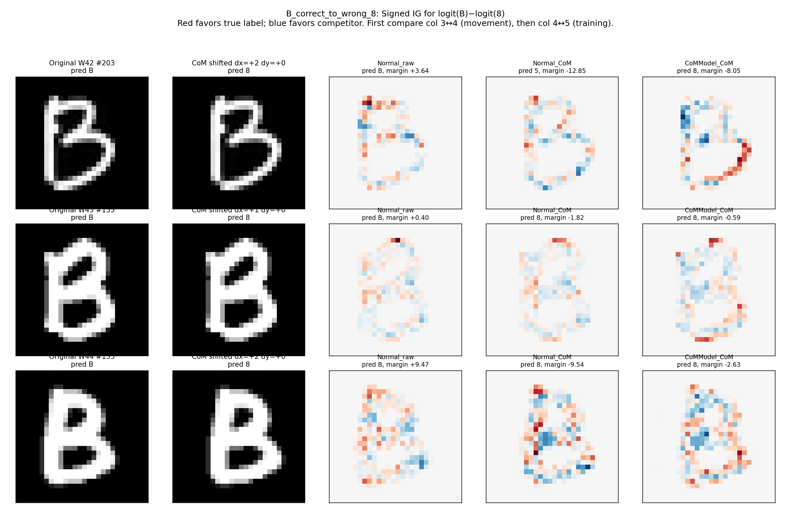

# EXP유004 — Automatic Centering: 정렬 효과와 MLP 픽셀 판단근거 검증

> **상태: 실험·분석·원본 검증 및 정식 배포 완료. 최종 추론 Pipeline 채택은 보류.**
>
> **통합 연구 질문:** 공식 MNIST·EMNIST와 Hand-made의 위치 분포 차이가 MLP 오분류를 유발하는가? CoM 정렬은 인식을 개선하는가? **숫자는 개선되지만 문자는 악화되는 이유가 이미지 이동 때문인지, 재학습된 가중치 때문인지** 확인한다.
>
> **핵심 결론:** CoM 정렬을 학습·평가에 적용하면 Hand-made 전체 **62.8516%→77.1094%(+14.2578%p)**, 공식 Validation **97.3177%→96.9167%(−0.4010%p)**. 기존 MLP를 그대로 고정하고 **이미지만 CoM 이동**해도 숫자 **56.31%→82.00%(+25.69%p)**, 문자 **73.75%→52.40%(−21.35%p)**로 상반된 변화가 발생했다. 새롭게 학습한 CoM MLP에서 문자는 **66.98%**로 회복됐으나 원본 기준보다 낮다.

**하나의 EXP유004에 두 검증 단계를 통합:** (1) Center of Mass·Bounding Box 정렬 모델을 공식 Training으로 학습·평가, (2) 기존 Normal MLP를 고정한 CoM 이동 통제 및 동일 CoM 입력에서 재학습 효과·Signed IG 검증. **서로 다른 두 실행을 하나의 연구 로그로 기록**하며 학습 여부를 단계별로 구분한다.

[정렬·모델 학습 코드](../../scripts/Automatic_Centering_Experiment.py) · [CoM 판단근거 분석 코드](../../scripts/CoM_Decision_Diagnostic.py) · [중심 정렬 Transformer](../../scripts/Automatic_Centering_Transformer.py) · [통합 결과 폴더](../../results/Automatic_Centering/README.md)

## 1. CM에서 출발한 오차 가설과 선행 연구

- **EXP유001 — Pixcel_Attribution:** 고정 MLP의 픽셀 기여 패턴 및 오분류 사례 관찰.
- **EXP유002 — Input_Sensitivity:** 같은 이미지의 위치·밝기·굵기·크기 변화로 예측과 정오답이 상당히 달라지는 현상 측정.
- **EXP유003 — Spatial_Response:** 공식 데이터와 Hand-made의 공간 분포 차이, 같은 이미지의 위치 변화와 오분류/은닉층 반응의 연관성 관찰.
- **EXP유004의 가설:** 학습과 추론 양쪽에서 이미지별 중심을 무감독·일관된 규칙으로 정렬하면 실제 손글씨 인식의 성능이 개선될 수 있다. **중심을 잘 옮겼다는 사실 자체와 분류 성능 개선은 별도 검증 대상이다.**

[실행 코드](../../scripts/Automatic_Centering_Experiment.py) · [중심 정렬 Transformer](../../scripts/Automatic_Centering_Transformer.py) · [실제 결과](../../results/Automatic_Centering/README.md) · [성공한 GitHub Actions #43638979287](https://github.com/ryu980920/Machine_Learning/actions/runs/43638979287)

## 2. 실행 조건 및 통제

| 구분 | 적용 내용 |
|---|---|
| 작성자/기간 | 유용성 · 2026-11-15 KST |
| 공식 학습/평가 | 동일한 **Training 76,800장 / Validation 19,200장**, 이전 Baseline의 그룹 분할 유지 |
| 실제 Hand-made 평가 | 작성자 **41·42·43·44**, 각 640장, 총 **2,560장**. 학습과 전처리 규칙 선정에는 **미사용** |
| 기준 모델 | **기존 EXP유002 frozen Normal MLP**, 예측 기록 재검증, 재학습 없음 |
| 신규 후보 | **Center_of_Mass MLP**, **Bounding_Box_Center MLP**, 각각 동일 공식 Training 76,800장으로 새로 학습 |
| 모델 정의 | 동일 `MLPClassifier(random_state=42)`, ReLU 단일 은닉층 **100개**, 기본 하이퍼파라미터, 동일 0~1 픽셀 스케일러 |
| Center of Mass | Threshold **32/255** 이상 픽셀의 **밝기 가중 중심** |
| Bounding Box Center | Threshold **32/255** 이상 영역의 최솟값·최댓값으로 구한 사각형 중심 |
| 목표 좌표 | **(13.5, 13.5)** — 28×28 이미지의 고정 기하학적 중심 |
| 이동 | `np.rint`를 적용한 **정수 픽셀 병진 이동**, 경계 외부 0 채움, wrap 및 보간 없음 |
| 학습/평가 Pipeline | `원본 → 같은 방식으로 중심 정렬 → PixelScaler255 → MLP` |
| 사용하지 않은 데이터 | **공식 Original Test 16,000장과 교수님 Test 전부 미사용** |
| 실험 결과 저장 | [review 실행 #43638979287](https://github.com/ryu980920/Machine_Learning/actions/runs/43638979287), Artifact `normal-mlp-exp004-automatic-centering-review`; 이후 **사용자 승인으로 원본을 변경 없이 연구 기록에 배포** |

기존 Normal의 Official Validation Confusion Matrix 차이 합 **0**, 기존 Hand-made 예측 불일치 **0**. 사용한 기존 MLP SHA-256: `9b54ba9c60e389575200d88ad0b93c47ec47f9c673eebeb755ff47e3ebe23b0a`. 공식 원본 데이터 SHA-256: `0e9570d0eb04c0c1da99d043b85bfdab7f3b639eebe4b10335b05b57ad671879`.

**분석 원칙:** 정답 클래스·작성자 정보는 사후 평가에서만 사용한다. 전처리의 위치·임계값·방식을 Hand-made의 결과에 맞춰 개별 이미지별로 선택하지 않는다.

## 3. 평가 결과 — 공식 Validation과 Hand-made

| 평가 데이터 | 조건 | 정답 수 | Accuracy | 기존 대비 | Macro F1 | 기존 오답 교정 / 신규 오답 |
|---|---|---:|---:|---:|---:|---:|
| 공식 Val 19,200장 | Normal | **18,685** | **97.3177%** | — | 0.9730 | — |
| 공식 Val 19,200장 | Center of Mass | 18,608 | 96.9167% | **−0.4010%p** | 0.9690 | 245 / 322 |
| 공식 Val 19,200장 | Bounding Box | 18,683 | 97.3073% | −0.0104%p | 0.9729 | 260 / 262 |
| Hand-made 2,560장 | Normal | **1,609** | **62.8516%** | — | 0.6241 | — |
| Hand-made 2,560장 | **Center of Mass** | **1,974** | **77.1094%** | **+14.2578%p** | **0.7704** | **533 / 168** |
| Hand-made 2,560장 | Bounding Box | 1,577 | 61.6016% | −1.2500%p | 0.6204 | 337 / 369 |

- Center of Mass Hand-made의 정답 개수는 기존보다 **365장 증가(533장 교정 − 168장 신규 오류)**했다.
- Bounding Box는 기존보다 **32장 감소(337장 교정 − 369장 신규 오류)**했다.
- 공식 Validation에서는 Center of Mass가 **77장 감소**, Bounding Box는 **2장 감소**했다.
- 정확도 차이만으로 **새로운 필체에서의 일반화 성능**을 확정하지 않는다.

## 4. Hand-made 숫자/문자 및 작성자별 효과

| 그룹 | Normal | Center of Mass | Bounding Box | Center of Mass 변화 |
|---|---:|---:|---:|---:|
| **숫자 0–9** | 56.31% | **83.19%** | 66.38% | **+26.88%p** |
| **문자 A–F** | **73.75%** | **66.98%** | 53.65% | **−6.77%p** |
| 작성자 41 | 59.38% | 68.44% | 66.41% | +9.06%p |
| 작성자 42 | 69.06% | 78.75% | 65.47% | +9.69%p |
| 작성자 43 | 55.94% | 77.97% | 44.69% | +22.03%p |
| 작성자 44 | 67.03% | 83.28% | 69.84% | +16.25%p |

**클래스별 실제 사례:**
- 숫자 **9: 33.75% → 90.00%**, 숫자 **5: 44.38% → 73.75%** (Normal → Center of Mass).
- 문자 **B: 40.00% → 33.12%**, **C: 95.00% → 83.75%**, **D: 63.12% → 53.12%**, **F: 87.50% → 77.50%**.
- **5→F 오류 60건 → 12건으로 감소**, **B→8 오류 53건 → 79건으로 증가**. 따라서 숫자 개선이 특정 문자 혼동을 함께 해결한 것은 아니다.

16개 클래스의 전체 Accuracy·Precision·Recall·F1, 작성자별 숫자/문자 성능 및 기존 예측과의 1:1 비교는 [exp004_group_metrics.csv](../../results/Automatic_Centering/exp004_group_metrics.csv)와 [exp004_predictions.csv.gz](../../results/Automatic_Centering/exp004_predictions.csv.gz)에 남겨두었다.

## 5. 중심 정렬의 정확성과 획 정보 손실

| 출처 | 방법 | 목표 중심까지 평균 거리: 정렬 전→후 | 일부 픽셀 강도 손실이 발생한 이미지 수 |
|---|---|---:|---:|
| 공식 Training | Center of Mass | 1.055 → 0.381px | 6,288 / 76,800 |
| 공식 Training | Bounding Box | 1.088 → 0.163px | 31 / 76,800 |
| 공식 Validation | Center of Mass | 1.055 → 0.383px | 1,617 / 19,200 |
| 공식 Validation | Bounding Box | 1.083 → 0.162px | 4 / 19,200 |
| **Hand-made** | **Center of Mass** | **1.390 → 0.380px** | **700 / 2,560** |
| **Hand-made** | Bounding Box | **0.276 → 0.258px** | **2 / 2,560** |

- Hand-made의 Center of Mass 정렬 시 전체 획 강도 대비 **평균 손실률 약 0.0118%**. 700장은 잉크값 손실이 0이 아닌 사례의 수이며, 각 사례에서 큰 손실이 발생했다는 뜻은 아니다.
- Bounding Box 기준에서는 Hand-made가 정렬 전부터 평균 중심 오차가 약 **0.276px**로 작아 전처리의 효과가 제한되었다.
- 정렬 후 목표 좌표에 가까워진 정도와 **MLP의 예측 정확도는 같은 평가 지표가 아니다**. 이 실험에서도 중심 정렬 오차가 작은 Bounding Box의 Hand-made 정확도가 더 낮았다.
- 본 실험은 **정수 픽셀 이동·획 손실 확인**만 했으며, 서브픽셀 보간이나 추가 크기 보정은 평가하지 않았다.

## 6. CoM 이미지 이동과 모델 재학습의 영향 분리

**실험 목적:** CoM 적용 이후 숫자 정확도가 개선되지만 문자 정확도가 하락하는 현상이 입력 이미지의 위치 이동 자체에서 나타나는지, 학습 가중치를 바꾸면서 나타나는지 분리한다. 아래의 모델 고정 분석에서는 **재학습을 수행하지 않았다.**

| 비교 | 입력 | 가중치 | 해석 |
|---|---|---|---|
| **① Normal/raw** | 원본 손글씨 | 기존 Normal MLP | 기존 기준 |
| **② Normal/CoM** | CoM 이동 이미지 | **기존 Normal MLP 고정** | **이미지 이동 자체의 영향** |
| **③ CoMModel/CoM** | **②와 정확히 동일한 CoM 이미지** | CoM 학습 MLP | **재학습된 가중치의 영향** |
| 보조: CoMModel/raw | 원본 손글씨 | CoM 학습 MLP | 학습 입력 분포 밖 통제이며 배포용 Pipeline이 아님 |

- 평가 데이터: 기존 Hand-made 41·42·43·44 각 640장 = **2,560장** (숫자 1,600장, 문자 960장).
- 기존 확정 Normal·CoM Pipeline의 가중치 **재학습하지 않음**, 기존 EXP유004의 2,560장 원본 예측을 **전수 일치 검증**.
- CoM 목표좌표 **(13.5,13.5)**, 밝기 임계값 **32**, 정수 픽셀 병진 이동, 보간 없음.
- **공식 Original Test 16,000장과 교수님 Test 모두 미사용.** Hand-made 데이터 학습·전처리 하이퍼파라미터 탐색 미실시.
- 예측 비교 결과는 [four_way_predictions.csv](../../results/Automatic_Centering/four_way_predictions.csv)에 같은 이미지별로 4조건을 나란히 저장했다.

| Hand-made | ① Normal/raw | ② Normal/CoM: 이동만 | ③ CoMModel/CoM: 이동+재학습 |
|---|---:|---:|---:|
| **숫자 0–9 (1,600장)** | 56.31% (901) | **82.00% (1,312)** | **83.19% (1,331)** |
| **문자 A–F (960장)** | **73.75% (708)** | 52.40% (503) | 66.98% (643) |
| **전체 (2,560장)** | 62.85% (1,609) | 70.90% (1,815) | **77.11% (1,974)** |

### 6.1 이미지 이동만 변경: ①→②

| 집단 | 정확도 변화 | 오답→정답 | 정답→오답 | 해석 |
|---|---:|---:|---:|---|
| 숫자 | **+25.69%p** | 455 | 44 | 같은 MLP에서도 CoM 이동으로 숫자 판정이 개선됨 |
| 문자 | **−21.35%p** | 29 | 234 | 같은 MLP에서도 CoM 이동으로 문자 오답이 대폭 증가 |

### 6.2 입력을 고정하고 MLP 가중치만 변경: ②→③

| 집단 | 정확도 변화 | 오답→정답 | 정답→오답 | 해석 |
|---|---:|---:|---:|---|
| 숫자 | **+1.19%p** | 108 | 89 | 재학습으로 숫자는 소폭 추가 개선 |
| 문자 | **+14.58%p** | 185 | 45 | 재학습으로 문자가 상당 부분 회복되었으나 원본 기준 73.75%에는 미달 |

**판단:** CoM 이동만으로도 숫자·문자 성능 방향이 반대가 되는 현상을 확인했으며, 재학습은 특히 문자 성능을 회복시키는 효과가 있었다. 즉, **이미지 정렬의 효과와 MLP가 학습한 위치별 가중치를 함께 고려해야 한다.**

## 7. 모델이 실제로 참고한 픽셀의 기여도(IG)

- **모델 판단 분석:** 16개 클래스를 동시에 예측하는 MLP의 `정답 클래스 logit − 경쟁 클래스 logit`에 대한 **Signed Integrated Gradients**.
- IG 설정: 검은 이미지 기준(0), **128 midpoint**, 두 비교에서 동일한 정답/경쟁 클래스 사용.
- **빨강 계열:** 경쟁 클래스보다 정답 클래스의 점수 차이를 높이는 픽셀 기여.
- **파랑 계열:** 경쟁 클래스 쪽으로 점수 차이를 낮추는 픽셀 기여.
- 실제 사례에서 각도·크기·획 자체는 바꾸지 않고 **이미지 전체를 정수 픽셀로 이동**했다.

### 7.1 숫자 5→F 오답이 CoM 이동 후 정답으로 바뀐 경우

Hand-made **작성자 42, 이미지 #501**. 실제 이동량 **X +3px, Y +1px**.

| 판단 조건 | 예측 | logit(5) − logit(F) |
|---|---|---:|
| 기존 Normal MLP + 원본 | **F (오답)** | −38.09 |
| 기존 Normal MLP + CoM 이미지 | **5 (정답)** | +28.35 |
| CoM 학습 MLP + 같은 CoM 이미지 | **5 (정답)** | +19.11 |

### 7.2 문자 B→8 신규 오류가 발생한 경우

Hand-made **작성자 44, 이미지 #155**. 실제 이동량 **X +2px, Y 0px**.

| 판단 조건 | 예측 | logit(B) − logit(8) |
|---|---|---:|
| 기존 Normal MLP + 원본 | **B (정답)** | +9.47 |
| 기존 Normal MLP + CoM 이미지 | **8 (오답)** | −9.54 |
| CoM 학습 MLP + 같은 CoM 이미지 | **8 (오답)** | −2.63 |

실제 **5→F 교정 유형 37장**, **B→8 신규 오답 유형 14장**을 확인했고, 작성자를 분산하여 대표 샘플의 Signed IG를 계산했다. 선택한 사례의 로그잇 변화와 IG를 전체 오류의 유일한 원인이라고 일반화하지 않는다.

## 8. 가설 B에 대한 통합 결론 및 한계

### 8.1 정렬 실험 자체에서 확인된 사항

1. **Center of Mass 정렬의 개선 가능성:** 4명의 기존 Hand-made 전체에서 분류 정확도가 **+14.26%p** 개선되었다. 공식 Validation에서는 **−0.40%p** 변동을 동반했다.
2. **반례/상충:** 전체 Hand-made 정확도 향상은 숫자에서 주도됐다. **문자 성능은 오히려 하락**하여 정렬을 최종 개선 정책으로 승인하기에는 추가 연구가 필요하다.
3. **방법별 차이:** Bounding Box Center는 정렬 위치를 정밀하게 계산했지만 Hand-made에서는 Baseline보다 낮은 정확도를 기록했다. 중심 좌표 보정량이 적다는 점과 관련 가능성이 있으나, 단일 원인으로 단정하지 않는다.
4. **선택 과적합 제한:** 기존 Hand-made는 **네 명의 작성자 데이터**이며 EXP유001·002·003에서 이미 반복적으로 분석했다. 이 결과를 바탕으로 Center of Mass를 가장 유망한 후보로 기술할 수는 있지만, **새 작성자에 대한 일반화 성능으로 보고할 수는 없다**.
5. **추가 검증 필요:** 현재 한 번의 **random_state=42** 학습 결과다. 복수 학습 Seed, 문자 정확도 하락의 원인, 새 작성자 독립 평가가 필요하다. 공식 Test / 교수님 Test는 **최종 단계까지 보존**한다.
6. **자동 배포/서비스 반영 금지:** 이번 기록의 배포는 **연구 결과 보관·공유**만 뜻하며, 기본 Normal MLP 코드를 후보 모델로 대체하거나 추론 Pipeline을 변경하지 않았다.

### 8.2 모델 고정 통제·IG에서 확인된 사항

1. **확인한 사실:** MLP 가중치를 고정했을 때도 CoM에 의한 *픽셀 절대 위치의 변화*가 숫자·문자 분류 결과를 크게 달라지게 한다.
2. **확인한 사실:** 정렬된 이미지로 MLP를 학습하면 문자 성능이 크게 회복된다. 그렇지만 원래 Normal MLP의 문자 정확도보다 여전히 **−6.77%p** 낮다.
3. **가능한 해석:** MLP가 글자 형태뿐 아니라 **이미지 내 특정 픽셀 좌표에 형성된 패턴**에 의존하므로, 통째로 이동한 획이 일부 클래스 판단에는 유리하고 다른 클래스에는 불리할 수 있다.
4. **확인되지 않은 것:** MLP가 글자의 획 형태를 **전혀 학습하지 않았다**는 주장, 모든 문자 악화의 단일 원인, 새로운 작성자에 대한 최종 성능.
5. **다음 개선 가설:** CoM 정렬은 유지하되, **학습 시 CoM 이동 후 ±1px 소규모 위치 증강**을 추가하면 특정 픽셀 좌표에 대한 과도한 의존성을 낮춰 문자의 손실을 줄일 수 있다. **아직 검증되지 않은 실험 제안**이며 본 EXP유004에는 학습/추론 정책으로 반영하지 않았다.

### 8.3 연구 판단

**확인된 결론:** 현재 MLP는 획의 형태만이 아니라 **절대 픽셀 좌표에도 민감**하다. 원본과 같은 글자 획을 이동했을 때 같은 고정 모델의 정답/오답이 바뀌었으며, CoM 정렬은 숫자의 정확도를 크게 높이고 일부 문자를 악화시켰다. **형태를 전혀 학습하지 않았다는 뜻은 아니다.**

**남은 개선 과제:** CoM 정렬을 유지하면서 위치 민감도를 낮추기 위한 **학습 시 ±1px 위치 증강**은 다음 가설(EXP유005 후보)이며, EXP유004에서 실행하거나 채택하지 않았다. 공식 Test와 교수님 Test는 미사용이다.

## 9. 원본 산출물과 재현 근거

- **통합 결과:** [results/Automatic_Centering/README.md](../../results/Automatic_Centering/README.md) — 두 단계의 실측 **19개 원본 파일**을 단일 폴더에 보관. 충돌하는 `SUMMARY.md`와 `metadata.json`은 2단계 것만 `CoM_Decision_SUMMARY.md`와 `CoM_Decision_metadata.json`로 이름을 바꾸고 **바이트 내용과 SHA-256은 그대로 보존**했다.
- **1단계 정렬 학습·평가:** [GitHub Actions #43638979287](https://github.com/ryu980920/Machine_Learning/actions/runs/43638979287) · Artifact **14131562043**. [학습 코드](../../scripts/Automatic_Centering_Experiment.py), [Transformer](../../scripts/Automatic_Centering_Transformer.py).
- **2단계 기존 가중치 고정·IG:** [GitHub Actions #43686466736](https://github.com/ryu980920/Machine_Learning/actions/runs/43686466736) · Artifact **14150383005**. [분석 코드](../../scripts/CoM_Decision_Diagnostic.py).
- **1단계 21,760개 대응 예측:** [exp004_predictions.csv.gz](../../results/Automatic_Centering/exp004_predictions.csv.gz), [그룹 지표](../../results/Automatic_Centering/exp004_group_metrics.csv), [Confusion Matrix](../../results/Automatic_Centering/exp004_confusions.csv).
- **2단계 2,560장 × 4조건:** [four_way_predictions.csv](../../results/Automatic_Centering/four_way_predictions.csv), [정확도](../../results/Automatic_Centering/four_way_summary.csv), [교정·신규오류](../../results/Automatic_Centering/contrasts.csv), [Signed IG](../../results/Automatic_Centering/selected_ig_diagnostics.csv), [5/F](../../results/Automatic_Centering/IG_5_wrong_F_to_5.png)·[B/8](../../results/Automatic_Centering/IG_B_correct_to_wrong_8.png).
- **원본 모델 SHA-256:** Normal `9b54ba9c60e389575200d88ad0b93c47ec47f9c673eebeb755ff47e3ebe23b0a`, CoM `3c1aac362d75ff5c4d9652188c1c4fd97524525f5409ec00d5a6c56fa3ad27ef`.
- **조건:** Python 3.13.18 · NumPy 2.3.5 · SciPy 1.17.0 · scikit-learn 1.8.0 · matplotlib 3.10.7. 저장된 joblib은 신뢰 가능한 파일만 불러오며, 기존 검증 환경에서 원본 경로로 실행한다.

**주의:** Hand-made 작성자 4명의 데이터를 여러 차례 탐색한 개발 결과다. 이는 미관찰 작성자에 대한 독립 Test 정확도를 의미하지 않는다. 기존 Normal 모델의 추론 Pipeline을 자동으로 교체하지 않았다.
