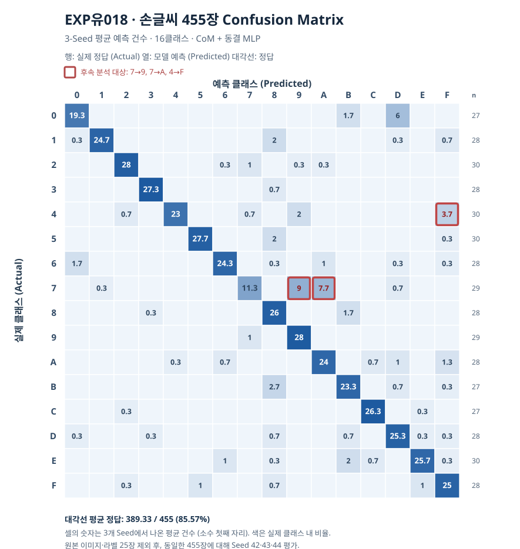

# EXP유018 — EXP유017 동결 MLP의 신규 손글씨 480장 평가와 새로운 혼동쌍 진단

**평가일:** 2026-11-16  
**상태:** 평가 및 과거 Confusion Matrix 대비 완료 / 새 혼동쌍의 원인 규명 미완료  
**후속 분석 대상:** 7→9, 7→A, 4→F  
**모델 학습·하이퍼파라미터 재탐색:** 없음

## 1. 배경과 연구 질문

[EXP유017 최종 선택 모델](https://github.com/ryu980920/Machine_Learning/pull/15)은 Official Validation 19,200장 96.5365%, 기존 Hand-made 2,560장 92.0703%를 기록하였다. 사용자 신규 수집 손글씨에서는 기존 CM과 달리 7→9, 7→A, 4→F 혼동이 두드러진다. 새 데이터의 획 형태와 원본 출처 차이가 이 오류에 어떻게 관여하는지 **후속 실험에서 규명**한다. 본 기록에서는 먼저 실제 성능과 오분류를 고정하며, 단일 원인을 확정하지 않는다.

## 2. 원본 데이터와 판독 필터링

- **원본 파일:** handwritten_0-9_A-F_28x28_grayscale(2).npz  
- **원본 SHA-256:** 0480348fba708279c3d76e287921ccc003a9eac7a1ba3e61b2020d7fd172d988
- **입력:** X (480,28,28), uint8 0~255; 정답 y (0~15). source_image, source_row, source_col은 원본 위치 식별용.
- **분포:** 16개 클래스별 원본 30장, 원본 이미지 그룹 1·2·3 각각 160장. 그룹 번호가 다른 작성자라는 증거는 없으므로 작성자별 분할로 해석하지 않음.
- **판독 필터:** 기존 시각 검토 시 모델 예측을 보기 전에 형태 결손·라벨 판독 곤란 샘플 **25장(5.21%) 제외**; **455장 유지(숫자 287, 문자 168)**. 제3자 독립 판독 합의는 받지 않았고 주관적 선택 가능성을 남긴다.
- **제외 샘플:** [0-based 원본 인덱스 및 개별 사유](../../results/크기편향_원인분석/EXP유018_제외25장_목록.csv). 모든 원본 480장 결과도 함께 보존해 선택 효과와 실제 성능을 분리한다.
- **제외 출처 편중:** 그룹 1은 0장, 그룹 2는 3장, 그룹 3은 22장 제외. 그룹별 성능 비교에 이 구성을 반드시 고려한다.
- X_gray, X_binary 등 다른 입력 표현도 원본 NPZ에 있으나 이번 모델 평가에는 **X만 사용**. 전처리나 입력 표현을 결과에 맞게 변경하지 않았다.

## 3. 재사용된 고정 모델과 추론 방법

- **동결 모델:** EXP유017 slot1_alpha_up, sklearn MLPClassifier (256,128), ReLU / Adam, alpha=0.03, learning_rate_init=0.001, early_stopping=False.
- **Training 구성(변경 없음):** Official Train 76,800장만, 학습 이미지 80%에 크기 균형 증강, 획 혼합 강도 14%, 전체 CoM.
- **이번 추론:** 원본 X → CoM 정렬(밝기 ≥32; 목표 중심 (13.5,13.5); 정수 pixel shift 및 zero-fill) → 저장된 PixelScaler255(/255.0) → 동결 MLP.
- **모델 Seed / SHA-256:**
  - 42: e08eab163cc2db86b03338185f1b0b4f1416a074572597f2b692adec85a0d190
  - 43: f47e4cc2a97af98e18e5bfdca9b2621acac0f9c303bcd1458fe270fb58e9f931
  - 44: 120cdf9f48691d3e75016379fb62a3cbf3f66d57ffcb7c4c59902a9639795413
- **금지한 사용:** 손글씨를 이용한 재학습, HP/임계값 조정, 교수님 Test/Original Test 접근, 최종 모델 교체.

## 4. 신규 수집 데이터 평가 — 3 Seed 원본 실측

| 평가 대상 | Seed 42 | Seed 43 | Seed 44 | 3-Seed 평균 | Macro F1 |
|---|---:|---:|---:|---:|---:|
| 원본 480장 | 82.2917% | 83.5417% | 83.3333% | **83.0556%** | 0.8278 |
| 판독 후 455장 | 84.6154% | 85.9341% | 86.1538% | **85.5678%** | 0.8522 |

- 25장 제외에 따른 정확도 +2.5122%p는 **평가 표본 변경 효과이지 모델 성능 개선이 아님**.
- 455장 숫자 정확도 **83.5075%(n=287)**, 문자 **89.0873%(n=168)**.
- 455장 원본 그룹별 정확도: 그룹 1 **92.50%(n=160)**, 그룹 2 **83.44%(n=157)**, 그룹 3 **79.95%(n=138)**.
- 주요 클래스 Recall: **7=39.08%(29장)**, **4=76.67%(30장)**; 7의 Macro F1은 클래스 단위 F1 **0.526**.
- [전체/숫자/문자/출처 3-Seed 성능 CSV](../../results/크기편향_원인분석/EXP유018_3Seed_그룹별성능.csv), [16클래스 Precision/Recall/F1 CSV](../../results/크기편향_원인분석/EXP유018_16클래스_3Seed_지표.csv).

## 4-1. Confusion Matrix — 판독 후 455장, 최종 동결 MLP의 3-Seed 평균

**평가 기준:** 판독 곤란 25장을 제외한 동일한 **455장**을 각 Seed 42·43·44의 EXP유017 동결 모델로 독립 예측했다. 클래스 순서는 `0 1 2 3 4 5 6 7 8 9 A B C D E F`이며 **행은 실제 정답, 열은 예측값**이다.

위 색상은 **각 행의 클래스 표본 수로 나눈 비율**이고, 셀의 수치는 **Seed별 예측 건수를 평균한 값**이다. 따라서 0.33, 0.67 등의 소수는 평균 건수이며 새로운 개별 이미지가 아니고, 세 모델을 결합한 앙상블 예측도 아니다.

### 16×16 원본 건수표 (Seed 3개 평균)

| 실제 \ 예측 | 0 | 1 | 2 | 3 | 4 | 5 | 6 | 7 | 8 | 9 | A | B | C | D | E | F | n |
|:---:|---:|---:|---:|---:|---:|---:|---:|---:|---:|---:|---:|---:|---:|---:|---:|---:|---:|
| 0 | 19.33 | 0 | 0 | 0 | 0 | 0 | 0 | 0 | 0 | 0 | 0 | 1.67 | 0 | 6 | 0 | 0 | 27 |
| 1 | 0.33 | 24.67 | 0 | 0 | 0 | 0 | 0 | 0 | 2 | 0 | 0 | 0 | 0 | 0.33 | 0 | 0.67 | 28 |
| 2 | 0 | 0 | 28 | 0 | 0 | 0 | 0.33 | 1 | 0 | 0.33 | 0.33 | 0 | 0 | 0 | 0 | 0 | 30 |
| 3 | 0 | 0 | 0 | 27.33 | 0 | 0 | 0 | 0 | 0.67 | 0 | 0 | 0 | 0 | 0 | 0 | 0 | 28 |
| 4 | 0 | 0 | 0.67 | 0 | 23 | 0 | 0 | 0.67 | 0 | 2 | 0 | 0 | 0 | 0 | 0 | 3.67 | 30 |
| 5 | 0 | 0 | 0 | 0 | 0 | 27.67 | 0 | 0 | 2 | 0 | 0 | 0 | 0 | 0 | 0 | 0.33 | 30 |
| 6 | 1.67 | 0 | 0 | 0 | 0 | 0 | 24.33 | 0 | 0.33 | 0 | 1 | 0 | 0 | 0.33 | 0 | 0.33 | 28 |
| 7 | 0 | 0.33 | 0 | 0 | 0 | 0 | 0 | 11.33 | 0 | 9 | 7.67 | 0 | 0 | 0.67 | 0 | 0 | 29 |
| 8 | 0 | 0 | 0 | 0.33 | 0 | 0 | 0 | 0 | 26 | 0 | 0 | 1.67 | 0 | 0 | 0 | 0 | 28 |
| 9 | 0 | 0 | 0 | 0 | 0 | 0 | 0 | 1 | 0 | 28 | 0 | 0 | 0 | 0 | 0 | 0 | 29 |
| A | 0 | 0 | 0 | 0 | 0.33 | 0 | 0.67 | 0 | 0 | 0 | 24 | 0 | 0.67 | 1 | 0 | 1.33 | 28 |
| B | 0 | 0 | 0 | 0 | 0 | 0 | 0 | 0 | 2.67 | 0 | 0 | 23.33 | 0 | 0.67 | 0 | 0.33 | 27 |
| C | 0 | 0 | 0.33 | 0 | 0 | 0 | 0 | 0 | 0 | 0 | 0 | 0 | 26.33 | 0 | 0.33 | 0 | 27 |
| D | 0.33 | 0 | 0 | 0.33 | 0 | 0 | 0 | 0 | 0.67 | 0 | 0 | 0.67 | 0 | 25.33 | 0.33 | 0.33 | 28 |
| E | 0 | 0 | 0 | 0 | 0 | 0 | 1 | 0 | 0.33 | 0 | 0 | 2 | 0.67 | 0 | 25.67 | 0.33 | 30 |
| F | 0 | 0 | 0.33 | 0 | 0 | 1 | 0 | 0 | 0.67 | 0 | 0 | 0 | 0 | 0 | 1 | 25 | 28 |

**일치성 검증:** Seed 42의 정답 385/455(84.62%), Seed 43의 정답 391/455(85.93%), Seed 44의 정답 392/455(86.15%). 평균 CM 대각선 합계 **389.33/455 = 85.5678%**로 EXP유018 §4의 3-Seed 평균 정확도와 일치한다. 각 Seed CM의 총합은 455이고, 모든 행의 합계는 위 `n`과 같다.

**CM에서 확인되는 주요 혼동 (해석 전 관측):** `7→9` 평균 **9.00건/29장(31.03%)**, `7→A` **7.67건/29장(26.44%)**, `4→F` **3.67건/30장(12.22%)**. 참고로 `0→D`도 **6.00건/27장(22.22%)**다. 붉은 테두리는 후속 원인 분석 대상 세 쌍을 표시한다.

**검증 가능한 원본 파일:** [평균 CM CSV](../../results/크기편향_원인분석/EXP유018_455장_CM_3Seed평균.csv) · [Seed 42](../../results/크기편향_원인분석/EXP유018_455장_CM_Seed42.csv) · [Seed 43](../../results/크기편향_원인분석/EXP유018_455장_CM_Seed43.csv) · [Seed 44](../../results/크기편향_원인분석/EXP유018_455장_CM_Seed44.csv). 이미 판독 제외된 25장을 **되살리거나 추가 제외하지 않았다.** 원본 480장 Accuracy는 §4에 그대로 유지한다.

## 5. 이전 CM 대비 새롭게 두드러진 혼동쌍

**공통 모델:** 최종 EXP유017 동결 가중치 3 Seed, 동일 CoM 전처리.  
**이전 데이터:** 기존 4명 Hand-made 2,560장, 클래스별 160장. [평가 Run #43850163206](https://github.com/ryu980920/Machine_Learning/actions/runs/43850163206).  
**신규 데이터:** 별도 480장 중 판독 필터링한 455장. 클래스별 유지 표본 수가 다름.

| 실제→예측 | 이전 2,560장 (Seed 평균/클래스 수) | 새 판독 455장 (Seed 평균/클래스 수) | 이전 비율 | 새 비율 |
|---|---:|---:|---:|---:|
| **7→9** | 9.00/160 | 9.00/29 | **5.63%** | **31.03%** |
| **7→A** | 0.00/160 | 7.67/29 | **0.00%** | **26.44%** |
| **4→F** | 3.00/160 | 3.67/30 | **1.88%** | **12.22%** |

- 실측 건수는 **3개 Seed의 평균**, 각 데이터의 **해당 정답 클래스 표본 수**를 분모로 사용. 전체 455장 대비 비율이 아님.
- 특히 이전 데이터에서도 7→9와 4→F가 **0건은 아니었음**. 다만 새 평가에서는 클래스별 오류 비중이 크게 높아졌음.
- **새 데이터에서 7→9는 원본 이미지 그룹 2에 집중:** 그룹2의 남은 7 총 9장 중 평균 **6.33건(70.37%)**. 그룹1은 10장 중 2.67건, 그룹3은 0건.
- **7→A는 그룹 3에만 집중:** 그룹3의 7 총 10장 중 평균 **7.67건(76.67%)**. 그룹1·2는 0건.
- **4→F는 그룹2와 3에 분포:** 그룹1 0/10, 그룹2 평균 1.67/10, 그룹3 평균 2/10. 그룹2의 Seed 44에서만 5/10이 관찰되는 등 Seed 의존성이 있어 단일 패턴으로 묶지 않음.
- [3개 혼동쌍의 이전/신규 데이터 직접 비교 CSV](../../results/크기편향_원인분석/EXP유018_이전CM_신규CM_주요쌍비교.csv), [혼동쌍 × 원본 이미지 그룹 × Seed 집계 CSV](../../results/크기편향_원인분석/EXP유018_주요쌍_원본그룹별.csv).

## 6. 후속 원인 분석의 가설 — 아직 검증되지 않음

1. **필체 구조·표기 방식의 변화:** 새 데이터의 일부 7은 상단·우측 획 구조가 ∩/n에 가까우며 원본 그룹에 따른 스타일 차이가 관찰됨. 7→9가 그룹2에, 7→A가 그룹3에 몰리는 현상과 연관되는지 확인할 필요.
2. **영상화/분할 및 강도 표현:** 업로드 파일에 X와 X_gray 등 서로 다른 배열이 존재한다. 원본 획이 입력 표현에 따라 달라지는지, 윤곽·획 연결성·두께가 변하는지 **쌍별 동일 인덱스**로 비교한다. 현 결과는 X만 썼으며 X_gray 성능을 측정한 것이 아님.
3. **CoM 정렬 영향:** 특정 필체를 중앙 정렬하는 과정에서 획이 경계에서 잘리거나 상대적 특징이 바뀌는지 원본/CoM 좌표를 비교한다. 현재는 이 원인 여부를 입증하지 않았음.
4. **학습 출처와 신규 필체의 분포 차이:** 이전 Hand-made 및 Official Validation 대비 클래스 내 BBox 긴 변, CoM 이동량, 픽셀 질량, 획 폭과 모델 확률 차이를 비교한다. 기존 2,560장과 새 455장의 난이도·표기 분포가 다를 수 있음.

**다음 분석 설계(미실행):** (a) 7→9, 7→A, 4→F 관련 원본 인덱스를 Seed 간 일치/불일치로 분류; (b) 원본 X·X_gray, CoM 전후 이미지를 동일한 축척으로 대조; (c) 이미지 그룹 내 클래스별 획·기하 통계와 정답 확률 비교; (d) 판독자 블라인드 재검토. 이 절차에서 모델은 그대로 고정하고, 새 수치가 나와도 즉시 재최적화하지 않는다.

## 7. 해석 범위, 재현성, 배포 경계

- **신규 수집 파일**이지만 이전 실험 자료와 **픽셀 단위 중복 여부는 확인하지 않았음**. 따라서 완전히 독립된 Writer Test라고 단정하지 않는다.
- 판독 필터는 사람의 주관적 판단이 개입하므로 480장 결과와 455장 결과를 **동시에 보고**하고, 7의 비정형 필체를 오답이라는 이유로 추가 삭제하지 않는다.
- 비교 대상은 같은 동결 모델이지만 서로 다른 두 데이터셋이므로, 정확도 92.07%→85.57% 차이를 **학습 후 모델 성능 저하**라고 해석하지 않는다.
- **데이터 보존:** 사용자가 제공한 원본 NPZ·455장 필터링 NPZ·480장 개별 이미지·모델 joblib은 공개 GitHub에 업로드하지 않는다. GitHub에는 이 로그, 수치 집계, 원본 인덱스별 제외 사유만 저장한다.
- **모델 상태:** Final 배포/학습 파이프라인/기존 체크포인트 수정 없음. EXP유017 모델은 동결 상태로 유지.
- **최종 판정:** 신규 데이터 판독 후 455장, 3-Seed 평균 **85.5678%**. 기존 CM에 드물거나 없던 혼동쌍 3개를 발견했고, **원본 그룹별 집중 위치는 확인했으나 발생 원인은 미확정**.

[Normal 실험 목록](README.md) · [수치 결과 목록](../../results/크기편향_원인분석/README.md)

---

## 8. 후속 판독 품질검사 및 438장 재평가 (기존 455장 결과와 별도 보존)

사용자가 오분류 이미지 및 자동 품질 의심 이미지를 육안으로 검토하여 **기존 제외 25장에 17장을 추가로 제외**하였다. 원본 480장에서 **총 42장 제외 → 438장 유지**이며, 기존 480장·455장 평가나 원본 라벨은 덮어쓰지 않았다.

- **추가 제외 원본 인덱스(0-based):** `#006, #009, #255, #271, #343, #345, #369, #391, #404, #407, #423, #439, #441, #455, #461, #471, #475`. [추가 제외 17장 기록](../../results/크기편향_원인분석/EXP유018_추가제외17장_사용자판독.csv).
- **유지 명시:** `#186`, `#349`. 실제 숫자 7이라고 작성된 사례라도, 사용자가 획 훼손·판독 품질상 제외로 판단한 일부 사례는 품질 필터에 따라 제거하였다. **7의 정답 라벨 자체는 9/A로 수정하지 않았다.**
- **판독 제약:** 두 독립 판독자의 전수 합의 또는 28×28 생성 전 원본 필기 사진에 대한 대조는 끝나지 않았다. 이번 438장 성능은 **오분류 이미지 확인 이후 결정된 사후 품질 필터 평가**이므로 독립 Test 성능이 아니다.

| 평가 집합 | Seed42 정답 | Seed43 정답 | Seed44 정답 | 3-Seed 평균 정확도 |
|---|---:|---:|---:|---:|
| 원본 480장 | 395/480 | 401/480 | 400/480 | **83.0556%** |
| 기존 필터 455장 | 385/455 | 391/455 | 392/455 | **85.5678%** |
| 사용자 판독 후 438장 | 381/438 | 386/438 | 388/438 | **87.8995%** |

평가 모델은 EXP유017 동결 3 Seed 그대로이며, **재학습이나 하이퍼파라미터 탐색 없이 기존 예측에서 제외 인덱스만 필터링해 재집계**했다. [모든 Seed별 결과](../../results/크기편향_원인분석/EXP유018_480_455_438_Seed별성능.csv) · [438장 3-Seed 평균 16×16 CM](../../results/크기편향_원인분석/EXP유018_438장_CM_3Seed평균.csv) · [주요 오분류쌍 변경](../../results/크기편향_원인분석/EXP유018_455_438_주요오류비교.csv).

## 9. 후속 원인 분석 — 438장에 남은 7→9 오분류

### 9.1. 품질 필터링 후 7→9 비율이 더 높아진 이유

| 집합 | 실제 7의 유지 수 | 7→9 3-Seed 평균 건수 | 클래스 내부 오류율 |
|---|---:|---:|---:|
| 기존 455장 | 29 | 9.00 | 31.03% |
| 추가 판독 후 438장 | 22 | **9.00** | **40.91%** |

**오류 발생 건수가 늘어난 것이 아니다.** 사용자 판독으로 제외된 7 이미지 7장은 7→9 발생 건수를 줄이지 않았고, 분모만 29→22로 감소했으므로 비율이 상승했다. 반면 `7→A`는 **7.67/29(26.44%) → 1.33/22(6.06%)**으로 감소했다.

### 9.2. 원본 그룹별 모델 판단

새 438장의 실제 7은 그룹1 **10장**, 그룹2 **9장**, 그룹3 **3장**이다. 동결 EXP유017 최종 모델에서:

| 원본 이미지 그룹 | 7 표본 수 | 7→9 Seed42/43/44 | 3-Seed 평균 오류율 |
|---|---:|---:|---:|
| 1 | 10 | 3 / 3 / 2 | 26.67% |
| **2** | **9** | **7 / 6 / 6** | **70.37%** |
| 3 | 3 | 0 / 0 / 0 | 0% |

그룹2의 **실제 9는 10장×3 Seed 모두 9로 정답 분류(30/30)**한 반면, 같은 그룹의 실제 7은 27회의 Seed별 예측 중 19회가 9였다. **양방향 오류라기보다 7→9 한쪽 방향으로 집중**되는 사례다. 그룹 번호는 원본 이미지 출처 구분이지 독립 작성자(w​​riter) 식별자가 아니다.

### 9.3. 최적화 이전 모델·입력 표현 비교

동일한 그룹2의 7 **9장×3 Seed = 27회**에 대해 모델을 재학습하지 않고 비교했다.

| 모델 및 입력 | 그룹2 7→9 | 438장 전체 정확도 |
|---|---:|---:|
| 기존 80-14 / `X→CoM` | **14/27 (51.85%)** | 84.55% |
| 최종 EXP유017 / `X→CoM` | **19/27 (70.37%)** | **87.90%** |
| 최종 / `X` (CoM 없음) | 24/27 (88.89%) | 76.41% |
| 최종 / `X_gray→CoM` | 15/27 (55.56%) | 87.67% |
| 최종 / `X_binary→CoM` | 11/27 (40.74%) | 81.20% |

따라서 **최적화 이전 모델에서도 동일 혼동이 있었고, 최종 모델에서 그 특정 필체의 7→9가 악화**됐다. 그러나 **전체 438장 정확도는 최종 모델이 약 +3.35%p 높았다.** CoM은 그룹2 7→9를 24회→19회로 완화하며, **해당 7들에서는 CoM 변환으로 픽셀 강도가 잘린 사례가 없었다.**

`X_gray` 및 `X_binary`는 기존 학습 입력 `X`와 다른 입력 표현을 **고정 가중치에 시험한 진단**이다. 입력을 바꾼 후 재학습하거나 배포 전처리로 채택한 것이 아니며, 일부 오류가 줄어도 전체 정확도가 동반 저하할 수 있다. [모델·입력별 집계 CSV](../../results/크기편향_원인분석/EXP유018_438장_7to9_모델입력별비교.csv).

### 9.4. 개별 이미지 확률과 형태적 단서

그룹2 실제 7의 `#167, #183, #247, #263, #295`는 **최종 모델 3개 Seed 모두 9로 분류**했다. 높은 확신을 보인 예시는 다음과 같다.

| 실제 7 원본 인덱스 | 3-Seed 평균 P(9) | 3-Seed 평균 P(7) |
|---|---:|---:|
| #183 | 89.90% | 7.06% |
| #247 | 90.71% | 2.39% |
| #263 | 90.45% | 8.03% |
| #295 | 96.58% | 0.43% |

정답을 7로 확인한 사용자 판독에 비추어, 이러한 예측은 **단순 동점에 가까운 불확실 분류가 아니라 특정 7의 형태를 9로 확신하는 모델 오류**다. 원본 그룹2의 7은 위쪽 굽은 획과 아래로 내려오는 선 때문에 9와 전체 실루엣이 유사하다.

정량적으로도 **원본 `X`를 강도 임계값 96으로 이진화하고 빈 영역을 채워 닫힌 내부 영역 유무를 검사**하면, 그룹2의 실제 7은 **0/10장**, 실제 9는 **9/10장**에서 고리(닫힌 내부 영역) 유무가 달랐다. 기존 7 중 1장은 앞서 품질 제외되었으므로 438장에 남은 7은 9장이다. 이 지표는 **특정 임계값에 의존하는 탐색적 영상 통계**다. MLP가 실제 고리 개폐를 활용하지 않았다는 직접적인 증거는 아니다.

[그룹2 실제 7의 Seed별 정답/예측 및 P7/P9 원본 인덱스별 CSV](../../results/크기편향_원인분석/EXP유018_438장_그룹2_7_개별예측.csv).

### 9.5. 결론과 미완료 검증

**관측 결과:** (1) 40.91% 상승은 7 샘플 분모 축소의 결과, (2) 그룹2 7→9는 19/27회로 집중, (3) 최종 MLP는 이전 80-14보다 이 그룹에서 오류 5회를 더 발생시켰지만 전체 정확도는 높음, (4) 입력 표현을 변경하면 이 오류율도 크게 달라짐.

**가장 유력한 설명(미확정 가설):** 그룹2의 일부 7은 9와 비슷한 외곽 실루엣을 갖지만, 고리의 개방·폐쇄 차이는 보존되어 있다. MLP가 이러한 국소 획 연결성보다 전체 모양/강도 패턴에 의존해 9로 분류할 가능성이 있다. **픽셀 중요도 분석, 상단 고리 개입 실험 및 독립 판독 검증 없이 이 메커니즘을 확정하지 않는다.**

**후속 검증(미실행):** `#167, #183, #231, #247, #263, #295, #311`의 국소 획 구조와 예측 확률 변화를 통제하여 비교하고, 같은 형태의 7을 포함한 새로운 독립 자료로 재검증한다. **현재 동결 모델·전처리·하이퍼파라미터·원본 NPZ·배포 파이프라인을 변경하지 않으며**, 438장 필터 평가를 독립 Test 합격 지표로 사용하지 않는다.

---

## 10. 7→9 가설 검증 — 가로 폭·상단 고리 개입 (2026-11-17)

**질문:** (H1) 좁은 가로 폭이 7→9를 유발하는가? (H2) 7 상단의 곡선/고리 연결성 때문에 9로 판단하는가?

**범위:** EXP유018 사용자 판독 후 유지된 원본 그룹2의 실제 7 **9장**, 실제 9 **10장**을 대상으로 EXP유017 동결 모델 Seed 42·43·44의 예측만 재계산. **학습·하이퍼파라미터 수정 없음.** 표의 분모 27/30은 각각 독립 이미지 9/10장×3 Seed이며, 3개 예측을 독립 27/30개 표본으로 간주하지 않음. 이미 오분류를 관찰한 뒤 시행한 사후 진단이며 일반화 성능 개선 주장과 구분.

### H1. 밝기 총합을 통제한 가로 방향 확대

**방법:** 기존 입력 `X→CoM`을 만든 후, 같은 28×28 좌표에서 밝기-가중 질량중심을 기준으로 가로 방향만 선형 보간(1.3, 1.5, 1.75, 2.0배). 보간 결과를 원본과 **총 픽셀 강도 합계가 같도록 보정**하고 0~255로 제한, 원래 CoM 위치는 고정. 실제 숫자 9도 **같은 변형**을 적용하여 9→7 부작용 비교. 비통제(강도 합계 변경 허용) 조건도 같이 계산.

| 입력 | 실제 7→9 | 실제 7 정답 | 실제 9→7 |
|---|---:|---:|---:|
| 원본 | **19/27** | 7/27 | 0/30 |
| 가로 1.3배, 강도 합계 고정 | **14/27** | 10/27 | 0/30 |
| 가로 1.5배, 강도 합계 고정 | **9/27** | 15/27 | **1/30** |
| 가로 1.75배, 강도 합계 고정 | **5/27** | 17/27 | 3/30 |
| 가로 2.0배, 강도 합계 고정 | **2/27** | 20/27 | 3/30 |

[가로 확대 원본/강도 고정/비고정 대조 CSV](../../results/크기편향_원인분석/EXP유018_7to9_가로폭_개입대조.csv).

**판정:** 가로 확대를 실시하면 해당 7→9가 감소하는 **개입 민감도는 확인**되었다. 하지만 폭을 더 늘리면 실제 9→7 오류가 생기고, 7의 다른 클래스 오분류도 남으므로 **폭 확대를 배포 전처리로 채택하지 않음.** 이 개입 결과만으로 “좁은 폭이 단독 근본 원인”이라고 단정하지 않음.

### H2. 7의 상단 고리 연결 조작

**방법:** 기존 CoM 입력에서 상단 획의 빈 부분에 짧은 연결 획을 추가해 실제로 닫힌 영역을 만들 수 있는 경우만 적용. 9장 중 **8장**에서 위상 변화 구현 가능; 1장(#295)은 적용 불가. **대조 조건:** 새 전경 픽셀을 추가하지 않고 기존 상단 픽셀의 밝기만 같은 총량만큼 높임(강도-추가 대조). 고리 조작 전후 정답·예측·P(9) 기록.

| 조건 | 수정 가능한 7 이미지 8장×3 Seed에서 7→9 |
|---|---:|
| 원본 | **16/24** |
| 상단 고리 연결 | **20/24** |
| 같은 총량의 상단 밝기만 증가 | **18/24** |

특히 원본 **#215는 `777`이었지만 고리 연결 시 `999`**, 같은 강도만 올린 대조에서는 `779`. [고리 개입·강도 대조의 원본 인덱스별 기록](../../results/크기편향_원인분석/EXP유018_7to9_상단고리_개입대조.csv).

**판정:** 상단 연결 구조를 바꾸면 9 판단이 강화되는 사례가 있어 **고리 모양이 판단에 관여할 수 있다는 가설은 부분 지지**. 그러나 해당 조작은 획의 위치·질량분포도 바꾸며, 실제 9의 고리를 열어도 9 예측이 대부분 유지됐다. **고리의 개방/폐쇄가 유일한 분류 기준이라는 주장은 기각.**

## 11. 후속 조사 — MNIST 원본의 좁은 숫자 7은 동결 MLP가 인식하는가? (2026-11-17)

### 자료 버전과 비교 경계

- 과거 보관된 `MNIST_EMNIST_official_split_112000.npz`를 **실제로 읽어 조사**. 이 사본 SHA-256은 `b52ce7873abb21182627841fb22b5c87fd6f54ac5cb925242deab44499271ec1`, `train_is_augmented` 합계 5,348.
- 현재 저장소의 최종 `02_data/datasets/MNIST_EMNIST_official_split_112000.npz`은 학습 스크립트 기준 SHA-256 `0e9570d0eb04c0c1da99d043b85bfdab7f3b639eebe4b10335b05b57ad671879`, 증강 5,349. **두 파일을 동일한 바이트라고 오인하지 않는다.** 저장소 검증 문서상 최종 수정은 문자 D의 증강 1장에 한정되고 숫자 클래스는 변경되지 않았으나, 현 작업에서 두 파일의 숫자 픽셀을 바이트 단위로 직접 대조하지는 못했다.
- **조사 범위는 96,000장 Train 후보 내부의 MNIST 원본 숫자 7(6,265장)과 숫자 9(5,949장).** 본 사본에 동일 그룹 기준 5분할을 재현하면 76,799/19,201장이 되어 최종 파일의 76,800/19,200과 다르므로 **최종 Official Train 숫자 7의 정확한 편입 수를 확인했다고 주장하지 않음.**
- 모두 EXP유017 **기존 동결 모델 3개로 예측**했으며, 별도 7/9 보조 분류 모델을 학습하거나 학습 데이터를 추가하지 않았다.

### 결과: 폭·강도가 낮은 MNIST 원본 7도 대부분 인식

가로 폭은 원본 `X`에서 강도 32 이상인 픽셀의 좌우 최소~최대 좌표 범위, 강도 합계는 784픽셀 합계. 예측에는 기존 `X→CoM`을 그대로 사용.

| 원본 집합 | 독립 이미지 수 | 3-Seed의 숫자 7 정답률 | 7→9 예측 비율 |
|---|---:|---:|---:|
| MNIST 숫자 7 전체 | **6,265** | **98.77%** | 0.19% |
| 가로 폭 ≤10px | **253** | **95.65%** | 1.32% |
| 가로 폭 ≤8px | **16** | **87.50%** | 0.00% |
| 가로 폭 ≤10px, 강도 합계 ≤12,020 | **28** | **96.43%** | 2.38% |
| 새 손글씨 그룹2의 유지된 실제 7 | **9** | **25.93%** | **70.37%** |

**위 12,020 강도 경계는 문제가 된 그룹2 분포에 맞춰 사후 정한 탐색 기준**으로, 곡선형 7을 고유하게 식별하는 정의가 아님. 좁고 어두운 MNIST의 7에서는 대부분 정답을 맞히므로 **“폭이 좁기만 하면 9로 잘못 인식한다”는 단독 원인 설명은 지지되지 않음**. 다만 사후 결정된 소표본 집합이므로 확률적 일반화 결론은 유보. [숫자 7/9 조건별 집계 CSV](../../results/크기편향_원인분석/EXP유018_7to9_MNIST원본_학습필체조사.csv).

### 형태가 비슷한 MNIST 7의 모델 예측

**HOG 진단:** 28×28 영상을 기존 CoM으로 맞춘 뒤 `orientations=9, pixels_per_cell=(4,4), cells_per_block=(2,2), L2-Hys`로 특징을 추출하고 코사인 유사도 계산(모델 학습 입력 HOG가 아님). 새 손글씨 그룹2 7 **9장 중 하나 이상**과 유사도 ≥0.70인 MNIST 원본 숫자 7은 **8장**, 이 중 **7장은 3개 Seed 모두 정답**, 나머지 1장은 3개 중 2개 정답. 유사도 ≥0.65일 때는 26장 중 23장이 3개 Seed 모두 정답.

원본과 형태가 비교적 유사한 MNIST 숫자 7 일부(예: `#52166, #33128, #43802`)도 모두 7로 인식했다. 반면 새 손글씨의 같은 특징에서는 높은 P(9)를 나타내므로 **폭이나 상단 굴곡 하나만으로 오류를 완전히 설명할 수 없음**.

### 조사 결론 및 남은 검증

1. **H1 수정:** 가로 확대는 동결 모델의 그룹2 7→9를 뚜렷하게 낮췄지만, MNIST 원본의 좁은 7은 대다수 맞히므로 좁은 폭은 **오류에 관여하는 요인일 수 있어도 충분조건이나 단독 근본 원인은 아님**.
2. **H2 부분 지지:** 고리를 연결한 조작으로 9 분류가 강화되는 사례가 있지만 구조·강도·위치가 완전히 분리되지 않고 표본 8장만 수정 가능하므로 확정 불가.
3. **현재 가장 일관된 설명:** 좁은 폭 + 위쪽 곡선/아래쪽 획 배치의 **결합 패턴**, 원본 학습 필체와 새 필체의 분포 차이. 이는 **검증할 가설**이지 검증된 인과 메커니즘이 아님.
4. **미해결:** 최종 v3 파일의 실제 `Official Train 76,800장`에 좁은 곡선형 7이 정확히 몇 장 편입됐는지는 미확인. 공개 GitHub의 최종 NPZ 원본 직접 접근·검증 후 동일 분할로 다시 세어야 함.
5. **배포/성능 경계:** 지금까지 사후 검토한 새 손글씨 438장을 향후 모델 선택 또는 독립 테스트에 재사용하지 않으며, 현재 EXP유017 체크포인트·파이프라인은 불변.

---

## 12. 픽셀 최근접 유사도와 수직 ±1px 민감도 — 후속 조사 실측 (2026-11-17)

### 목적 및 자료

육안으로는 MNIST 원본 숫자 7과 새 손글씨의 실제 7이 유사한데도, EXP유017 최종 MLP는 새 손글씨 그룹2의 일부 7을 높은 확신으로 9라고 판단한다. 이를 **(a) 입력 픽셀 공간의 유사도**, **(b) 위치만 변화시켰을 때 모델의 예측 반응**으로 분리해 확인한다.

- 기존 EXP유018 사용자 품질 판독 후 유지된 **그룹2 실제 7 아홉 장**: `#167, #183, #215, #231, #247, #263, #279, #295, #311`. `#199`는 기존 25장 품질 제외 목록에 포함되어 본 분석에서 제외.
- 비교 데이터: 구버전 보관 NPZ의 MNIST 원본 숫자 7 **6,265장**, 9 **5,949장**. **현 GitHub 최종 v3 파일과 SHA가 다르다**는 제약은 §11을 따른다.
- 동일한 기존 `X→CoM`(픽셀 밝기≥32, 목표 중심 13.5, 정수 픽셀 이동) 입력을 사용. MNIST 최근접 탐색은 CoM 후 28×28 벡터를 L2 정규화한 **픽셀 코사인 유사도**이며, HOG 특징 비교(§11)와는 별도 검사.
- 동결 EXP유017 `MLPClassifier` 3개 모델 Seed 42/43/44를 **SHA-256 검증 후 재사용**. 모델 재학습 없음.

### 12.1. MNIST 7·9 중 입력 픽셀 패턴이 더 가까운 쪽

| 실제 7 원본 인덱스 | MNIST 최근접 7 코사인 | MNIST 최근접 9 코사인 | 더 가까운 클래스 |
|---|---:|---:|---|
| #167 | 0.82101 | **0.83263** | 9 |
| #183 | **0.83324** | 0.83091 | 7 |
| #215 | **0.79967** | 0.78203 | 7 |
| #231 | 0.76276 | **0.78769** | 9 |
| #247 | 0.77725 | **0.82715** | 9 |
| #263 | **0.83154** | 0.79912 | 7 |
| #279 | **0.77811** | 0.75004 | 7 |
| #295 | 0.70653 | **0.76074** | 9 |
| #311 | 0.66902 | **0.66939** | 9 |

**9장 중 5장**은 최근접 MNIST 7보다 최근접 MNIST 9와 코사인 유사도가 더 높다. #311의 차이는 **0.00037에 불과**하므로 클래스 간 유사도 판정이 불안정하다. 역으로 #183·#263은 픽셀상 최근접 숫자가 7인데도 동결 MLP 세 Seed가 모두 9로 분류했다. **따라서 최근접 픽셀 유사도만으로 MLP 오류를 설명할 수 없으며**, 위 표는 MLP의 학습된 결정 함수와 동등하지 않다.

[9장 × MNIST 원본 최근접 7/9 유사도 및 원본 인덱스 CSV](../../results/크기편향_원인분석/EXP유018_그룹2_7_픽셀최근접7_9.csv).

### 12.2. CoM 입력의 세로 위치만 ±1픽셀 이동

기존 `X→CoM` 적용 결과를 고정하고 **재-CoM 없이** 영상을 위(-1) 또는 아래(+1)로 1픽셀 정수 평행이동. 이미지 밖의 픽셀은 0으로 채운다. 이동 과정에서 일부 경계 픽셀이 이탈할 수 있으므로 **획 연결성을 의도적으로 바꾼 개입은 아니지만, 질량·위상 보존까지 확정한 통제 실험도 아니다.**

| 조건 | 실제 7→9 | 정답 7 | 다른 오분류 | 평균 P(9) |
|---|---:|---:|---:|---:|
| CoM 기준 입력 | 19/27 | 7/27 | 1/27 | 58.93% |
| 위로 1px(-1) | **21/27** | 6/27 | 0/27 | 72.58% |
| 아래로 1px(+1) | **14/27** | **7/27** | **6/27** | 43.74% |

**해석:** 7→9는 위치 1px 이동에 민감하다. 그러나 아래로 이동하면 7→9가 줄어도 **정답 7은 7회로 증가하지 않으며**, D·A·B·C 등 다른 오분류가 생겼다. 이것은 실사용 전처리 개선 또는 7 인식 성능 향상 증거가 아니다. 위치 이동이 **7↔9 Shortcut의 단독 원인이라는 주장도 아직 미검증**이다. [9장×3 Seed×3위치 별 예측 표](../../results/크기편향_원인분석/EXP유018_그룹2_7_수직1px_Seed별예측.csv).

## 13. 다음 조사 설계 — 7→9 Shortcut의 실체 규명 (미실행)

기존 **EXP유012**에서 숫자·문자 구분의 **크기 Shortcut**은, (1) Official Train의 크기–클래스 상관관계, (2) 학습된 MLP 가중치를 고정한 **동일 이미지 크기 개입 시 예측 방향 변화**, (3) 전체 클래스와 복수 Seed에 걸친 반복 반응의 결합으로 뒷받침되었다. **7→9 역시 단순 외형 유사성이나 픽셀의 높은 중요도만으로 Shortcut이라고 확정하지 않는다.**

### 현재 근거와 경쟁 가설

1. **입력 좌표/비율 단서:** 가로 폭 개입(§10)과 세로 ±1px 개입(§12)에서 예측이 이동. 절대 픽셀 좌표, 상단 위치, 가로세로 비율, CoM 정렬 후 잔여 획 위치가 결정 경계에 영향을 주는지 확인 필요.
2. **획 구조·부분영역 단서:** 고리를 닫으면 9 예측이 강화된 사례(§10)가 존재하지만, 이는 숫자 9의 **정당한 형태 구분 단서**일 수도 있다. Shortcut인지 알려면 **원래 클래스가 유지되는 변형에 대해 불필요하게 예측이 뒤집히는지**를 봐야 한다.
3. **학습 데이터 분포 차이:** MNIST 원본의 매우 좁은 7도 대부분 정답(§11). 따라서 가로 폭·낮은 강도 **단독 원인 가설은 기각 또는 약화**되고, '폭×상단 곡선×아래 획 방향/위치'의 결합 및 획 강도 패턴 가설을 구분할 필요.
4. **표현 차이:** HOG에서는 실제 7과 형태가 유사하지만 원본 픽셀 코사인 최근접은 9가 될 수 있음(§11~12). 이 차이가 MLP의 특정 은닉층 활성화와 연결되는지는 **아직 계산하지 않음**.

### Shortcut 확정을 위한 후속 검증 조건

- **기준선:** 그룹2의 실제 7·9뿐 아니라 그룹1/3, Official Train 내부의 정상·오류 7/9를 포함해 `P(7)−P(9)` 마진, 전체 정답, 다른 클래스 전환을 모두 기록.
- **독립 개입:** 가로 폭, 상단·하단 국소 획 위치, 수직/수평 ±1px, 상단·하단 밝기 질량의 상대 비율, 고리 개방/폐쇄를 **한 번에 하나씩 조작**하고, 가능한 경우 전체 강도 합계·위상·CoM 이동량을 통제. '조작이 숫자 7을 7로 유지했는지'를 사람의 판독 또는 사전 정의된 보존성 규칙으로 분리 검사.
- **대조:** 실제 9에도 동일 변형, 크기·강도만 바꾼 sham 조건, 기존 정답인 7에 같은 조작. 특정 변화가 단지 모든 숫자를 뒤집는지, 7→9만 특이하게 유발하는지 확인.
- **MLP 근거:** 픽셀 영역 마스킹 및 입력 기울기/Integrated Gradients 등을 통해 실제 P7−P9 변화에 민감한 좌표를 찾되, **중요도 지도 한 장만으로 Shortcut 확정 금지**.
- **증거 판정:** Official Train의 특정 특징–정답 상관, 동결 MLP의 반복적 예측 전환, 원래 정답/획 연결성 유지, 복수 Seed·출처의 일관성, 대조군에서의 특이성까지 갖춰야 **Shortcut이라고 주장**할 수 있다.
- **평가 경계:** 기존 사용자 판독 438장은 **가설 탐색용**으로 사용됐으므로 새 전처리/모델 선택을 위한 독립 Test로 재사용하지 않음. 새 학습·GitHub 실험 러닝·배포·체크포인트 변경은 본 절에서 실행하지 않음.

**현재 상태:** '7→9 Shortcut = 가로 폭' 또는 '= 상단 고리'로 **확정한 것이 아니라, 조합된 기하·위치 단서의 의존 가능성을 확인한 단계**. 추가 통제 실험 이후 판단한다.
