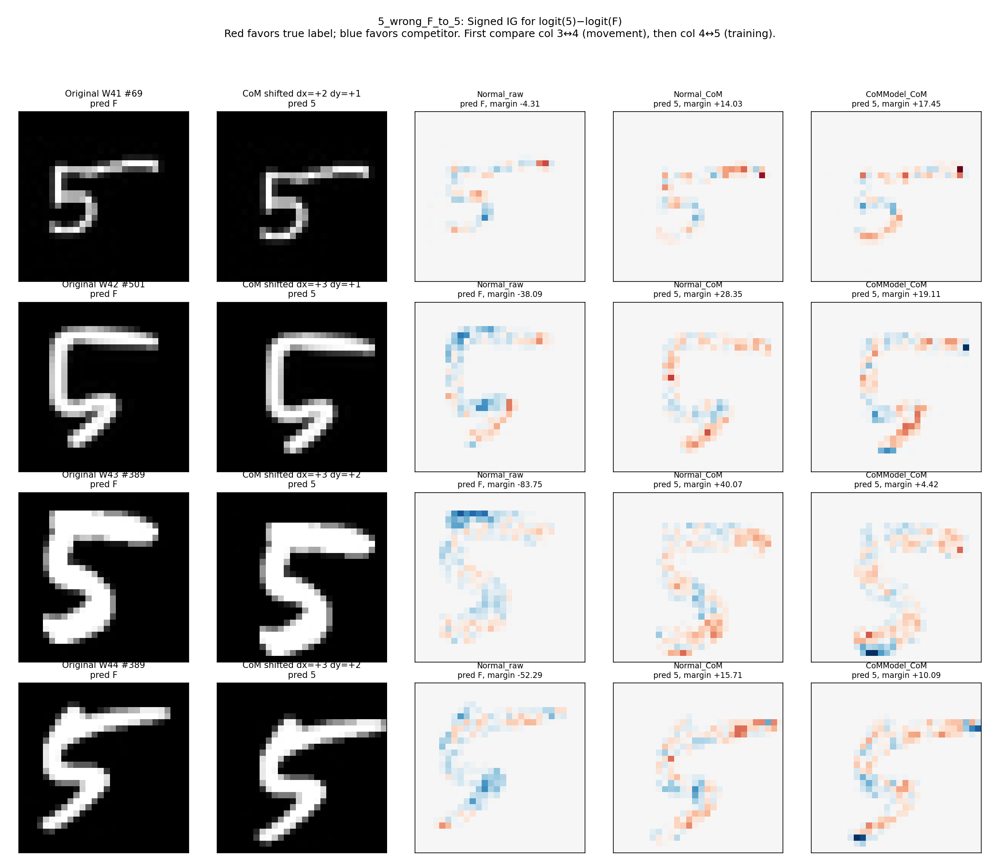
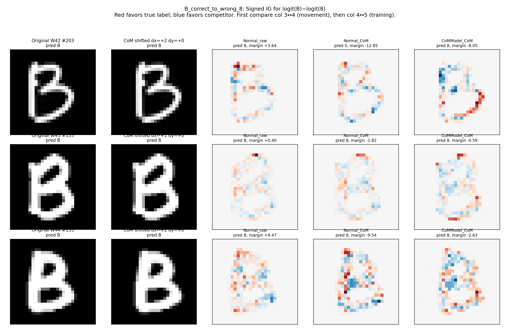

# EXP유004 CoM 판단근거 후속 분석 — 원본 실측 결과

**연구 기록 배포 완료(사용자 승인).** 실험 본편 [Automatic_Centering](../README.md)에 연결된 **가설 B 위치 의존성 분석**이다. 이미지 이동과 모델 재학습 효과를 분리하고 대표 `5/F`·`B/8` Signed IG를 계산했다.

- [분석 로그](../../../logs/EXP유004_CoM_판단근거_후속분석.md)
- [원본 실행 코드](../../../scripts/CoM_Decision_Diagnostic.py)
- [성공한 GitHub Actions 실행 #43686466736](https://github.com/ryu980920/Machine_Learning/actions/runs/43686466736)
- 원본 Actions Artifact: **14150383005** (`exp004-com-pixel-decision-review`), 원본 ZIP SHA-256 **`2b72fb6b643c37d6dd233699c027ef5d9e6c156d352a99278420d082ee2e8869`**.

## 실제 관찰 결과

| Hand-made | Normal 원본 | Normal + CoM 이동 | CoM 학습 MLP + CoM 이동 |
|---|---:|---:|---:|
| 숫자 0–9 | 56.3125% | **82.0000%** | **83.1875%** |
| 문자 A–F | **73.7500%** | 52.3958% | 66.9792% |
| 전체 | 62.8516% | 70.8984% | **77.1094%** |

- **고정 모델에 CoM 이동만 적용:** 숫자 **+25.6875%p**, 문자 **−21.3542%p**.
- **같은 CoM 이미지에서 모델을 새 가중치로 교체:** 숫자 **+1.1875%p**, 문자 **+14.5833%p**.
- 원본 Hand-made **2,560장 전체**, 기존 EXP유004의 개별 예측과 **2,560개 전부 일치** 검증.
- 이 비교는 **원본 Test 또는 교수님 Test가 아닌 이미 여러 번 분석한 개발용 Hand-made**를 사용하므로 독립 Test 정확도 개선을 의미하지 않는다.
- **CoM 학습 MLP에 원본을 입력하는 조건**은 학습 분포 밖 보조 진단이며 실사용 전처리 방식이 아니다.

## 검증된 원본 9개 파일

| 파일 | 용도 | SHA-256 |
|---|---|---|
| [SUMMARY.md](SUMMARY.md) | 원본 실행 당시 review-only 요약 | `bfb44d9f73a97caaee3d3827ed43368dcd881c4e337707742cb0524288fe5598` |
| [four_way_summary.csv](four_way_summary.csv) | 원본·CoM 이미지 및 2개 MLP의 집단별 Accuracy 28행 | `d91c241d1d543dfd7891958e50138f878888c21558a27f54a775260223ae6952` |
| [contrasts.csv](contrasts.csv) | 동일 모델/동일 입력 통제 비교, 교정·신규 오류 28행 | `22b67fd77ba45d6e097c6c8600141989a2ad8ca7468d57afaff0455c3840aff4` |
| [four_way_predictions.csv](four_way_predictions.csv) | Hand-made 2,560장별 4조건 예측 및 정답 여부 | `723ce660eeba09ff70af8d4de001e0e54d42bfac8fe02a8c01a758582e17c1af` |
| [pairwise_margins.csv](pairwise_margins.csv) | 5/F와 B/8 상대 클래스 logit margin 8행 | `0c885c59bc8383691a6fedbf59786a6e0c4a4298967a6029c41da4690a5102e0` |
| [selected_ig_diagnostics.csv](selected_ig_diagnostics.csv) | 7개 대표 이미지 × 3조건 Signed IG 21행 | `7f14a8f077301f31469f392c97f56c475c82e1e6b9d2662c078e44f966a51e92` |
| [IG_5_wrong_F_to_5.png](IG_5_wrong_F_to_5.png) | 실제 5→F 오류가 CoM 후 교정된 사례의 원본/정렬/IG | `84d6bfffc5d42cda41088dd5b1323bd88ca0b2dc0951f0555cfdab3434f6464f` |
| [IG_B_correct_to_wrong_8.png](IG_B_correct_to_wrong_8.png) | 실제 B→8 오류가 CoM 후 새로 발생한 사례의 원본/정렬/IG | `9f7e905af3cce09fa50b709fc18f483de4de36fb1aa01729e3794ad352068e50` |
| [metadata.json](metadata.json) | 원본 모델 SHA, IG 설정, 미학습·Test 미사용 증빙 | `e7f99ebdd99d5c5ecfa562801c610e462e6ebb62acfaf0a54eb453867dc71775` |

**배포 제한:** 실험 코드는 앞서 저장소에 추가됐지만 이 9개 원본 자료는 별도 검증 후 사용자 승인으로 배포한다. 기존 EXP유001~004 원본 수치·학습 모델을 덮어쓰지 않았으며, **MLP 추론 Pipeline에 반영하지 않았다.** 원본 `SUMMARY.md` 및 `metadata.json`의 `review-only`는 실험 당시의 상태를 보존한 것이다.
