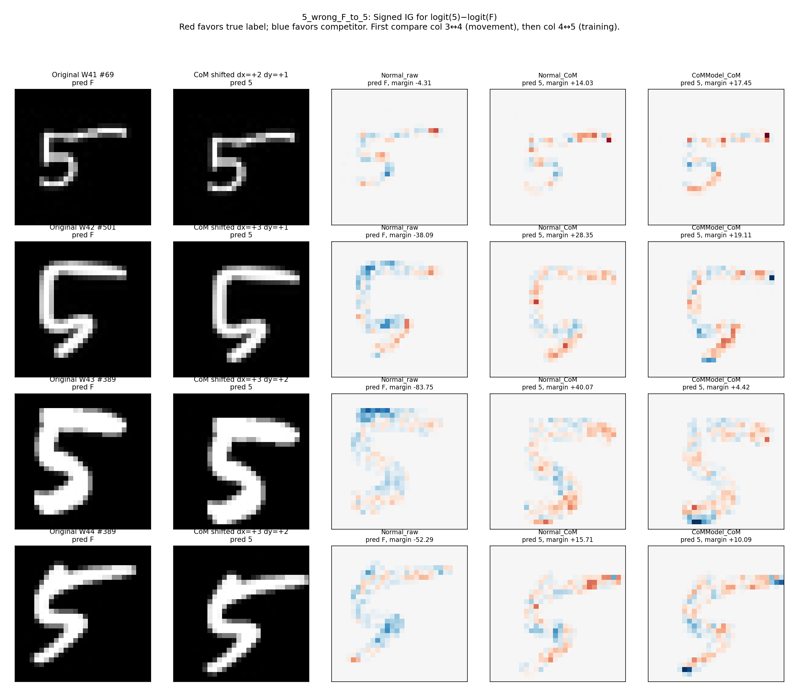
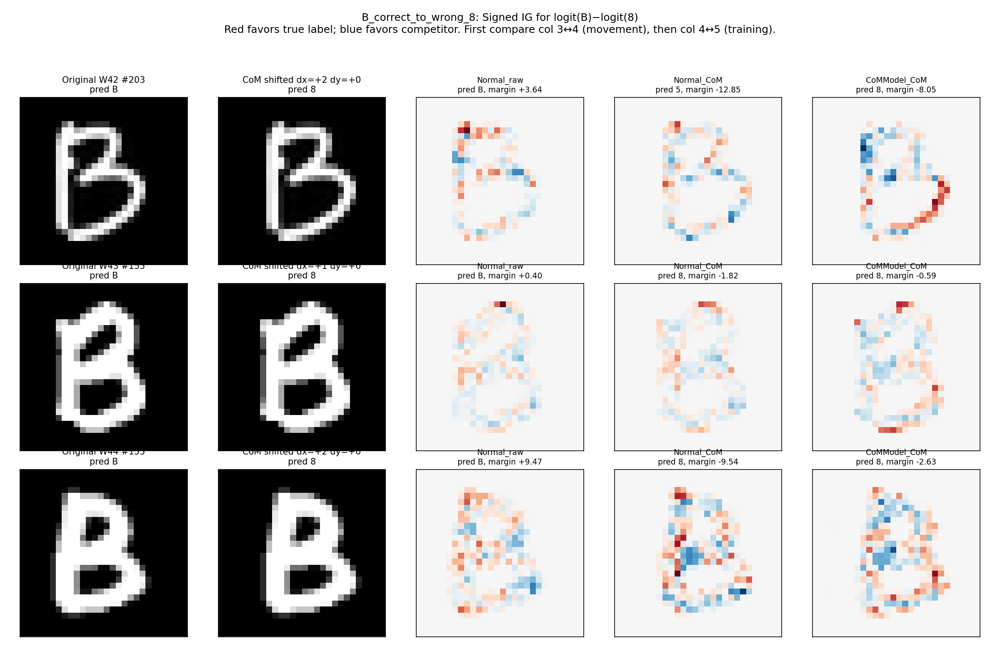

# EXP유004 — Automatic Centering: 전체 결과와 검증 근거

**연구 원본 19개 파일을 이 폴더 한 곳에 보관한다.** Center of Mass/Bounding Box 정렬 학습·평가(1단계), CoM 이동 자체와 재학습 효과의 분리·픽셀 기여도(2단계)는 **모두 하나의 실험 EXP유004**에 속한다.

[**단일 통합 실험 로그**](../../logs/EXP유004_Automatic_Centering.md) · [중심 정렬 실험 코드](../../scripts/Automatic_Centering_Experiment.py) · [CoM 픽셀 판단 분석 코드](../../scripts/CoM_Decision_Diagnostic.py) · [정렬 Transformer](../../scripts/Automatic_Centering_Transformer.py)

## 1. 실측 결과의 핵심

| Hand-made 2,560장 | 숫자 0–9 | 문자 A–F | 전체 |
|---|---:|---:|---:|
| Normal MLP + 원본 | 56.31% | **73.75%** | 62.85% |
| Normal MLP + CoM 정렬만 (가중치 고정) | 82.00% | 52.40% | 70.90% |
| CoM MLP + CoM 정렬 (재학습) | **83.19%** | 66.98% | **77.11%** |

- 정렬 모델 학습·평가에서 공식 Validation 정확도: Normal **97.3177%**, CoM MLP **96.9167%**, Bounding Box MLP **97.3073%**.
- 기존 MLP를 고정한 CoM 이동만의 효과는 숫자 **+25.69%p**, 문자 **−21.35%p**였어. 같은 CoM 입력에서 신규 MLP로 변경하면 문자 정확도가 **+14.58%p** 회복돼.
- CoM 정렬이 모든 클래스의 오차를 해결하지는 못했으며 **추론 Pipeline 자동 적용·최종 채택은 보류**. 공식 Test, 교수님 Test 미사용. Hand-made 네 작성자는 반복 검토한 개발용 데이터다.

## 2. 원본 연구 실행 및 재현 증빙

**1단계 — 정렬 학습 및 성능 측정**

- [GitHub Actions #43638979287](https://github.com/ryu980920/Machine_Learning/actions/runs/43638979287), 원본 Artifact **14131562043**.
- 공식 Training **76,800장**, 공식 Validation **19,200장**, Hand-made **2,560장**; 정렬 모델 둘을 각각 다시 학습, 기존 Normal 모델을 기준으로 사용.
- 동일 `MLPClassifier(random_state=42)`, 좌표 (13.5,13.5), threshold 32, 정수 이동, zero-fill, no interpolation.
- 기존 Normal MLP SHA-256: `9b54ba9c60e389575200d88ad0b93c47ec47f9c673eebeb755ff47e3ebe23b0a`. CoM 모델 SHA-256: `3c1aac362d75ff5c4d9652188c1c4fd97524525f5409ec00d5a6c56fa3ad27ef`.

**2단계 — CoM 위치 변화와 재학습된 모델 판단 분리**

- [GitHub Actions #43686466736](https://github.com/ryu980920/Machine_Learning/actions/runs/43686466736), 원본 Artifact **14150383005**, 원본 ZIP SHA-256 `2b72fb6b643c37d6dd233699c027ef5d9e6c156d352a99278420d082ee2e8869`.
- 공식/교수님 Test 미사용, 모델 **재학습 0회**, 원본 및 정렬된 Hand-made **2,560장** 전체의 기존/CoM 모델 예측 비교 및 **2,560장 기존 산출물 재검증**.
- 기존 CoM 분석 산출물의 `SUMMARY.md`와 `metadata.json`은 1단계 결과와 이름이 겹치므로 각각 **`CoM_Decision_SUMMARY.md`**, **`CoM_Decision_metadata.json`**으로 **파일 이름만 변경**했다. 원본 파일 bytes와 SHA-256은 보존했다. 원본 내부의 `review-only`는 실험 당시 상태를 나타낸다.

## 3. 1단계 정렬·학습 결과 원본 10개

| 파일 | 내용 | 검증 SHA-256 앞 12자 |
|---|---|---|
| [SUMMARY.md](SUMMARY.md) | 성공 실행 중 생성한 실제 결과 요약 (생성 당시 review-only 상태 보존) | `a218e64f267a` |
| [exp004_group_metrics.csv](exp004_group_metrics.csv) | Accuracy·Macro F1·Precision·Recall·오류 교정: 전체/16개 클래스/작성자/숫자·문자, **144행** | `1810fa279353` |
| [exp004_predictions.csv.gz](exp004_predictions.csv.gz) | 공식 Validation 19,200 + Hand-made 2,560, **21,760행**; 세 모델의 같은 이미지별 정답·예측 | `0dbdbe369a73` |
| [exp004_confusions.csv](exp004_confusions.csv) | 공식/손글씨 × 세 모델 × 16×16 혼동행렬, **1,536행** | `5bf4cfd74f97` |
| [exp004_typical_confusions.csv](exp004_typical_confusions.csv) | 5→F, B→8, 0→D 등 대표 오분류쌍, **36행** | `ff5607175a05` |
| [exp004_alignment_stats.csv](exp004_alignment_stats.csv) | Train/Validation/Hand-made × 중심 방법별 오차·이동·획손실, **6행** | `66ff7aa03dd3` |
| [accuracy_comparison.png](accuracy_comparison.png) | 두 데이터셋에 대한 세 모델 정확도 그래프 | `64201b7036cf` |
| [exp004_run_metadata.json](exp004_run_metadata.json) | 기준 모델·데이터 SHA, 동일 학습 조건, 정렬 규칙, 2개 학습 시간과 환경, Test 미사용 플래그 | `265899d0c35d` |
| [exp004_mass.joblib](exp004_mass.joblib) | Center of Mass **학습 완료 후보 Pipeline** | `3c1aac362d75` |
| [exp004_bbox.joblib](exp004_bbox.joblib) | Bounding Box **학습 완료 후보 Pipeline** | `09976f913cf4` |

## 4. 2단계 CoM 판정 변화·IG 결과 원본 9개

| 파일 | 용도 | SHA-256 |
|---|---|---|
| [CoM_Decision_SUMMARY.md](CoM_Decision_SUMMARY.md) | 원본 실행 당시 review-only 요약 | `bfb44d9f73a97caaee3d3827ed43368dcd881c4e337707742cb0524288fe5598` |
| [four_way_summary.csv](four_way_summary.csv) | 원본·CoM 이미지 및 2개 MLP의 집단별 Accuracy 28행 | `d91c241d1d543dfd7891958e50138f878888c21558a27f54a775260223ae6952` |
| [contrasts.csv](contrasts.csv) | 동일 모델/동일 입력 통제 비교, 교정·신규 오류 28행 | `22b67fd77ba45d6e097c6c8600141989a2ad8ca7468d57afaff0455c3840aff4` |
| [four_way_predictions.csv](four_way_predictions.csv) | Hand-made 2,560장별 4조건 예측 및 정답 여부 | `723ce660eeba09ff70af8d4de001e0e54d42bfac8fe02a8c01a758582e17c1af` |
| [pairwise_margins.csv](pairwise_margins.csv) | 5/F와 B/8 상대 클래스 logit margin 8행 | `0c885c59bc8383691a6fedbf59786a6e0c4a4298967a6029c41da4690a5102e0` |
| [selected_ig_diagnostics.csv](selected_ig_diagnostics.csv) | 7개 대표 이미지 × 3조건 Signed IG 21행 | `7f14a8f077301f31469f392c97f56c475c82e1e6b9d2662c078e44f966a51e92` |
| [IG_5_wrong_F_to_5.png](IG_5_wrong_F_to_5.png) | 실제 5→F 오류가 CoM 후 교정된 사례의 원본/정렬/IG | `84d6bfffc5d42cda41088dd5b1323bd88ca0b2dc0951f0555cfdab3434f6464f` |
| [IG_B_correct_to_wrong_8.png](IG_B_correct_to_wrong_8.png) | 실제 B→8 오류가 CoM 후 새로 발생한 사례의 원본/정렬/IG | `9f7e905af3cce09fa50b709fc18f483de4de36fb1aa01729e3794ad352068e50` |
| [CoM_Decision_metadata.json](CoM_Decision_metadata.json) | 원본 모델 SHA, IG 설정, 미학습·Test 미사용 증빙 | `e7f99ebdd99d5c5ecfa562801c610e462e6ebb62acfaf0a54eb453867dc71775` |

## 5. 결론 및 사용 주의

- **확인된 사실:** 동일한 기존 MLP에서 글자의 절대 픽셀 위치를 바꾸면 숫자·문자의 예측 정확도에 서로 반대 방향의 큰 변화가 생긴다. 따라서 MLP의 위치 의존성을 가설 B의 주요 원인으로 판단한다.
- **해석 제한:** IG가 모델이 형태를 전혀 학습하지 않았다는 증거는 아니다. 동일한 네 명 Hand-made에서 최적화·분석한 성능을 새 작성자에게 일반화하지 않는다.
- **데이터 보존:** 기존 원본과 재학습 모델 파일, CSV, 이미지, 실제 실행/데이터 해시는 유지하고 상대 경로만 단일 폴더 구조로 통합했다.
- **안전:** 신뢰할 수 없는 joblib 파일을 역직렬화하지 않는다. Python 3.13.18, NumPy 2.3.5, SciPy 1.17.0, scikit-learn 1.8.0, matplotlib 3.10.7의 검증 환경을 따른다.
