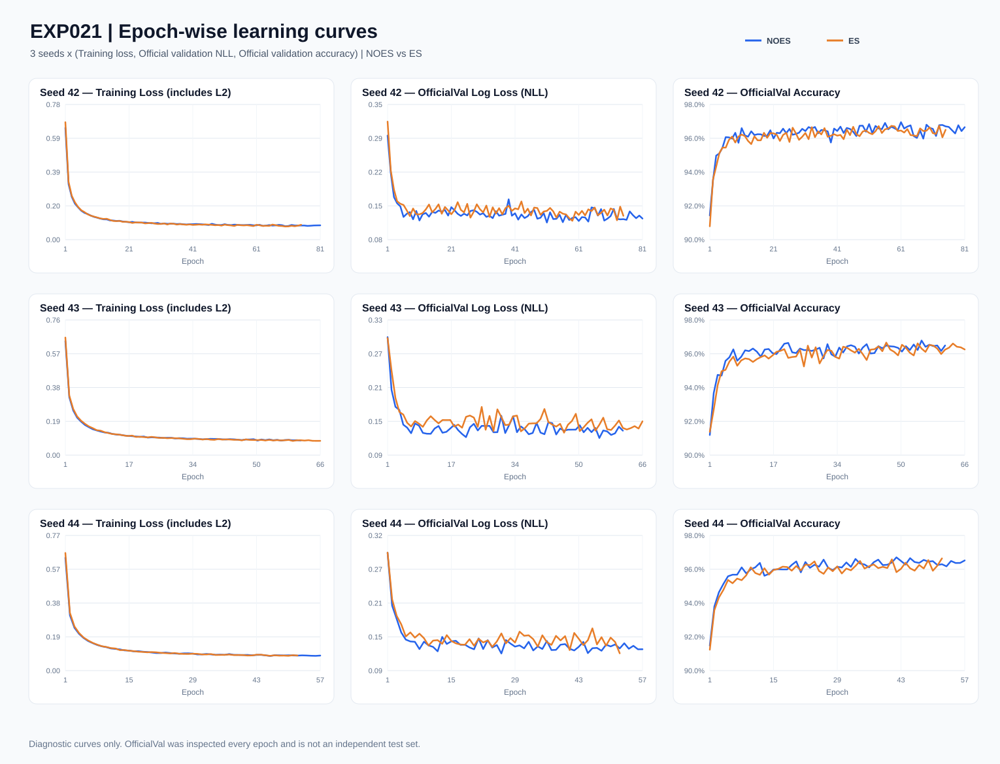
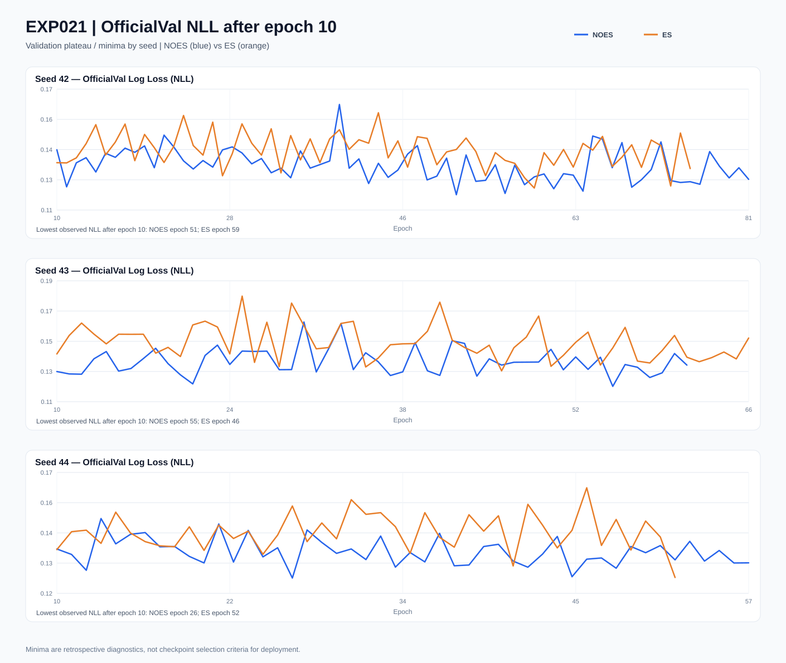
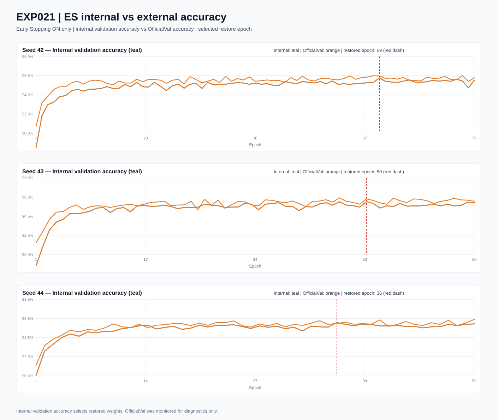
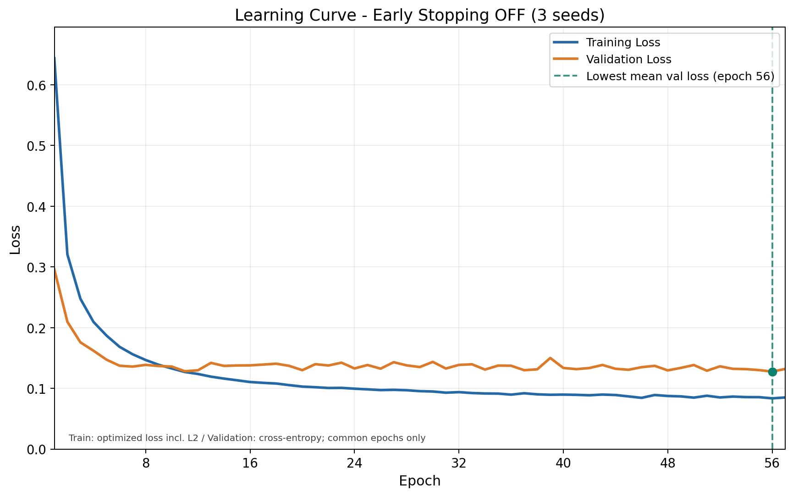
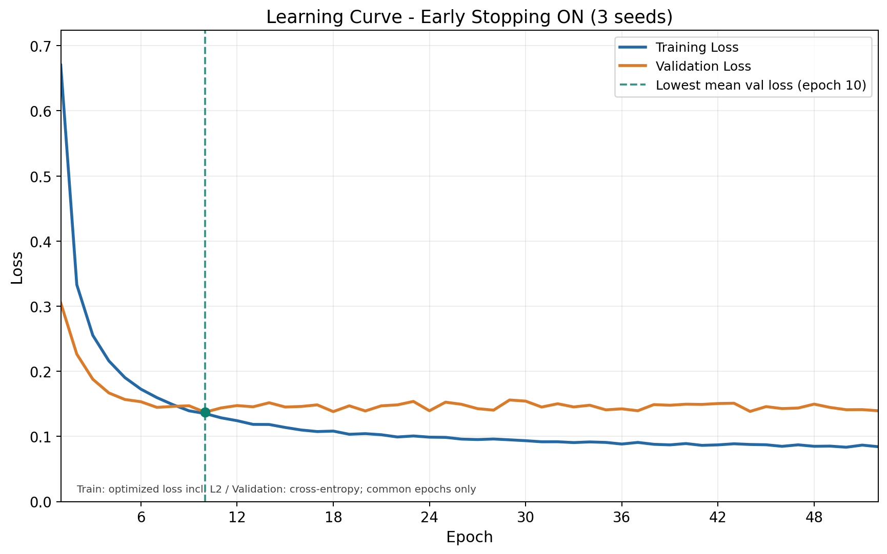

# EXP021 — Early Stopping Learning Curves (실측 3-Seed)

## 목적 및 모델 조건

기존 EXP017 최종 MLP `(256,128)` / alpha=0.03 / learning rate=0.001 / Size80%-Stroke14%+CoM에 대해 Seed42/43/44에서 epoch별 Training Loss, 외부 OfficialVal Log Loss, 외부 OfficialVal Accuracy를 재측정하였다. 기존 frozen model weights는 변경하지 않았다.

## 실험의 데이터 분할 차이

- **NOES**: OfficialTrain 76,800 전체로 학습, `early_stopping=False`, `n_iter_no_change=10`, 최대 200 epoch, training-loss 기반 종료.
- **ES**: 동일 공식 Train에 대해 scikit-learn 내부에서 10%(7,680장)를 별도 검증으로 분리, 실제 가중치 학습 69,120장, `early_stopping=True`, `n_iter_no_change=15`, 최대 200 epoch, 내부 검증 **accuracy** 기반 중단 및 최고 score epoch 가중치 복원.
- 외부 OfficialVal 19,200장은 두 모델의 학습/내부 ES 판단에 사용되지 않았지만 **곡선 진단에 매 epoch 조회**하므로, external validation에서 후선정한 최고 epoch는 독립 Test 점수로 사용하거나 바로 배포하지 않는다.
- Original Test/교수님 Test/사용자 손글씨를 학습과 조기 종료 판단에 사용하지 않았다.

## 학습 곡선 이미지

**전체 3-Seed 실측 곡선**

**검증 NLL 확대 (epoch ≥ 10)**

**Early Stopping ON 내부·외부 검증 정확도**

**기존 평균 곡선 — OFF / ON**

## 관찰 결과

| Seed | Mode | 실제 종료 | 복원 epoch | OfficialVal(최종) | OfficialVal loss 최저 epoch | OfficialVal accuracy 최고 epoch |
|---|---|---:|---:|---:|---:|---:|
| 42 | NOES | 81 | 81 | 96.6562% | 51 | 61 |
| 42 | ES | 75 | 59 | 96.7031% | 59 | 73 |
| 43 | NOES | 61 | 61 | 96.4896% | 55 | 55 |
| 43 | ES | 66 | 50 | 96.5312% | 46 | 46 |
| 44 | NOES | 57 | 57 | 96.5208% | 26 | 42 |
| 44 | ES | 52 | 36 | 96.1771% | 52 | 52 |

- ES: 3 Seed 평균 OfficialVal 정확도 **96.4705%**, 종료 epoch 평균 64.3, 복원 epoch 평균 48.3.
- NOES: 3 Seed 평균 OfficialVal 정확도 **96.5556%**, 종료 epoch 평균 66.3, 복원 epoch 평균 66.3.

**중요한 설계 한계:** ES와 NOES는 학습 데이터 수(69,120 vs 76,800)와 patience(15 vs 10)가 달라서, 성능 차이를 **Early Stopping의 독립 인과 효과**라고 단정할 수 없다. ES의 평가 상 이득이 있더라도 Train 분할 영향이 섞여 있다. 보다 엄격한 인과 비교에는 동일한 69,120 Train으로 같은 optimizer trajectory를 실행하여 체크포인트만 다른 epoch에서 선택해야 한다.

## 실측 모델 선택에 필요한 추가 절차

현재 ES가 내부 Validation Accuracy 기준으로 중단한 위치가 외부 Validation Loss/Accuracy에 비해 이르거나 늦었는지 곡선에서 확인하되, 조기 종료 정책 변경은 동일 분할/동일 학습 경로 비교와 크기 Shortcut Gate 검증을 마친 뒤에 결정한다.

## 원본 파일

- `EXP021_epochwise_3seed_learning_curves.csv`: 6개 실험의 매 epoch 수치
- `EXP021_comparison_by_seed.csv`, `EXP021_3Seed_aggregate.csv`: epoch 및 정확도 비교
- `EXP021_original_frozen_model_check.csv`: 원본 동결 모델과 버전 확인
- [EXP021_Learning_Curves_3Seeds.svg](EXP021_Learning_Curves_3Seeds.svg): Seed42/43/44 × Training Loss·OfficialVal NLL·Accuracy 실측 곡선
- [EXP021_EarlyStopping_Internal_vs_Official_Accuracy.svg](EXP021_EarlyStopping_Internal_vs_Official_Accuracy.svg): Early Stopping ON 내부 검증 Accuracy vs 외부 검증 Accuracy 및 복원 epoch
- [EXP021_Validation_Plateau_Zoom_3Seeds.svg](EXP021_Validation_Plateau_Zoom_3Seeds.svg): 10 epoch 이후 검증 NLL 구간 확대
- [EXP021_3Seed_Mean_Learning_Curve_NOES.png](EXP021_3Seed_Mean_Learning_Curve_NOES.png): Early Stopping OFF 3-Seed 평균 곡선
- [EXP021_3Seed_Mean_Learning_Curve_ES.png](EXP021_3Seed_Mean_Learning_Curve_ES.png): Early Stopping ON 3-Seed 평균 곡선
