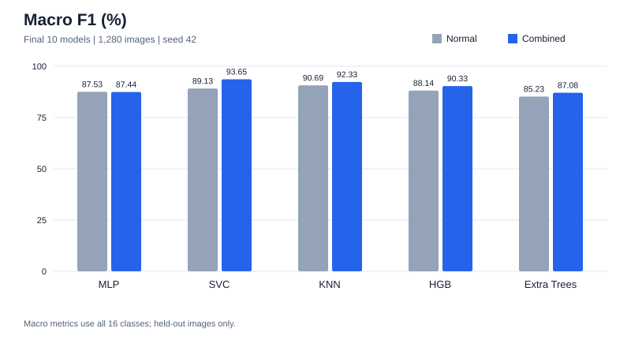

# Final Handmade Validation — 10 frozen models (2026-11-26)

> **2026-11-28 최종 선정 변경:** 이 페이지의 10개 모델 실측 결과는 Fine-Tuning 이전 비교 이력이다. SVC Combined는 C2_G2 (94.453125%, 1209/1280 개발 평가)로 선정 변경되었고, 다른 9개 모델은 유지한다. [현재 선정 Manifest](../07_fine_tuning/05_final_models/CURRENT_FINAL_MODEL_SELECTION.json) · [재현 Notebook](../07_fine_tuning/Fine_Tuning_Reproduction.ipynb) · [추론 Notebook](../07_fine_tuning/Final_Inference.ipynb). 기존 CSV/그래프/아티팩트는 당시 기록이며 C2_G2 바이너리의 공개 배포를 의미하지 않는다.

**최종 10개 모델 재학습 및 신규 Handmade Validation 1,280장 평가 완료.** 2026-11-27 결과 공개.

- [최종 비교 보고서 및 그래프](logs/EXP_FINAL_002_10Model_Validation_Results.md)
- [실측 비교 CSV](results/summary.csv) · [Normal/Combined 변화량](results/normal_vs_combined.csv)
- [체크포인트 아티팩트 Manifest](results/FINAL_EVALUATION_MANIFEST.json) · [입력 데이터 Manifest](results/validation_manifest.json)
- [최종 학습 실행](https://github.com/ryu980920/Machine_Learning/actions/runs/45777648203) (10/10 성공)

**Accuracy 1위: SVC Combined 93.671875% (1199/1280), Macro Precision 93.95595%, Macro F1 93.64541%.** KNN Normal 학습 최단, MLP Normal 추론 최단. 결과 공개와 연구 모델 교체는 별개이며 단일 최종 제출 모델의 선정은 별도 결정한다. 신규 Validation 원본, 모델 바이너리 및 기존 전체 ZIP의 개별 예측·혼동행렬은 이번 커밋에 포함하지 않는다. SVG는 실측 CSV에서 다시 생성했다. 기존 중간 MLP 기록은 역사적 자료이다.

| 모델 | 학습 장수 | Training (s) | Inference (ms/image) | Accuracy (%) | Macro Precision (%) | Macro F1 (%) | 정답/1280 |
|---|---:|---:|---:|---:|---:|---:|---:|
| MLP Normal | 76800 | 110.268 | 0.3117 | 87.4219 | 88.1496 | 87.5332 | 1119 |
| MLP Combined | 79360 | 72.724 | 0.3264 | 87.5000 | 87.7151 | 87.4422 | 1120 |
| SVC Normal | 76800 | 153.752 | 8.4822 | 89.2188 | 90.2670 | 89.1275 | 1142 |
| SVC Combined | 82080 | 178.546 | 9.6546 | 93.6719 | 93.9559 | 93.6454 | 1199 |
| KNN Normal | 107520 | 29.509 | 42.7191 | 90.7031 | 91.1980 | 90.6898 | 1161 |
| KNN Combined | 113920 | 31.556 | 46.5702 | 92.3438 | 92.6169 | 92.3269 | 1182 |
| HGB Normal | 76800 | 1496.263 | 28.2613 | 88.1250 | 88.6492 | 88.1360 | 1128 |
| HGB Combined | 79360 | 1170.185 | 20.3871 | 90.3125 | 90.5694 | 90.3257 | 1156 |
| ExtraTrees Normal | 76800 | 128.627 | 18.1779 | 85.1563 | 86.1880 | 85.2328 | 1090 |
| ExtraTrees Combined | 79360 | 135.180 | 15.1087 | 87.0313 | 87.6333 | 87.0775 | 1114 |

## Graphs

[학습 시간](figures/training_time.svg) · [추론 시간](figures/inference_time.svg) · [Precision](figures/precision.svg)

## Approved protocol

Mode B: official training 76,800 images, Combined uses all existing 2,560 Handmade samples from collection groups 41–44. The 1,280 new images are evaluation only; collector labels are not verified identities of individual handwriting contributors. Original Test and Professor Test are not accessed. Prior extra 480 and screened 438 are not added to training.

Final outputs: ten standalone models, Training Time (augmentation + feature extraction + fit), Inference Time (batch 1 end-to-end, warmup then 5 passes), accuracy, macro precision, macro F1. Seed 42; common CPU runtime, two threads, sequential fit. Do not tune after seeing new validation scores.

## Frozen recipes

| Model | Normal | Combined | Final training rows N/C |
|---|---|---|---:|
| MLP | EXP017 slot1_alpha_up | CMB011/base, 4 cohorts | 76800 / 79360 |
| SVC | EXP007 hybrid | CMB005 extra20 per D/B class per cohort | 76800 / 82080 |
| KNN | EXP014 targeted10 / EXP015 k3 | CMB005 pixel20 HOG80 + repeat_mixed_50 | 107520 / 113920 |
| HGB | N9 | C6 | 76800 / 79360 |
| Extra Trees | T02_feat18 | T02_feat18 | 76800 / 79360 |

Main source: 476672f224a3cb5e7b652af4841626bdced46c69. Extra Trees exact source: ec30f7fd4a97de9f8336df2eef6a52b394c810c0. SVC/KNN four-cohort augmentation extends the original three-cohort rules; fold-offset sentinel 0 preselected before new validation. Common scikit-learn 1.8.0 differs from HGB report's stated 1.9.1; exact re-fit parity is not assumed.

## Actual source and input audit

- Source export and original development split verification: https://github.com/ryu980920/Machine_Learning/actions/runs/45775698001.
- Official source SHA-256: 0e9570d0eb04c0c1da99d043b85bfdab7f3b639eebe4b10335b05b57ad671879.
- Local combined new NPZ SHA-256: 73de49ac0a0e05eba5099a0a8c31b332ac8abec3fd7eebbc69eb875210770f31; 1280 unique pixel hashes, 80 samples per class, 320 per collector, zero empty samples and exact duplicates.
- Cross-source exact pixel and raw cosine >=0.995 checks: zero against official training 76800, official development validation 19200, and existing Handmade 2560.
- Local smoke checks succeeded for all ten configurations (NOT full-data fit or new-set performance).
- Existing frozen MLP Normal seed42 checkpoint matched SHA and reproduced 18551/19200 official development predictions in the local runtime. Official-only 30%-size/28%-stroke array reproduced exactly from the original augmentation function.
- The new raw validation data remains local, not published in this public repository. Audit threshold does not prove absence of shifted/cropped duplicates or actual writer identity overlap.

The audit above describes preflight history. The final 10-model results are linked at the top. No deployed prediction weights were replaced.
