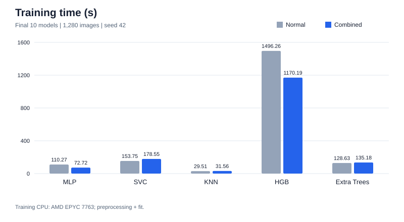
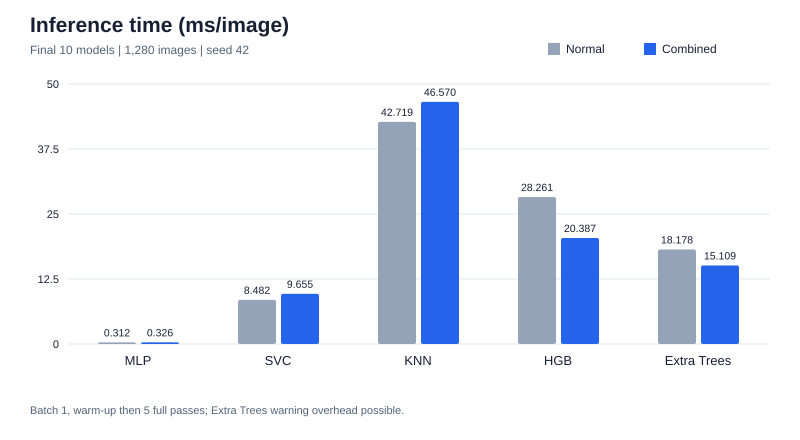
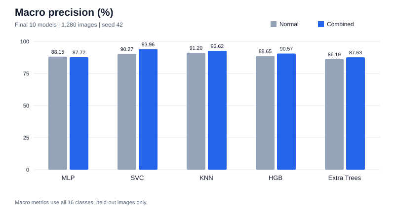
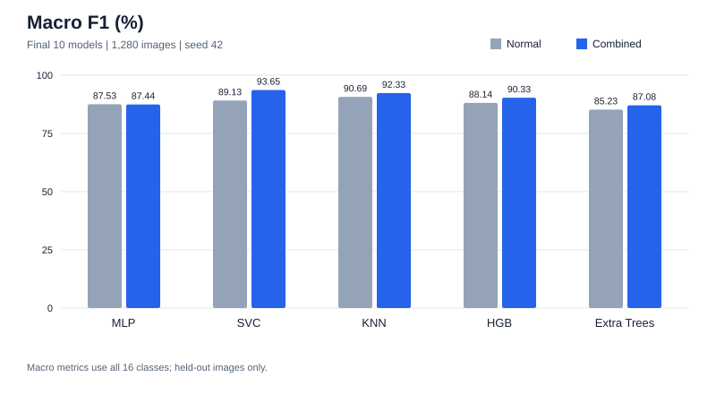

# EXP_FINAL_002 — 10개 최종 모델 Handmade Validation

- 실험일: 2026-11-26 / 결과 공개: 2026-11-27.
- 학습 10/10, 신규 Validation 평가 10/10 완료. 기존 중간 MLP 평가가 아닌 [동일 Runner의 최종 재학습](https://github.com/ryu980920/Machine_Learning/actions/runs/45777648203) 결과만 사용.
- 공식 Train 76,800장, Combined는 기존 네 수집자 데이터 2,560장 전체 포함. 모델별 동결 증강·복제 방식 유지. 신규 Validation 1,280장(클래스당 80장, 수집자당 320장), Seed 42. Original Test 및 교수님 Test 미사용.

## 실제 비교표

| 모델 | 학습 장수 | Training (s) | Inference (ms/image) | Accuracy (%) | Macro Precision (%) | Macro F1 (%) | 정답/1280 |
|---|---:|---:|---:|---:|---:|---:|---:|
| MLP Normal | 76800 | 110.268 | 0.3117 | 87.4219 | 88.1496 | 87.5332 | 1119 |
| MLP Combined | 79360 | 72.724 | 0.3264 | 87.5000 | 87.7151 | 87.4422 | 1120 |
| SVC Normal | 76800 | 153.752 | 8.4822 | 89.2188 | 90.2670 | 89.1275 | 1142 |
| SVC Combined | 82080 | 178.546 | 9.6546 | 93.6719 | 93.9559 | 93.6454 | 1199 |
| KNN Normal | 107520 | 29.509 | 42.7191 | 90.7031 | 91.1980 | 90.6898 | 1161 |
| KNN Combined | 113920 | 31.556 | 46.5702 | 92.3438 | 92.6169 | 92.3269 | 1182 |
| HGB Normal | 76800 | 1496.263 | 28.2613 | 88.1250 | 88.6492 | 88.1360 | 1128 |
| HGB Combined | 79360 | 1170.185 | 20.3871 | 90.3125 | 90.5694 | 90.3257 | 1156 |
| ExtraTrees Normal | 76800 | 128.627 | 18.1779 | 85.1563 | 86.1880 | 85.2328 | 1090 |
| ExtraTrees Combined | 79360 | 135.180 | 15.1087 | 87.0313 | 87.6333 | 87.0775 | 1114 |

정확도, Macro Precision, Macro F1 모두 SVC Combined가 1위(1,199/1,280, 93.671875%). KNN Normal 학습 최단, MLP Normal 추론 최단. 정확도 기준으로 SVC Combined가 가장 우수한 **이번 Validation 후보**이며, 전체 팀의 최종 제출 모델 확정 또는 기존 MLP 연구 모델 교체를 의미하지 않는다.

## 그래프

## 평가 기준과 한계

Training은 학습용 증강/전처리/특징 추출 + fit으로, 저장 및 평가 제외. Inference는 Warm-up 후 Batch 1, 1,280장 × 5회 평균, 전처리 포함. Accuracy = 정답 수 / 1280. Precision 및 F1 = 16클래스 Macro 평균. 학습은 동일 AMD EPYC 7763 Runner, 추론은 별도 동일 평가 환경. 서로 다른 CPU에서 잰 학습·추론 시간을 같은 하드웨어 벤치마크로 해석하지 않음. HGB 보고서의 1.9.1과 달리 공통 scikit-learn 1.8.0으로 재학습. Extra Trees 반복 경고 출력이 시간에 영향을 줄 가능성이 있음. Normal→Combined 차이는 독립 최적화 구성의 비교로 데이터 추가만의 인과효과가 아님. 수집자 번호는 실제 작성자 ID가 아니므로 새로운 작성자 일반화라고 단정하지 않음.

## 공개 범위 및 재현

- [실측 원본 summary.csv](../results/summary.csv), [Normal vs Combined](../results/normal_vs_combined.csv)
- [체크포인트 아티팩트 및 공개 범위 Manifest](../results/FINAL_EVALUATION_MANIFEST.json), [Validation 원본 해시](../results/validation_manifest.json)
- [최종 학습 코드](../scripts/long_fit.py), [학습 Workflow](../../.github/workflows/final-validation-long-fit.yml), [소스 검증 Workflow](../../.github/workflows/final-validation-source-audit.yml).
- 체크포인트는 Actions artifacts로 보존(만료 기간 유의); 바이너리 자체를 Git에 커밋하지 않음. 신규 Validation 원본은 공개하지 않음.
- 이번 배포 시 실행 환경 접근 장애로 이전 전체 결과 ZIP을 열 수 없어 개별 예측·혼동행렬 및 원래 로컬 평가 스크립트는 미게시. 원본 CSV 두 개를 직접 읽어 공개하고 SVG를 재생성함. 이번 배포에서 별도로 재학습하거나 평가하지 않았음.
- 공식 Test와 교수님 Test를 확인한 뒤에 하이퍼파라미터를 수정하지 않음. 이전 연구의 4-fold 모델과 이번 4개 수집군 전체학습 단일 모델을 구분할 것.
