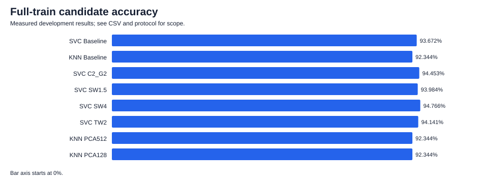
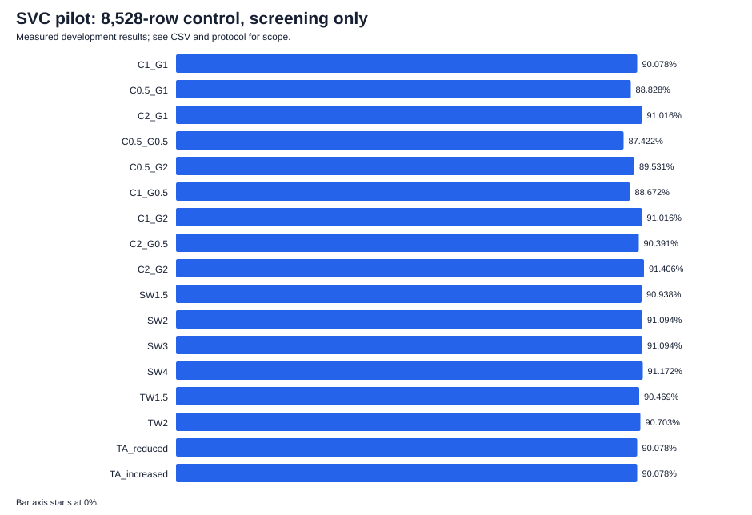
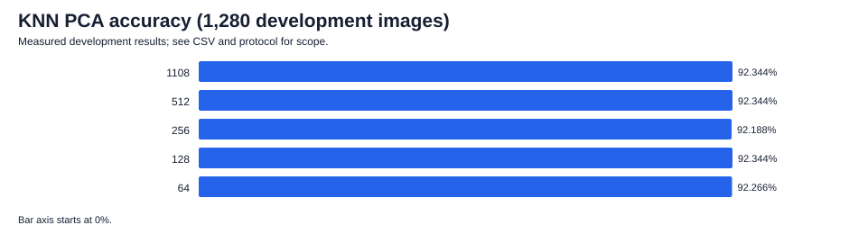
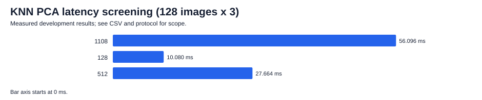

# SVC·KNN Fine-Tuning 최종 검토 보고

## 1. 작업 범위와 결론
기존 체크포인트와 신규 1,280장 개별 예측 완전 재현(0 불일치). 오분류 115개 고유 사례 및 모델별 판단 근거 분석. SVC/KNN 단계별 DOE, 후속 후보 및 조합 선별과 로그 완료. SVC는 계산 제약으로 전수 full DOE를 수행하지 않고 17개 고유 Pilot 조건, 4개 full 후보 학습, 4개 조합 Pilot으로 진행. KNN은 4개 거리 Pilot, 13개 full vote, 5개 복제/계보, 5개 PCA, 26개 PCA vote 재검증을 수행. Full 미승격/미측정 조건의 범위를 기록함. 독립 최종 Test 미실시 및 최종 배포 보류.

**SVC 정확도 우선 검토 후보: C2_G2. KNN: 기존 유지.** SVC SW4 최고 개발 정확도지만 공식 보호 기준 탈락. C2_G2는 정확도 보호 기준 통과, 시간 증가 권장치 초과. 교체 여부는 사용자 검토 사항.

## 2. 비교표 (실제 full 학습·1,280장 개발)
| condition | correct | Accuracy(%) | Precision(%) | F1(%) | official_correct | matched_1280x5_ms | status |
| --- | --- | --- | --- | --- | --- | --- | --- |
| SVC Baseline | 1199 | 93.6719 | 93.9559 | 93.6454 | 18967 | 10.9942 | retained reference |
| KNN Baseline | 1182 | 92.3438 | 92.6169 | 92.3269 | 18856 | — | retain under approved accuracy gate |
| SVC C2_G2 | 1209 | 94.4531 | 94.6050 | 94.4137 | 19003 | 12.7130 | accuracy-first review candidate; latency preference exceeded |
| SVC SW1.5 | 1203 | 93.9844 | 94.2186 | 93.9653 | 18962 | — | pass accuracy guardrails; full latency not measured |
| SVC SW4 | 1213 | 94.7656 | 94.9403 | 94.7613 | 18945 | — | fail official guardrail |
| SVC TW2 | 1205 | 94.1406 | 94.3337 | 94.1229 | 18962 | — | pass accuracy guardrails; full latency not measured |
| KNN PCA512 | 1182 | 92.3438 | 92.6266 | 92.3348 | 18856 | — | speed alternative only; strict accuracy increase not achieved |
| KNN PCA128 | 1182 | 92.3438 | 92.6161 | 92.3311 | 18856 | — | speed alternative only; strict accuracy increase not achieved |

학습 시간은 `final_comparison.csv`의 fit_s 및 기존 benchmark training_time_previous_s 참조. 실험 환경과 준비/fit 범위가 달라 하나의 공정한 training-time 순위로 혼합하지 않았다. 새 full SVC 공통 학습 준비 12.523029초 별도 기록. SVC Baseline과 C2_G2 matched_1280x5_ms는 같은 평가 환경의 5회 반복이며 별도 코어 동시 fit이 있었음. 나머지 후보의 정식 시간은 미측정. KNN PCA latency screen은 128장×3회로 별도 기록.

## 3. 그래프

## 4. 단계별 로그
- [Baseline 재현](../00_baseline/STEP00_Baseline.md)
- [오분류 분석](../01_error_analysis/STEP01_Error_Analysis.md)
- [SVC 종합 보고서](../06_reports/SVC_Fine_Tuning_Report.md)
- [KNN 종합 보고서](../06_reports/KNN_Fine_Tuning_Report.md)
- [후보 및 모델 해시/선정 Manifest](../05_final_models/FINAL_MODEL_SELECTION.json)
- [전체 비교 CSV](final_comparison.csv)

## 5. 미완료 및 제한
승인한 모든 단계의 탐색과 로그는 작성했으나 최초 명목 70조건을 전량 full 데이터로 실행한 것이 아니다. SVC의 full 9조건 grid 등 미승격/미실행 부분은 Pilot과 구분. 공식 원래 함수 19200 전량은 C2_G2에서 검증, 다른 세 후보는 RBF 직접 계산 전량 + 원래 함수 640개 교차 확인. 최종 시간은 C2_G2와 SVC Baseline만 1280×5로 재측정. KNN의 strict accuracy gate 탈락 조건은 추가 공식/정식 시간 측정을 생략. PCA128은 속도 대안으로만 보존.

이번 1280장은 모델 선택에 사용했으므로 성능은 개발 Validation 결과이며 독립 Test 성능 아님. 교수님 Test/Original Test 미사용. 95% 연구 목표 미달. 모든 로컬 학습 프로세스 종료. GitHub 변경/배포 없음. 사용자가 검토한 뒤에만 공개 배포 범위를 결정한다.
