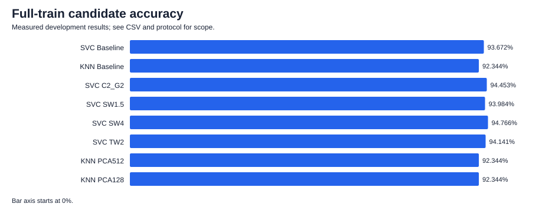

# SVC · KNN Fine-Tuning — 공개 실험 기록

**2026-11-28 사용자 승인: SVC Combined 최종 선정은 C2_G2로 변경 확정.** 정확도 우선으로 선정하며 속도 권장 기준 미충족 사실은 유지한다. KNN Combined 및 다른 8개 모델 선정은 유지. [현재 최종 선정 Manifest](05_final_models/CURRENT_FINAL_MODEL_SELECTION.json) 우선 적용. 기존 검토 Manifest 및 보고서의 보류 문구는 당시 기록이다. 가중치 바이너리 공개 배포는 별도이며 이번에는 변경하지 않음.

**SVC C2_G2 최종 선정: 94.453125% (1209/1280), +10장. KNN 기존 유지: 92.34375% (1182/1280).** SVC SW4는 공식 보호 기준 실패, C2_G2는 추론 시간 권장 기준 초과. 독립 최종 Test 미실시.

## 열람 순서

- [최종 검토 보고서 및 그래프](04_final_comparison/FINAL_REVIEW.md) · [최종 비교 CSV](04_final_comparison/final_comparison.csv)
- [STEP 0 Baseline](00_baseline/STEP00_Baseline.md) · [STEP 1 오류 분석](01_error_analysis/STEP01_Error_Analysis.md)
- [SVC 종합 및 4개 실험 로그](06_reports/SVC_Fine_Tuning_Report.md) · [KNN 종합 및 5개 실험 로그](06_reports/KNN_Fine_Tuning_Report.md)
- [사전 프로토콜](EXPERIMENT_PROTOCOL.json) · [후보 및 체크포인트 SHA256](05_final_models/FINAL_MODEL_SELECTION.json) · [입력 SHA256](INPUT_MANIFEST.json)
- [재현 Notebook](Fine_Tuning_Reproduction.ipynb) · [추론 Notebook](Final_Inference.ipynb) · [추론 스크립트](extract_inference.py) · [requirements](requirements.txt)

## 공개 범위

원본 검토 ZIP에서 공개 가능한 집계 CSV, 혼동행렬/클래스별 집계, 실험별 로그, 설정/해시, 코드 및 Notebook을 추출. PNG 그래프 원본 대신 동일 집계 CSV로 SVG 4종 재생성. 개별 예측, 개인별 집계, 오류 이미지와 개인별 이웃/형상 기록, 입력 ZIP 및 모델 바이너리는 공개하지 않음. 보고서·Notebook·설정에 참조된 비공개 파일은 승인된 로컬 전체 검토 패키지에서 확보해야 함. 공개 저장소만으로 end-to-end 재현 가능한 상태가 아니며, Notebook의 새 환경 전체 재실행도 수행하지 않았음. 기존 SVC/KNN 체크포인트는 [기존 학습 Actions](https://github.com/ryu980920/Machine_Learning/actions/runs/45777648203) 및 [아티팩트 manifest](../06_final_validation/results/FINAL_EVALUATION_MANIFEST.json) 참고(만료 가능). 새 C2_G2 바이너리는 로컬 전체 검토 패키지에서만 확보 가능.

SVC Pilot 선별 및 4개 full 후보, KNN 거리 Pilot·전체 투표 등 실제 수행 범위 유지. 1,280장은 모델 선택용 개발 데이터. Original Test/교수님 Test 미사용. 기존 로그의 배포 보류 문구는 작성 시점의 기록이며 이번 공개는 실험 자료 배포에 한정. [검토 당시 README](REVIEW_README.md) 및 [공개 범위 기록](PUBLICATION_NOTE.md).

