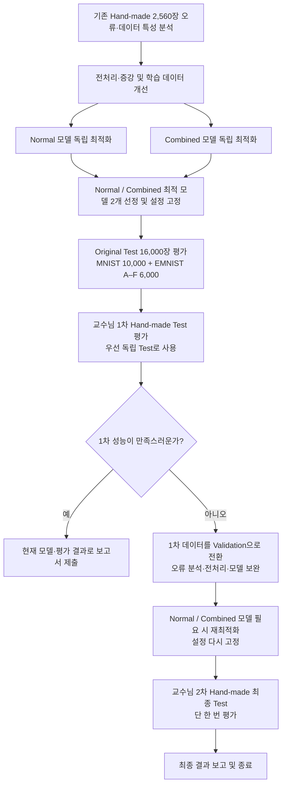

# Machine Learning 팀 프로젝트

2026년 2학기 머신러닝 팀 프로젝트의 계획, 데이터, 실험 및 발표 자료를 관리하는 저장소입니다.

## 프로젝트 개요

숫자 **0–9**와 대문자 **A–F**(총 16개 클래스)를 인식하는 머신러닝 모델을 학습합니다. 기존 **eMNIST** 데이터로 학습한 모델을 직접 만든 손글씨 데이터에 적용하여 성능 차이를 확인하고, 성능 저하 원인을 분석한 뒤 데이터 처리와 모델 학습 방법을 개선합니다.

최종 정확도뿐 아니라 **문제 발견 → 원인 분석 → 해결 방법 시도 → 결과 검증**에 이르는 과정을 기록하는 것이 중요합니다.

## 폴더 안내

| 폴더 | 내용 |
| --- | --- |
| [01_project](01_project/README.md) | 계획, 팀원별 역할, 일정 및 진행 기록 |
| [02_data](02_data/README.md) | eMNIST·손글씨 데이터 제작, 전처리와 검수 기록 |
| [03_experiments](03_experiments/README.md) | 모델 학습·성능 평가·개선 실험 및 시행착오 |
| [04_reports](04_reports/README.md) | 중간 발표, 최종보고서 및 제출 자료 |

각 폴더는 **개요 → 작업 내용 → 진행 현황 → 결과 및 자료 → 특이사항 및 시행착오 → 향후 계획** 순서로 작성합니다.

## 주요 일정

| 날짜 | 일정 |
| --- | --- |
| 10/25(일) | 팀 수행계획서 제출 |
| 10/26(월) | 수행계획서 발표 일정 확인 필요 |
| 11/1(일) | 개인별 손글씨 데이터셋 640개 제출 |
| 11/8(일) | 중간 발표자료 마감 |
| 11/9(월) | 중간 발표 및 피드백 일정 확인 필요 |
| 12/6(일) | 팀 최종 결과물 제출 |
| 12/7(월) | 최종 발표 |

일정이 바뀌면 이 표와 [01_project](01_project/README.md)의 기록을 함께 갱신합니다.

## 팀 기록 원칙

- 진행 현황은 **날짜 / 담당자 / 작업 내용 / 상태 / 결과물**을 기록합니다. 상태는 **예정 / 진행 중 / 완료 / 보류**로 통일합니다.
- 특이사항이나 시행착오는 **문제 / 원인 / 시도한 방법 / 결과 / 다음 작업 / 관련 자료** 순서로 기록합니다.
- 원인이 확실하지 않으면 추정이라고 표시합니다. 수치가 개선되었다면 이전 값과 변경 후 값을 함께 남깁니다.
- 실패한 시도도 삭제하지 않습니다. 결론과 실제 자료가 연결되도록 파일명이나 링크를 남깁니다.
- 팀원이 수행하지 않은 일을 완료로 표기하거나 측정하지 않은 결과를 작성하지 않습니다.
- 데이터를 공유할 때 개인 식별 정보는 제외하고, 사용 범위와 권한을 확인합니다. 최종 테스트 데이터는 학습·튜닝 데이터와 분리합니다.

## 현재 상태

공식 분할 기반 [데이터 구성 Notebook](02_data/scripts/02_official_split_dataset.ipynb)과 [NPZ 데이터셋](02_data/datasets/MNIST_EMNIST_official_split_112000.npz)을 등록했습니다. [EXP곽001 데이터셋 구성 실험일지](03_experiments/W01_2026-11-02_11-08/logs/EXP곽001_MNIST_EMNIST_데이터셋_구성.md)는 PDF 원문을 Markdown으로 변환했으며, 이전 데이터 버전의 기록임을 표시했습니다.

**Hand-made Grayscale 데이터셋:** [02_data/Hand_made](02_data/Hand_made/)에 41·42·43·44번 **각 640장(총 2,560장)**을 원본 JPG 기반 **0–255 Grayscale NPZ**로 통일했습니다(2026-11-09 기존 Binary 파일 교체). Normal 모델의 Hand-made 평가에 사용하며, 후속 Combined 학습에 일부 편입할 경우 **작성자별 보류 평가셋과 학습셋을 겹치지 않게 분리**합니다. [변환 검증 기록](02_data/Hand_made/GRAYSCALE_VERIFICATION.md) 참조.

## 확정 연구 흐름도 — 2026-11-10

**교수님 최신 직접 답변:** Original Test는 이 팀의 공식 구성 기준 **MNIST 10,000장 + EMNIST A–F 6,000장 = 16,000장**으로 사용한다(사용자 확인). **1차 Hand-made는 첫 평가 후 Validation으로 전환 가능**, **2차는 최종 Test로 1회만 사용**한다. Normal과 Combined는 **각각 별도로 최적 모델을 선정**하며 같은 알고리즘일 필요가 없다.

**팀 채택 운영안:** 두 모델을 먼저 선정·고정하고 Original Test 16,000장 → 교수님 1차 Hand-made Test 순서로 평가한다. **1차 성능이 충분하면 그대로 보고서 작성·제출**, 부족할 때에만 1차를 *개발용 Validation*으로 전환해 개선하고 2차에서 한 번 최종 평가한다. 이는 팀이 선택한 1차 활용 전략이며 교수님 답변 자체가 모든 경우의 2차 생략을 명시한 것은 아니다.

**독립성:** 1차를 Validation으로 활용하기 시작하면 수정된 모델에 대한 1차 점수는 독립 Test가 아니다. 2차는 결과 확인 후 다시 튜닝하지 않는다. Original Test도 모델을 선택·튜닝하는 데이터로 사용하지 않고, 모델 버전별 평가 결과를 명확히 기록한다. 자동 입력 Pipeline은 각 평가 전에 고정한 설정으로 실행한다.

**현재 실제 완료:** W02 실험 1(13개 후보 중 5개 선정), 실험 2(공식 Train 76,800 / Validation 19,200으로 Normal Baseline 평가), 실험 3(기존 Hand-made 2,560장 성능·방향·Grayscale 오류 분석). **Normal/Combined의 독립 최적화 및 외부 Test는 아직 미실시**다.

- [흐름도와 조건별 상세 설명](01_project/RESEARCH_FLOW.md) · [전체 연구계획](01_project/RESEARCH_PLAN.md) · [의사결정 이력](01_project/DECISION_LOG.md).
- [Hand-made 분할·그룹 CV 및 Test 정책](02_data/HANDMADE_SPLIT_PLAN.md) · [후속 W02 실험 순서](03_experiments/W02_2026-11-09_11-15/README.md).
- 기존 2,560장의 오류 분석은 개발에 활용 가능하다. 신규 작성자 Validation 수집과 추가 손글씨 학습 데이터 수집도 가능하다. **팀원별 상세 업무 배정은 팀장이 직접 작성한다.**
- [학습 전 모델 5개 실행 안내](03_experiments/model_optimization/README.md): 현재 Combined와 자동 Pipeline/그룹 CV는 미구현이며 계획을 완료로 표기하지 않는다.
